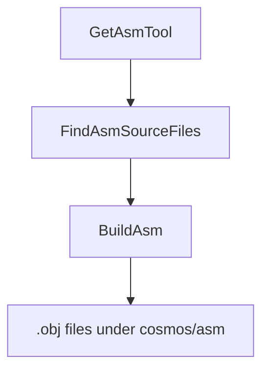

`Cosmos.Build.Asm` compile des sources assembleur écrites à la main en fichiers objets, qui sont ensuite liés à la sortie de NativeAOT. Les cibles x64 et ARM64 utilisent toutes deux l'**assembleur intégré de clang** sur des fichiers `.s` en syntaxe GAS.

---

## Diagramme de flux

---

## Paramètres

| Nom | Description | Valeur par défaut |
| --- | --- | --- |
| `AsmToolPath` | Chemin complet de l'exécutable `clang`. Détecté automatiquement par `GetAsmTool` s'il n'est pas défini. | Résolu via `ResolveCosmosToolTask` (PATH du système + bundle d'outils Cosmos) |
| `AsmSearchPath` | Un ou plusieurs répertoires à parcourir (de façon non récursive) à la recherche de fichiers `*.s`. | aucun |
| `AsmFiles` | Liste explicite de fichiers `*.s` à compiler (ajoutés aux résultats du parcours). | aucun |
| `AsmOutputPath` | Répertoire des fichiers objets compilés. | `$(IntermediateOutputPath)/cosmos/asm/` |

Remarques :
- Lorsque `RuntimeIdentifier` est défini (par exemple `linux-x64`), `FindAsmSourceFiles` privilégie un sous-dossier d'architecture s'il existe (par exemple `<searchDir>/x64/`).
- Le triplet cible est choisi par `AsmBuildTask` à partir de `TargetArchitecture` : `x86_64-elf` pour x64 et `aarch64-none-elf` pour ARM64.

---

## Tâches

| Tâche | Description | Dépend de |
| --- | --- | --- |
| `GetAsmTool` | Résout `AsmToolPath` vers le binaire clang via `ResolveCosmosToolTask`. | aucune |
| `FindAsmSourceFiles` | Nettoie les entrées, applique les substitutions propres à l'architecture et découvre les fichiers `*.s` sous `AsmSearchPath`. | `Build` |
| `BuildAsm` | Appelle `AsmBuildTask` pour chaque fichier avec `--target=<triple> -c`, en écrivant dans `AsmOutputPath`. | `FindAsmSourceFiles; GetAsmTool` |
| `CleanAsm` | Supprime `$(IntermediateOutputPath)/cosmos/asm/`. | `Clean` |

---

## Déroulement détaillé

1. `GetAsmTool` résout `AsmToolPath` vers un binaire `clang` (valeur explicite / système / bundle d'outils Cosmos).
2. `FindAsmSourceFiles` :
   - Retire de `AsmSearchPath` et de `AsmFiles` les entrées qui n'existent pas (en émettant des avertissements).
   - Si `RuntimeIdentifier` est défini, remplace chaque entrée de `AsmSearchPath` qui contient un sous-dossier correspondant à l'architecture par ce sous-dossier (par exemple `x64`).
   - Construit un motif de recherche non récursif `%(AsmSearchPath.FullPath)/*.s` et ajoute les résultats à `AsmFiles` (sans doublons).
3. `BuildAsm` appelle `AsmBuildTask` pour chaque fichier :
   - Calcule l'empreinte SHA1 de la source et produit `<name>-<sha1>.obj` dans `AsmOutputPath`.
   - Exécute `clang --target=<x86_64-elf|aarch64-none-elf> -c -o <output.obj> <input.s>`.
4. `CleanAsm` supprime le dossier intermédiaire `cosmos/asm` pendant `Clean`.

---

## Sorties

- Des fichiers objets dans `$(IntermediateOutputPath)/cosmos/asm/`, nommés `<sourceName>-<sha1>.obj`, où `<sha1>` est l'empreinte du contenu de la source. Les noms sont ainsi déterministes et favorables au cache d'un build à l'autre.

---

## Composants associés

- [`Cosmos.Build.Asm`](https://github.com/CosmosOS/Cosmos/blob/gen3/src/Cosmos.Build.Asm)
