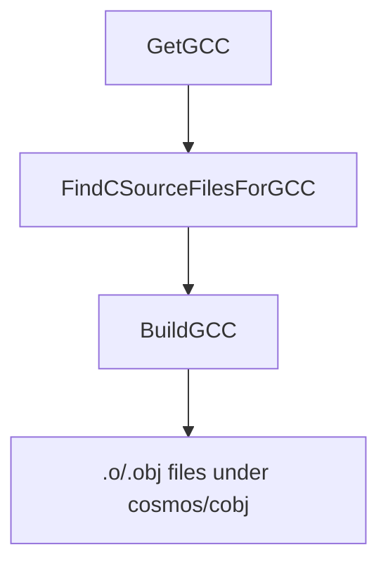

`Cosmos.Build.GCC` compile les sources C en fichiers objets, qui sont ensuite liés à la sortie de NativeAOT.

---

## Diagramme de flux

---

## Paramètres

| Nom | Description | Valeur par défaut |
| --- | --- | --- |
| `GCCPath` | Chemin complet ou nom de l'exécutable `gcc`. Défini par `GetGCC` selon le système d'exploitation, redéfinissable dans votre projet. | Unix : `gcc` ; Windows : `x86_64-elf-gcc` |
| `GCCProject` | Un ou plusieurs répertoires dans lesquels chercher les fichiers `*.c` (sans récursion). Prend en charge la substitution par un sous-dossier d'architecture. | aucun |
| `GCCOutputPath` | Répertoire des fichiers objets compilés. | `$(IntermediateOutputPath)/cosmos/cobj/` |
| `GCCCompilerFlags` | Options de compilation supplémentaires transmises à GCC. | `-O2 -fno-stack-protector -nostdinc -fno-builtin`, plus les options propres à l'architecture |

Remarques :
- Lorsque `RuntimeIdentifier` est défini (par exemple `linux-x64`), `FindCSourceFilesForGCC` privilégie un sous-dossier d'architecture s'il existe (par exemple `<dir>/x64/`).
- Sous Windows, l'outil par défaut est un compilateur croisé (`x86_64-elf-gcc`) ; sous Unix, c'est `gcc`. Vous pouvez redéfinir `GCCPath`.

---

## Tâches

| Tâche | Description | Dépend de |
| --- | --- | --- |
| `GetGCC` | Résout `GCCPath` selon le système d'exploitation (Unix : `gcc`, Windows : `x86_64-elf-gcc`). | aucune |
| `FindCSourceFilesForGCC` | Nettoie les entrées de `@(GCCProject)` et applique les substitutions d'architecture. | `Build` |
| `BuildGCC` | Invoque `GCCBuildTask` pour compiler chaque fichier `*.c` de chaque répertoire de `@(GCCProject)`. | `FindCSourceFilesForGCC; GetGCC` |
| `CleanGCC` | Supprime `$(IntermediateOutputPath)/cosmos/cobj/`. | `Clean` |

---

## Déroulement détaillé

1. `GetGCC` définit `GCCPath` en fonction du système d'exploitation hôte. Vous pouvez redéfinir `GCCPath` dans votre fichier de projet si nécessaire.
2. `FindCSourceFilesForGCC` :
   - Retire de `@(GCCProject)` les chemins qui n'existent pas (en émettant des avertissements).
   - Si `RuntimeIdentifier` est défini et qu'un sous-dossier d'architecture correspondant existe (par exemple `x64`), le dossier est remplacé par ce sous-dossier.
   - Journalise la liste finale des répertoires de projets C.
3. `BuildGCC` :
   - S'assure que `GCCOutputPath` (`$(IntermediateOutputPath)/cosmos/cobj/`) existe et supprime les objets obsolètes.
   - Pour chaque répertoire de `@(GCCProject)`, appelle `GCCBuildTask`, qui compile chaque fichier `*.c` de ce répertoire (sans récursion).
   - Chaque fichier est compilé séparément en un objet nommé `<name>-<sha1>.(obj|o)`, dont l'empreinte est calculée à partir du contenu du fichier ; l'extension est `.obj` sous Windows et `.o` ailleurs.
4. `CleanGCC` supprime le répertoire `cosmos/cobj` pendant `Clean`.

---

## Sorties

- Fichiers objets dans `$(IntermediateOutputPath)/cosmos/cobj/`, nommés `<sourceName>-<sha1>.(obj|o)`.

---

## Composants associés

- [`Cosmos.Build.GCC`](https://github.com/CosmosOS/Cosmos/blob/gen3/src/Cosmos.Build.CC)
