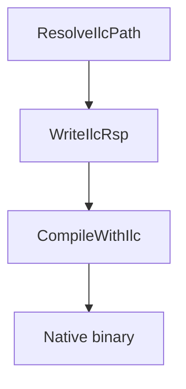

## Vue d'ensemble

`Cosmos.ilc.Build` intègre le compilateur AOT natif [ILCompiler](https://github.com/dotnet/runtime/blob/main/docs/design/coreclr/botr/ilc-architecture.md) au pipeline MSBuild. Il consomme les assemblies patchés produits par [`Cosmos.Build.Patcher`](https://github.com/CosmosOS/Cosmos/blob/gen3/src/Cosmos.Build.Patcher) et les transforme en fichiers objets natifs, liés ensuite aux bibliothèques de la plateforme pour CosmosOS.

---

## Diagramme de flux

---

## Paramètres

| Nom | Description | Valeur par défaut |
| --- | --- | --- |
| `IlcToolsPath` | Chemin de l'exécutable `ilc`, résolu à partir du pack de runtime `Microsoft.DotNet.ILCompiler`. | résolu automatiquement |
| `IlcIntermediateOutputPath` | Répertoire dans lequel les fichiers `.ilc.rsp` et `.o` sont écrits. | `$(IntermediateOutputPath)/cosmos/native/` |
| `IlcSystemModule` | Module système utilisé comme point d'entrée d'ILCompiler. | `System.Private.CoreLib` |
| `UnmanagedEntryPointsAssembly` | Assemblies dont les méthodes sont exportées via `--generateunmanagedentrypoints`. | `Cosmos.Kernel.Runtime` |

---

## Tâches

| Tâche | Description | Dépend de |
| --- | --- | --- |
| `ResolveIlcPath` | Télécharge et localise ILCompiler, puis définit `IlcToolsPath`. | `Build` |
| `WriteIlcRsp` | Produit le fichier de réponse d'ILCompiler, qui liste les entrées, les références et les options. | `ResolveIlcPath` |
| `CheckIlcCache` | Calcule l'empreinte des entrées, des références et du fichier de réponse, et la compare à celle de la dernière compilation. | `WriteIlcRsp` |
| `CompileWithIlc` | Exécute `ilc` avec le fichier de réponse pour produire un fichier objet natif, sauf si `CheckIlcCache` a constaté que l'objet est à jour. | `WriteIlcRsp`, `CheckIlcCache` |

---

## Déroulement détaillé

1. **ResolveIlcPath** utilise `GetPackageDirectory` pour trouver le package `runtime.<RID>.Microsoft.DotNet.ILCompiler` et définit `IlcToolsPath`.
2. **WriteIlcRsp** crée `$(IlcIntermediateOutputPath)$(AssemblyName).ilc.rsp` en rassemblant les assemblies patchés depuis `$(IntermediateOutputPath)/cosmos`, les références depuis `cosmos/ref` et des options d'ILCompiler telles que `--runtimeknob` et les options `--feature`.
3. **CheckIlcCache** calcule une seule empreinte SHA-256 sur les assemblies d'entrée, les assemblies de référence et le fichier de réponse, et la compare à `.ilc-hash`, issu de la dernière compilation. Le fichier de réponse fait partie de la clé à dessein : un commutateur de fonctionnalité basculé dans le `.csproj` du noyau ne modifie aucun assembly, seulement les arguments `--runtimeknob` du fichier de réponse, et une clé calculée sur les seuls assemblies conserverait l'objet compilé pour l'ancienne valeur.
4. **CompileWithIlc** exécute `ilc` avec le fichier de réponse généré, produit `$(AssemblyName).o` dans `$(IlcIntermediateOutputPath)` et écrit la nouvelle empreinte. Lorsque l'empreinte correspondait, l'étape est sautée et le journal affiche `ILC cache hit`.
5. Le binaire natif est alors prêt pour la suite de l'empaquetage, par exemple l'intégration au chargeur d'amorçage.

---

## Sorties

- Fichier de réponse : `$(IntermediateOutputPath)/cosmos/native/$(AssemblyName).ilc.rsp`, qui liste les entrées, les références et les options d'ILCompiler.
- Objet natif : `$(IntermediateOutputPath)/cosmos/native/$(AssemblyName).o`, produit par `CompileWithIlc` pour l'édition de liens.
- Clé de cache : `$(IntermediateOutputPath)/cosmos/native/.ilc-hash`, l'empreinte des entrées à partir desquelles l'objet a été compilé.

Remarques :
- Les assemblies de référence résolus par ILC se trouvent sous `$(IntermediateOutputPath)/cosmos/ref/` et proviennent de l'étape du Patcher.

---

## Composants associés

- [`Cosmos.Build.Ilc`](https://github.com/CosmosOS/Cosmos/blob/gen3/src/Cosmos.Build.Ilc)
- [`Cosmos.Build.Patcher`](https://github.com/CosmosOS/Cosmos/blob/gen3/src/Cosmos.Build.Patcher)
- [`Cosmos.Patcher`](https://github.com/CosmosOS/Cosmos/blob/gen3/src/Cosmos.Patcher)
