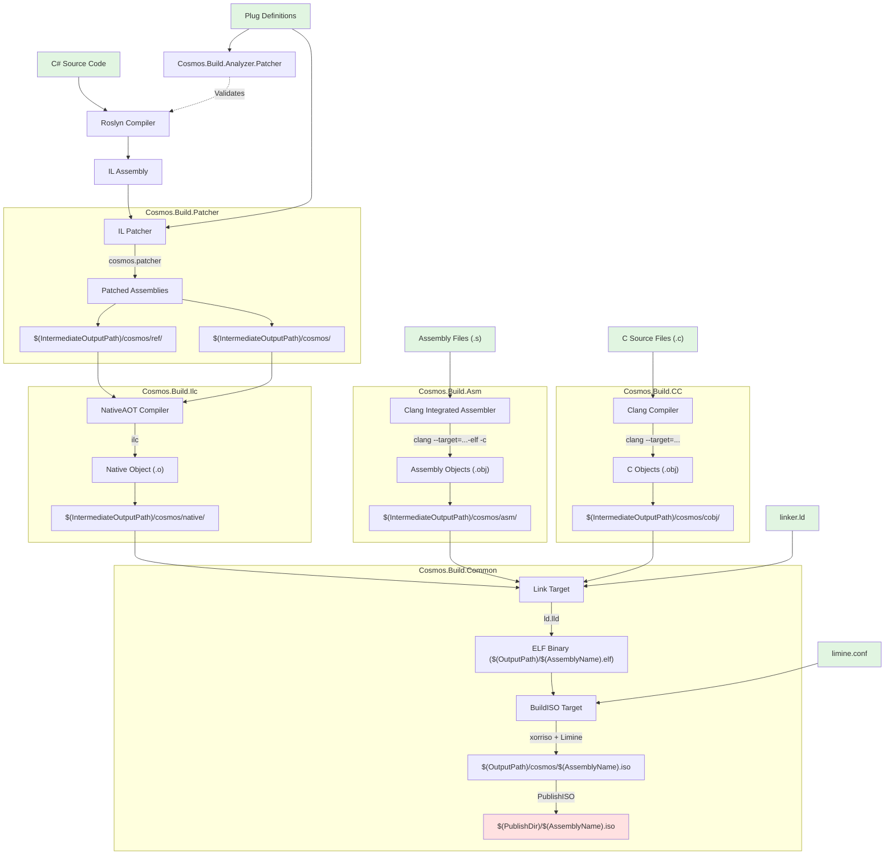

# Étapes de compilation du noyau

Ce document décrit le pipeline de build complet qui transforme le code C# du noyau en une image ISO amorçable, au moyen de la compilation .NET NativeAOT, d'un patching IL sur mesure et de la génération de code natif.

## Diagramme du flux de compilation

## Prérequis

| Outil | Rôle | Version requise |
|------|---------|-----------------|
| **.NET SDK** | Compilation principale | 10.0+ |
| **Clang** | Compilation du C et de l'assembleur (x64/ARM64 via --target) | Chaîne d'outils LLVM |
| **ld.lld** | Édition de liens ELF | Chaîne d'outils LLVM |
| **xorriso** | Création de l'ISO | Dernière version |

## Composants principaux

- [`Cosmos.Sdk`](https://github.com/CosmosOS/Cosmos/blob/gen3/src/Cosmos.Sdk) : orchestration par le SDK MSBuild
- [`Cosmos.Build.Patcher`](https://github.com/CosmosOS/Cosmos/blob/gen3/src/Cosmos.Build.Patcher) : infrastructure de patching IL
- [`Cosmos.Build.Ilc`](https://github.com/CosmosOS/Cosmos/blob/gen3/src/Cosmos.Build.Ilc) : intégration de NativeAOT
- [`Cosmos.Build.Asm`](https://github.com/CosmosOS/Cosmos/blob/gen3/src/Cosmos.Build.Asm) : compilation de l'assembleur
- [`Cosmos.Build.CC`](https://github.com/CosmosOS/Cosmos/blob/gen3/src/Cosmos.Build.CC) : compilation du C (Clang)
- [`Cosmos.Build.Common`](https://github.com/CosmosOS/Cosmos/blob/gen3/src/Cosmos.Build.Common) : édition de liens et création de l'ISO

## Projet d'exemple

Implémentation de référence : `examples/DevKernel/DevKernel.csproj`

## Récapitulatif des sorties

| Étape | Chemin de sortie | Contenu |
|-------|------------|---------|
| Patching | `$(IntermediateOutputPath)/cosmos/` | Assembly principal patché |
| Patching | `$(IntermediateOutputPath)/cosmos/ref/` | Assemblies de référence |
| NativeAOT | `$(IntermediateOutputPath)/cosmos/native/` | Fichiers objets natifs (.o) |
| Assembleur | `$(IntermediateOutputPath)/cosmos/asm/` | Objets produits par l'assembleur Clang (.obj) |
| Code C | `$(IntermediateOutputPath)/cosmos/cobj/` | Objets Clang (.o/.obj) |
| Édition de liens | `$(OutputPath)/$(AssemblyName).elf` | Noyau ELF lié |
| ISO | `$(OutputPath)/cosmos/$(AssemblyName).iso` | Image ISO amorçable |
| Publication | `$(PublishDir)/$(AssemblyName).iso` | ISO publiée |
