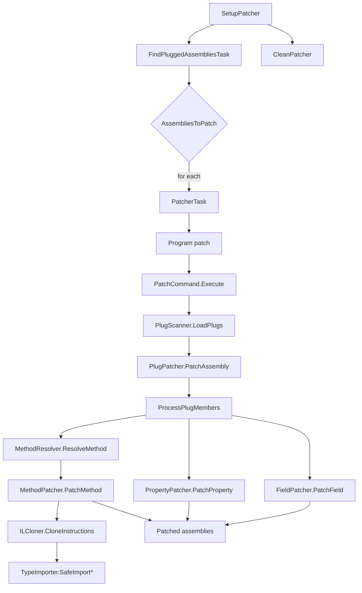

<a id="overview"></a>

## Vue d'ensemble

`Cosmos.Patcher.Build` intègre l'outil [`Cosmos.Patcher`](https://github.com/CosmosOS/Cosmos/blob/gen3/src/Cosmos.Patcher) au pipeline MSBuild. `Cosmos.Patcher` réécrit l'IL des assemblies candidats en y appliquant des plugs à la manière de CosmosOS, afin que le framework .NET Core puisse s'exécuter sur des cibles NativeAOT. L'analyse statique est assurée par [`Cosmos.Patcher.Analyzer`](https://github.com/CosmosOS/Cosmos/blob/gen3/src/Cosmos.Build.Analyzer.Patcher), qui signale les erreurs de plug pendant la compilation C#, avant que le moindre IL ne soit réécrit.

---

<a id="net-assembly-structure"></a>

## Structure d'un assembly .NET

Un assembly .NET (`.dll` ou `.exe`) est un exécutable portable qui contient des métadonnées et du code IL. Le patcher manipule ces structures à l'aide de Mono.Cecil.

```
┌─────────────────────────────────────────────────────────────────────┐
│                        AssemblyDefinition                           │
│  ┌───────────────────────────────────────────────────────────────┐  │
│  │ Name: "MyAssembly"                                            │  │
│  │ Version: 1.0.0.0                                              │  │
│  │ CustomAttributes: [AssemblyInfo, ...]                         │  │
│  └───────────────────────────────────────────────────────────────┘  │
│                              │                                      │
│                              ▼                                      │
│  ┌───────────────────────────────────────────────────────────────┐  │
│  │                   ModuleDefinition[0]                         │  │
│  │  ┌─────────────────────────────────────────────────────────┐  │  │
│  │  │ Name: "MyAssembly.dll"                                  │  │  │
│  │  │ AssemblyReferences: [mscorlib, System.Runtime, ...]     │  │  │
│  │  │ TypeReferences: [external type tokens]                  │  │  │
│  │  └─────────────────────────────────────────────────────────┘  │  │
│  │                           │                                   │  │
│  │                           ▼                                   │  │
│  │  ┌─────────────────────────────────────────────────────────┐  │  │
│  │  │                  TypeDefinition[0]                      │  │  │
│  │  │  ┌───────────────────────────────────────────────────┐  │  │  │
│  │  │  │ FullName: "MyNamespace.MyClass"                   │  │  │  │
│  │  │  │ BaseType: System.Object                           │  │  │  │
│  │  │  │ Interfaces: [IDisposable, ...]                    │  │  │  │
│  │  │  │ CustomAttributes: [Plug, Serializable, ...]       │  │  │  │
│  │  │  │                                                   │  │  │  │
│  │  │  │  ┌─────────────────────────────────────────────┐  │  │  │  │
│  │  │  │  │            FieldDefinition[0]               │  │  │  │  │
│  │  │  │  │  Name, FieldType, Attributes, Constant      │  │  │  │  │
│  │  │  │  ├─────────────────────────────────────────────┤  │  │  │  │
│  │  │  │  │            FieldDefinition[n]               │  │  │  │  │
│  │  │  │  └─────────────────────────────────────────────┘  │  │  │  │
│  │  │  │                                                   │  │  │  │
│  │  │  │  ┌─────────────────────────────────────────────┐  │  │  │  │
│  │  │  │  │          PropertyDefinition[0]              │  │  │  │  │
│  │  │  │  │  Name, PropertyType, GetMethod, SetMethod   │  │  │  │  │
│  │  │  │  ├─────────────────────────────────────────────┤  │  │  │  │
│  │  │  │  │          PropertyDefinition[n]              │  │  │  │  │
│  │  │  │  └─────────────────────────────────────────────┘  │  │  │  │
│  │  │  │                                                   │  │  │  │
│  │  │  │  ┌─────────────────────────────────────────────┐  │  │  │  │
│  │  │  │  │           MethodDefinition[0]               │  │  │  │  │
│  │  │  │  │  Name, ReturnType, Parameters, Attributes   │  │  │  │  │
│  │  │  │  │                                             │  │  │  │  │
│  │  │  │  │  ┌───────────────────────────────────────┐  │  │  │  │  │
│  │  │  │  │  │           MethodBody                  │  │  │  │  │  │
│  │  │  │  │  │  Variables: [local0, local1, ...]     │  │  │  │  │  │
│  │  │  │  │  │  MaxStackSize: 8                      │  │  │  │  │  │
│  │  │  │  │  │  InitLocals: true                     │  │  │  │  │  │
│  │  │  │  │  │                                       │  │  │  │  │  │
│  │  │  │  │  │  Instructions:                        │  │  │  │  │  │
│  │  │  │  │  │   IL_0000: ldarg.0                    │  │  │  │  │  │
│  │  │  │  │  │   IL_0001: call .ctor                 │  │  │  │  │  │
│  │  │  │  │  │   IL_0006: ldstr "Hello"              │  │  │  │  │  │
│  │  │  │  │  │   IL_000B: call Console.WriteLine     │  │  │  │  │  │
│  │  │  │  │  │   IL_0010: ret                        │  │  │  │  │  │
│  │  │  │  │  │                                       │  │  │  │  │  │
│  │  │  │  │  │  ExceptionHandlers:                   │  │  │  │  │  │
│  │  │  │  │  │   [try/catch/finally blocks]          │  │  │  │  │  │
│  │  │  │  │  └───────────────────────────────────────┘  │  │  │  │  │
│  │  │  │  ├─────────────────────────────────────────────┤  │  │  │  │
│  │  │  │  │           MethodDefinition[n]               │  │  │  │  │
│  │  │  │  └─────────────────────────────────────────────┘  │  │  │  │
│  │  │  └───────────────────────────────────────────────────┘  │  │  │
│  │  ├─────────────────────────────────────────────────────────┤  │  │
│  │  │                  TypeDefinition[n]                      │  │  │
│  │  └─────────────────────────────────────────────────────────┘  │  │
│  └───────────────────────────────────────────────────────────────┘  │
│  ┌───────────────────────────────────────────────────────────────┐  │
│  │                   ModuleDefinition[n]                         │  │
│  └───────────────────────────────────────────────────────────────┘  │
└─────────────────────────────────────────────────────────────────────┘
```

<a id="flow-chart"></a>

## Diagramme de flux



---

<a id="parameters"></a>

## Paramètres

| Nom | Description | Valeur par défaut |
| --- | --- | --- |
| `EnablePatching` | Active ou désactive le patching. | `true` |
| `CosmosPatcherExe` | Chemin de l'exécutable `Cosmos.Patcher`. | `%USERPROFILE%\.dotnet\tools\cosmos.patcher.exe` sous Windows, `cosmos.patcher` sous Unix |
| `PatcherOutputPath` | Répertoire dans lequel les assemblies patchés sont écrits. | `$(IntermediateOutputPath)/cosmos/ref/` |
| `PlugReference` | Noms des assemblies de plugs à inclure. | aucun |

---

<a id="tasks"></a>

## Tâches

| Tâche | Description | Dépend de |
| --- | --- | --- |
| `SetupPatcher` | Rassemble les assemblies candidats, résout les références de plugs et prépare les répertoires de sortie. | `Build`, `ResolveIlcPath` |
| `RunPatcher` | Exécute `Cosmos.Patcher` pour chaque entrée de `AssembliesToPatch`. | `SetupPatcher` |
| `CleanPatcher` | Supprime les fichiers générés par le patcher. | `Clean` |
| `FindPluggedAssembliesTask` | Filtre les assemblies candidats pour ne garder que ceux qui contiennent des types cibles. | `SetupPatcher` |
| `PatcherTask` | Enveloppe MSBuild autour de `Cosmos.Patcher` pour les scénarios personnalisés. | aucune |

---

<a id="detailed-workflow"></a>

## Déroulement détaillé

1. **SetupPatcher** rassemble les assemblies de sortie et de référence, résout les références de plugs et les stocke dans `$(IntermediateOutputPath)/cosmos`.

2. **FindPluggedAssembliesTask** utilise [`PlugScanner.FindPluggedAssemblies`](https://github.com/CosmosOS/Cosmos/blob/gen3/src/Cosmos.Patcher/PlugScanner.cs) pour croiser les cibles des plugs avec les assemblies candidats, et produit `AssembliesToPatch`.

3. **RunPatcher** parcourt `AssembliesToPatch` et, pour chaque assembly, la [`PatcherTask`](https://github.com/CosmosOS/Cosmos/blob/gen3/src/Cosmos.Build.Patcher/Tasks/PatcherTask.cs) lance la CLI [`Cosmos.Patcher`](https://github.com/CosmosOS/Cosmos/blob/gen3/src/Cosmos.Patcher) ([`Program`](https://github.com/CosmosOS/Cosmos/blob/gen3/src/Cosmos.Patcher/Program.cs) → [`PatchCommand.Execute`](https://github.com/CosmosOS/Cosmos/blob/gen3/src/Cosmos.Patcher/PatchCommand.cs)). Dans `Execute` :
   - L'assembly cible et les assemblies de plugs sont lus par [`PatcherAssemblyLoader`](https://github.com/CosmosOS/Cosmos/blob/gen3/src/Cosmos.Patcher/Resolution/PatcherAssemblyLoader.cs) avec un [`PatcherAssemblyResolver`](https://github.com/CosmosOS/Cosmos/blob/gen3/src/Cosmos.Patcher/Resolution/PatcherAssemblyResolver.cs) qui cherche dans les répertoires de la cible, des plugs et de la sortie, ainsi que dans ceux que `RunPatcher` transmet avec `--search` (`cosmos/ref` et le répertoire de chaque assembly candidat). L'écriture d'un assembly patché résout les types de ses constantes : un champ `const` ou un paramètre par défaut dont le type est une énumération d'un autre assembly Cosmos exige que cet assembly soit trouvé, et le résolveur par défaut de Mono.Cecil ne cherche que dans le répertoire courant et dans le runtime hôte.
   - [`PlugScanner.LoadPlugs`](https://github.com/CosmosOS/Cosmos/blob/gen3/src/Cosmos.Patcher/PlugScanner.cs) découvre les types de plugs dans ces assemblies.
   - [`PlugPatcher.PatchAssembly`](https://github.com/CosmosOS/Cosmos/blob/gen3/src/Cosmos.Patcher/Patching/PlugPatcher.cs) regroupe les plugs par cible `[Plug]` et patche chaque type cible à l'aide de :
       - [`MethodResolver`](https://github.com/CosmosOS/Cosmos/blob/gen3/src/Cosmos.Patcher/Resolution/MethodResolver.cs), qui fait correspondre les signatures des plugs (constructeurs et paramètres `aThis` compris) par nom et par types de paramètres.
       - [`PlugPatcher.Method`](https://github.com/CosmosOS/Cosmos/blob/gen3/src/Cosmos.Patcher/Patching/PlugPatcher.Method.cs), qui échange ou clone l'IL et supprime les métadonnées P/Invoke.
       - [`ILCloner`](https://github.com/CosmosOS/Cosmos/blob/gen3/src/Cosmos.Patcher/IL/ILCloner.cs), qui clone les instructions, remappe les paramètres et corrige les cibles de branchement.
       - [`TypeImporter`](https://github.com/CosmosOS/Cosmos/blob/gen3/src/Cosmos.Patcher/IL/TypeImporter.cs), qui importe de façon sûre les références de types, de méthodes et de champs, en corrigeant les autoréférences qui produiraient des métadonnées IL invalides.
       - [`PlugPatcher.Property`](https://github.com/CosmosOS/Cosmos/blob/gen3/src/Cosmos.Patcher/Patching/PlugPatcher.Property.cs), qui relie les getters et les setters aux implémentations des plugs.
       - [`PlugPatcher.Field`](https://github.com/CosmosOS/Cosmos/blob/gen3/src/Cosmos.Patcher/Patching/PlugPatcher.Field.cs), qui copie les valeurs constantes et redirige les accès aux champs.
   - L'assembly patché est écrit dans `PatcherOutputPath`.

4. **CleanPatcher** supprime la sortie patchée lorsque le projet est nettoyé.

5. [`Cosmos.Patcher.Analyzer`](https://github.com/CosmosOS/Cosmos/blob/gen3/src/Cosmos.Build.Analyzer.Patcher) valide les règles des plugs pendant la compilation, afin de détecter les erreurs avant le patching.

---

<a id="outputs"></a>

## Sorties

- Assembly applicatif patché : `$(IntermediateOutputPath)/cosmos/$(AssemblyName)_patched.dll`, la sortie principale du projet après application des plugs.
- Assemblies de référence pour ILC : `$(IntermediateOutputPath)/cosmos/ref/*.dll`, patchés là où des plugs s'appliquent ; sinon copiés sans modification pour la résolution.
- Les répertoires intermédiaires sont créés à la demande sous `$(IntermediateOutputPath)/cosmos/`.

Remarques :
- `RunPatcher` ne s'exécute que lorsque `EnablePatching` vaut `true`, et après que `SetupPatcher` a calculé `@(AssembliesToPatch)` et les destinations.

---

<a id="related-components"></a>

## Composants associés

- [`Cosmos.Patcher`](https://github.com/CosmosOS/Cosmos/blob/gen3/src/Cosmos.Patcher)
- [`Cosmos.Patcher.Analyzer`](https://github.com/CosmosOS/Cosmos/blob/gen3/src/Cosmos.Build.Analyzer.Patcher)
