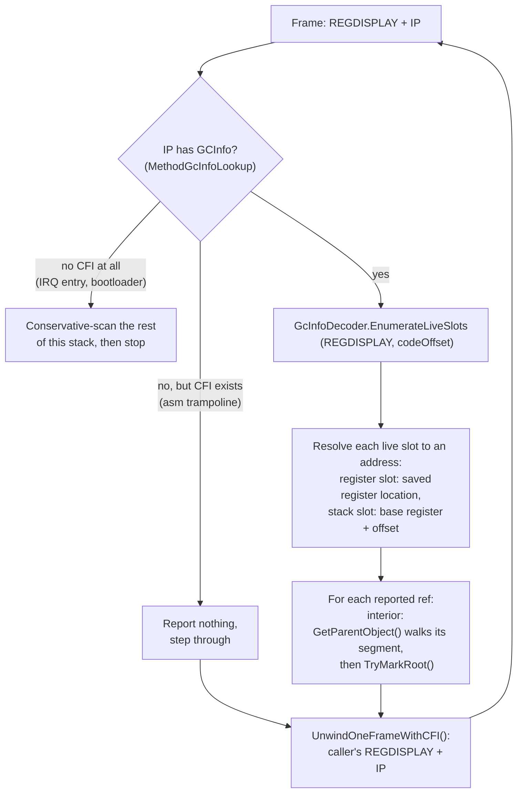

<a id="overview"></a>

## Vue d'ensemble

Un parcours de pile peut [deviner ou savoir](gc-concepts/conservative-vs-precise.md) quels mots de la pile sont des références d'objet. Cet article traite du cas où l'on sait : les métadonnées **GCInfo** qu'ILC émet pour chaque méthode, la façon dont le GC s'en sert pour parcourir le thread déclencheur cadre par cadre, et la contrainte des [points sûrs](gc-concepts/safepoint.md) qui décide des threads qu'il peut couvrir. Il prolonge la section [Phase de marquage](garbage-collector.md#mark-phase) de l'article Ramasse-miettes.

> [!NOTE]
> État : le parcours précis est actif pour le thread qui déclenche le GC et pour les cadres de [funclet](gc-concepts/funclet.md) d'exception, et il résout les pointeurs intérieurs en leurs objets parents (phases 1 à 3 et 5 de l'epic [#348](https://github.com/valentinbreiz/nativeaot-patcher/issues/348), prise en charge des pointeurs intérieurs issue de [#376](https://github.com/valentinbreiz/nativeaot-patcher/issues/376)/[#384](https://github.com/valentinbreiz/nativeaot-patcher/issues/384)). Les threads préemptés dans l'ordonnanceur conservent le parcours conservateur jusqu'à l'arrivée du [détournement d'adresse de retour](#the-safepoint-constraint) ([#385](https://github.com/valentinbreiz/nativeaot-patcher/issues/385)).

---

<a id="why-precise-scanning"></a>

## Pourquoi un parcours précis

Le [parcours conservateur](gc-concepts/conservative-vs-precise.md) ne sait pas quels mots de la pile sont des références, il traite donc chaque mot de la taille d'un pointeur comme un candidat (`ScanThreadStack` et `ScanMemoryRange` alimentant `TryMarkRoot` dans [`GarbageCollector.Mark.cs`](https://github.com/CosmosOS/Cosmos/blob/gen3/src/Cosmos.Kernel.Core/Memory/GarbageCollector/GarbageCollector.Mark.cs)) et garde tous ceux qui tombent dans le tas du GC et portent une `MethodTable` plausible. Ce sont des filtres de plausibilité, pas une preuve, et deux problèmes en découlent.

**Sur-enracinement.** Tout pointeur périmé vers le tas laissé dans un emplacement de débordement mort ou dans un cadre d'appelé pas encore écrasé devient une [racine](gc-concepts/gc-roots.md) : l'objet mort vers lequel il pointe survit donc à la collecte, avec tout ce qu'il référence transitivement. Une fausse racine passant par une référence forte provoque une fuite silencieuse. Celle qui maintient en vie la cible d'une référence faible est au moins visible : un handle faible qui aurait dû être effacé se résout encore, et c'est ce que la CI détecte.

**Fragilité de la disposition.** Qu'un pointeur périmé se trouve dans un emplacement parcouru relève du hasard de la compilation, si bien que la correction change chaque fois que la génération de code change. L'issue [#346](https://github.com/valentinbreiz/nativeaot-patcher/issues/346) en est l'archétype : ajouter un seul champ de 8 octets à une structure allouée sur la pile (`InterruptScope`, inlinée autour de chaque chemin du GC et de l'ordonnanceur) a déplacé les emplacements situés en dessous, un pointeur de tableau périmé est tombé là où le parcours lit, et les tests de références faibles ont échoué. Ajouter un champ, introduire une variable locale ou mettre à jour le compilateur relevaient tous de la même classe de défaillance, jusqu'à ce que le parcours du thread déclencheur devienne précis.

Une demi-mesure tentante consiste à garder le parcours conservateur en ne lisant que les plages de cadres vivants trouvées en suivant la chaîne des pointeurs de cadre. C'est dangereux ici : ILC compile de nombreuses fonctions sans pointeur de cadre, si bien que la chaîne saute des cadres sans le signaler. Le dispatch des exceptions peut tolérer un cadre sauté ; le GC ne le peut pas, car une racine manquée libère un objet vivant et se transforme en use-after-free pendant le balayage, ce qui est strictement pire que le sur-enracinement qu'elle devait supprimer. Demander au compilateur où se trouvent les références est la seule voie correcte.

---

<a id="what-gcinfo-is"></a>

## Ce qu'est le GCInfo

Lorsqu'ILC compile une méthode, il émet, à côté du code machine, un petit blob GCInfo qui répond à une seule question :

> Si un GC se déclenche alors que l'exécution se trouve à l'offset de code N dans cette méthode, quels registres CPU et quels emplacements de pile contiennent des références d'objet vivantes, lesquelles sont des pointeurs intérieurs, et lesquelles sont épinglées ?

Un blob par méthode. C'est ce qui rend un parcours précis possible : au lieu de deviner quels mots de la pile ressemblent à des pointeurs, le GC interroge le compilateur.

<a id="where-it-lives-in-the-binary"></a>

### Où il se trouve dans le binaire

Retrouver le blob à l'exécution s'appuie sur la mécanique de déroulement d'ELF, si bien que quatre termes DWARF reviennent ci-dessous. Chaque binaire porte une section `.eh_frame` : une table avec une entrée par fonction (une **FDE**, entrée de description de cadre) dont les règles d'information de cadre d'appel (**CFI**) permettent à un runtime de reconstruire les registres de l'appelant depuis n'importe quelle instruction de cette fonction. Chaque FDE peut aussi pointer vers un blob de données propres au langage (la **LSDA**), une zone de forme libre que le dérouleur lui-même n'interprète jamais. NativeAOT range son enregistrement par méthode derrière ce pointeur LSDA.

ILC écrit un enregistrement par méthode dans la section `.dotnet_eh_table`, organisé ainsi : `[LSDA header][GCInfo blob][EH clauses]`. L'éditeur de liens conserve la section et ses bornes : voir `*(.dotnet_eh_table)` et `__dotnet_eh_table_start` / `__dotnet_eh_table_end` dans [`linker.x64.ld`](https://github.com/CosmosOS/Cosmos/blob/gen3/src/Cosmos.Build.Templates/Linker/linker.x64.ld) et [`linker.arm64.ld`](https://github.com/CosmosOS/Cosmos/blob/gen3/src/Cosmos.Build.Templates/Linker/linker.arm64.ld). La FDE DWARF `.eh_frame` d'une méthode porte un pointeur vers l'en-tête LSDA de cet enregistrement, et [`MethodGcInfoLookup`](https://github.com/CosmosOS/Cosmos/blob/gen3/src/Cosmos.Kernel.Core/Runtime/GcInfo/MethodGcInfoLookup.cs) parcourt `.eh_frame` pour résoudre un pointeur d'instruction vers cet en-tête. Une IP n'est donc séparée du blob GCInfo que par le parcours d'un en-tête LSDA. Aucune modification du pipeline de build, d'un outil exécuté après l'édition de liens ou du patcher n'est nécessaire.

La section `.dotnet_eh_table` est une suite de ces enregistrements, un par méthode, chacun organisé dans cet ordre :

| Partie de l'enregistrement | Contenu |
|-------------|----------|
| En-tête LSDA, octet 0 | `unwindBlockFlags` : `UBF_FUNC_KIND_MASK` 0x03 (ROOT / HANDLER / FILTER), `UBF_FUNC_HAS_EHINFO` 0x04, `UBF_FUNC_HAS_ASSOCIATED_DATA` 0x10 |
| enregistrements de funclet uniquement | Un offset int32 relatif à lui-même vers la LSDA de la méthode principale, plus un delta de début int32 ; un funclet réutilise le GCInfo de sa méthode principale |
| si `HAS_ASSOCIATED_DATA` | pointeur int32 |
| si `HAS_EHINFO` | pointeur int32 |
| **Blob GCInfo** | Compacté au bit près (voir ci-dessous) ; c'est ce que décode le parcours précis |
| Clauses EH | La table try/catch/finally |

La FDE `.eh_frame` d'une méthode fait pointer son pointeur LSDA sur le premier octet de cet enregistrement, et l'offset de code pour la requête GCInfo vaut `ip - methodStart`.

> [!NOTE]
> Référence en amont : la disposition de l'en-tête LSDA est le format que le runtime NativeAOT analyse dans `FindMethodInfo` / `GetCodeOffset` de [`UnixNativeCodeManager.cpp`](https://github.com/dotnet/runtime/blob/main/src/coreclr/nativeaot/Runtime/unix/UnixNativeCodeManager.cpp).

<a id="whats-inside-the-blob"></a>

### Ce que contient le blob

Le GCInfo est un flux étroitement compacté au bit près ; chaque champ occupe le nombre minimal de bits et rien n'est aligné sur l'octet. Logiquement, il comporte trois parties :

| Partie | Contenu |
|------|----------|
| **En-tête** | Les drapeaux (la version est fixée par le runtime, elle n'est pas encodée dans le blob), la longueur du code (égale à la plage de PC de la FDE, une vérification de cohérence utile), le registre de base de pile auquel les offsets des emplacements de pile sont relatifs (`SP` ou le registre de cadre), la présence ou non d'un cookie GS ou d'un contexte de génériques, le nombre de points sûrs et le nombre de plages entièrement interruptibles. |
| **Table des emplacements** | L'ensemble des emplacements que cette méthode utilise à un moment ou à un autre pour des références d'objet. Chaque emplacement est soit un registre (désigné par son numéro), soit un emplacement de pile (registre de base plus offset signé). Drapeaux par emplacement : `GC_SLOT_INTERIOR` (la valeur pointe au milieu d'un objet, pas sur son en-tête) et `GC_SLOT_PINNED` (la cible ne doit pas être déplacée). Les emplacements non suivis, vivants pendant tout le corps de la méthode, se trouvent à la fin de la table. |
| **Vivacité** | Quels emplacements sont vivants à quels offsets de code. Une plage entièrement interruptible encode une vivacité valide pour n'importe quelle IP à l'intérieur ; une méthode partiellement interruptible n'encode la vivacité que par **point sûr** (site d'appel). |

<a id="a-tiny-worked-example"></a>

### Un petit exemple détaillé

```csharp
static void Foo()
{
    byte[] a = new byte[128];     // 'a' is an object reference
    Bar();                        // ←(I) call site = safepoint; 'a' still needed below, so live here
    GC.KeepAlive(a);
    string s = Compute();         // 's' is an object reference; 'a' is now dead
    Console.WriteLine(s);         // ←(II) call site = safepoint; 's' live, 'a' dead here
}
```

Voici, conceptuellement, le GCInfo qu'ILC émet pour `Foo`. D'abord la table des emplacements :

| Emplacement | Position | Contient | Drapeaux |
|------|----------|-------|-------|
| 0 | registre `RSI` | `s` | aucun |
| 1 | pile, base du cadre - 0x18 | `a` | aucun |

Une méthode qui détient une `ref` vers un tableau ajouterait un emplacement marqué `INTERIOR`, et un bloc `fixed` un emplacement marqué `PINNED` ; `Foo` n'a ni l'un ni l'autre. Ensuite, la vivacité des emplacements sur le corps de la méthode, de l'offset 0x00 à la longueur du code :

| Offset de code | Emplacements vivants |
|-------------|------------|
| 0x00 à 0x4A | aucun |
| 0x4A à 0x6C | uniquement l'emplacement 1 (le tableau) |
| 0x6C à la longueur du code | uniquement l'emplacement 0 (la chaîne) |

- Un GC se déclenche alors que le cadre de `Foo` est sur la pile, avec l'IP sur l'adresse de retour qui suit `Bar()`. L'offset de code se résout en point sûr (I), le GCInfo ne signale que l'emplacement qui contient `a`, et le `byte[128]` est conservé. Rien d'autre.
- Un GC se déclenche avec l'IP sur l'adresse de retour qui suit `WriteLine`. Le point sûr (II) ne signale que le registre qui contient `s`. Le `byte[128]` n'est pas signalé et il est collecté, alors même que son pointeur périmé se trouve encore dans l'emplacement de pile de `a`. Ce dernier cas est exactement celui où le parcours conservateur se trompe.

> [!NOTE]
> Référence en amont : le format qui fait autorité et la sémantique du décodeur sont `GcInfoDecoder::EnumerateLiveSlots` dans [`gcinfodecoder.cpp`](https://github.com/dotnet/runtime/blob/main/src/coreclr/vm/gcinfodecoder.cpp) (compilé avec `GCINFODECODER_NO_EE` pour NativeAOT), avec les types dans [`gcinfotypes.h`](https://github.com/dotnet/runtime/blob/main/src/coreclr/inc/gcinfotypes.h) et [`gcinfodecoder.h`](https://github.com/dotnet/runtime/blob/main/src/coreclr/inc/gcinfodecoder.h). Le décodeur du noyau est un portage direct du sous-ensemble v4 dont il a besoin.

---

<a id="how-the-precise-scan-walks-a-thread"></a>

## Comment le parcours précis remonte un thread

Le parcours remonte le thread déclencheur du GC un cadre à la fois. Pour chaque cadre, il dispose de deux entrées : l'IP (une adresse de retour qui pointe dans le code de cette méthode) et un `REGDISPLAY`, une structure qui contient l'état des registres de ce cadre. Les deux proviennent d'une mécanique construite pour le traitement des exceptions : le dérouleur CFI de [`ExceptionHelper.cs`](https://github.com/CosmosOS/Cosmos/blob/gen3/src/Cosmos.Kernel.Core/Runtime/ExceptionHandling/ExceptionHelper.cs) reconstruit l'état des registres de l'appelant cadre par cadre, et un petit stub natif (`_native_capture_regdisplay`) initialise le `REGDISPLAY` de départ pour le propre cadre du parcours.

La fonction qui mène le parcours est `PreciseScanCurrentThread` dans [`GarbageCollector.PreciseStack.cs`](https://github.com/CosmosOS/Cosmos/blob/gen3/src/Cosmos.Kernel.Core/Memory/GarbageCollector/GarbageCollector.PreciseStack.cs), appelée depuis `ScanStackRoots` pour le seul thread déclencheur du GC. La remontée est plafonnée à 256 étapes de déroulement au-delà du premier cadre.



Pour chaque emplacement signalé, le callback (`PreciseRootTrampoline`) fait l'une des deux choses suivantes :

- Une référence ordinaire est passée directement à `TryMarkRoot` ; les vérifications habituelles de plage du tas et de `MethodTable` sont, sur une racine signalée précisément, une double précaution sans danger.
- Un emplacement marqué `GC_CALL_INTERIOR` contient un pointeur au milieu d'un objet (un byref, la référence d'un span). Le callback le résout en l'objet qui le contient avec `GetParentObject`, qui trouve le segment contenant l'adresse dans l'une ou l'autre chaîne et le parcourt depuis son premier objet ; le mécanisme pas à pas se trouve dans [Ramasse-miettes : Pointeurs intérieurs](garbage-collector.md#interior-pointers). Le drapeau `GC_CALL_PINNED` de l'emplacement ne joue aucun rôle : il indique que l'emplacement est une variable locale épinglée (celle d'une instruction `fixed`), et non sur quel tas se trouve l'objet. Une adresse qui ne se trouve dans aucun objet ne marque rien. C'est la correction pour les objets atteignables uniquement par un byref (issue [#384](https://github.com/valentinbreiz/nativeaot-patcher/issues/384)).

Les cadres sans GCInfo sont de deux sortes. Un trampoline asm écrit à la main qui porte encore des directives `.cfi` (`RhpCallCatchFunclet`, `RhpCallFilterFunclet`, `RhpCallFinallyFunclet`, `RhpThrowEx`) est traversé sans rien signaler : les cadres managés situés de part et d'autre couvrent ses emplacements de sauvegarde de registres, et l'objet d'exception en cours de propagation reste signalé, car des cadres managés plus profonds dans la pile (la variable locale d'exception du corps du funclet, le dispatcher managé `RhThrowEx` qu'appelle le stub) le détiennent dans des emplacements que décrit leur propre GCInfo. Un cadre sans aucune CFI (les stubs d'entrée d'interruption, le chargeur d'amorçage) termine la remontée : le parcours examine de façon conservatrice le reste de la plage de pile et s'arrête plutôt que de planter. La même fin conservatrice s'exécute si le dérouleur échoue en cours de remontée ou si la table des emplacements d'une méthode dépasse le tampon de taille fixe du décodeur. Deux sorties sont plus brutales : un cadre déroulé qui échoue aux vérifications de cohérence (une IP nulle, un pointeur de pile qui n'augmente pas ou qui sort de la pile) ou une remontée qui épuise son plafond de 256 cadres arrête le parcours sans fin conservatrice, et les cadres plus anciens ne sont pas parcourus pour cette collecte.

Les cadres de [funclet](gc-concepts/funclet.md) (corps catch, filter et finally) ne portent pas de GCInfo propre. Leur en-tête LSDA redirige vers l'enregistrement de la méthode principale, et l'offset de code est résolu par rapport au début de la méthode principale : le funclet est donc parcouru avec la table des emplacements du parent, sur le cadre où il s'exécute réellement. Les funclets de filtre s'exécutent en plein lancement d'exception, si bien que les emplacements non suivis du parent peuvent y être périmés et ne sont pas signalés (`NoReportUntracked`) ; les funclets catch et finally les signalent normalement, et le marquage est idempotent, si bien qu'un double signalement avec le cadre parent est sans danger.

---

<a id="the-safepoint-constraint"></a>

## La contrainte des points sûrs

Le GCInfo n'est valide qu'aux [points sûrs](gc-concepts/safepoint.md) : les sites d'appel pour une méthode partiellement interruptible, ou n'importe quelle IP dans une plage entièrement interruptible. Qu'un parcours précis d'un thread donné soit fiable dépend donc de l'endroit où se trouve le pointeur d'instruction de ce thread lorsque le GC s'exécute :

1. **Le thread qui a déclenché le GC.** Il a atteint le ramasse-miettes par une chaîne d'appels managés aboutissant à l'allocateur, si bien que chaque adresse de retour en remontant sa pile est un point sûr de site d'appel. Un parcours précis de ce thread est fiable. Les cadres de funclet d'exception sont eux aussi entrés par le `call` du dispatcher, ce sont donc également des points sûrs.

2. **Les threads immobilisés dans l'ordonnanceur.** Un thread dans la file d'exécution, bloqué ou endormi a été préempté par l'IRQ du minuteur sur une instruction arbitraire, pas nécessairement un point sûr, si bien qu'une recherche dans son GCInfo peut n'avoir aucun sens à cet endroit. L'IP préemptée peut tomber par chance dans une plage entièrement interruptible, où la recherche serait valide, mais rien ne le garantit : la plupart des corps de méthode ne sont décrits qu'à leurs sites d'appel, si bien qu'un parcours précis seulement de temps en temps aurait encore besoin du repli conservateur pour tous les autres arrêts. NativeAOT standard résout ce problème par le détournement d'adresse de retour : avant de parcourir un tel thread, le runtime remplace une adresse de retour présente sur la pile par l'adresse d'un stub, laisse le thread s'exécuter jusqu'à ce retour, l'immobilise sur le stub (un point sûr par construction), le parcourt précisément, puis restaure la véritable adresse de retour. Cosmos n'a pas encore de tel sous-système ; c'est l'issue [#385](https://github.com/valentinbreiz/nativeaot-patcher/issues/385).

D'ici là, les threads autres que le thread déclencheur du GC conservent le parcours conservateur décrit dans [Ramasse-miettes : Phase de marquage](garbage-collector.md#mark-phase). Les threads et l'état de leurs registres sauvegardés proviennent du registre des threads de l'ordonnanceur ; voir [Ordonnanceur](scheduler.md).

---

<a id="source-files"></a>

## Fichiers source

| Élément | Où | Remarques |
|-------|-------|-------|
| Remontée précise cadre par cadre | [`GarbageCollector.PreciseStack.cs`](https://github.com/CosmosOS/Cosmos/blob/gen3/src/Cosmos.Kernel.Core/Memory/GarbageCollector/GarbageCollector.PreciseStack.cs) | boucle de remontée, callback de racine, résolution des pointeurs intérieurs ; `ScanStackRoots` dans `GarbageCollector.Mark.cs` y aiguille |
| Décodeur GCInfo v4 | [`GcInfoDecoder.cs`](https://github.com/CosmosOS/Cosmos/blob/gen3/src/Cosmos.Kernel.Core/Memory/GarbageCollector/GcInfo/GcInfoDecoder.cs), [`GcSlotTable.cs`](https://github.com/CosmosOS/Cosmos/blob/gen3/src/Cosmos.Kernel.Core/Memory/GarbageCollector/GcInfo/GcSlotTable.cs), [`GcInfoTypes.cs`](https://github.com/CosmosOS/Cosmos/blob/gen3/src/Cosmos.Kernel.Core/Memory/GarbageCollector/GcInfo/GcInfoTypes.cs), [`GcInfoBitStreamReader.cs`](https://github.com/CosmosOS/Cosmos/blob/gen3/src/Cosmos.Kernel.Core/Memory/GarbageCollector/GcInfo/GcInfoBitStreamReader.cs) | en-tête, table des emplacements, `EnumerateLiveSlots` ; portage de `gcinfodecoder.cpp` |
| Recherche du GCInfo à partir de l'IP | [`MethodGcInfoLookup.cs`](https://github.com/CosmosOS/Cosmos/blob/gen3/src/Cosmos.Kernel.Core/Runtime/GcInfo/MethodGcInfoLookup.cs), [`EhFrameNative.cs`](https://github.com/CosmosOS/Cosmos/blob/gen3/src/Cosmos.Kernel.Core/Bridge/Import/EhFrameNative.cs) | l'unique analyseur `.eh_frame` / LSDA du noyau : IP → FDE → LSDA → blob GCInfo, y compris la redirection du funclet vers la méthode principale ; sert aussi au dérouleur d'exceptions |
| Dérouleur CFI, `REGDISPLAY` | [`ExceptionHelper.cs`](https://github.com/CosmosOS/Cosmos/blob/gen3/src/Cosmos.Kernel.Core/Runtime/ExceptionHandling/ExceptionHelper.cs) (+ `ExceptionHelper.X64.cs` / `ExceptionHelper.ARM64.cs`, [`RegisterContext.X64.cs`](https://github.com/CosmosOS/Cosmos/blob/gen3/src/Cosmos.Kernel.Core/Runtime/ExceptionHandling/RegisterContext.X64.cs) / [`RegisterContext.ARM64.cs`](https://github.com/CosmosOS/Cosmos/blob/gen3/src/Cosmos.Kernel.Core/Runtime/ExceptionHandling/RegisterContext.ARM64.cs)) | `UnwindOneFrameWithCFI` exécute les instructions de cadre d'appel DWARF pour reconstruire l'état des registres de l'appelant ; construit pour [#227](https://github.com/valentinbreiz/nativeaot-patcher/issues/227) |
| Stub `_native_capture_regdisplay` | `src/Cosmos.Kernel.Native.X64/CPU/ContextCapture.s`, `src/Cosmos.Kernel.Native.ARM64/CPU/ContextCapture.s`, [`ContextSwitchNative.cs`](https://github.com/CosmosOS/Cosmos/blob/gen3/src/Cosmos.Kernel.Core/Bridge/Import/ContextSwitchNative.cs) | initialise le `REGDISPLAY` de départ pour le thread déclencheur du GC |
| `.dotnet_eh_table` conservée, avec `__dotnet_eh_table_start/end` | [`linker.x64.ld`](https://github.com/CosmosOS/Cosmos/blob/gen3/src/Cosmos.Build.Templates/Linker/linker.x64.ld), [`linker.arm64.ld`](https://github.com/CosmosOS/Cosmos/blob/gen3/src/Cosmos.Build.Templates/Linker/linker.arm64.ld) | le GCInfo est accessible à l'exécution via la LSDA de la FDE |
| Parcours conservateur (threads immobilisés) | [`GarbageCollector.Mark.cs`](https://github.com/CosmosOS/Cosmos/blob/gen3/src/Cosmos.Kernel.Core/Memory/GarbageCollector/GarbageCollector.Mark.cs) | `ScanThreadStack` / `ScanMemoryRange` / `TryMarkRoot` ; ce qui reste en place jusqu'à l'arrivée du détournement |
| Tests | `tests/Kernels/Cosmos.Kernel.Tests.GarbageCollector` | `GC_GcInfoDecoder`, `GC_PreciseStackScan`, `GC_FuncletNoFalseRoot`, `GC_FuncletNoCrashOnAllocInCatch`, `GC_StackScanPaddingStress`, `GC_InteriorPointerRoot`, `GC_InteriorPointerRootMidTlab`, `GC_InteriorPointerRootPinnedHeap`, `GC_InteriorPointerRootFixed` |
| Stub de détournement | pas encore écrit | [#385](https://github.com/valentinbreiz/nativeaot-patcher/issues/385), phase 4 de l'epic |
