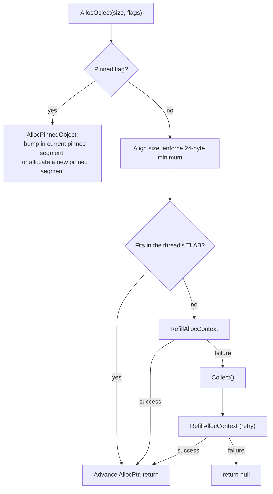
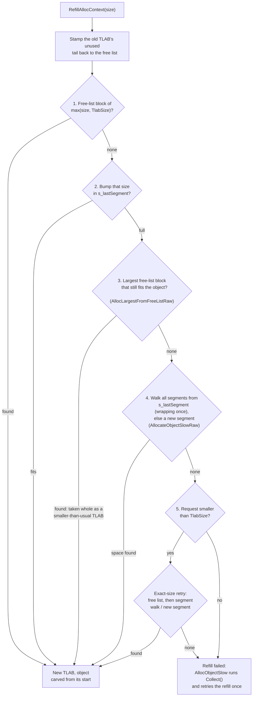
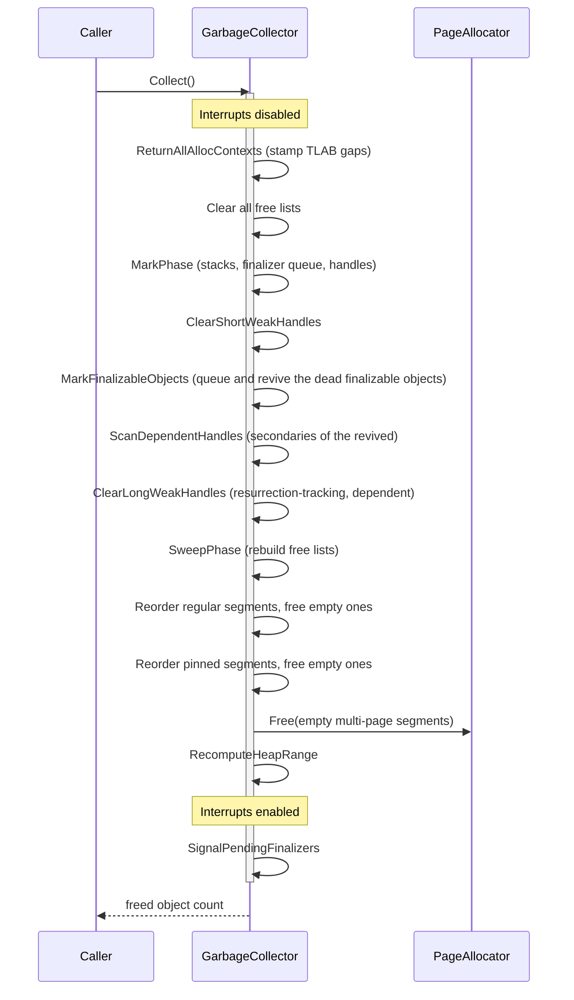
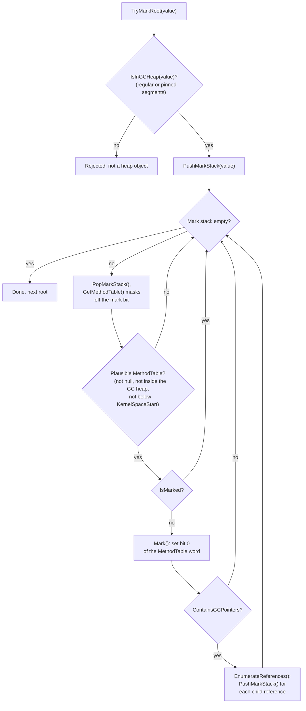
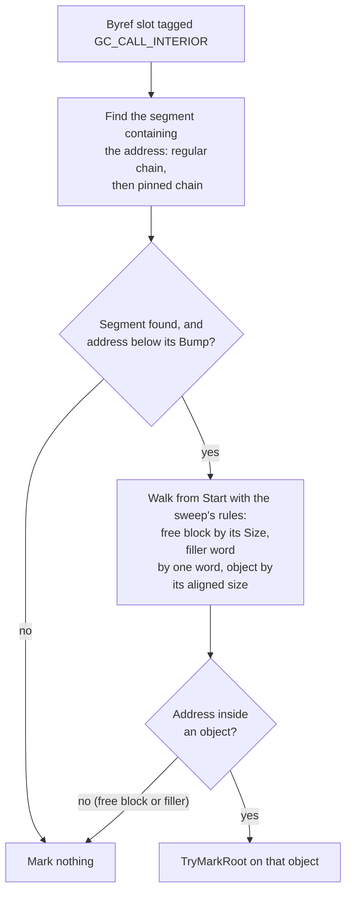
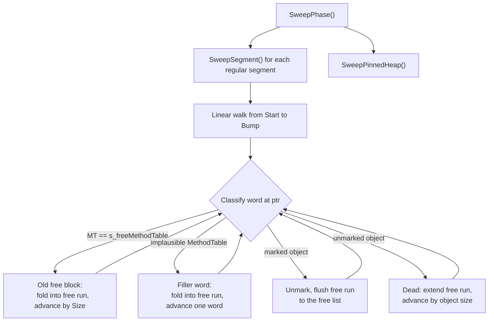

*L'origine du nom d'OrionGC. Crédit et copyright de l'image : [Stanislav Volskiy](https://apod.nasa.gov/apod/ap151123.html), APOD du 23 novembre 2015.*

## Vue d'ensemble

Le ramasse-miettes (qui s'identifie sous le nom **OrionGC** dans la table de configuration du runtime) est un collecteur [stop-the-world](gc-concepts/stop-the-world.md), [non déplaçant](gc-concepts/non-moving.md), de type [marquage-balayage](gc-concepts/mark-and-sweep.md), avec une [génération unique](gc-concepts/gc-generations.md). Chaque collecte met en pause tous les threads, marque les objets encore atteignables, libère les autres sur place et ne change jamais l'adresse d'un objet vivant. Chaque terme lié dispose d'une courte note de contexte dans le [glossaire](garbage-collector-glossary.md). Le ramasse-miettes gère quatre types de mémoire :

- le [tas GC ordinaire](#regular-heap), où chaque `new` alloue,
- le [tas d'objets épinglés](#pinned-heap), pour les objets dont l'adresse ne doit jamais changer,
- le [magasin de handles GC](#handle-store), des références vers des objets du tas détenues depuis l'extérieur du tas,
- les [segments gelés](#frozen-segments), des objets en lecture seule intégrés au binaire du noyau, jamais collectés.

Le GC fonctionne habituellement dans un noyau multithread, mais n'en a pas besoin. Lorsque l'[ordonnanceur](scheduler.md) tourne, il préempte les threads depuis l'interruption du minuteur, conserve chaque thread vivant dans un registre global des threads à partir duquel le GC effectue son parcours, et stocke l'état d'allocation de chaque thread dans son bloc de contrôle `SchedulerThread` ; les gestionnaires d'interruption allouent aussi (le tick de l'ordonnanceur, les pilotes d'entrée). Avant le démarrage de l'ordonnanceur, ou dans les noyaux qui l'excluent de la compilation, le GC fonctionne de la même manière avec un unique contexte d'allocation statique et la pile courante comme seule racine de pile. Dans les deux modes, il n'existe pas de thread dédié au GC : une collecte s'exécute sur le thread qui l'a déclenchée, quel qu'il soit, à l'intérieur de `InternalCpu.DisableInterruptsScope()`, de sorte qu'aucun changement de thread ni aucun gestionnaire d'interruption ne peut observer le tas en pleine collecte.

Comme chaque thread et chaque gestionnaire d'interruption peut allouer, l'allocation passe par des [TLAB](gc-concepts/tlab.md) par thread (thread-local allocation buffers, tampons d'allocation locaux au thread) : chaque thread incrémente un pointeur dans son propre tampon et, hormis un compteur global d'octets alloués, ne touche à l'état partagé que lorsque le tampon est épuisé et doit être rechargé. La collecte est un dernier recours. Lorsqu'une recharge échoue, le ramasse-miettes agrandit d'abord le tas ; `Collect()` ne s'exécute que lorsque l'allocateur de pages lui-même n'a plus rien à donner, ou lorsqu'on l'appelle explicitement.

Le marquage part des [racines](gc-concepts/gc-roots.md), les emplacements situés hors du tas qui contiennent des références. OrionGC parcourt trois groupes : la pile du thread qui a déclenché la collecte, parcourue de façon [précise](gc-concepts/conservative-vs-precise.md) à partir du GCInfo de NativeAOT (voir [Parcours précis de la pile (GCInfo)](garbage-collector-gcinfo.md)) ; les piles et les registres sauvegardés de tous les autres threads enregistrés, parcourus de façon conservatrice ; et les handles GC forts (les types de handle qui maintiennent leur cible en vie). Les champs statiques n'ont pas besoin d'un parcours séparé : pendant l'initialisation des modules, les objets qui contiennent les champs statiques de chaque module sont rassemblés dans des tableaux formant une épine dorsale, maintenus en vie par un handle fort, si bien que le parcours des handles atteint transitivement chaque champ statique.

Cette répartition des parcours contraint toute la conception. Un thread préempté peut être arrêté sur n'importe quelle instruction, sa pile ne peut donc être parcourue que de façon conservatrice, et une référence conservatrice épingle sa cible : un mot qui ressemble simplement à un pointeur vers le tas peut être un entier, si bien que le ramasse-miettes ne doit jamais déplacer l'objet vers lequel il semble pointer. En retour, le caractère non déplaçant garde le reste simple : les adresses des objets sont stables pour toute leur vie, et l'épinglage ne coûte rien. Une génération unique signifie qu'il n'y a ni [barrières d'écriture ni ensembles mémorisés (remembered sets)](gc-concepts/gc-generations.md) ; les écritures de références se compilent en simples écritures. Le compromis récurrent cède du débit en échange de simplicité et de vérifiabilité : chaque collecte parcourt tout le tas, mais chaque structure peut être parcourue à la main et la comptabilité est exacte, jusqu'aux nombres d'objets libérés que vérifie la [suite de tests](#tests). Ce à quoi la conception renonce est rassemblé dans [Limites et évolution](#limitations-and-evolution).

Le code se trouve dans `src/Cosmos.Kernel.Core/Memory/GarbageCollector/`. La classe `GarbageCollector` elle-même est une classe partielle statique découpée par phase (`.Alloc`, `.Tlab`, `.Mark`, `.Sweep`, etc.) ; les segments, les handles et la structure TLAB ont leurs propres types, et le dossier `GcInfo/` contient le décodeur du parcours précis de la pile. La liste complète des fichiers se trouve dans [Fichiers source](#source-files), à la fin de cet article.

---

## Structures fondamentales

Quatre formes de données sous-tendent tout le reste de cet article : le descripteur de type que le compilateur émet pour chaque type managé, l'objet tel que le GC le voit, le bloc libre qui décrit l'espace mort, et l'état d'allocation par thread. Chaque section suivante s'appuie sur elles.

### MethodTable

Chaque type managé compilé par ILC (le compilateur ahead-of-time de NativeAOT ; voir [Étapes de compilation du noyau](build/kernel-compilation-steps.md)) possède une `MethodTable`, un descripteur de type qui réside dans les sections de données du noyau, jamais sur le tas GC. Le GC lit quelques-uns de ses champs :

| Champ | Rôle |
|-------|---------|
| `RawBaseSize` | Taille en octets d'un objet de taille fixe |
| `BaseSize` / `ComponentSize` | Taille de base plus taille par élément, pour les tableaux et les chaînes |
| `HasComponentSize` | Vrai pour les tableaux et les chaînes |
| `ContainsGCPointers` | Vrai si les instances contiennent des références que le GC doit suivre |

Comme les pointeurs de `MethodTable` résident toujours dans l'espace noyau, hors du tas, le GC s'en sert comme filtre de validité : un objet candidat dont le premier mot est nul, pointe à l'intérieur du tas GC ou se situe sous `AddressSpace.KernelSpaceStart` ne peut pas être un véritable objet.

La seule chose que ces champs ne décrivent pas, c'est l'emplacement des références à l'intérieur d'une instance. Cette disposition se trouve dans le GCDesc stocké juste avant la `MethodTable` (voir [GCDesc](#gcdesc)).

### En-tête d'objet

Chaque objet du tas GC commence par un en-tête [`GCObject`](https://github.com/CosmosOS/Cosmos/blob/gen3/src/Cosmos.Kernel.Core/Memory/GarbageCollector/GCObject.cs) :

| Décalage | Taille (x64) | Contenu | Remarques |
|--------|------------|----------|-------|
| 0 | 8 octets | `MethodTable*` | Le bit 0 sert aussi de bit de marquage |
| 8 | 4 octets | `Length` | Nombre d'éléments ; seuls les tableaux et les chaînes ont cet emplacement |
| 8, 12 ou 16 | reste de l'objet | Champs ou éléments | Les champs commencent à 8 pour les objets de taille fixe ; les caractères d'une chaîne à 12 ; les éléments d'un tableau à 16 (4 octets de remplissage après `Length`) |

Les pointeurs de `MethodTable` sont alignés, le bit 0 vaut donc normalement zéro. `Mark()` le positionne, `Unmark()` l'efface, et `GetMethodTable()` le masque avant de déréférencer. `ComputeSize()` renvoie `BaseSize + Length * ComponentSize` pour les tableaux et les chaînes, `RawBaseSize` pour tout le reste.

### FreeBlock

L'espace mort est décrit par des entrées `FreeBlock` chaînées dans des listes de blocs libres par classe de taille. Un `FreeBlock` est disposé de façon que le balayage puisse le parcourir comme un objet, avec la `MethodTable` marqueur au décalage 0 et `Size` là où se trouve `GCObject.Length` :

| Décalage | Taille (x64) | Contenu | Remarques |
|--------|------------|----------|-------|
| 0 | 8 octets | `MethodTable*` | Pointe vers le marqueur `s_freeMethodTable` qui identifie les blocs libres |
| 8 | 4 octets | `Size` | Taille totale de ce bloc libre (suivie de 4 octets de remplissage) |
| 16 | 8 octets | `Next*` | Bloc libre suivant dans la même classe de taille |

L'en-tête fait 24 octets, c'est pourquoi `MinBlockSize` vaut 24 : chaque allocation est arrondie à au moins cette taille, si bien que n'importe quel objet peut plus tard être transformé sur place en bloc libre.

### AllocContext (TLAB)

[`AllocContext`](https://github.com/CosmosOS/Cosmos/blob/gen3/src/Cosmos.Kernel.Core/Memory/GarbageCollector/AllocContext.cs) est l'état d'allocation par thread (le [TLAB](gc-concepts/tlab.md) lui-même), stocké directement dans chaque `SchedulerThread`, sous forme de champ incorporé (avec un contexte statique de repli utilisé avant que l'ordonnanceur ne tourne, et pendant toute la vie du noyau lorsque l'ordonnanceur est exclu de la compilation) :

| Champ | Signification |
|-------|---------|
| `AllocPtr` | Pointeur d'allocation courant, avance vers `AllocLimit` |
| `AllocLimit` | Fin du TLAB ; l'atteindre force une recharge |
| `AllocBytes` | Octets cumulés alloués par ce thread sur le tas ordinaire |
| `AllocBytesUoh` | Octets cumulés alloués par ce thread sur le tas épinglé |

---

## Organisation de la mémoire

Cette section explique où réside la mémoire managée et comment le GC s'y retrouve : l'anatomie d'un segment et de sa table de briques, la façon dont les segments s'enchaînent pour former les deux tas, puis les deux structures qui se trouvent à côté des tas (le magasin de handles et les segments gelés), et enfin ce qui reste volontairement hors de portée du GC.

### Segments

Un segment est une plage contiguë de pages provenant de l'allocateur de pages (`PageType.GCHeap`). L'en-tête [`GCSegment`](https://github.com/CosmosOS/Cosmos/blob/gen3/src/Cosmos.Kernel.Core/Memory/GarbageCollector/GCSegment.cs) se trouve à la base de l'allocation, suivi de la table de briques du segment, puis de 8 octets réservés, puis de la région utilisable :

La bande représente une seule allocation contiguë dans l'ordre des adresses, avec à gauche la base alignée sur une page. `Start` pointe sur le premier octet après l'emplacement réservé, `Bump` sur la frontière où atterrira la prochaine allocation (il avance vers `End`, situé un octet après le dernier octet du segment), et `Next` relie les segments dans les chaînes présentées plus bas. `TotalSize` vaut `End - Start` ; `UsedSize` compte les octets utilisés avant le balayage.

- De `Start` à `Bump` se trouvent les objets alloués et les blocs libres laissés par les collectes précédentes.
- De `Bump` à `End` s'étend un espace encore jamais touché ; l'[allocation par incrément de pointeur](gc-concepts/bump-allocation.md) distribue la mémoire à partir de `Bump` et le fait avancer.
- Les 8 octets réservés avant `Start` existent parce que le runtime écrit un [en-tête d'objet du runtime](gc-concepts/object-header.md) (hachage d'identité ou verrou léger) à `objRef - 4`. Pour le premier objet d'un segment, cette écriture doit tomber dans un remplissage réservé plutôt que dans les métadonnées propres du segment.

L'allocation des segments se trouve dans [`GCSegmentManager`](https://github.com/CosmosOS/Cosmos/blob/gen3/src/Cosmos.Kernel.Core/Memory/GarbageCollector/GCSegmentManager.cs). `AllocateSegment(requestedSize)` relève la demande à au moins une page, dimensionne la table de briques, arrondit le total à un nombre entier de pages et ajoute le nouveau segment à la liste chaînée de son gestionnaire. Le surplus dû à l'arrondi aux pages est attribué à la région utilisable, si bien que `TotalSize` est généralement un peu plus grand que la demande.

### Table de briques

Pendant le marquage, le GC détient parfois une adresse qui pointe au milieu d'un objet plutôt que sur son début : une `ref` vers un élément de tableau, ou la référence contenue dans un `Span<T>` (voir [Pointeurs intérieurs](#interior-pointers)). Pour marquer l'objet, il doit d'abord trouver où celui-ci commence, et la mémoire du tas n'offre aucun chemin de retour : les objets se suivent bout à bout sans pointeurs arrière, si bien que le seul moyen garanti de trouver un début à partir d'une adresse intérieure quelconque est de parcourir le segment depuis `Start`, objet par objet, jusqu'à atteindre celui qui contient l'adresse.

La table de briques devait raccourcir ce parcours : un index grossier, propre à chaque segment, des débuts d'objets, pour qu'une recherche puisse sauter près de la cible et n'avancer ensuite que sur une courte distance. Le GC .NET standard conserve une table de briques pour la même tâche, d'où le nom.

Le mécanisme : la région utilisable est divisée en tranches de 255 emplacements de la taille d'un pointeur (environ 2 Kio, une taille choisie pour qu'un indice d'emplacement tienne dans un octet), et la table stocke un octet par tranche, qui contient l'indice (compté à partir de 1) de l'emplacement du dernier début d'objet enregistré dans cette tranche (0 signifie aucun). `GCSegment.MarkObject(addr)` enregistre les débuts au moment de l'allocation : sur le tas épinglé, cela concerne chaque objet, mais sur le tas ordinaire seulement chaque tampon alloué par incrément de pointeur depuis le segment, c'est-à-dire en pratique chaque TLAB.

La table est actuellement écrite mais jamais lue, car ses entrées ne constituent pas un point de départ sûr pour un parcours. Elles sont incomplètes : les objets qui suivent le premier à l'intérieur d'un TLAB ne sont jamais enregistrés, et un TLAB recyclé depuis la liste de blocs libres n'ajoute aucune entrée. Elles sont aussi périmées : rien n'efface une entrée lorsqu'un balayage ramène `Bump` en arrière ou qu'une recharge depuis la liste de blocs libres réutilise l'espace, et `MarkObject` ne fait jamais qu'augmenter une entrée, si bien qu'une ancienne entrée peut pointer au milieu d'un objet vivant, où un parcours lirait des données d'objet comme des en-têtes. La recherche d'un pointeur intérieur part donc toujours de `Start`. Cela reste peu coûteux parce que les segments sont petits : un nouveau segment est dimensionné pour la demande qui l'a rendu nécessaire, soit au moins une page, 8 Kio pour une recharge de TLAB, ou un grand objet.

### Chaînes de segments

#### Tas ordinaire

La chaîne ordinaire est le tas managé, la mémoire derrière chaque `new` du code C# du noyau. Les instances de classe, les tableaux, les chaînes et les valeurs boxées commencent tous leur vie dans l'un de ses segments ; le code utilisateur ne choisit jamais un segment, c'est l'allocateur qui s'en charge. Agrandir le tas revient à ajouter un segment à la chaîne ; le réduire revient à rendre un segment vide à l'allocateur de pages. Le GC .NET standard organise son tas de la même façon, en segments ou en régions découpés dans des réservations plus grandes.

> [!NOTE]
> Documentation officielle : [Principes fondamentaux du ramasse-miettes](https://learn.microsoft.com/en-us/dotnet/standard/garbage-collection/fundamentals).

#### Tas épinglé

La chaîne épinglée existe parce que l'adresse d'un objet échappe parfois au monde du GC : un tampon confié à un périphérique pour un DMA, une structure passée à du code natif, un pointeur obtenu avec `fixed`. En .NET standard, où le ramasse-miettes compacte le tas, de tels objets doivent être épinglés pour ne pas être déplacés en pleine opération, soit temporairement (l'instruction `fixed`, `GCHandle.Alloc` avec `GCHandleType.Pinned`), soit pour toute leur vie en les allouant sur un tas d'objets épinglés dédié (`GC.AllocateArray<T>(length, pinned: true)`), ce qui évite que les objets épinglés à longue durée de vie fragmentent le tas principal. Dans OrionGC, rien ne bouge jamais, l'épinglage n'ajoute donc aucune contrainte ; la chaîne épinglée respecte l'indicateur de tas épinglé du runtime avec une liste de segments qui lui est propre (voir [Allocation épinglée](#pinned-allocation) pour le mécanisme).

> [!NOTE]
> Documentation officielle : [l'instruction fixed](https://learn.microsoft.com/en-us/dotnet/csharp/language-reference/statements/fixed), [GC.AllocateArray](https://learn.microsoft.com/en-us/dotnet/api/system.gc.allocatearray), [Fonctionnement interne du tas d'objets épinglés](https://devblogs.microsoft.com/dotnet/internals-of-the-poh/).

Les deux tas conservent leurs segments dans une liste simplement chaînée, chacune gérée par sa propre instance de `GCSegmentManager` (`s_segmentManager` pour le tas ordinaire, `s_pinnedSegmentManager` pour le tas épinglé) :

`s_lastSegment` est le segment où commence la prochaine tentative d'allocation par incrément de pointeur ; `s_currentSegment` en est le reflet (chaque site de mise à jour leur affecte le même segment). Les objets alloués avec l'indicateur `GC_ALLOC_PINNED_OBJECT_HEAP` vont plutôt dans la chaîne épinglée.

Après chaque collecte, les segments des deux chaînes sont regroupés dans l'ordre FULL, SEMIFULL, FREE, et les segments vides qui s'étendent sur plus d'une page sont rendus à l'allocateur de pages (voir [Réordonnancement des segments](#segment-reordering)).

Pour rejeter rapidement des valeurs arbitraires, le GC met en cache une boîte englobante (`s_gcHeapMin` / `s_gcHeapMax`) couvrant les segments ordinaires. `IsInGCHeap` vérifie d'abord la boîte, puis parcourt la liste des segments ; tout ce qui se trouve hors de la boîte, ou dans la boîte mais entre deux segments, est comparé à la chaîne épinglée par un simple parcours linéaire (`IsInPinnedHeap`). La boîte est recalculée paresseusement chaque fois qu'une modification de segment positionne `s_heapRangeDirty`.

### Magasin de handles

Un handle GC est une référence vers un objet managé qui échappe au parcours normal des racines et dont la durée de vie est explicite : le code alloue le handle, l'utilise, puis le libère. Le code C# rencontre les handles sous trois formes principales. `GCHandle.Alloc` maintient un objet en vie (et éventuellement épinglé) pendant que du code natif détient un pointeur brut vers lui : c'est le schéma de l'interopérabilité. `WeakReference` observe un objet sans le maintenir en vie : c'est le schéma du cache. `DependentHandle`, le mécanisme derrière `ConditionalWeakTable`, lie la durée de vie d'un objet à celle d'un autre, ce qui permet d'attacher un état supplémentaire à des objets qu'on ne peut pas modifier. Le runtime du noyau en est aussi client : ses caches internes et l'épine dorsale des statiques décrite dans la vue d'ensemble résident derrière des handles.

> [!NOTE]
> Documentation officielle : [GCHandle](https://learn.microsoft.com/en-us/dotnet/api/system.runtime.interopservices.gchandle), [Références faibles](https://learn.microsoft.com/en-us/dotnet/standard/garbage-collection/weak-references), [DependentHandle](https://learn.microsoft.com/en-us/dotnet/api/system.runtime.dependenthandle).

Le magasin appartient à un unique [`GCHandleManager`](https://github.com/CosmosOS/Cosmos/blob/gen3/src/Cosmos.Kernel.Core/Memory/GarbageCollector/GCHandleManager.cs) (l'instance `s_gCHandleManager`) et il est organisé par type de handle : un `GCHandleSegmentStore` par type de handle, plus un magasin séparé pour les handles dépendants.

| Type | Valeur | Maintient la cible en vie ? | Remarques |
|------|-------|--------------------|-------|
| `Weak` | 0 | Non | Effacé dès que le marquage trouve la cible morte, avant que la [finalisation](gc-concepts/finalization.md) ne puisse la ranimer |
| `WeakTrackResurrection` | 1 | Non | Effacé seulement lorsque la cible est encore morte après la finalisation |
| `Normal` | 2 | Oui | Parcouru comme racine forte |
| `Pinned` | 3 | Oui | Parcouru comme racine forte ; la cible se trouve de toute façon sur le tas non déplaçant |
| dépendant | 6 | Sous condition | Primaire dans `Object`, secondaire dans `ExtraInfo` ; correspond au `HNDTYPE_DEPENDENT` du runtime. Aucun membre nommé de l'énumération ne lui correspond |

Chaque magasin est une liste chaînée de pages `GCHandleSegment`. Un segment est une page de 4 Kio : un en-tête de 16 octets suivi de 170 emplacements de handle de 24 octets chacun :

Un emplacement `GCHandle` est `{ GCObject* Object; nint ExtraInfo; GCHandleType Type; }`. Les emplacements libres sont estampillés avec le type sentinelle `(GCHandleType)(-1)` et chaînés via `ExtraInfo` dans une liste d'emplacements libres interne au segment. La tête de liste, le nombre de handles vivants et une étiquette de version [ABA](gc-concepts/aba-problem.md) sont regroupés dans un seul mot de 64 bits mis à jour avec `Interlocked.CompareExchange`, si bien que l'allocation et la libération d'un emplacement se font sans verrou au sein d'un segment. Lorsque tous les segments d'un magasin sont pleins, le magasin alloue une page de plus et l'ajoute sous son spinlock sûr vis-à-vis des IRQ : sans lui, deux threads agrandissant le magasin en même temps relieraient chacun un segment à la même queue, et le second lien rendrait orphelin le premier, dont aucune collecte ne parcourrait ni n'effacerait les handles. La chaîne ne fait que grandir, si bien que la recherche d'un segment ayant de la place la lit sans le verrou ; le ramasse-miettes prend le verrou pour parcourir un magasin en effaçant les cibles mortes.

Une valeur de handle remise au runtime est simplement l'adresse de son emplacement. L'allocation, `RhHandleSet`, l'accès au secondaire d'un handle dépendant et la libération reconvertissent tous l'`IntPtr` en `GCHandle*`.

Pendant une collecte, les magasins `Normal` et `Pinned` sont parcourus comme racines, les handles dépendants sont traités par une boucle de convergence, et les handles faibles ne sont jamais parcourus ; voir [Les handles pendant le marquage](#handles-during-marking).

### Segments gelés

Les objets dont le contenu est connu au moment du build n'ont pas besoin d'être construits à l'exécution. ILC dispose les littéraux de chaîne, les tableaux gelés et les données statiques préinitialisées sous forme d'objets tout prêts dans les sections de données du binaire du noyau, si bien qu'ils existent dès la première instruction à des adresses qui ne changent jamais, n'occupent aucun espace de tas et ne coûtent rien au ramasse-miettes. Il n'existe pas d'API C# pour cela ; le code en bénéficie automatiquement dès qu'il utilise des littéraux de chaîne et des données statiques que le compilateur peut évaluer à l'avance. Le .NET amont appelle cela le tas non GC.

> [!NOTE]
> Documentation officielle : [Notes de conception du tas non GC](https://github.com/dotnet/runtime/blob/main/docs/design/features/NonGC-Heap.md).

Le runtime enregistre chacune de ces régions au démarrage via `RhRegisterFrozenSegment`, et `ManagedModule` enregistre directement la `FrozenObjectRegion` de chaque module. Le GC les consigne dans une liste chaînée de nœuds `FrozenSegmentInfo` découpés dans une page de métadonnées allouée par incrément de pointeur :

Les segments gelés ne participent ni au marquage ni au balayage. `IsInFrozenSegment` répond aux requêtes d'appartenance (bornées par `AllocSize`), et `GetObjectGeneration` signale les objets gelés comme étant hors des générations du GC. Rester hors de la phase de marquage repose sur une hypothèse que le noyau ne vérifie pas : un objet gelé ne doit jamais détenir la seule référence vers un objet du tas ordinaire (voir [Limites et évolution](#limitations-and-evolution)).

### Ce que le GC ne touche pas

Les tas de style malloc du noyau (SmallHeap, MediumHeap, LargeHeap dans `Memory/Heap/`) ne font pas partie du GC. Les objets managés n'y résident jamais, et le balayage ne les parcourt délibérément jamais : un bloc non managé vivant dont le premier mot contiendrait par hasard un pointeur vers le tas GC serait indiscernable d'un en-tête d'objet non marqué, et le balayer libérerait de la mémoire vivante (issue [#386](https://github.com/valentinbreiz/nativeaot-patcher/issues/386), couverte par le test `GC_MallocHeapNotSwept`). Leur unique point d'entrée, `Heap` (`Alloc`, `Free`, `Realloc`, et l'élagage des pages vides du petit tas après une collecte), prend son propre spinlock sûr vis-à-vis des IRQ autour des chaînes des sous-tas, comme le fait `PageAllocator` autour de sa table des pages : les piles des threads, les blocs non managés du runtime et `NativeMemory` y allouent depuis n'importe quel thread.

---

## Allocation

Cette section explique comment un `new` devient un pointeur en une poignée d'instructions, et ce qui se passe lorsque le chemin rapide est épuisé. La demande part des fonctions d'aide exportées par le runtime, passe par le TLAB du thread et, si le TLAB ne suffit pas, se replie sur les listes de blocs libres, l'allocation par incrément de pointeur dans les segments, de nouveaux segments, et seulement ensuite une collecte.

### Pont avec le runtime

Le runtime NativeAOT appelle des fonctions exportées dans [`Memory.cs`](https://github.com/CosmosOS/Cosmos/blob/gen3/src/Cosmos.Kernel.Core/Runtime/Memory.cs). Les exports d'allocation convergent vers `GarbageCollector.AllocObject(size, flags)` ; avant l'initialisation du GC, ils se replient sur l'allocateur de démarrage (`MemoryOp.Alloc` plus une mise à zéro explicite).

| Export du runtime | Correspond à | Rôle |
|----------------|---------|---------|
| `RhpNewFast` | `AllocObject(RawBaseSize)` | Objet de taille fixe |
| `RhpNewArray`, `RhpNewArrayFast`, `RhpNewPtrArrayFast` | `AllocObject(BaseSize + length * ComponentSize)` | Tableaux ; une longueur négative renvoie null |
| `RhNewArray` | `RhAllocateNewArray` sans indicateur | Tableaux |
| `RhAllocateNewArray` | `AllocObject(size, flags)` | Tableaux, avec indicateurs d'allocation |
| `RhAllocateNewObject` | `AllocObject(RawBaseSize, flags)` | Objet avec indicateurs (utilisé avec l'indicateur épinglé pour les statiques GC) |
| `RhNewString`, `RhNewVariableSizeObject` | `RhpNewArray` | Chaînes et autres objets de taille variable |

Les exports des handles et des segments gelés :

| Export du runtime | Correspond à | Rôle |
|----------------|---------|---------|
| `RhpHandleAlloc` | `AllocateHandler(obj, type, IntPtr.Zero)` | Allouer un handle d'un type donné |
| `RhpHandleAllocDependent` | `AllocateHandler(primary, (GCHandleType)6, secondary)` | Allouer un handle dépendant pour une paire primaire/secondaire |
| `RhHandleSet` | `HandleSetPrimary` | Faire pointer un handle existant vers une nouvelle cible |
| `RhHandleFree` | `FreeHandle` | Rendre l'emplacement à la liste d'emplacements libres de son segment |
| `RhRegisterFrozenSegment` | `RegisterFrozenSegment` | Enregistrer une région gelée au démarrage |
| `RhUpdateFrozenSegment` | `UpdateFrozenSegment` | Mettre à jour les bornes d'une région gelée enregistrée |

Les exports de finalisation se trouvent dans [`GC.cs`](https://github.com/CosmosOS/Cosmos/blob/gen3/src/Cosmos.Kernel.Core/Runtime/GC.cs) à côté de `RhGetMaxGcGeneration`, et sous-tendent les méthodes de la classe `GC` liées aux finaliseurs ainsi que `GC.MaxGeneration` ; [Finalisation](#finalization) décrit ce sur quoi ils agissent :

| Export du runtime | Correspond à | Rôle |
|----------------|---------|---------|
| `RhSuppressFinalize` | `SuppressFinalize` | `GC.SuppressFinalize` : annule chaque inscription de l'objet |
| `RhReRegisterForFinalize` | `TryRegisterForFinalize` | `GC.ReRegisterForFinalize` : inscrit l'objet une fois de plus ; false conduit CoreLib à lever `OutOfMemoryException` |
| `RhWaitForPendingFinalizers` | `WaitPendingFinalizers` | `GC.WaitForPendingFinalizers` : attend une passe du thread de finalisation, ou exécute la file sur le thread appelant lorsque ce thread est désactivé |
| `RhGetMaxGcGeneration` | renvoie `0` | `GC.MaxGeneration` : le ramasse-miettes n'a qu'une seule génération |

Parmi les indicateurs d'allocation, `GC_ALLOC_PINNED_OBJECT_HEAP` et `GC_ALLOC_FINALIZE` sont respectés. L'indicateur de finalisation est la demande d'inscrire l'objet pour la finalisation, comme en .NET : `RhpNewFinalizable`, la fonction d'aide qu'ILC appelle pour chaque `new` d'un type doté d'un finaliseur, le transmet, et `RhNewObject`, le chemin lent que CoreLib emprunte pour `MemberwiseClone`, `GetUninitializedObject` et la réflexion, fait passer un type finalisable par cette fonction d'aide ; une allocation d'un tel type sans l'indicateur (`RhAllocateNewObject` depuis un appelant qui ne le positionne pas) n'est pas inscrite, et elle est récupérée sans que son finaliseur s'exécute. Les indicateurs d'alignement et de mise à zéro facultative sont acceptés et ignorés, et les allocations sur le tas ordinaire sont toujours fournies remplies de zéros.

### Déroulement d'une allocation

`AllocObject` s'exécute entièrement à l'intérieur de `DisableInterruptsScope` : les gestionnaires d'interruption allouent aussi (tick de l'ordonnanceur, entrées), et une recharge entrelacée sur le même contexte mélangerait des pointeurs issus de deux TLAB différents (issue [#382](https://github.com/valentinbreiz/nativeaot-patcher/issues/382)).

Le chemin rapide se résume à deux opérations sur des pointeurs : si `AllocPtr + size <= AllocLimit`, incrémenter et retourner. Tout le reste se passe pendant la recharge.

### Recharge du TLAB

`RefillAllocContext` (dans [`GarbageCollector.Tlab.cs`](https://github.com/CosmosOS/Cosmos/blob/gen3/src/Cosmos.Kernel.Core/Memory/GarbageCollector/GarbageCollector.Tlab.cs)) remplace un TLAB épuisé en essayant les sources bon marché avant les sources coûteuses : d'abord l'espace recyclé des [listes de blocs libres](#free-lists), puis l'espace de segment jamais touché, puis de nouvelles pages, et une collecte seulement lorsque tout le reste a échoué.

`TlabSize` vaut 8 Kio. L'étape 3 est ce qui garde utilisable un segment partiellement vivant : après un balayage, les objets survivants découpent l'espace libre en blocs de moins de 8 Kio, si bien qu'une recharge qui exigerait un TLAB de taille normale échouerait toujours à cet endroit et agrandirait le tas à la place ; prendre le plus grand bloc entier comme TLAB plus petit que d'habitude recycle cet espace.

Notez l'ordre général : le tas grandit avant toute tentative de collecte. `Collect` ne s'exécute qu'une fois que l'allocateur de pages lui-même n'a plus rien à donner, et si la nouvelle tentative de recharge qui la suit échoue aussi, l'allocation renvoie null.

### Listes de blocs libres

Dans un ramasse-miettes non déplaçant, l'espace que le balayage récupère reste où il est, dispersé entre les objets survivants, et l'allocation par incrément de pointeur ne peut pas l'atteindre : le curseur `Bump` n'avance que dans l'espace jamais touché. Les listes de blocs libres sont le moyen de réutiliser cet espace dispersé. Chaque trou que trouve le balayage, et chaque fin de TLAB restituée, est classé comme [FreeBlock](#freeblock), et les recharges de TLAB puisent dans ces listes avant de toucher à l'espace neuf des segments.

Trouver un trou adapté doit être rapide, c'est pourquoi les blocs sont répartis en 12 classes de taille, des puissances de deux de 16 à 32768 octets ; une recherche saute directement à la plus petite classe capable de satisfaire la demande au lieu de parcourir une seule longue liste. Elle remonte les classes et prend le premier bloc qui convient exactement ou qui laisse un reste d'au moins 24 octets ; ce reste devient un bloc libre à part entière et il est reclassé. Le plancher de 24 octets est `MinBlockSize`, le plus petit espace pouvant encore contenir un en-tête `FreeBlock`. Les blocs de plus de 32768 octets sont classés dans la dernière classe.

Les listes ne survivent jamais à une collecte : elles sont vidées au début de celle-ci et reconstruites par le balayage. Le balayage fusionne l'espace mort voisin en plages neuves et plus grandes, si bien que les entrées enregistrées avant lui décriraient des blocs qui n'existent plus ; reconstruire à partir de zéro garde les listes fiables sans comptabilité supplémentaire.

Une règle protège les voisins : lorsqu'une plage d'espace mort est classée comme bloc libre, ses 8 derniers octets (`ReservedHeaderSlotSize`) sont laissés hors du bloc. Ces octets se trouvent juste devant l'objet qui suit la plage, exactement là où le runtime écrit l'[en-tête d'objet du runtime](gc-concepts/object-header.md) de cet objet (le hachage d'identité ou le verrou léger, à `objRef - 4`) ; les recycler permettrait à une nouvelle allocation d'écraser l'en-tête d'un voisin vivant. Le classement exige donc une plage d'au moins 32 octets : `MinBlockSize` (24) pour le bloc plus la fin de 8 octets. Un bloc déjà présent dans les listes est entièrement allouable, c'est pourquoi en scinder un ne demande qu'un reste de 24 octets.

### Restitution des TLAB

`Collect` commence par restituer chaque contexte d'allocation : le TLAB de chaque thread enregistré et le contexte statique de repli (`ReturnAllAllocContexts`). Un trou d'au moins 32 octets (le minimum de classement vu dans [Listes de blocs libres](#free-lists)) est estampillé sur place comme `FreeBlock` et poussé dans la liste de blocs libres ; les trous plus petits sont simplement mis à zéro pour que le balayage ne bute pas sur des données périmées. Ensuite, chaque contexte vaut `null`/`null` et se recharge à sa prochaine utilisation.

### Allocation épinglée

Les objets épinglés contournent entièrement les TLAB : `AllocPinnedObject` alloue par incrément de pointeur dans le segment épinglé courant, et alloue un nouveau segment épinglé lorsque celui-ci est plein. L'allocation épinglée ne puise jamais dans les listes de blocs libres (même si l'espace libre épinglé découvert par le balayage y afflue bien). Le tas épinglé existe pour les objets dont l'adresse doit rester stable, comme les objets de base des statiques GC que `ManagedModule.InitializeStatics` alloue avec l'indicateur épinglé.

---

## Collecte

Une collecte marque tout ce qui est atteignable, puis récupère tout ce qui ne l'est pas. L'ordre des phases ci-dessous est imposé par des dépendances : les TLAB doivent être restitués avant que quoi que ce soit ne parcoure le tas, les handles faibles ne peuvent être jugés qu'une fois le marquage terminé, les objets morts dotés d'un finaliseur sont ranimés entre l'effacement des deux sortes de handles faibles, les listes de blocs libres sont reconstruites par le balayage qui les vide, et les chaînes de segments sont rangées en dernier pour que la prochaine allocation tombe au bon endroit. Les finaliseurs eux-mêmes s'exécutent hors de la section masquée : `SignalPendingFinalizers` les exécute ou réveille le thread de finalisation, et les laisse à la prochaine allocation lorsque l'appelant a encore les interruptions masquées. `Collect()` renvoie le nombre d'objets libérés :

La taille et la fragmentation de la génération 0 sont relevées avant et après les phases, et la durée alimente `GetLastGCPercentTimeInGC`.

### Phase de marquage

La phase de marquage trouve tous les objets atteignables à l'aide d'une liste de travail. `MarkPhase` réinitialise la pile de marquage, parcourt les racines de pile, marque les objets qui attendent encore dans la file de finalisation (ils restent vivants jusqu'à ce que leur finaliseur se soit exécuté, voir [Finalisation](#finalization)), puis parcourt les handles GC.

Le parcours des piles est hybride :

- Le **thread qui déclenche le GC** est parcouru **précisément**. Il a atteint le ramasse-miettes par une chaîne d'appels managés, si bien que chaque adresse de retour remontant sa pile est un [point sûr](gc-concepts/safepoint.md) de site d'appel où le GCInfo est valide. `PreciseScanCurrentThread` parcourt ses cadres un par un et signale exactement les emplacements que le compilateur déclare vivants, y compris les cadres de [funclet](gc-concepts/funclet.md) d'exception. Le mécanisme a son propre article : [Parcours précis de la pile (GCInfo)](garbage-collector-gcinfo.md).
- **Tous les autres threads enregistrés** ont été préemptés sur une instruction arbitraire, où une recherche dans le GCInfo n'aurait aucun sens. Ces threads font l'objet d'un parcours **conservateur** : chaque registre sauvegardé et chaque mot de leur pile de la taille d'un pointeur est traité comme une référence potentielle. Remplacer ce dernier chemin conservateur nécessite le détournement d'adresse de retour, suivi dans l'issue [#385](https://github.com/valentinbreiz/nativeaot-patcher/issues/385). Les threads morts sont ignorés.

Les deux parcours doivent savoir où se termine une pile, et le thread de démarrage, le thread principal du noyau, n'a pas de pile allouée par l'ordonnanceur : il s'exécute sur la pile du chargeur d'amorçage, si bien que son parcours s'arrête au sommet enregistré par `kmain` (`BootStack.Top`). Sur ARM64, il s'exécute en EL1t, sur `SP_EL0`, tandis qu'une interruption sauvegarde son contexte sur la pile `SP_EL1`. Le stub d'interruption sauvegarde donc `SP_EL0` dans l'emplacement du pointeur de pile du contexte, et lorsque le `SPSR` sauvegardé indique EL1t, le parcours conservateur part de cette valeur. Partir plutôt du contexte sauvegardé reviendrait à parcourir la mémoire depuis la pile `SP_EL1` jusqu'à `BootStack.Top`, à travers la majeure partie de l'espace d'adressage.

Il n'y a pas de passe dédiée aux racines statiques. `ManagedModule.InitializeStatics` stocke les objets de base des statiques GC de chaque module dans un tableau épine dorsale atteignable depuis un handle GC fort (`Normal`), si bien que le parcours des magasins de handles couvre transitivement tous les champs statiques (le test `GC_StaticOnlyReachability` le démontre).

Chaque pointeur candidat, quelle que soit la racine qui l'a produit, passe par `TryMarkRoot(value)` : un test d'appartenance peu coûteux, puis la boucle de marquage standard qui vide la liste de travail :

Les deux étapes de validation sont ce qui rend le parcours conservateur sûr : un candidat peut être n'importe quel motif de bits qui se trouvait par hasard dans un registre ou un emplacement de pile, donc avant d'être traité comme un objet, il doit à la fois tomber dans un segment du tas et porter un pointeur de `MethodTable` plausible (le filtre de validité vu dans [MethodTable](#methodtable)). Les racines précises passent par les mêmes vérifications et n'y échouent simplement jamais.

La pile de marquage commence à une page (512 entrées) et, lorsqu'elle est pleine, grandit par copie dans une allocation de pages plus grande. Si l'agrandissement échoue, le ramasse-miettes journalise un avertissement et abandonne le pointeur, si bien qu'un échec d'allocation à ce moment peut conduire à un sous-marquage ; il n'y a pas de solution de repli.

#### GCDesc

`EnumerateReferences` décode le **GCDesc** qu'ILC stocke immédiatement avant chaque `MethodTable`. Le mot situé à `MT[-1]` est `numSeries` et sélectionne l'une de deux dispositions.

Séries normales (`numSeries > 0`), pour les objets ordinaires et les tableaux de références. Les lignes du tableau suivent l'ordre en mémoire, adresses basses en premier ; le GCDesc croît vers le bas à partir de la `MethodTable` :

| Emplacement | Contenu |
|----------|----------|
| sous `MT[-1]`, en s'étendant vers le bas | De `GCDescSeries[numSeries-1]` jusqu'à `GCDescSeries[0]`, chacune contenant `SeriesSize` et `StartOffset` ; l'entrée 0 se trouve au plus près du mot de comptage |
| `MT[-1]` | `numSeries` (positif) |
| `MT[0]`, `MT[1]`, ... | Les champs de la `MethodTable` elle-même |

Chaque `GCDescSeries` décrit une plage contiguë de références. `SeriesSize` est stocké avec un biais égal à la taille de l'objet, si bien que le parcours calcule `SeriesSize + objectSize` pour obtenir le nombre d'octets et parcourt autant de mots à partir de `obj + StartOffset`.

Séries de valeurs (`numSeries < 0`), pour les tableaux de structures qui contiennent des références, disposées de la même façon :

| Emplacement | Contenu |
|----------|----------|
| sous `MT[-2]`, en s'étendant vers le bas | Les entrées `ValSerieItem`, chacune contenant `Nptrs` (nombre de pointeurs) et `Skip` (octets à sauter) ; l'élément 0 se trouve au plus près du mot de décalage |
| `MT[-2]` | `startOffset` des données des éléments |
| `MT[-1]` | `numSeries` (négatif ; le nombre d'entrées est sa valeur absolue) |
| `MT[0]`, `MT[1]`, ... | Les champs de la `MethodTable` elle-même |

Le parcours place un curseur à `obj + startOffset` et, pour chaque élément du tableau, parcourt les entrées `ValSerieItem` : lire `Nptrs` pointeurs, puis sauter `Skip` octets, `|numSeries|` fois par élément.

### Pointeurs intérieurs

Une `ref` vers un élément de tableau, le `_reference` d'un `Span<T>` ou tout autre byref peut être la seule référence vivante vers un objet. Un tel pointeur ne pointe pas sur l'en-tête de l'objet, si bien que la vérification de MethodTable de `TryMarkRoot` l'écarterait et que l'objet serait collecté alors qu'il est encore utilisé (issue [#384](https://github.com/valentinbreiz/nativeaot-patcher/issues/384), corrigée pour les cadres parcourus précisément par la prise en charge des pointeurs intérieurs introduite par [#376](https://github.com/valentinbreiz/nativeaot-patcher/issues/376) ; les threads parcourus de façon conservatrice les manquent toujours, voir [Limites et évolution](#limitations-and-evolution)).

Le parcours précis de la pile corrige cela pour le thread qui déclenche le GC. Le GCInfo marque les emplacements byref avec `GC_CALL_INTERIOR`, et le callback de racine du parcours les résout en leur objet conteneur avec `GetParentObject` avant de marquer :

Trois choix de cette recherche sont délibérés :

- **Les deux chaînes, par adresse.** L'indicateur `GC_CALL_PINNED` d'un emplacement décrit l'emplacement de pile (une variable locale épinglée, ce que crée une instruction `fixed`), et non le tas d'où provient l'objet : un pointeur `fixed` vers un tableau du tas ordinaire et un simple `Span<T>` sur un tableau `GC.AllocateArray<T>(n, pinned: true)` sont tous deux ordinaires. Les plages libres du balayage épinglé alimentent aussi les listes de blocs libres partagées, si bien qu'un TLAB du tas ordinaire peut se trouver à l'intérieur d'un segment épinglé.
- **Depuis `Start`.** La [table de briques](#brick-table) n'est pas un point de départ sûr pour un parcours, si bien que chaque recherche parcourt son segment depuis le premier objet.
- **Les règles d'avancement du [balayage](#sweep-phase).** Le parcours classe chaque mot comme le fait `SweepSegment` et enjambe les objets de `Align(ComputeSize())`, la taille que l'allocateur a réservée, si bien que l'objet trouvé est un objet que `SweepSegment` visite aussi comme début d'objet et démarque pour le cycle suivant. `ComputeSize()` seul ne constitue pas un pas valide : les chaînes et les tableaux d'éléments de 1 ou 2 octets ont des tailles qui ne sont pas des multiples de la taille d'un pointeur.

Une adresse qui tombe dans un bloc libre, dans du remplissage ou au-delà de `Bump` ne marque rien, plutôt que d'être remise à `TryMarkRoot` comme s'il s'agissait d'un en-tête.

Le parcours conservateur n'accepte toujours que les pointeurs qui tombent exactement sur un en-tête d'objet. `GC_InteriorPointerRoot` est le test d'acceptation : un `int[2100]` atteignable uniquement par une `ref int` vers l'élément 8 doit survivre à une collecte suivie d'une rafale d'allocations. Les deux premiers choix ont leurs propres cellules : `GC_InteriorPointerRootMidTlab` enracine un tableau situé derrière un autre objet dans son TLAB, dont le début n'a donc jamais été enregistré dans la table de briques ; `GC_InteriorPointerRootPinnedHeap` enracine un tableau du tas épinglé par un simple byref ; et `GC_InteriorPointerRootFixed` enracine un tableau du tas ordinaire uniquement par un pointeur `fixed`.

### Les handles pendant le marquage

Le parcours des handles a lieu après celui des piles, en deux passes :

1. Tous les handles `Normal`, puis tous les handles `Pinned`, sont marqués comme racines fortes.
2. Les handles dépendants sont traités jusqu'à un point fixe : chaque fois que le primaire d'un handle est marqué et que son secondaire ne l'est pas, le secondaire est marqué, et la boucle se répète jusqu'à ce qu'une passe ne marque plus rien de nouveau. Cela gère les chaînes où le secondaire d'un handle dépendant est le primaire d'un autre.

Les handles faibles ne sont jamais parcourus. Une fois le marquage terminé, le ramasse-miettes efface la cible de chaque handle faible dont la cible n'est pas marquée, en deux étapes de part et d'autre de la finalisation. `ClearShortWeakHandles` efface d'abord le magasin `Weak`, si bien qu'une référence faible courte lit null dès que sa cible est trouvée morte, même si un finaliseur la ranime. Les objets morts dotés d'un finaliseur sont ensuite mis en file et marqués, avec ce qu'ils référencent, et la boucle des handles dépendants s'exécute une fois de plus pour les secondaires qui s'y rattachent. `ClearLongWeakHandles` efface enfin le magasin `WeakTrackResurrection` et les handles dépendants dont le primaire n'est toujours pas marqué, en mettant aussi leur secondaire à zéro, puisque le handle ne le maintient plus en vie. Un handle effacé reste alloué, puisque son propriétaire le détient toujours, y lit null, puis le libère ou lui donne plus tard une nouvelle cible.

| Type | Parcouru comme racine ? | Nettoyage après le marquage |
|------|------------------|--------------------|
| `Weak` | Non | Effacé si la cible n'est pas marquée, avant la finalisation |
| `WeakTrackResurrection` | Non | Effacé si la cible n'est pas marquée après la finalisation |
| `Normal` | Oui | Aucun |
| `Pinned` | Oui | Aucun |
| dépendant (6) | Le secondaire, si le primaire est marqué | Effacé si le primaire n'est pas marqué après la finalisation |

### Phase de balayage

Le balayage parcourt chaque segment linéairement de `Start` à `Bump`, en accumulant l'espace mort consécutif dans une plage libre. Trois sortes de mots non vivants sont intégrées à la plage :

- les blocs libres des collectes précédentes (premier mot égal à la `MethodTable` marqueur des blocs libres), enjambés selon leur taille stockée ;
- les mots de remplissage dont le premier mot ne peut pas être une `MethodTable` (nul, sous l'espace noyau ou à l'intérieur du tas GC). Ils proviennent de trous de TLAB mis à zéro trop petits pour être estampillés, de l'en-tête du runtime écrit à `objRef - 4` à côté d'un trou, ou de données périmées. Ils sont sautés un mot de la taille d'un pointeur à la fois ;
- les objets non marqués, comptés comme libérés.

Lorsqu'un objet marqué est atteint, il est démarqué pour le cycle suivant et la plage en cours est déposée comme `FreeBlock` (moins la fin réservée de 8 octets, qui est assainie au lieu d'être recyclée). Les plages de moins de 32 octets (le minimum de classement vu dans [Listes de blocs libres](#free-lists)) sont abandonnées et deviennent du remplissage pour le balayage suivant. Une plage qui atteint `Bump` est récupérée en ramenant plutôt `Bump` en arrière, ce qui permet de rendre un segment vidé à l'allocateur de pages.

Le tas épinglé est balayé avec le même parcours, sans la branche des blocs libres ; ses plages libres vont elles aussi dans les listes de blocs libres partagées. Si le balayage rencontre une taille impossible (zéro, ou dépassant la fin du segment), il abandonne ce segment pour cette collecte plutôt que de s'avancer dans une zone corrompue.

### Réordonnancement des segments

Après le balayage, chaque chaîne est regroupée en une seule passe : d'abord les segments FULL, puis SEMIFULL, puis FREE. Les segments vides de plus d'une page sont rendus à l'allocateur de pages ; les segments vides d'une seule page sont conservés comme capacité disponible. `s_lastSegment` (et `s_currentPinnedSegment` pour la chaîne épinglée) est dirigé vers le premier segment à moitié plein, ou à défaut le premier segment libre, pour que la prochaine allocation tombe dans de l'espace disponible. Les deux réordonnancements marquent la plage du tas comme modifiée, et `Collect` recalcule la boîte englobante à la fin.

---

## Finalisation

Un type doté d'un finaliseur (`~ClassName`) demande au ramasse-miettes d'exécuter ce code avant que la mémoire de l'objet ne soit récupérée, et la [page de concept](gc-concepts/finalization.md) explique pourquoi cela oblige à conserver un objet mort pendant une collecte de plus. L'implémentation se trouve dans [`GarbageCollector.Finalizer.cs`](https://github.com/CosmosOS/Cosmos/blob/gen3/src/Cosmos.Kernel.Core/Memory/GarbageCollector/GarbageCollector.Finalizer.cs) et repose sur deux tableaux de pointeurs d'objets, conservés dans des pages qui leur sont propres, si bien qu'ajouter une entrée n'alloue jamais sur le tas GC et que le ramasse-miettes ne les parcourt jamais par accident.

Le registre, `s_finalizable`, contient chaque objet vivant dont le finaliseur reste à exécuter. `AllocObject` y ajoute chaque objet dont l'allocation porte `GC_ALLOC_FINALIZE` (l'indicateur que `RhpNewFinalizable` transmet pour chaque `new` d'un type doté d'un finaliseur, voir [Pont avec le runtime](#runtime-bridge)), et `GC.ReRegisterForFinalize` ajoute une entrée de plus pour un objet dont la finalisation n'est pas annulée ; comme en .NET, un objet inscrit deux fois est finalisé deux fois. Lorsque le registre ne peut pas grandir, l'allocation réussit quand même, le ramasse-miettes journalise un avertissement, et cet objet n'est jamais finalisé ; seul `GC.ReRegisterForFinalize` signale l'échec, que CoreLib transforme en `OutOfMemoryException`. Le registre n'est pas une racine. Pendant une collecte, une fois les racines marquées et les handles faibles courts effacés, `MarkFinalizableObjects` déplace chaque objet inscrit que rien n'a atteint vers la file, `s_finalizerQueue`, et ce n'est qu'ensuite qu'il marque les objets mis en file et ce qu'ils référencent. Les mettre tous en file avant d'en marquer un seul signifie qu'un objet référencé uniquement par un autre objet finalisable mort est finalisé par cette même collecte, comme le fait .NET. La file est une racine à partir de ce moment : `MarkPhase` marque ses entrées à chaque collecte ultérieure, si bien qu'un objet et tout ce qu'il référence restent vivants jusqu'à ce que son finaliseur se soit exécuté, et sa mémoire est récupérée par la première collecte suivante qui le trouve de nouveau mort. Si la file ne peut pas grandir, les objets morts restent inscrits et vivants, et la collecte suivante réessaie.

`GC.SuppressFinalize` positionne un indicateur dans l'[en-tête d'objet du runtime](gc-concepts/object-header.md) de l'objet, les 4 octets situés avant l'objet où CoreLib conserve le code de hachage d'identité et le verrou léger, dans l'un des trois bits que CoreLib réserve au ramasse-miettes (le `BIT_SBLK_FINALIZER_RUN` de .NET) ; le registre et la file ne sont pas touchés, si bien que l'appel coûte un seul OU atomique. Une collecte qui trouve mort un objet portant cet indicateur le retire du registre au lieu de le mettre en file, et il est balayé ; une passe qui rencontre dans la file une entrée portant l'indicateur, dont la finalisation a été annulée après qu'une collecte l'a mise en file (depuis un autre finaliseur mort en même temps que lui, ou via une référence faible qui suit la résurrection), l'ignore et efface l'indicateur, comme le fait .NET. `GC.ReRegisterForFinalize` sur un objet portant l'indicateur efface celui-ci, et les inscriptions de l'objet redeviennent valables ; sur un objet que la collecte a déjà retiré, maintenu en vie depuis par un autre finaliseur, il rajoute une inscription, après un parcours linéaire du registre et de la file que seul ce chemin rare paie. L'allocateur efface l'indicateur sur chaque objet finalisable qu'il fournit : il ne met pas à zéro le mot d'en-tête, et un bloc recyclé commence là où un objet dont la finalisation avait été annulée a pu mourir.

Les finaliseurs ne s'exécutent jamais à l'intérieur de la collecte, qui a les interruptions masquées, ni à aucun autre endroit où les interruptions sont masquées : un finaliseur est du code arbitraire, et il peut allouer, prendre des verrous ou lancer une collecte. L'endroit où ils s'exécutent dépend de `GarbageCollector.ThreadedFinalizer`. `Kernel.Start` l'active, juste après avoir activé les interruptions, lorsque le commutateur `CosmosEnableFinalizerThread` est activé, ce qui est le cas par défaut dans tout noyau doté d'un ordonnanceur (`Sdk.targets` le désactive en même temps que l'ordonnanceur) ; un noyau compilé avec le commutateur désactivé, ou qui redéfinit `Start`, la laisse désactivée. Seuls Core et l'anneau supporté peuvent atteindre la propriété, puisque `GarbageCollector` est interne.

Tant qu'elle est désactivée, les finaliseurs s'exécutent sur le thread qui a effectué la collecte, juste après celle-ci. Lorsque la collecte s'est exécutée avec les interruptions masquées, ce que fait `Heap.Collect` et ce que fait aussi une collecte lancée par l'allocateur lorsqu'il manque de mémoire, ils s'exécutent plutôt sur le prochain thread qui alloue. L'allocateur vérifie la file avant d'allouer plutôt qu'après, si bien que le nouvel objet ne peut pas être balayé pendant que les finaliseurs s'exécutent. `GC.WaitForPendingFinalizers` exécute la file sur le thread appelant.

Activer `ThreadedFinalizer` démarre un thread noyau qui exécute les finaliseurs par passes. Cela n'a aucun effet lorsque l'ordonnanceur est exclu de la compilation, et si le thread ne peut pas démarrer, un avertissement est journalisé et la propriété reste désactivée. Une collecte, ou une allocation qui trouve la file non vide, se contente alors de prendre le moniteur du thread pour demander une passe, et ne le fait même pas lorsqu'une demande est en attente ou qu'une passe est en cours ; elle n'attend jamais la passe. `GC.WaitForPendingFinalizers` demande une passe et attend la fin d'une passe commencée après sa demande. Il retourne immédiatement lorsque les interruptions sont masquées, lorsque rien n'est en attente, ou lorsqu'un finaliseur l'appelle, puisque le thread s'attendrait lui-même. Désactiver `ThreadedFinalizer` arrête le thread une fois sa passe en cours terminée, et le thread qui collecte exécute de nouveau les finaliseurs ; une attente en cours, ou une attente qui commence pendant l'arrêt, dure jusqu'à ce que le thread se soit terminé, puisque la file appartient au thread jusque-là, puis exécute sur le thread appelant ce que sa dernière passe a laissé. Un finaliseur ne peut pas désactiver la propriété, puisque le thread attendrait sa propre fin : l'appel est donc journalisé et ignoré.

Une seule passe s'exécute à la fois : `RunPendingFinalizers` revendique un indicateur avec les interruptions masquées, et retourne immédiatement lorsqu'une autre passe le détient, y compris dans le cas d'un finaliseur qui lance une collecte. La passe prend les entrées de la file une par une et ne se termine que lorsqu'elle trouve la file vide, en libérant l'indicateur dans la même étape masquée, si bien que ce qu'une collecte met en file pendant une passe est exécuté par cette passe. Une exception qu'un finaliseur laisse s'échapper est journalisée et la passe continue avec le finaliseur suivant, là où .NET mettrait fin au processus.

`GCMemoryInfo.FinalizationPendingCount` indique combien d'objets la dernière collecte a laissés dans la file. Il tombe rarement à zéro : le `Gen2GcCallback` de CoreLib, que `ArrayPool` utilise pour se réduire, se réinscrit depuis son propre finaliseur pour être rappelé après chaque collecte, si bien que chaque collecte le trouve de nouveau mort.

---

## Statistiques et informations mémoire

[`GarbageCollector.Info.cs`](https://github.com/CosmosOS/Cosmos/blob/gen3/src/Cosmos.Kernel.Core/Memory/GarbageCollector/GarbageCollector.Info.cs) sous-tend les requêtes mémoire du runtime :

- `GetStats(out totalCollections, out totalObjectsFreed)` expose les deux compteurs cumulés. La valeur de retour de `Collect()` et ces compteurs sont exacts : la suite de tests vérifie que les écarts correspondent.
- `GetSimpleMemoryInfo()` remplit l'instantané derrière `RhGetMemoryInfo`, qui est ce que lit `GC.GetGCMemoryInfo()` : taille du tas (plage occupée des segments ordinaires et épinglés), octets fragmentés (somme de tous les blocs inscrits dans les listes de blocs libres), octets validés (segments, segments gelés, pile de marquage, page des listes de blocs libres, pages du magasin de handles), nombre d'objets épinglés (objets du tas épinglé plus handles `Pinned`), indice de collecte, et [génération condamnée](gc-concepts/gc-generations.md) (toujours 0 ; le ramasse-miettes n'est pas générationnel, si bien que les octets promus valent toujours 0 eux aussi). `RhGetMemoryInfo` ajoute à côté de l'instantané le nombre d'objets en attente de finalisation, lu depuis `GetFinalizationPendingCount()` : le nombre d'objets que la dernière collecte a laissés dans la file de finalisation.
- `GetTotalAllocatedBytes()` / `GetTotalAllocatedBytesPrecise()` sous-tendent `GC.GetTotalAllocatedBytes()` ; la variante précise soustrait la fin inutilisée de chaque TLAB vivant.
- `GetLastGCPercentTimeInGC()` est dérivé de la durée de la dernière collecte et de l'intervalle écoulé depuis la précédente.
- `Variables` est la table de configuration du runtime ; elle indique `GCName = "OrionGC"`, avec le GC serveur, le GC concurrent et les grandes pages tous désactivés.

---

## Limites et évolution

Chaque choix ci-dessus sacrifie quelque chose. Cette section rassemble les points délicats en un seul endroit, avec la voie de sortie lorsqu'elle existe.

- **Pauses sur tout le tas.** Une génération unique et l'absence de concurrence signifient que chaque collecte parcourt chaque objet vivant avec les interruptions désactivées. C'est le bon compromis tant que les tas sont petits ; des tas plus grands nécessiteraient des générations (avec leurs barrières d'écriture et leurs ensembles mémorisés) ou un marquage incrémental.
- **Le stop-the-world repose sur un seul CPU.** L'ordonnanceur exécute actuellement tout sur le CPU 0 (`SchedulerManager.GetCurrentCpuId()` renvoie 0), si bien que désactiver les interruptions arrête chaque mutateur. Un noyau multicœur aurait besoin d'un rendez-vous entre CPU avant que cette garantie ne tienne de nouveau.
- **Le parcours conservateur retient trop et interdit le déplacement.** Sur les threads préemptés, un entier qui ressemble par hasard à une adresse du tas maintient en vie un objet mort, et rien de ce que ces piles semblent référencer ne peut jamais être déplacé. La sortie est le détournement d'adresse de retour ([#385](https://github.com/valentinbreiz/nativeaot-patcher/issues/385)), qui permettrait de parcourir précisément chaque thread.
- **Les pointeurs intérieurs ne sont résolus que sur le chemin précis.** Un byref maintenu en vie uniquement par la pile d'un thread préempté doit tomber exactement sur un en-tête d'objet pour être trouvé ([#376](https://github.com/valentinbreiz/nativeaot-patcher/issues/376), [#384](https://github.com/valentinbreiz/nativeaot-patcher/issues/384)).
- **Les segments gelés ne sont pas suivis.** Un objet gelé qui détiendrait la seule référence vers un objet du tas ordinaire ne le maintiendrait pas en vie. Les objets gelés ne référencent normalement que d'autres données gelées, si bien qu'une telle référence ne devrait pas exister, mais rien ne le vérifie dans un sens ou dans l'autre.
- **La [finalisation](#finalization) repose elle aussi sur un seul CPU.** L'exécution d'une seule passe à la fois est garantie par un indicateur revendiqué avec les interruptions masquées, ce qui n'exclut que les threads partageant le CPU.
- **Sans le thread de finalisation, les finaliseurs s'exécutent sur des threads empruntés.** Avec `CosmosEnableFinalizerThread` désactivé, ou sans ordonnanceur, les finaliseurs s'exécutent sur le thread qui a collecté ou alloué ensuite, quel qu'il soit, sous n'importe quel `SpinLock` ordinaire que ce thread détient : `KernelConsole` alloue sous son verrou, si bien qu'un finaliseur qui écrit sur la console depuis cet endroit met le CPU en attente active sur lui-même. C'est pour cette raison que le thread est activé par défaut ; les finaliseurs livrés avec le noyau (`Monitor`, `WeakReference`, `ConditionalWeakTable`, `SafeHandle`) prennent des verrous sûrs vis-à-vis des IRQ, ou aucun verrou.
- **Un échec d'agrandissement de la pile de marquage peut conduire à un sous-marquage.** Si la pile de marquage ne peut pas grandir en pleine collecte, des pointeurs sont abandonnés avec un avertissement journalisé, et un objet vivant non marqué serait balayé. Il n'existe pas encore de solution de repli en cas de débordement.
- **Un échec d'allocation renvoie null.** Lorsque même une collecte ne peut pas libérer assez de mémoire, les fonctions d'aide à l'allocation renvoient null ; il n'existe pas de chemin `OutOfMemoryException` depuis l'allocateur.

Retirer le chemin conservateur est la clé de voûte : une fois que chaque thread pourra être parcouru précisément, le déplacement cessera d'être impossible, et le compactage ou les générations deviendront des options de conception plutôt que des impasses.

---

## Tests

La suite de tests du noyau dans [`tests/Kernels/Cosmos.Kernel.Tests.GarbageCollector`](https://github.com/CosmosOS/Cosmos/blob/gen3/tests/Kernels/Cosmos.Kernel.Tests.GarbageCollector/Kernel.cs) exécute 96 tests (`make test KERNEL=GarbageCollector`). Points saillants :

- comptabilité exacte des collectes (`GC_CollectBasic`, `GC_UnreachableExactCount`),
- comportement des handles faibles et dépendants (`GC_WeakReference`, `GC_DependentHandle`, `GC_DependentHandleCleanup`), et magasin de handles qui grandit sous deux threads à la fois (`GC_HandleStore_ConcurrentSegmentGrowth`),
- racines par pointeur intérieur (`GC_InteriorPointerRoot`, le test d'acceptation de #384, ainsi que `GC_InteriorPointerRootMidTlab`, `GC_InteriorPointerRootPinnedHeap`, `GC_InteriorPointerRootFixed`),
- atteignabilité des statiques via l'épine dorsale de handles (`GC_StaticOnlyReachability`),
- parcours précis de la pile et cadres de funclet (`GC_PreciseStackScan`, `GC_FuncletNoFalseRoot`, `GC_FuncletNoCrashOnAllocInCatch`, `GC_StackScanPaddingStress`),
- tas malloc laissés intacts (`GC_MallocHeapNotSwept`),
- allocation multithread sous des collectes répétées (`GC_MultithreadChurnUnderCollect`),
- une collecte lancée par un thread de travail pendant que le thread principal, sur la pile du chargeur d'amorçage, n'est pas en cours d'exécution (`GC_CollectFromWorkerThread`),
- comptabilité des TLAB et estampillage des trous (`GC_TLAB_*`),
- câblage des informations mémoire (`GC_Info_*`),
- finalisation sur le thread qui collecte (`GC_Finalizer_*`, dans `FinalizerTests.cs`) : finaliseurs exécutés une fois par inscription et seulement pour les objets inatteignables, résurrection, annulation et réinscription (l'indicateur d'annulation à côté du verrou léger, laissé périmé dans un mot d'en-tête recyclé, et sur un objet qu'une collecte a retiré), l'ordre par rapport aux handles faibles et dépendants, les finaliseurs qui allouent, lancent une collecte ou lèvent une exception, les allocations effectuées avec les interruptions masquées, ainsi que le nombre d'objets en attente et `GC.MaxGeneration`,
- le thread de finalisation (`GC_FinalizerThread_*`, dans `FinalizerThreadTests.cs`, et avant tout `GC_FinalizerThread_OnByDefault`, qui vérifie que `Kernel.Start` l'a activé et le désactive pour les cellules qui testent le thread qui collecte) : son démarrage, son arrêt et son redémarrage, l'attente de ses passes, y compris une passe interrompue par un arrêt, et le même comportement des finaliseurs exécuté depuis ce thread.

---

## Fichiers source

| Domaine | Chemin |
|------|------|
| Cœur du GC | [`src/Cosmos.Kernel.Core/Memory/GarbageCollector/GarbageCollector.cs`](https://github.com/CosmosOS/Cosmos/blob/gen3/src/Cosmos.Kernel.Core/Memory/GarbageCollector/GarbageCollector.cs) |
| Allocation d'objets | [`GarbageCollector.Alloc.cs`](https://github.com/CosmosOS/Cosmos/blob/gen3/src/Cosmos.Kernel.Core/Memory/GarbageCollector/GarbageCollector.Alloc.cs), [`GarbageCollector.Tlab.cs`](https://github.com/CosmosOS/Cosmos/blob/gen3/src/Cosmos.Kernel.Core/Memory/GarbageCollector/GarbageCollector.Tlab.cs) |
| Phase de marquage | [`GarbageCollector.Mark.cs`](https://github.com/CosmosOS/Cosmos/blob/gen3/src/Cosmos.Kernel.Core/Memory/GarbageCollector/GarbageCollector.Mark.cs), [`GarbageCollector.PreciseStack.cs`](https://github.com/CosmosOS/Cosmos/blob/gen3/src/Cosmos.Kernel.Core/Memory/GarbageCollector/GarbageCollector.PreciseStack.cs) |
| Décodeur GCInfo (parcours précis) | [`GcInfo/`](https://github.com/CosmosOS/Cosmos/tree/gen3/src/Cosmos.Kernel.Core/Memory/GarbageCollector/GcInfo), voir [Parcours précis de la pile](garbage-collector-gcinfo.md) |
| Phase de balayage | [`GarbageCollector.Sweep.cs`](https://github.com/CosmosOS/Cosmos/blob/gen3/src/Cosmos.Kernel.Core/Memory/GarbageCollector/GarbageCollector.Sweep.cs) |
| Segments du tas | [`GCSegment.cs`](https://github.com/CosmosOS/Cosmos/blob/gen3/src/Cosmos.Kernel.Core/Memory/GarbageCollector/GCSegment.cs), [`GCSegmentManager.cs`](https://github.com/CosmosOS/Cosmos/blob/gen3/src/Cosmos.Kernel.Core/Memory/GarbageCollector/GCSegmentManager.cs) |
| Handles GC | [`GCHandle.cs`](https://github.com/CosmosOS/Cosmos/blob/gen3/src/Cosmos.Kernel.Core/Memory/GarbageCollector/GCHandle.cs), [`GCHandleSegment.cs`](https://github.com/CosmosOS/Cosmos/blob/gen3/src/Cosmos.Kernel.Core/Memory/GarbageCollector/GCHandleSegment.cs), [`GCHandleManager.cs`](https://github.com/CosmosOS/Cosmos/blob/gen3/src/Cosmos.Kernel.Core/Memory/GarbageCollector/GCHandleManager.cs), [`GarbageCollector.GCHandler.cs`](https://github.com/CosmosOS/Cosmos/blob/gen3/src/Cosmos.Kernel.Core/Memory/GarbageCollector/GarbageCollector.GCHandler.cs) |
| Finalisation | [`GarbageCollector.Finalizer.cs`](https://github.com/CosmosOS/Cosmos/blob/gen3/src/Cosmos.Kernel.Core/Memory/GarbageCollector/GarbageCollector.Finalizer.cs) |
| Tas épinglé | [`GarbageCollector.PinnedHeap.cs`](https://github.com/CosmosOS/Cosmos/blob/gen3/src/Cosmos.Kernel.Core/Memory/GarbageCollector/GarbageCollector.PinnedHeap.cs) |
| Segments gelés | [`GarbageCollector.Frozen.cs`](https://github.com/CosmosOS/Cosmos/blob/gen3/src/Cosmos.Kernel.Core/Memory/GarbageCollector/GarbageCollector.Frozen.cs) |
| Statistiques | [`GarbageCollector.Info.cs`](https://github.com/CosmosOS/Cosmos/blob/gen3/src/Cosmos.Kernel.Core/Memory/GarbageCollector/GarbageCollector.Info.cs) |
| En-tête d'objet | [`GCObject.cs`](https://github.com/CosmosOS/Cosmos/blob/gen3/src/Cosmos.Kernel.Core/Memory/GarbageCollector/GCObject.cs) |
| Structure TLAB | [`AllocContext.cs`](https://github.com/CosmosOS/Cosmos/blob/gen3/src/Cosmos.Kernel.Core/Memory/GarbageCollector/AllocContext.cs) |
| Exports du runtime | [`src/Cosmos.Kernel.Core/Runtime/Memory.cs`](https://github.com/CosmosOS/Cosmos/blob/gen3/src/Cosmos.Kernel.Core/Runtime/Memory.cs) |
| Configuration des modules et des statiques | [`src/Cosmos.Kernel.Core/Runtime/ManagedModule.cs`](https://github.com/CosmosOS/Cosmos/blob/gen3/src/Cosmos.Kernel.Core/Runtime/ManagedModule.cs) |
| Allocateur de pages | [`src/Cosmos.Kernel.Core/Memory/PageAllocator.cs`](https://github.com/CosmosOS/Cosmos/blob/gen3/src/Cosmos.Kernel.Core/Memory/PageAllocator.cs) |
