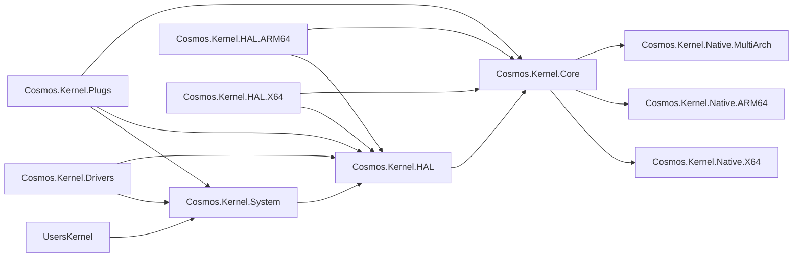

# Organisation d'un projet de noyau

Le noyau Cosmos est composé de projets organisés en couches afin d'imposer un graphe de dépendances propre. Les dépendances vont **uniquement vers le bas** : un projet ne doit jamais référencer un projet situé au-dessus de lui dans la hiérarchie.

## Graphe des dépendances

## Description des projets

| Projet | Rôle |
|---------|---------|
| **Cosmos.Kernel.System** | API de haut niveau du système d'exploitation : Console, FileSystem (le VFS avec les systèmes de fichiers FAT, ext2 et ISO 9660), Graphics (avec les types 3D à activer explicitement sous `Graphics.Rendering3D`), Input, Network (avec le point d'extension expérimental des paquets sous `Network.Protocols`), Timers. C'est la couche avec laquelle interagissent les noyaux utilisateurs. |
| **Cosmos.Kernel.Drivers** | Les vingt-cinq pilotes que Cosmos livre au-dessus du kit de pilotes : les pilotes de l'hôte PCI et du port racine PCI Express, le pilote Intel E1000E, les pilotes des transports virtio PCI et MMIO, les pilotes virtio-net et virtio-input, les quatre pilotes d'affichage, `VirtioGpuDriver`, `VmwareSvgaDriver` (avec sa couche de commandes SVGA3D et `Canvas3D`), `AmdDcnDriver` et `IntelGraphicsDriver`, les trois pilotes bloc, `AhciDriver`, `NvmeDriver` et le pilote feuille virtio `VirtioBlkDriver`, dont le gestionnaire de stockage consomme les disques, le pilote HD Audio, `HdAudioDriver`, les pilotes USB : `XhciDriver`, `EhciDriver` et `OhciDriver` avec les pilotes de classe du hub, du clavier HID en mode boot, de la souris HID en mode boot et du stockage de masse, et les pilotes PS/2 : `I8042Driver` avec `Ps2KeyboardDriver` et `Ps2MouseDriver`. Chaque pilote se trouve dans un dossier type de bus / catégorie / pilote, et son espace de noms suit le dossier ([Dossiers des pilotes](coding-guidelines.md#driver-folders)) : `Pci/` (`Audio/HdAudio`, `Bus/Ehci`, `Bus/Ohci`, `Bus/PcieRootPort`, `Bus/VirtioPci`, `Bus/Xhci`, `Display/AmdDcn`, `Display/IntelGraphics`, `Display/VmwareSvga`, `Network/E1000E`, `Storage/Ahci`, `Storage/Nvme`), `Platform/Bus/` (`I8042`, `PciHost`, `VirtioMmio`), `Ps2/Input/` (`Ps2Keyboard`, `Ps2Mouse`), `Usb/` (`Bus/UsbHub`, `Input/UsbKeyboard`, `Input/UsbMouse`, `Storage/UsbMassStorage`) et `Virtio/` (`Display/VirtioGpu`, `Input/VirtioInput`, `Network/VirtioNet`, `Storage/VirtioBlk`), si bien que le pilote xHCI est `Cosmos.Kernel.Drivers.Pci.Bus.Xhci.XhciDriver`. C'est un assembly de pilotes de la couche User (`CosmosDriverAssembly`), que l'analyseur de couches restreint à ce qu'un auteur de noyau peut nommer, et auquel aucun projet n'accorde d'autorisation `InternalsVisibleTo` ; un seul package `lib/net10.0` sans RID, puisqu'il ne contient aucun code propre à une architecture. Il est référencé par Cosmos.Kernel, si bien que chaque noyau embarque ses pilotes dans le manifeste. |
| **Cosmos.Kernel.HAL** | Couche d'abstraction matérielle : la logique partagée, les contrats de plateforme, tous internes (`Boot/` : le contrat de démarrage `IPlatformInitializer` et l'enregistrement de la plateforme `PlatformHAL` ; `Timers/` : la base de la source de ticks avec ses entrées de minuteur (chaque handle `SoftwareTimer` de **System** en enveloppe une)), les catégories de périphériques (`Devices/` : `Display/` (avec les facettes d'écran), `Input/`, `Network/` et `Storage/`, chacune contenant le contrat et le vocabulaire du type de périphérique, le récepteur par lequel un pilote rend compte (le type bloc n'en a pas) et le consommateur interne de l'anneau supporté ; `IBlockDevice`, que les noyaux implémentent et pilotent directement, et `MacAddress` sont les types stables), le kit de pilotes (`DriverKit/`, avec le pilote et sa liaison à sa racine, ce qu'une liaison fournit sous `Resources/`, `Interrupts/` et `Threading/`, ses six types de bus sous `DriverKit/Buses/` (synthétique, plateforme, PCI, virtio, USB et PS/2, un dossier chacun), et son registre et son moteur internes sous `DriverKit/Engine/`). L'écran du firmware que le kit publie au-dessus du framebuffer de démarrage se trouve avec le type écran. Aucun code unsafe ([Code unsafe](coding-guidelines.md#unsafe-code)). [Dossiers de la HAL](coding-guidelines.md#hal-folders) donne les règles de ses dossiers. |
| **Cosmos.Kernel.HAL.X64** | Code de plateforme x86-64 : la description de la machine (les nœuds 8042 et hôte PCI), le routage des lignes de l'I/O APIC, le PIT et la RTC CMOS. Aucun pilote de périphérique. |
| **Cosmos.Kernel.HAL.ARM64** | Code de plateforme ARM64 : la description de la machine (l'hôte ECAM et les emplacements virtio-mmio, issus de la table MCFG d'ACPI, du device tree ou de la table de la machine virt), le routage des lignes du GIC, le minuteur générique et la RTC PL031. Aucun pilote de périphérique. |
| **Cosmos.Kernel.Core** | Runtime bas niveau : gestion de la mémoire, GC, ordonnanceur, E/S série, routine de traitement des paniques, le CSPRNG du noyau derrière `RandomNumberGenerator` ([Nombres aléatoires](../user/random.md)), et ce que le chargeur d'amorçage et le firmware transmettent (`Firmware/` : le framebuffer de démarrage, l'analyseur de device tree que lit la description ARM64, l'heure de démarrage, le pont vers la table ACPI MCFG que le code de démarrage natif analyse, et l'horloge lue via les services runtime UEFI). C'est la couche du noyau qui contient le code unsafe : les couches supérieures atteignent la mémoire par ses points d'entrée fondés sur les adresses (`MemoryBlock` avec `PageAllocator.AllocBlock`, `AddressSpace.HhdmOffset`). |
| **Cosmos.Kernel.Native.X64** | Fichiers assembleur x86-64 (`.s`, syntaxe GAS) : stubs d'interruption, changement de contexte, SIMD. |
| **Cosmos.Kernel.Native.ARM64** | Fichiers assembleur ARM64 (`.s`, syntaxe GAS) : vecteurs d'exception, changement de contexte. |
| **Cosmos.Kernel.Native.MultiArch** | Code C natif multiplateforme (ACPI, stubs de la libc). |
| **Cosmos.Kernel.Plugs** | Remplacements de méthodes au niveau IL pour les types de la BCL (`Console`, `Thread`, `Environment`, etc.). |
| **Cosmos.Kernel.Boot.Limine** | Intégration du protocole du chargeur d'amorçage Limine. |
| **Cosmos.Kernel** | L'agrégateur que référence chaque noyau. Il intègre Boot.Limine, Core, Drivers, HAL, Plugs et System, livre les sources C d'amorçage `kmain`, et contient l'initialiseur de bibliothèque qui câble les gestionnaires d'exceptions du CPU et l'ordonnanceur. Aucun type public. |

## Projets du système de build

| Projet | Rôle |
|---------|---------|
| **Cosmos.Build.Patcher** | Patcher IL : applique les plugs et les correctifs au moment du build. |
| **Cosmos.Build.Ilc** | Intégration personnalisée d'ILC (compilateur IL) pour NativeAOT. |
| **Cosmos.Build.Asm** | Compilation de l'assembleur avec Clang (fichiers `.s` en syntaxe GAS pour x64 comme pour ARM64). |
| **Cosmos.Build.CC** | Compilation croisée avec Clang pour les cibles bare-metal x64 et ARM64. |
| **Cosmos.Build.Common** | Propriétés de build partagées, sélecteur d'architecture. |
| **Cosmos.Build.API** | Attributs de plug (`[Plug]`, `[PlugMember]`) et énumérations. |
| **Cosmos.Build.Analyzer.Patcher** | Analyseur Roslyn qui vérifie la correction des plugs. |

## Règles

- Ne référencez **jamais** vers le haut (Core ne doit référencer ni HAL ni System)
- Ne référencez **jamais** un projet HAL propre à une plateforme depuis Core
- Les préoccupations transversales (mémoire, ordonnanceur, série) vont dans **Core**
- Le code unsafe va dans **Core** : HAL, HAL.X64, HAL.ARM64, System et Drivers se compilent avec `AllowUnsafeBlocks=false`, et ce dont ils ont besoin de la mémoire ou du firmware est un point d'entrée de Core
- Le code de plateforme (descriptions de machine, routage des lignes d'interruption, sources de ticks, horloges du firmware) va dans **HAL.X64** / **HAL.ARM64** ; les pilotes de périphériques vont dans **Cosmos.Kernel.Drivers**, au-dessus du kit
- Les API destinées aux utilisateurs vont dans **System**
- Les contrats matériels que l'anneau supporté partage encore (`IBlockDevice`, `MacAddress`) sont définis dans **HAL**, hors du point d'extension expérimental du kit ; les autres types des catégories de périphériques, à côté d'eux sous `Devices/`, relèvent du point d'extension, et le périphérique réseau que pilote la pile est interne à **System**
- Un pilote écrit au-dessus du kit de pilotes pour un périphérique qu'atteignent les bus du kit va dans **Drivers**, qui ne référence que System et HAL, et jamais les assemblies d'architecture

Pour le style de code et les modèles d'implémentation, consultez les [Règles de codage](coding-guidelines.md).
