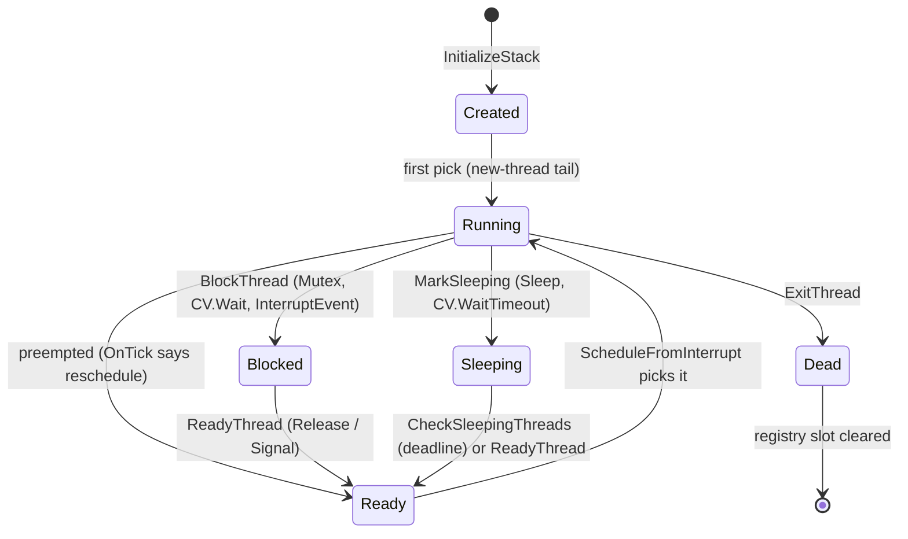
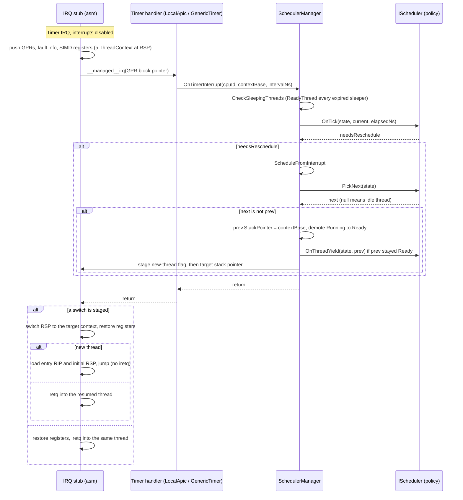
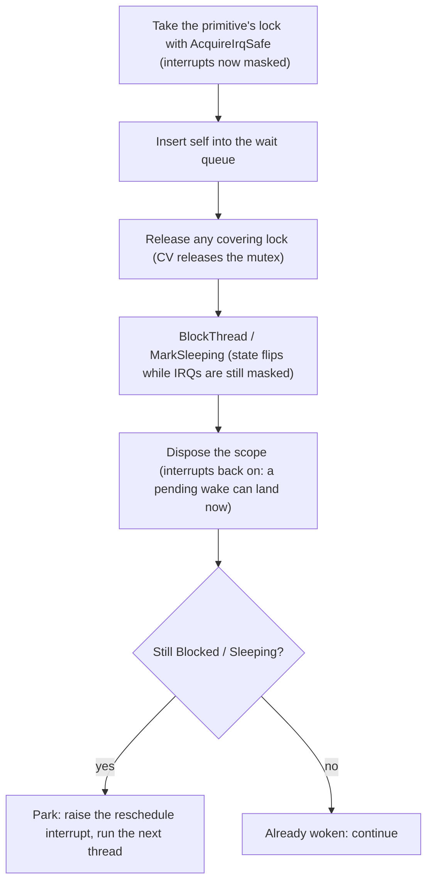

## Vue d'ensemble

L'ordonnanceur est **[préemptif](sched-concepts/preemption.md)**, **[interchangeable](../user/scheduler-plugging.md)** et, par défaut, **[à partage équitable en temps virtuel](sched-concepts/virtual-time-fair-share.md)**. Chaque changement de contexte a lieu en contexte d'interruption : le tick matériel arrive, le stub d'interruption a déjà sauvegardé les registres du thread courant sur sa pile, et l'ordonnanceur décide vers quelle pile sauvegardée l'interruption retourne. Il n'y a pas de thread dédié à l'ordonnanceur et, aujourd'hui, pas de changement volontaire qui fonctionne : un thread s'exécute jusqu'à ce qu'une sortie d'interruption bascule vers un autre (le tick, ou une interruption de périphérique dont le gestionnaire d'interruption a réveillé un autre thread), jusqu'à ce qu'il se mette en attente sur une primitive bloquante, ou jusqu'à ce qu'il se termine. Chaque terme lié dispose d'une courte note de contexte dans le [glossaire](scheduler-glossary.md) ; « interchangeable » renvoie plutôt au guide pratique.

La conception sépare [la politique du mécanisme](sched-concepts/policy-and-mechanism.md). Le mécanisme est fixe et partagé : le registre des threads, les transitions du cycle de vie, le point d'entrée du tick du minuteur, l'assembleur qui sauvegarde et restaure les registres, et le pont par lequel le GC parcourt les threads. La politique, c'est-à-dire tout ce qui décide *quel* thread s'exécute *quand*, est une interface unique, [`IScheduler`](https://github.com/CosmosOS/Cosmos/blob/gen3/src/Cosmos.Kernel.Core/Scheduler/IScheduler.cs), que n'importe quel algorithme peut implémenter. L'implémentation par défaut est [Stride](#the-stride-policy), un ordonnanceur à partage équitable en temps virtuel ; [Écrire un ordonnanceur](../user/scheduler-plugging.md) montre comment la remplacer.

Au démarrage, [`LibraryInitializer`](https://github.com/CosmosOS/Cosmos/blob/gen3/src/Cosmos.Kernel/Internal/Runtime/CompilerHelpers/LibraryInitializer.cs) met tout en place lorsque le commutateur de fonctionnalité est activé : il appelle `SchedulerManager.Initialize` avec le nombre de CPU, crée un thread inactif par CPU et en fait le thread courant de ce CPU (le thread inactif est le noyau en cours de démarrage lui-même, il ne possède donc pas de pile séparée), installe un `StrideScheduler` par-dessus, bascule `SchedulerManager.IsRunning`, et démarre enfin le minuteur de l'ordonnanceur avec un quantum de 10 ms. Les threads inactifs viennent en premier parce que les statiques de thread vivent sur le thread courant et qu'un hook de politique peut exécuter un constructeur de classe, dont l'exécuteur prend un verrou indexé par une statique de thread. À partir de ce premier tick, le flux principal du noyau n'est plus que le thread inactif, préempté comme n'importe quel autre.

Tout ce que fait l'ordonnanceur est contraint par les deux consommateurs qui voient son état de l'extérieur : l'interruption du minuteur et le ramasse-miettes. L'interruption peut se déclencher à n'importe quelle [frontière d'instruction](sched-concepts/instruction-boundary.md) : après une instruction machine, avant la suivante, n'importe où dans le flux, coupant en deux toute séquence de code de plus d'une instruction. Chaque transition d'état s'exécute donc avec les interruptions désactivées, et les primitives bloquantes suivent un [protocole de mise en attente](#the-park-protocol) strict, pour qu'un réveil arrivant au milieu d'une transition ne soit jamais perdu. Et le [ramasse-miettes](garbage-collector.md) parcourt le [registre des threads](#thread-registry) pendant les collectes, si bien que chaque thread vivant doit être enregistré et que son état sauvegardé doit se trouver exactement là où le registre l'indique.

Le code se trouve dans `src/Cosmos.Kernel.Core/Scheduler/`. [`SchedulerManager`](https://github.com/CosmosOS/Cosmos/blob/gen3/src/Cosmos.Kernel.Core/Scheduler/SchedulerManager.cs) est le mécanisme ; `Stride/` contient la politique par défaut ; les primitives de synchronisation et le service d'alarmes occupent leurs propres fichiers à côté. La sauvegarde et la restauration des registres propres à chaque architecture se trouvent dans les projets natifs. La carte complète des fichiers se trouve dans [Fichiers source](#source-files), à la fin de cet article.

---

## Modèle des threads

Cette section explique ce qu'est physiquement un thread : le bloc de contrôle, la pile sur laquelle il s'exécute, l'instantané des registres qui le préserve d'une préemption à l'autre, et le registre qui le rend visible à l'ordonnanceur et au GC.

### Le bloc de contrôle de thread

Un [`SchedulerThread`](https://github.com/CosmosOS/Cosmos/blob/gen3/src/Cosmos.Kernel.Core/Scheduler/SchedulerThread.cs) est une classe managée sur le tas du GC :

| Champ | Rôle |
|-------|---------|
| `Id`, `CpuId` | Identifiant unique au niveau global (un simple compteur incrémenté) et le CPU attribué |
| `State` | L'un de `Created`, `Ready`, `Running`, `Blocked`, `Sleeping`, `Dead` |
| `Flags` | `IdleThread`, `Pinned`, `Managed` ; les bits 8 à 15 sont réservés aux ordonnanceurs. `IsIdle` lit le premier : le thread que les primitives bloquantes font tourner en boucle ou scruter au lieu de le mettre en attente |
| `StackBase`, `StackSize`, `StackPointer` | L'allocation de la pile et le pointeur de pile sauvegardé (voir plus bas) |
| `InstructionPointer` | Le point d'entrée, placé dans le contexte initial. Comptabilité du gestionnaire, hors du point d'extension |
| `LastScheduledAt`, `WakeupTime` | Comptabilité tenue par le gestionnaire, hors du point d'extension ; `WakeupTime` est l'échéance du sommeil en ticks de `Stopwatch` |
| `TotalRuntime` | Temps CPU cumulé, imputé au thread courant par la politique active |
| `AllocContext` | Le [TLAB](gc-concepts/tlab.md) du thread (voir [l'article sur le GC](garbage-collector.md#alloccontext-tlab)) |
| `_threadStaticStorage` | Le stockage des champs `[ThreadStatic]`, transmis à CoreLib par référence |
| `_exceptionDispatchState` | L'état du répartiteur d'exceptions pour ce thread, qui lance, déroule et intercepte ses exceptions sur sa propre pile : la tête de sa chaîne ExInfo, sa garde contre un lancement depuis l'intérieur d'une répartition, et les funclets qui s'exécutent dessus. `ExceptionHelper.State` le lit par référence, et le code de démarrage utilise l'état propre du répartiteur tant qu'il n'est pas encore un thread de l'ordonnanceur (valentinbreiz/nativeaot-patcher#440) |
| `SchedulerData` | Un unique emplacement `object?` auquel l'ordonnanceur actif rattache sa comptabilité (hérité de `SchedulerExtensible`) |

Deux drapeaux modifient le comportement ailleurs :

- `Pinned` : le thread ne doit pas migrer d'un CPU à l'autre. `SelectCpu` et `Balance` de Stride le respectent.
- `Managed` : le paramètre d'entrée est un `GCHandle` d'un `System.Threading.Thread`, et le trampoline d'entrée appelle `Thread.StartThread` de CoreLib au lieu de décoder le paramètre comme une `Action` libre.

### Pile par thread

`SchedulerThread.InitializeStack` alloue un bloc contigu, de `DefaultStackSize` = 256 Kio quand le créateur ne précise pas de taille (les demandes explicites sont respectées jusqu'à un plancher de 64 Kio ; voir [Création et première exécution](#creation-and-first-run)). Le contexte de registres d'un thread qui ne s'est pas encore exécuté est fabriqué en bas (à l'adresse la plus basse, arrondie au multiple de 16 octets supérieur), et la pile d'appels utilisable croît vers le bas, du sommet vers lui :

`StackPointer` pointe toujours sur le contexte sauvegardé courant, si bien que le stub IRQ sait d'où restaurer et que le GC sait où commence l'état sauvegardé d'un thread en attente. Pour un thread `Created`, il s'agit du contexte fabriqué à la base montré ci-dessus, que la première exécution consomme ; à partir de là, chaque préemption sauvegarde un nouveau contexte à la position de pile, quelle qu'elle soit, où l'interruption est tombée, et `StackPointer` le suit. Deux planchers de taille comptent (issue [#433](https://github.com/valentinbreiz/nativeaot-patcher/issues/433)) :

- `DefaultStackSize` doit rester au-dessus de 128 Kio, le `MinExecutionStackSize` de CoreLib : `RuntimeHelpers.EnsureSufficientExecutionStack` compare le pointeur de pile courant aux bornes que rapporte le runtime, et une pile plus petite lui fait lever une exception à chaque appel.
- La pile de démarrage est séparée : le noyau demande 1 Mio à Limine, et [`BootStack`](https://github.com/CosmosOS/Cosmos/blob/gen3/src/Cosmos.Kernel.Core/Runtime/BootStack.cs) capture son sommet avant que le moindre code managé ne s'exécute. Le code qui s'exécute avant le démarrage de l'ordonnanceur (et le thread inactif, qui ne possède aucune allocation propre) rapporte plutôt ces bornes.

Il n'y a pas de page de garde : un thread dont la récursion dépasse `StackBase` empiète directement sur ce que l'allocateur a placé en dessous, et rien ne détecte le débordement.

### Le contexte sauvegardé

[`ThreadContext`](https://github.com/CosmosOS/Cosmos/blob/gen3/src/Cosmos.Kernel.Core/Scheduler/ThreadContext.X64.cs) reproduit, champ pour champ, le cadre que le stub IRQ empile quand une interruption se déclenche. Cette équivalence est l'astuce centrale : préempter un thread et créer un thread produisent la même structure, si bien que reprendre l'un ou l'autre passe par le même chemin de code.

| | x64 (448 octets) | ARM64 (816 octets) |
|---|---|---|
| Zone SIMD | `Xmm[256]` (XMM0 à XMM15) | `Neon[512]` (Q0 à Q31) |
| Registres généraux | De R15 jusqu'à RAX (15 emplacements dans l'ordre mémoire ; le stub empile RAX en premier) | X0 à X30 |
| Informations de faute | `Interrupt`, `CpuFlags`, `Cr2`, plus un emplacement relais `TempRcx` | `Interrupt`, `CpuFlags` (ESR_EL1), `Far` (FAR_EL1) |
| Cadre de retour | `Rip`, `Cs`, `Rflags`, `Rsp`, `Ss` (le cadre de `iretq`) | `Sp`, `Elr`, `Spsr` |

(Les lignes suivent l'ordre mémoire de x64 ; sur ARM64, le cadre de retour se trouve avant les informations de faute.)

Pour un nouveau thread, `ThreadContext.Initialize` fabrique l'instantané qu'aurait un thread préempté : tous les registres à zéro sauf l'argument d'entrée (RDI sur x64, X0 sur ARM64), un pointeur de cadre nul pour que les parcours de pile s'arrêtent, le point d'entrée dans l'emplacement de reprise (`Rip` / `Elr`), et un pointeur de pile initial aligné (sur x64, le sommet aligné sur 16 puis diminué de 8, l'état qui suit un `call` et qu'attend l'ABI ; sur ARM64, simplement aligné, puisque AArch64 garde SP aligné sur 16 en permanence).

### Registre des threads

`SchedulerManager` possède un tableau plat et fixe `SchedulerThread?[256]` (`SchedulerThread.MaxThreadCount`), alloué une seule fois dans `Initialize` et exposé sous le nom `SchedulerManager.Threads`. Chaque thread vivant occupe un emplacement depuis `CreateThread` jusqu'à ce que `ExitThread` le libère ; les threads bloqués et endormis restent enregistrés même si aucune file d'exécution ne les contient.

Le registre existe pour le GC. Pendant une collecte, la phase de marquage parcourt directement le tableau, sans répartition par interface (une répartition par interface peut allouer, et rien ne doit allouer au milieu d'une collecte), et parcourt la pile de chaque thread enregistré ; un thread absent du registre continuerait de s'exécuter pendant que le GC libère les objets vers lesquels pointe sa pile. C'est aussi le point dangereux de la capacité fixe : quand le registre est plein, `RegisterThread` journalise un avertissement et abandonne l'enregistrement, mais le thread est quand même mis en file et s'exécute quand même, sans que sa pile soit parcourue (issue [#444](https://github.com/valentinbreiz/nativeaot-patcher/issues/444)).

---

## Cycle de vie

Chaque transition s'exécute avec les interruptions masquées : les points d'entrée de `SchedulerManager` ci-dessous prennent `InternalCpu.DisableInterruptsScope()`, et le changement lui-même (`ScheduleFromInterrupt`) compte sur le fait de s'exécuter déjà en contexte d'interruption. Chaque point d'entrée notifie la politique active par le hook `IScheduler` correspondant ; le tableau indique ce qu'il fait d'autre :

| Point d'entrée | Changement d'état | Hook de politique | En outre |
|-------------|--------------|-------------|------|
| `CreateThread` | aucun (`InitializeStack` a déjà fixé `Created`) | `OnThreadCreate` | enregistre le thread dans le registre |
| `ReadyThread` | `Ready`, sauf si le thread est encore `Created`, après le hook | `OnThreadReady` | positionne le drapeau par CPU `_needReschedule` |
| `BlockThread` | `Blocked` | `OnThreadBlocked` | positionne `_needReschedule` |
| `MarkSleeping` | `Sleeping`, après le calcul de `WakeupTime` | `OnThreadBlocked` | pas d'arrêt ; l'appelant se met lui-même en attente (voir [le protocole de mise en attente](#the-park-protocol)) |
| `Sleep` | via `MarkSleeping` | | puis `Park` |
| `Park` | aucun | aucun | positionne `_needReschedule` et déclenche l'interruption de réordonnancement du contrôleur ; revient une fois que le thread s'exécute à nouveau (voir [Mise en attente](#parking)) |
| `YieldThread` | aucun | aucun ; le changement qu'il demande appelle `OnThreadYield` | positionne `_needReschedule` et revient avant le changement |
| `ExitThread` | `Dead` | `OnThreadExit` | exécute le callback de sortie, rend le TLAB au GC, libère l'emplacement du registre |

Trois détails sont délibérés :

- Un thread `Created` garde cet état même après que `ReadyThread` l'a mis en file. `ScheduleFromInterrupt` se sert de `State == Created` pour détecter une première exécution, qui a besoin du chemin de sortie particulier décrit plus bas.
- `ReadyThread`, `BlockThread` et `YieldThread` positionnent `_needReschedule` pour que la sortie d'interruption suivante réordonnance immédiatement. Sans cela, un thread réveillé par une interruption de périphérique resterait dans la file d'exécution jusqu'à un quantum entier, un thread qui vient de se bloquer tournerait dans sa boucle d'arrêt pendant le reste de son quantum, et un thread qui cède la main garderait le CPU jusqu'à l'épuisement de son quantum.
- `WakeupTime` est stocké en ticks de `Stopwatch`, pas en nanosecondes. La vérification faite au tick compare avec `Stopwatch.GetTimestamp()`, et la conversion en passant par les nanosecondes déformait les délais d'un facteur 16 sur le minuteur à 62,5 MHz d'ARM64.

### Création et première exécution

Le code du noyau crée les threads par un seul point de passage : l'export `SystemNative_CreateThread` de [`libSystemNative.cs`](https://github.com/CosmosOS/Cosmos/blob/gen3/src/Cosmos.Kernel.Core/Bridge/Interop/libSystemNative.cs), qui sert d'implémentation au P/Invoke `Interop.Sys.CreateThread` de CoreLib. Ainsi, `new System.Threading.Thread(...).Start()` dans du code noyau passe par CoreLib jusqu'à cet export, qui arrondit la taille de pile demandée au multiple de page supérieur (plancher de 64 Kio), construit un `SchedulerThread` marqué `Managed`, fait pointer son contexte sur le trampoline `ThreadNative.EntryPointStub`, et appelle `CreateThread` puis `ReadyThread`. (`System.Threading.Thread` ne porte aucun plug : `Thread.CreateThread` exécute le corps non modifié de CoreLib, et `Thread.Yield` atteint le `RhYield` du runtime.)

Les threads du kit de pilotes (son worker, et le thread `TryStartThread` d'un pilote, comme les threads de branchement à chaud des pilotes de contrôleurs hôtes USB ou le thread de slot du pilote de port racine PCI Express), ainsi que le thread de finalisation du collecteur tant que `GarbageCollector.ThreadedFinalizer` est activé, ne passent pas par CoreLib : `Thread.Start` ne revient qu'une fois que le nouveau thread s'est exécuté, si bien que sur une machine où rien ne bascule jamais vers lui (un minuteur qui ne produit jamais de tick, ou un CPU de démarrage dont l'APIC ID n'est pas 0, et dont les ticks n'ordonnancent jamais rien), il tourne en boucle indéfiniment. [`KernelThread.TryStart`](https://github.com/CosmosOS/Cosmos/blob/gen3/src/Cosmos.Kernel.Core/Scheduler/KernelThread.cs) construit lui-même le `SchedulerThread`, sans le drapeau `Managed` et avec un `GCHandle<Action>` pour paramètre, puis attend que le thread fasse passer un mot de synchronisation de « en attente » à « démarré ». Il attend aussi longtemps que l'ordonnanceur fonctionne, et ne s'arrête que sur les deux pannes pour lesquelles il existe : aucun tick pendant `KernelThread.NoTickTimeoutMs` (1 s) de temps `Stopwatch`, c'est-à-dire un minuteur qui s'est arrêté, ou `KernelThread.NoSwitchTicks` (10) de `SchedulerManager.TickCount` sans que `SchedulerManager.SwitchCount` bouge, c'est-à-dire des ticks qui ne basculent vers rien. Tant que les ticks basculent entre les threads, la politique donne son tour au nouveau thread, quel que soit le nombre de quanta que prennent les threads qu'elle classe avant lui : un thread Stride réveillé peut se trouver deux quanta derrière la valeur de pass globale, si bien que plusieurs ticks peuvent s'écouler avant qu'un nouveau thread ne s'exécute. Aucune des deux bornes n'est mesurée à partir du démarrage du nouveau thread lui-même, et aucune n'est une simple durée : sous émulation, le TSC ou le compteur du generic timer suit le temps de l'hôte, si bien qu'un CPU virtuel que l'hôte a retiré de l'ordonnancement voit passer des millisecondes sans recevoir aucun tick. Quand l'attente se termine, il fait passer le mot à « abandonné » à la place ; les deux compare-exchange tranchent la course, et un thread qui la perd revient sans exécuter son point d'entrée. Un thread qui ne s'est jamais exécuté est aussi retiré immédiatement de la file d'exécution par `ExitThread` : laissé en file, la prochaine interruption de périphérique basculerait quand même vers lui, et sa sortie mettrait le CPU en attente jusqu'à un tick de minuteur qu'une telle machine ne délivre jamais.

La première exécution d'un thread `Created` ne peut pas se terminer par `iretq`, parce qu'il n'y a aucun cadre interrompu vers lequel retourner. Le chemin de sortie IRQ reçoit plutôt l'ordre (par un drapeau préparé depuis le C#) de prendre la fin de chemin réservée aux nouveaux threads : il charge depuis le contexte le point d'entrée et le pointeur de pile initial fabriqué, réactive les interruptions au passage, et saute. Le point d'arrivée est toujours `EntryPointStub`, qui transmet à `SchedulerManager.InvokeCurrentThreadStart` : celui-ci décode le paramètre (`Thread.StartThread` de CoreLib pour les threads `Managed`, un `GCHandle<Action>` sinon), l'exécute dans un catch-all pour qu'un thread qui lève une exception se termine avec le code 1 au lieu d'emporter le noyau, et finit par `ExitThread` suivi d'une boucle d'arrêt. Après cette première entrée, rien ne distingue plus le thread d'un thread préempté quelconque.

---

## Préemption

Cette section explique comment le tick devient un changement de contexte : quel matériel le déclenche, ce que sauvegarde le chemin d'interruption, comment la décision de la politique est préparée, et comment le chemin de sortie la consomme.

### Sources de minuteur

L'ordonnanceur ne possède pas de minuteur ; il expose `OnTimerInterrupt` et laisse la plateforme l'appeler. Le câblage diffère selon l'architecture :

| Architecture | Tick de l'ordonnanceur | Minuteurs logiciels ([Minuteurs et alarmes](#timers-and-alarms)) |
|--------------|----------------|------------------------------|
| x64 | Minuteur LAPIC, vecteur 239, périodique, 10 ms | PIT sur l'IRQ 0, ponctuel, réarmé à chaque interruption, 10 ms |
| ARM64 | Generic Timer, INTID 30, réarmé à chaque interruption, 10 ms | même interruption, traitée avant le tick de l'ordonnanceur |

Dans les deux cas, le gestionnaire d'interruption passe l'intervalle *configuré* comme `elapsedNs`, et non un temps écoulé mesuré, et calcule lui-même l'adresse du contexte sauvegardé : l'entrée IRQ managée reçoit un pointeur vers le bloc des registres généraux, et le gestionnaire d'interruption soustrait la zone de sauvegarde SIMD (256 octets sur x64, 512 sur ARM64) pour retrouver la base du `ThreadContext`. C'est cette adresse que contiendra le `StackPointer` d'un thread préempté.

### Le tick

La politique ne touche jamais un registre. Tout ce qui se passe entre la sauvegarde et la restauration du stub est du C# managé ordinaire qui opère sur `SchedulerThread` et `PerCpuState` ; le passage de relais, dans chaque sens, tient en un pointeur. La file d'exécution ne contient jamais deux fois le même thread, et `Ready` signifie « en file ». La comptabilité de sortie remet `prev` en file par `OnThreadYield` (le hook de remise en file de la politique), en le rétrogradant à `Ready`, uniquement s'il était `Running`. Un thread qui s'est bloqué ou endormi juste avant le tick garde son état d'attente et n'est pas remis en file, et un thread déjà `Ready` est déjà en file : il s'est mis en attente et un réveil l'a rendu prêt avant que le changement ne le retire du CPU (la vérification des threads endormis faite au tick réveille un thread endormi au tick même qui le ferait sortir du CPU). Quand la politique rend l'entrée du thread courant lui-même, le thread reste sur le CPU et repasse à `Running`. `ReadyThread` ne fait rien pour un thread déjà `Ready` ou `Running`, et `YieldThread` ne met lui-même rien en file : le changement qu'il demande remet le thread en file comme n'importe quel autre `prev` `Running`. Une seconde entrée n'est pas anodine : le pass du thread continue de monter pendant que l'entrée périmée garde sa place, si bien que la file cesse d'être triée, et `PickNext`, qui ne prend que la tête, n'atteint jamais ce qui a été mis en file derrière cette entrée.

La préparation elle-même consiste en deux écritures dans des variables globales natives : d'abord le drapeau de nouveau thread, puis le pointeur de pile cible (`_context_switch_target_rsp` ; une valeur non nulle signifie qu'il faut changer de thread). Chacun des 256 vecteurs d'interruption vérifie cette variable globale en sortie, si bien que n'importe quelle interruption peut effectuer un changement préparé, pas seulement celle du minuteur. Les variables de préparation sont des globales uniques, une raison de plus qui cantonne pour l'instant le noyau à un seul CPU.

### Réveiller depuis un gestionnaire d'interruption

Les gestionnaires d'interruption des périphériques réveillent aussi des threads : le gestionnaire d'interruption signalée par message du pilote NVMe signale un `DeviceEvent` du kit de pilotes, un [`InterruptEvent`](#interruptevent) en dessous, dont le thread en attente doit s'exécuter. Le seul chemin du tick laisserait ce thread en file jusqu'à un quantum entier, si bien que les réveils prennent un raccourci. `ReadyThread` (ainsi que `BlockThread` et `YieldThread`) positionnent un drapeau par CPU `_needReschedule`, et le répartiteur d'interruptions appelle `ReschedulePendingFromIrq` à la sortie d'une interruption matérielle traitée : si le drapeau est positionné et qu'aucun changement n'est déjà préparé pour cette interruption, il exécute `ScheduleFromInterrupt` sur place, sur le chemin de sortie de l'interruption du périphérique elle-même. La vérification du changement déjà préparé compte : le gestionnaire d'interruption du minuteur a pu préparer un changement pendant la même interruption, et un second `ScheduleFromInterrupt` sauvegarderait le pointeur de pile de ce cadre dans un thread dont le vrai contexte se trouve ailleurs.

### Mise en attente

Un thread qui se bloque ou s'endort cède le CPU par `SchedulerManager.Park`, appelé après son changement d'état, une fois sa portée sans IRQ libérée. `Park` positionne `_needReschedule` et déclenche l'interruption de réordonnancement du contrôleur sur le CPU courant (`IInterruptController.TryRaiseReschedule`). Son gestionnaire d'interruption ne fait rien : l'interruption n'existe que pour sa sortie, qui exécute `ReschedulePendingFromIrq` et bascule vers le thread suivant.

| Architecture | Interruption de réordonnancement |
|--------------|----------------------|
| x64 | Auto-IPI du Local APIC, vecteur `0xF0` |
| ARM64 | SGI 8, par `ICC_SGI1R_EL1` sur GICv3 ou `GICD_SGIR` sur GICv2 |

`Park` attend ensuite que l'état quitte `Blocked` ou `Sleeping`, ce qui arrive une fois qu'un réveil a rendu le thread prêt et que l'ordonnanceur l'a de nouveau exécuté, ou immédiatement quand le réveil est arrivé avant le changement. S'arrêter (halt) à la place laissait le CPU inactif pendant le reste du tick chaque fois qu'un thread se bloquait. Un thread qui se met en attente avant que le contrôleur puisse déclencher l'interruption s'arrête toujours ; le thread inactif ne se met jamais en attente (voir les primitives plus bas), et s'arrête entre ses vérifications de la variable de condition.

### Ce qui n'existe pas : un changement volontaire

`SchedulerManager.Schedule` et `ContextSwitch.Switch` existent dans l'arborescence mais n'ont aucun appelant, et aucun des deux ne peut mener à bien un changement synchrone : ils ne font que *préparer* un pointeur de pile cible, le changement préparé est consommé à une sortie d'interruption, et un appelant volontaire n'a aucun cadre de registres sauvegardé par une interruption que cette sortie pourrait restaurer (l'assistant de `Schedule` ne sauvegarde même pas le pointeur de pile sortant). La seule entrée de cession volontaire qui fonctionne, le `RhYield` du runtime derrière `Thread.Yield`, emprunte plutôt le chemin d'interruption : `YieldThread` positionne `_needReschedule`, pour que la sortie de l'interruption matérielle suivante bascule même si le quantum n'est pas épuisé, et revient immédiatement. Ce changement choisit d'abord le remplaçant et remet ensuite en file le thread qui cède la main par `OnThreadYield`, exactement comme le fait une préemption, si bien que le thread n'est jamais en file pendant qu'il s'exécute encore. L'appelant n'attend pas le changement, et `Thread.Yield` indique toujours qu'aucun autre thread ne s'est exécuté : attendre coûterait jusqu'à un tick à chaque appel, alors que CoreLib appelle `Thread.Yield` à chaque tour de ses boucles « tourner puis bloquer » (sur un CPU, un worker inactif du pool de threads tourne 70 fois avant de se mettre en attente, et `Thread.Start` tourne jusqu'à ce que le nouveau thread signale qu'il a démarré). S'arrêter jusqu'au changement faisait durer ces boucles 70 ticks. Un vrai changement synchrone aurait besoin de son propre chemin de sauvegarde (l'équivalent de celui du stub IRQ, où l'on entrerait par un appel plutôt que par une interruption), qui n'existe pas encore.

---

## La politique Stride

L'[ordonnancement Stride](https://web.eecs.umich.edu/~mosharaf/Readings/Stride.pdf) est un ordonnancement à partage proportionnel, dont la comptabilité, en temps virtuel, est déterministe. Chaque thread détient des `Tickets` (100 par défaut), son poids dans le partage. Des tickets découlent un `Stride`, la constante `Stride1` (2^20) divisée par le nombre de tickets, et un `Pass`, le temps virtuel du thread. La file d'exécution reste triée par `Pass` et `PickNext` retire toujours le plus bas : le thread qui a consommé la plus petite part de son partage s'exécute ensuite. Pendant qu'un thread s'exécute, son `Pass` avance proportionnellement à son temps d'exécution (`Stride * elapsed / quantum`, soit exactement un stride par quantum complet de 10 ms), et davantage de tickets signifie un stride plus petit, un `Pass` qui monte plus lentement, et plus de CPU.

Chaque CPU porte un `StrideCpuData` : la file d'exécution (une `List<SchedulerThread>` maintenue triée par `Pass` croissant), `TotalTickets` (le partage agrégé, qui sert aussi de mesure de charge), et `GlobalPass`, l'horloge virtuelle propre au CPU, qui avance au rythme agrégé (`Stride1 / TotalTickets` par quantum). `GlobalPass` est le point de référence par rapport auquel se calculent le placement au réveil et les changements de priorité.

Ce que fait Stride dans chaque hook :

| Hook | Comportement |
|------|----------|
| `InitializeCpu` / `ShutdownCpu` | Crée / supprime le `StrideCpuData` par CPU |
| `OnThreadCreate` | Attache un `StrideThreadData` (100 tickets, `Pass = 0`) ; le thread n'est pas encore en file |
| `OnThreadReady` | Place le thread (voir le placement au réveil plus bas), l'insère trié par `Pass`, ajoute ses tickets à `TotalTickets` |
| `OnThreadBlocked` | Sauvegarde `Remain = Pass - GlobalPass`, retire le thread de la file, soustrait ses tickets |
| `OnThreadExit` | Retire le thread de la file, soustrait ses tickets, supprime la comptabilité du thread |
| `OnTick` | Fait avancer le `Pass` du thread courant et le `GlobalPass` du CPU ; réordonnance si le `Pass` de la tête de file est strictement inférieur, ou si le quantum est écoulé |
| `OnThreadYield` | Remonte `Pass` jusqu'à `GlobalPass` s'il a pris du retard, puis réinsère le thread |
| `PickNext` | Retire la tête (plus petit `Pass`) ; null sur une file vide, et le gestionnaire exécute alors le thread inactif |
| `OnPickFailed` | Réinsère un thread vers lequel le gestionnaire n'a pas pu basculer |
| `SelectCpu` | Respecte `Pinned` ; sinon accepte un CPU dont la charge (`TotalTickets`) est inférieure à 80 % de la meilleure charge trouvée jusque-là |
| `Balance` | Uniquement quand la file de ce CPU est vide : vole le thread de queue (plus grand `Pass`) au pair dont la file est la plus longue, si cette file en contient au moins deux et que le thread de queue n'est pas `Pinned` |
| `OnThreadMigrate` | Déplace les tickets entre les CPU et recale `Pass` sur `GlobalPass + Remain` de la destination |
| `SetPriority` / `GetPriority` | Fixe / lit les tickets ; lors d'un changement, l'écart courant par rapport à `GlobalPass` est mis à l'échelle par le rapport des strides, pour que la position relative soit conservée |

Le placement au réveil est l'endroit où l'équité demande du discernement. Un thread réveillé ne peut pas garder son ancien `Pass` : il a pris beaucoup de retard sur `GlobalPass` pendant son attente, et l'exécuter jusqu'à ce qu'il rattrape ce retard affamerait tous les autres. `ReadyThread` appelle le hook avant de marquer le thread `Ready`, si bien que le hook distingue un réveil (`Blocked` ou `Sleeping`) d'un premier démarrage (`Created`, placé à `GlobalPass`), et un réveil prend l'un de deux placements :

- un **plafond anti-famine**, `Pass = max(GlobalPass + Remain, GlobalPass - 2 * Stride1)` : `Remain` restitue la fraction de son quantum qui restait au thread quand il s'est bloqué, et le plafond borne le retard sur `GlobalPass` auquel un thread réveillé peut être placé ;
- un **bonus interactif**, `Pass = GlobalPass - Stride / 2`, une avance d'un demi-quantum pour les threads classés interactifs, afin que les threads pilotés par les entrées préemptent rapidement les traitements par lots. Un thread est interactif quand il est resté en attente plus de deux fois plus longtemps qu'il ne s'est exécuté depuis son réveil précédent. `OnThreadBlocked` horodate la mise en attente, `OnTick` additionne le temps d'exécution depuis le réveil, les deux sont comparés en nanosecondes, et la classification est refaite à chaque réveil, si bien qu'un thread qui devient gourmand en CPU la perd. Le côté exécution est aussi grossier que [le tick](sched-concepts/scheduler-tick.md) : un thread se voit imputer une période entière quand le tick tombe sur lui et rien quand il se met en attente avant, si bien qu'un réveil peut le juger interactif et le suivant non, pour le même comportement ; la moyenne est juste, la réponse à chaque réveil ne l'est pas. Un thread hérité en attente lors d'un changement de politique n'a ni l'un ni l'autre en mémoire : sa mise en attente est datée du changement et son temps d'exécution sur toute sa vie tient lieu de durée d'exécution, si bien que ce premier réveil peut refuser un bonus, mais jamais en accorder un que la vraie mesure refuserait.

Deux remarques d'implémentation valent pour quiconque touche à ce code. Le retrait de la file s'exécute sous `DisableInterruptsScope` et parcourt la file avec `ReferenceEquals` au lieu de `List.Remove`, parce que `EqualityComparer<T>.Default` a besoin d'assistants du runtime que le noyau n'a pas. Et `OnTick` tolère un thread dont le `SchedulerData` est déjà null (il s'est terminé au milieu d'un quantum) en réordonnançant si quoi que ce soit d'autre est en file.

---

## Primitives de synchronisation

La synchronisation bloquante repose sur trois appels du gestionnaire, `BlockThread`, `ReadyThread` et `MarkSleeping`, si bien qu'elle fonctionne sans modification sous n'importe quelle politique. Les primitives sont : `SpinLock` (non bloquant), `Mutex`, `ConditionVariable`, `Monitor` (leur composition) et `InterruptEvent` (la complétion d'une interruption vers un thread). Toutes se trouvent à côté de l'ordonnanceur parce que leur exactitude dépend des mécanismes internes de l'ordonnanceur, et surtout du protocole de mise en attente décrit plus bas.

### SpinLock et la portée sûre vis-à-vis des IRQ

[`SpinLock`](https://github.com/CosmosOS/Cosmos/blob/gen3/src/Cosmos.Kernel.Core/Scheduler/SpinLock.cs) est un verrou CAS d'un seul mot avec deux formes d'acquisition, et choisir la bonne constitue tout le contrat. Le couple simple `Acquire`/`Release` n'est sûr que pour les verrous jamais touchés depuis un contexte d'interruption : sur un seul CPU, un gestionnaire d'interruption qui tourne sur un verrou que détient le thread qu'il a lui-même interrompu tourne indéfiniment. `AcquireIrqSafe` renvoie une portée qui désactive les interruptions avant de prendre le verrou et les restaure après l'avoir relâché, dans cet ordre aux deux bouts, si bien qu'aucune interruption ne peut se déclencher pendant que le verrou est détenu sur ce CPU. Chaque verrou de `Mutex`, `ConditionVariable` et `InterruptEvent` est pris exclusivement par `AcquireIrqSafe` : leurs côtés attente détiennent le verrou avec les interruptions masquées, si bien qu'un détenteur qui l'aurait acquis de façon simple et serait préempté au milieu de la section provoquerait un interblocage de tous les autres threads qui tournent sur le verrou, et le côté signal de `InterruptEvent` s'exécute en plus bel et bien depuis des gestionnaires d'interruption.

### Le protocole de mise en attente

Une primitive bloquante doit faire passer un thread de l'exécution à l'attente alors qu'un réveil peut arriver à n'importe quelle instruction, depuis le chemin du minuteur ou depuis une interruption de périphérique. Le mode de défaillance est le réveil perdu : le thread en attente est rendu prêt *avant* d'avoir fini de se bloquer, le blocage s'applique ensuite par-dessus, et le thread ne se réveille jamais (issue [#357](https://github.com/valentinbreiz/nativeaot-patcher/issues/357), qui était exactement cette course dans `ConditionVariable.Wait`). Chaque chemin bloquant du noyau suit les trois mêmes règles :

1. **Une seule section atomique.** L'insertion dans la file, l'éventuel relâchement d'un verrou englobant et le changement d'état ont lieu dans une seule portée `AcquireIrqSafe`. Un réveil ne peut pas s'intercaler, parce que le côté signal a besoin du même verrou et que les interruptions sont masquées.
2. **Une mise en attente gardée par l'état.** `Park`, après la portée, n'agit que tant que le thread est encore en attente. Un réveil qui arrive dans la fenêtre entre la sortie de la portée et le changement remet l'état à `Ready`, et la garde le voit ; un arrêt inconditionnel dormirait sans s'en apercevoir.
3. **Des résultats fondés sur l'appartenance.** Pour les attentes avec délai, la question « ai-je été signalé ou le délai a-t-il expiré » se tranche par l'appartenance à la file d'attente, pas par des drapeaux : un signal retire le thread de la file, si bien qu'après le réveil, être encore dans la file signifie que le délai a expiré (et le thread retire sa propre entrée périmée pour qu'un signal ultérieur ne puisse pas être dépensé sur elle).

`MarkSleeping` existe comme point d'entrée séparé précisément pour la règle 1 : `Sleep` est `MarkSleeping` suivi de `Park`, mais `ConditionVariable.WaitTimeout` a besoin du changement d'état à l'intérieur de *sa* portée de verrou, si bien qu'il appelle `MarkSleeping` à cet endroit et `Park` ensuite.

### Mutex

[`Mutex`](https://github.com/CosmosOS/Cosmos/blob/gen3/src/Cosmos.Kernel.Core/Scheduler/Mutex.cs) est un verrou bloquant récursif : une référence au propriétaire, une profondeur de récursion et une liste d'attente FIFO. Une acquisition disputée se met en attente selon le protocole ci-dessus dès la première tentative échouée ; il n'y a pas de phase « tourner puis se mettre en attente ». Le relâchement à la profondeur zéro effectue un **transfert direct** : toujours sous le verrou, il retire de la file le thread en attente de tête et en fait le propriétaire avant de le rendre prêt, si bien qu'un thread en cours d'exécution ne peut pas s'interposer et reprendre le mutex pendant la latence de réveil du thread en attente. Le thread réveillé reconnaît le transfert (il possède le mutex qu'il n'a jamais acquis explicitement) et revient.

Deux cas particuliers : le thread inactif ne se met jamais en attente (le bloquer ne ferait que le faire choisir à nouveau comme repli inactif), il acquiert donc le mutex en tournant, avec les interruptions activées entre les tentatives. Et en l'absence de tout contexte de thread (ordonnanceur désactivé ou pas encore prêt), `Acquire`/`Release` ne font rien et `TryAcquire` réussit, si bien que le code du tout début du démarrage peut passer par des chemins protégés par un mutex.

### ConditionVariable et Monitor

[`ConditionVariable`](https://github.com/CosmosOS/Cosmos/blob/gen3/src/Cosmos.Kernel.Core/Scheduler/ConditionVariable.cs) fournit l'attente et le signal, intégrés à un mutex. `Wait(mutex)` s'insère dans la file, relâche le mutex et se bloque, le tout dans une seule portée (règle 1 ; relâcher le mutex hors de la portée est le bug #357), puis réacquiert le mutex au réveil. `WaitTimeout` se met en attente par `MarkSleeping` avec l'échéance, et indique « signalé » ou « délai expiré » d'après l'appartenance (règle 3). `Signal` rend prêt le thread en tête de la file FIFO ; `SignalAll` les rend tous prêts.

Même cas particulier que pour `Mutex` : le thread inactif ne se met pas non plus en attente ici. Il s'insère et relâche le mutex dans la même portée, puis vérifie la liste d'attente entre deux arrêts jusqu'à ce qu'un `Signal` l'en retire ou que l'échéance passe. Il s'arrête au lieu de tourner, contrairement au mutex (dont les détentions sont courtes par contrat) et à l'événement d'interruption (dont le signal peut venir d'une ISR qu'aucune interruption ne suit) : le signal d'une variable de condition vient d'un thread, qui ne s'exécute qu'à une sortie d'interruption, si bien que l'arrêt se termine au plus tard au tick suivant, et un noyau qui rythme son `Run` avec `Thread.Sleep` ne brûle pas le CPU pendant tout le sommeil. Le mettre en attente retirait ses tickets du total de Stride sans le réveil qui les lui rend (le repli inactif le remet en `Running`), si bien que le total débordait, que `GlobalPass` se figeait, et que les threads créés ensuite tenaient le thread principal à l'écart du CPU ; `Thread.Sleep` et `Thread.Join` de CoreLib atteignent ce chemin par le moniteur bas niveau, si bien que le thread principal du noyau y passe constamment.

[`Monitor`](https://github.com/CosmosOS/Cosmos/blob/gen3/src/Cosmos.Kernel.Core/Scheduler/Monitor.cs) compose un `Mutex` et une `ConditionVariable` selon la forme classique du moniteur ; ses `Signal`/`SignalAll` relâchent aussi le mutex, si bien que signaler fait sortir du moniteur.

### InterruptEvent

[`InterruptEvent`](https://github.com/CosmosOS/Cosmos/blob/gen3/src/Cosmos.Kernel.Core/Scheduler/InterruptEvent.cs) est la primitive de complétion d'une interruption vers un thread : un gestionnaire d'interruption le signale, un thread l'attend. Le `DeviceEvent` du kit de pilotes en enveloppe un : le pilote NVMe de `Cosmos.Kernel.Drivers` en crée un par emplacement de commande par sa liaison, et le signale depuis son gestionnaire d'interruption signalée par message, par `InterruptContext.Signal`, quand la complétion de l'emplacement arrive.

Les signaux sont **comptés**, et non mémorisés comme un simple état levé : deux signaux réveillent deux threads en attente, et les signaux qui arrivent sans aucun thread en attente sont mis en réserve et consommés un par attente future (réinitialisation automatique). Le côté signal est sûr en contexte d'interruption par construction : il prend le verrou sûr vis-à-vis des IRQ, incrémente le compteur, retire un thread en attente de la file et appelle `ReadyThread`, sans allocation ni répartition par interface sur le chemin (la liste d'attente est pré-dimensionnée à quatre, si bien que les attentes ordinaires n'allouent pas non plus sous le verrou sur lequel tourne le gestionnaire d'interruption). Ce `ReadyThread` positionne `_needReschedule`, si bien que le thread réveillé s'exécute sur le chemin de sortie de cette même interruption (voir [Réveiller depuis un gestionnaire d'interruption](#waking-from-an-interrupt-handler)).

Le côté attente suit le protocole de mise en attente, avec deux variantes. Les appelants qui ne peuvent pas se mettre en attente (le thread inactif, ou du code qui s'exécute avant que l'ordonnanceur soit prêt) scrutent le compteur de signaux avec les interruptions activées entre les vérifications, et ne s'arrêtent délibérément jamais : si l'interruption de signal se déclenchait juste avant un arrêt, aucune autre interruption ne viendrait peut-être jamais y mettre fin. Et `Wait(maxIterations)` borne l'attente par un nombre de tours de boucle, un garde-fou contre les interruptions de périphérique perdues plutôt qu'une horloge.

---

## Minuteurs et alarmes

Le travail différé comporte deux niveaux, séparés par contexte d'exécution. La règle figure dans la documentation d'API des deux : le contexte d'interruption ne doit pas bloquer, le contexte de thread le peut.

| | [`TimerManager`](https://github.com/CosmosOS/Cosmos/blob/gen3/src/Cosmos.Kernel.System/Timers/TimerManager.cs) | [`AlarmManager`](https://github.com/CosmosOS/Cosmos/blob/gen3/src/Cosmos.Kernel.System/Timers/AlarmManager.cs) |
|---|---|---|
| Le callback s'exécute en | contexte d'interruption (le tick du minuteur) | un thread noyau dédié |
| Peut bloquer, prendre un Mutex | non | oui |
| Résolution | la période de la source de ticks | le tick de l'ordonnanceur |
| Reposant sur | le registre de `TimerEntry` de la source de ticks | [`AlarmSystem`](https://github.com/CosmosOS/Cosmos/blob/gen3/src/Cosmos.Kernel.Core/Scheduler/AlarmSystem.cs) : une liste triée par échéance, un `Mutex`, une `ConditionVariable` |
| Planifié avec | `Schedule(Action, TimeSpan)`, `ScheduleRecurring(Action, TimeSpan)` | les deux mêmes signatures |
| Handle | un `SoftwareTimer`, null quand aucune source de ticks n'est enregistrée | un identifiant `ulong`, 0 quand l'ordonnanceur ne tourne pas |
| Annulé avec | `Cancel(SoftwareTimer?)` | `Cancel(ulong)` |
| Valeur de retour de l'annulation | true uniquement si le minuteur était encore en attente | true uniquement si l'alarme était encore en attente |
| Appelable depuis | n'importe quel contexte, chemin du tick compris : les membres masquent les interruptions | le contexte de thread uniquement : chaque membre prend le mutex de la liste d'alarmes et se met en attente s'il est détenu |
| Ponctuel / récurrent | les deux (la période récurrente doit être positive) | les deux (la période récurrente doit être positive) |

Les deux gestionnaires prennent les mêmes arguments dans le même ordre et signalent l'annulation de la même façon, si bien que la seule chose que choisit le site d'appel est le contexte dans lequel s'exécute le *callback*, ce que dit le nom du gestionnaire. Ce qui ne converge pas, c'est le contexte *depuis* lequel chaque gestionnaire peut être appelé : planifier ou annuler une alarme se met en attente sur un mutex, si bien que le faire depuis un callback de `TimerManager` met le thread en attente à l'intérieur de l'interruption du minuteur et fige le noyau. Les types de handle diffèrent aussi, parce qu'une alarme appartient à `AlarmSystem`, qui est interne à `Cosmos.Kernel.Core`, alors qu'un minuteur logiciel est un handle public par lequel l'anneau supporté enveloppe l'entrée du registre de la source de ticks.

Le premier niveau est proche du matériel : `TickSource` tient un registre de comptes à rebours `TimerEntry` (chaque handle `SoftwareTimer` en enveloppe un) et les fait avancer depuis son interruption de tick (`HandleTick`), en invoquant les callbacks échus sur place, en contexte d'interruption. Sur x64, le PIT fournit ce tick, séparé du tick de l'ordonnanceur que fournit le LAPIC ; sur ARM64, l'unique interruption du Generic Timer pilote les deux, les minuteurs logiciels en premier.

Le second niveau est un service entièrement bâti sur les primitives ci-dessus, et sert aussi d'exemple de référence de leur usage. `AlarmSystem` garde ses alarmes dans une liste triée par échéance, protégée par un `Mutex` ; un thread noyau démarré à la demande attend sur une `ConditionVariable` avec `WaitTimeout` borné à la prochaine échéance (ou un battement de 1 s quand il n'y a rien à faire), déclenche les alarmes échues hors du verrou dans un catch-all, et réarme les alarmes récurrentes à partir de *maintenant* plutôt qu'à partir de leur échéance nominale, si bien qu'un réveil tardif ne produit pas de rafale de rattrapage. `Add` signale la variable de condition pour qu'une nouvelle échéance plus proche raccourcisse l'attente en cours. Comme l'insertion et l'attente partagent le mutex, aucune alarme ne peut se glisser sans être vue entre le calcul de l'échéance et la mise en attente (encore la règle 1, un niveau plus haut).

---

## Intégration avec le GC

L'ordonnanceur est la source de vérité du GC pour les racines de pile ; l'histoire complète se trouve dans [l'article sur le GC](garbage-collector.md#mark-phase). Le contrat côté ordonnanceur comporte trois parties :

- **Le registre est l'ensemble des racines.** La phase de marquage parcourt directement `SchedulerManager.Threads`, un parcours de tableau plat sans répartition par interface ni allocation. Chaque thread enregistré et non `Dead` est parcouru ; un thread que le registre ne contient pas n'existe pas pour le GC.
- **Les threads en attente sont parcourus de façon conservatrice à partir de leur état sauvegardé.** Pour chaque thread qui ne s'exécute pas en ce moment, le GC lit le `ThreadContext` sauvegardé par `SchedulerThread.GetContext()` et traite les registres généraux sauvegardés comme des candidats racines (la zone SIMD et les drapeaux sont ignorés), puis parcourt chaque mot de la taille d'un pointeur, de `StackPointer` jusqu'au sommet de la pile. Le parcours précis des threads en attente nécessite le détournement d'adresse de retour, suivi dans l'issue [#385](https://github.com/valentinbreiz/nativeaot-patcher/issues/385).
- **Le thread déclencheur est parcouru de façon précise.** Le thread qui est entré dans `Collect` l'a atteint par une chaîne d'appels managés, si bien que sa pile est parcourue cadre par cadre à partir de GCInfo (voir [Parcours précis de la pile](garbage-collector-gcinfo.md)) ; l'ordonnanceur fournit les bornes de la pile.

Le parcours conservateur explique aussi pourquoi `TryMarkRoot` valide de façon agressive : un mot de pile n'est un candidat que s'il pointe dans le tas du GC, et le pointeur `MethodTable` qui s'y trouve doit se situer hors du tas et au-dessus de `AddressSpace.KernelSpaceStart` (la moitié haute du noyau) avant d'être déréférencé.

Les collectes s'exécutent avec les interruptions désactivées sur le thread déclencheur, si bien qu'aucun tick, aucun changement de thread et aucun gestionnaire d'interruption ne peut modifier l'état des threads au milieu d'un parcours. La même discipline protège l'autre sens : comme `AllocObject` est lui aussi atomique vis-à-vis des interruptions, les gestionnaires d'interruption (le tick lui-même, les pilotes d'entrée) peuvent allouer.

---

## Pont avec le runtime

Le runtime et CoreLib voient l'ordonnanceur à travers les exports de [`Runtime/Thread.cs`](https://github.com/CosmosOS/Cosmos/blob/gen3/src/Cosmos.Kernel.Core/Runtime/Thread.cs) :

| Export | Comportement |
|--------|----------|
| `RhGetCurrentThreadStackBounds` | Les vraies bornes `[StackBase, StackBase + StackSize)` du thread courant ; les bornes de la pile de démarrage avant que l'ordonnanceur ne tourne, pour le thread inactif, et quand le commutateur est désactivé (issue [#433](https://github.com/valentinbreiz/nativeaot-patcher/issues/433)) |
| `RhGetThreadStaticStorage` | Référence vers le stockage `[ThreadStatic]` du thread courant (une épine dorsale statique quand le commutateur est désactivé) |
| `RhGetDefaultStackSize` | `SchedulerThread.DefaultStackSize`, 256 Kio |
| `RhSetThreadExitCallback` | Stocke le callback qu'invoque `ExitThread` ; CoreLib s'en sert pour le nettoyage des threads managés |
| `RhYield` | Implémente `Thread.Yield` : demande un changement à la prochaine sortie d'interruption par `YieldThread` et renvoie 0 avant celui-ci ; voir [Ce qui n'existe pas](#what-there-is-not-a-voluntary-switch) |
| `RhSpinWait` | Une boucle vide comptée |
| `RhGetThreadEntryPointAddress`, `RhSetCurrentThreadName` | Des bouchons : zéro, et une ligne de journal sur le port série |

Le côté natif du changement est [`ContextSwitchNative`](https://github.com/CosmosOS/Cosmos/blob/gen3/src/Cosmos.Kernel.Core/Bridge/Import/ContextSwitchNative.cs) : cinq minuscules imports `[SuppressGCTransition]`, identiques sur les deux architectures. La paire de préparation (`_native_set_context_switch_sp`, `_native_set_context_switch_new_thread`) et l'accesseur du pointeur préparé (dont une lecture non nulle sert aussi de garde « changement déjà préparé ») pilotent le chemin de sortie ; `_native_get_sp` lit le pointeur de pile courant pour le parcours, par le GC, d'un thread en cours d'exécution ; et `_native_capture_regdisplay` amorce le parcours précis de la pile par le GC.

---

## Commutateur de fonctionnalité

L'ordonnanceur est conditionné par `CosmosEnableScheduler` dans le `.csproj` du noyau, exposé sous la forme `CosmosFeatures.SchedulerEnabled` et vérifié à trois niveaux :

- `SchedulerManager.IsEnabled` (interne) reflète le commutateur. Les points d'entrée de création (`Initialize`, `CreateThread`, `ReadyThread`) lèvent une exception quand il est désactivé ; commutateur désactivé, rien d'autre n'est atteignable, puisqu'aucun thread n'existe jamais. Sur l'anneau supporté, la même information s'exprime par `KernelFeatures.Scheduler` et `SchedulerDiagnostics.IsSupported`.
- `SchedulerManager.IsRunning` (interne) est l'interrupteur d'armement à l'exécution, lu sur l'anneau supporté sous la forme `SchedulerDiagnostics.IsRunning`. `LibraryInitializer` ne le bascule qu'une fois le gestionnaire, la politique et les threads inactifs entièrement câblés, et les points d'entrée côté interruption (`OnTimerInterrupt`, `ReschedulePendingFromIrq`) reviennent immédiatement tant qu'il n'est pas positionné, si bien que le premier tick ne peut pas entrer en course avec un ordonnanceur à moitié construit.
- `SchedulerManager.IsReady` (`IsEnabled` plus l'état initialisé) est la garde pour toucher à l'état par CPU, et celui des trois que publie le point d'extension. `Mutex` et `InterruptEvent` le vérifient littéralement ; `ConditionVariable` et les exports du runtime obtiennent le même effet par la vérification de la fonctionnalité plus la propagation de null sur l'état du CPU. Quand l'ordonnanceur n'est pas prêt, ils se dégradent : `Mutex` ne fait plus rien, `InterruptEvent` scrute au lieu de se mettre en attente, et les bornes de pile se rabattent sur la pile de démarrage.

---

## Limites et évolution

- **Un seul CPU** ([affinité CPU et répartition de charge](sched-concepts/cpu-affinity.md)). `GetCurrentCpuId()` renvoie 0, les variables de préparation du changement sont des globales uniques, et rien n'appelle jamais `SelectCpu` ni `Balance`. Les structures sont conçues par CPU (c'est le rôle de `PerCpuState`), mais le SMP nécessite une préparation par CPU, une vraie source d'identifiant de CPU et un site d'appel pour la répartition de charge.
- **Pas de changement volontaire.** Un thread qui se bloque déclenche l'interruption de réordonnancement sur son propre CPU et bascule à sa sortie, mais `Thread.Yield` ne fait que positionner `_needReschedule` et attend l'interruption suivante, jusqu'à un quantum sur un système inactif. La correction est un chemin de sauvegarde synchrone, symétrique de celui du stub IRQ.
- **Le registre plafonne à 256 threads et échoue en mode ouvert.** L'enregistrement est abandonné avec une ligne de journal alors que le thread s'exécute toujours ; le GC ne parcourt alors jamais sa pile, ce qui est une source d'utilisations après libération, et non une dégradation en douceur (issue [#444](https://github.com/valentinbreiz/nativeaot-patcher/issues/444)).
- **Pas de protection de pile.** Pas de page de garde, et le contexte sauvegardé se trouve sur le chemin du débordement des propres cadres du thread.
- **Pas d'héritage de priorité.** `Mutex` réveille dans l'ordre FIFO et transfère directement, ce qui est équitable mais [inverse les priorités](sched-concepts/priority-inversion.md) : un détenteur qui a peu de tickets n'est pas favorisé pendant qu'un thread qui en a beaucoup attend. Le hook `SetPriority` est la matière première d'un protocole d'héritage ; aucune politique n'en implémente.
- **Les threads en attente épinglent les objets qu'ils référencent.** Le parcours conservateur des piles en attente est le coût, côté GC, d'une préemption à des instructions arbitraires ; le détournement d'adresse de retour ([#385](https://github.com/valentinbreiz/nativeaot-patcher/issues/385)) est la porte de sortie.
- **Le tick est nominal.** `OnTimerInterrupt` reçoit l'intervalle configuré, pas une mesure ([le tick et le quantum](sched-concepts/scheduler-tick.md)), si bien que la comptabilité du temps dérive de tout ce que fait le matériel entre deux ticks.

---

## Tests

Deux suites de tests de noyau couvrent cet article. [`Cosmos.Kernel.Tests.Threading`](https://github.com/CosmosOS/Cosmos/blob/gen3/tests/Kernels/Cosmos.Kernel.Tests.Threading/Kernel.cs) exécute 89 tests (`make test KERNEL=Threading`) :

- le cycle de vie des threads et la concurrence (`Thread_Start_ExecutesDelegate`, `Thread_Multiple_CanRunConcurrently`), et les identifiants de thread distribués depuis deux threads créateurs à la fois (`Thread_Ids_UniqueAcrossConcurrentStarts`),
- la répartition des exceptions sur plusieurs threads à la fois (`Thread_Throw_TwoThreadsUnhandled_BothJoin`, `Thread_Throw_ConcurrentCatchRethrow_OwnExceptions`),
- la forme référence de `Interlocked.CompareExchange` (le `RhpCheckedLockCmpXchg` du runtime, écrit en assembleur puisqu'il doit être atomique vis-à-vis d'un tick), mise en concurrence depuis deux threads (`Interlocked_ReferenceExchange_TwoThreads`),
- le dimensionnement des piles et le plancher de #433 (`Thread_MaxStackSize_IsHonored`, `Thread_MaxStackSize_TinyRequestIsFloored`, `Thread_EnsureSufficientExecutionStack_Passes`),
- les statiques de thread (`Thread_ThreadStatics`),
- la contention sur les mutex, le transfert direct et la comptabilité du thread inactif (`Mutex_ThreeContenders_AllAcquire`, `Mutex_ReleaseHandsOffToParkedWaiter`, `Mutex_IdleThreadContention_KeepsTicketAccounting`),
- les spinlocks, les moniteurs et l'instruction `lock` (`SpinLock_*`, `Monitor_*`, `Lock_Statement_*`),
- les événements d'interruption (`InterruptEvent_TwoWaiters_BothWake`),
- la surface de la BCL au-dessus de tout cela : délégués, `Task`, `async`/`await`, `ThreadPool`.

[`Cosmos.Kernel.Tests.Timer`](https://github.com/CosmosOS/Cosmos/blob/gen3/tests/Kernels/Cosmos.Kernel.Tests.Timer/Kernel.cs) exécute 27 tests sur x64 et 21 sur ARM64 (`make test KERNEL=Timer`), et couvre les deux niveaux de travail différé (`TimerManager_Schedule_*`, `AlarmSystem_*`), le `System.Threading.Timer` de la BCL bâti au-dessus, `Stopwatch`, `DateTime`, et le matériel de minuterie propre à chaque architecture (PIT et LAPIC sur x64).

---

## Fichiers source

| Domaine | Chemin |
|------|------|
| Interface de politique | [`src/Cosmos.Kernel.Core/Scheduler/IScheduler.cs`](https://github.com/CosmosOS/Cosmos/blob/gen3/src/Cosmos.Kernel.Core/Scheduler/IScheduler.cs) |
| Mécanisme | [`SchedulerManager.cs`](https://github.com/CosmosOS/Cosmos/blob/gen3/src/Cosmos.Kernel.Core/Scheduler/SchedulerManager.cs), [`SchedulerExtensible.cs`](https://github.com/CosmosOS/Cosmos/blob/gen3/src/Cosmos.Kernel.Core/Scheduler/SchedulerExtensible.cs), [`PerCpuState.cs`](https://github.com/CosmosOS/Cosmos/blob/gen3/src/Cosmos.Kernel.Core/Scheduler/PerCpuState.cs) |
| Bloc de contrôle de thread | [`SchedulerThread.cs`](https://github.com/CosmosOS/Cosmos/blob/gen3/src/Cosmos.Kernel.Core/Scheduler/SchedulerThread.cs), [`SchedulerThreadState.cs`](https://github.com/CosmosOS/Cosmos/blob/gen3/src/Cosmos.Kernel.Core/Scheduler/SchedulerThreadState.cs) |
| Contexte sauvegardé | [`ThreadContext.X64.cs`](https://github.com/CosmosOS/Cosmos/blob/gen3/src/Cosmos.Kernel.Core/Scheduler/ThreadContext.X64.cs), [`ThreadContext.ARM64.cs`](https://github.com/CosmosOS/Cosmos/blob/gen3/src/Cosmos.Kernel.Core/Scheduler/ThreadContext.ARM64.cs) |
| Politique Stride | [`Stride/StrideScheduler.cs`](https://github.com/CosmosOS/Cosmos/blob/gen3/src/Cosmos.Kernel.Core/Scheduler/Stride/StrideScheduler.cs), [`Stride/StrideThreadData.cs`](https://github.com/CosmosOS/Cosmos/blob/gen3/src/Cosmos.Kernel.Core/Scheduler/Stride/StrideThreadData.cs), [`Stride/StrideCpuData.cs`](https://github.com/CosmosOS/Cosmos/blob/gen3/src/Cosmos.Kernel.Core/Scheduler/Stride/StrideCpuData.cs) |
| Synchronisation | [`SpinLock.cs`](https://github.com/CosmosOS/Cosmos/blob/gen3/src/Cosmos.Kernel.Core/Scheduler/SpinLock.cs), [`Mutex.cs`](https://github.com/CosmosOS/Cosmos/blob/gen3/src/Cosmos.Kernel.Core/Scheduler/Mutex.cs), [`ConditionVariable.cs`](https://github.com/CosmosOS/Cosmos/blob/gen3/src/Cosmos.Kernel.Core/Scheduler/ConditionVariable.cs), [`Monitor.cs`](https://github.com/CosmosOS/Cosmos/blob/gen3/src/Cosmos.Kernel.Core/Scheduler/Monitor.cs), [`InterruptEvent.cs`](https://github.com/CosmosOS/Cosmos/blob/gen3/src/Cosmos.Kernel.Core/Scheduler/InterruptEvent.cs) |
| Alarmes | [`AlarmSystem.cs`](https://github.com/CosmosOS/Cosmos/blob/gen3/src/Cosmos.Kernel.Core/Scheduler/AlarmSystem.cs) |
| Minuteurs logiciels | [`src/Cosmos.Kernel.System/Timers/SoftwareTimer.cs`](https://github.com/CosmosOS/Cosmos/blob/gen3/src/Cosmos.Kernel.System/Timers/SoftwareTimer.cs), [`src/Cosmos.Kernel.HAL/Timers/TimerEntry.cs`](https://github.com/CosmosOS/Cosmos/blob/gen3/src/Cosmos.Kernel.HAL/Timers/TimerEntry.cs), [`src/Cosmos.Kernel.HAL/Timers/TickSource.cs`](https://github.com/CosmosOS/Cosmos/blob/gen3/src/Cosmos.Kernel.HAL/Timers/TickSource.cs), [`src/Cosmos.Kernel.System/Timers/TimerManager.cs`](https://github.com/CosmosOS/Cosmos/blob/gen3/src/Cosmos.Kernel.System/Timers/TimerManager.cs) |
| Câblage au démarrage | [`src/Cosmos.Kernel/Internal/Runtime/CompilerHelpers/LibraryInitializer.cs`](https://github.com/CosmosOS/Cosmos/blob/gen3/src/Cosmos.Kernel/Internal/Runtime/CompilerHelpers/LibraryInitializer.cs) |
| Point de passage de la création des threads | [`src/Cosmos.Kernel.Core/Bridge/Interop/libSystemNative.cs`](https://github.com/CosmosOS/Cosmos/blob/gen3/src/Cosmos.Kernel.Core/Bridge/Interop/libSystemNative.cs), [`src/Cosmos.Kernel.Core/Bridge/Export/ThreadNative.cs`](https://github.com/CosmosOS/Cosmos/blob/gen3/src/Cosmos.Kernel.Core/Bridge/Export/ThreadNative.cs) |
| Exports du runtime | [`src/Cosmos.Kernel.Core/Runtime/Thread.cs`](https://github.com/CosmosOS/Cosmos/blob/gen3/src/Cosmos.Kernel.Core/Runtime/Thread.cs), [`src/Cosmos.Kernel.Core/Runtime/BootStack.cs`](https://github.com/CosmosOS/Cosmos/blob/gen3/src/Cosmos.Kernel.Core/Runtime/BootStack.cs) |
| Imports natifs de préparation | [`src/Cosmos.Kernel.Core/Bridge/Import/ContextSwitchNative.cs`](https://github.com/CosmosOS/Cosmos/blob/gen3/src/Cosmos.Kernel.Core/Bridge/Import/ContextSwitchNative.cs) |
| Stub IRQ et chemins de sortie x64 | [`src/Cosmos.Kernel.Native.X64/CPU/Interrupts.s`](https://github.com/CosmosOS/Cosmos/blob/gen3/src/Cosmos.Kernel.Native.X64/CPU/Interrupts.s) |
| Stub IRQ et chemins de sortie ARM64 | [`src/Cosmos.Kernel.Native.ARM64/CPU/Interrupts.s`](https://github.com/CosmosOS/Cosmos/blob/gen3/src/Cosmos.Kernel.Native.ARM64/CPU/Interrupts.s), [`src/Cosmos.Kernel.Native.ARM64/CPU/ContextSwitch.s`](https://github.com/CosmosOS/Cosmos/blob/gen3/src/Cosmos.Kernel.Native.ARM64/CPU/ContextSwitch.s) |
| Matériel de minuterie | [`src/Cosmos.Kernel.Core.X64/Cpu/LocalApic.cs`](https://github.com/CosmosOS/Cosmos/blob/gen3/src/Cosmos.Kernel.Core.X64/Cpu/LocalApic.cs), [`src/Cosmos.Kernel.HAL.X64/PIT.cs`](https://github.com/CosmosOS/Cosmos/blob/gen3/src/Cosmos.Kernel.HAL.X64/PIT.cs), [`src/Cosmos.Kernel.HAL.ARM64/GenericTimer.cs`](https://github.com/CosmosOS/Cosmos/blob/gen3/src/Cosmos.Kernel.HAL.ARM64/GenericTimer.cs) |
| Intégration au marquage du GC | [`src/Cosmos.Kernel.Core/Memory/GarbageCollector/GarbageCollector.Mark.cs`](https://github.com/CosmosOS/Cosmos/blob/gen3/src/Cosmos.Kernel.Core/Memory/GarbageCollector/GarbageCollector.Mark.cs) |

---

## Références

La conception de l'ordonnanceur s'appuie sur trois sources principales :

1. *Stride Scheduling: Deterministic Proportional-Share Resource Management*, Waldspurger et Weihl (MIT/LCS/TM-528). [PDF](https://web.eecs.umich.edu/~mosharaf/Readings/Stride.pdf). L'algorithme de partage équitable en temps virtuel de `StrideScheduler` (pass, stride, tickets, la file d'exécution triée) vient de cet article.
2. *Ekiben: a pluggable scheduler API.* [arXiv:2306.15076](https://arxiv.org/pdf/2306.15076). La forme de `IScheduler` (hooks de cycle de vie, `PickNext`, `OnTick`, emplacement d'état par CPU, la séparation entre politique et mécanisme) est calquée sur le trait `EkibenScheduler` d'Ekiben. `IScheduler.cs` le signale dans le code.
3. *Multithreading in .NET at the CLR Level: What Really Happens Under the Hood*. [codetodeploy sur Medium](https://medium.com/codetodeploy/multithreading-in-net-at-the-clr-level-what-really-happens-under-the-hood-5699528b6e55). Des éléments de contexte sur la façon dont le CLR modélise les threads ; utilisé lors du câblage de `RhYield`, du stockage des statiques de thread et du point de passage de la création des threads managés.
