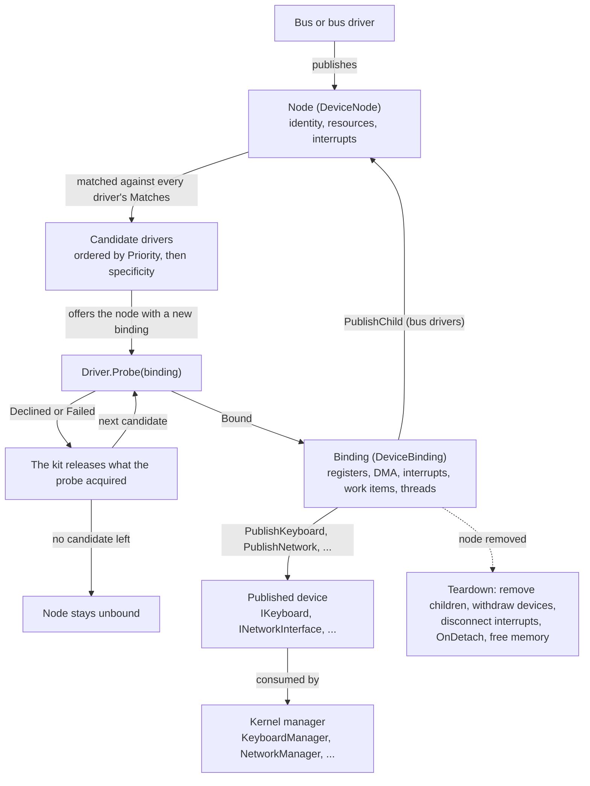

<a id="writing-a-driver"></a>

# Écrire un pilote

Dans cet article, nous verrons comment écrire un pilote de périphérique pour Cosmos Gen3 : comment un pilote est mis en correspondance avec un périphérique, comment il accède au matériel, comment il remet un périphérique au noyau et comment on le teste sans matériel.

Chaque noyau embarque déjà les pilotes fournis listés dans [Ce que le kit prend en charge](#what-the-kit-supports) : vous écrivez donc un pilote quand votre matériel n'en fait pas partie. Une règle façonne tout le kit : un pilote n'accède au matériel et au noyau qu'à travers sa liaison, et la liaison enregistre tout ce que le pilote acquiert, afin que ce soit le kit, et non le pilote, qui le libère. La première moitié de cette page suit un pilote de la correspondance jusqu'au démontage ; la seconde passe chaque bus en revue, puis les pilotes de périphériques fournis ; les dernières sections montrent comment observer les pilotes à l'exécution, en tester un sans matériel et en distribuer un sous forme de bibliothèque. Chaque terme lié dispose d'une courte note de contexte dans le [glossaire des pilotes](driver-glossary.md).

Si vous trouvez des bugs ou quelque chose d'anormal, merci de [soumettre une issue](https://github.com/CosmosOS/Cosmos/issues/new/choose) sur notre dépôt.

---

<a id="experimental-status"></a>

## Statut expérimental

Le kit de pilotes est expérimental : chaque type public sous `Cosmos.Kernel.HAL.DriverKit` et `Cosmos.Kernel.HAL.Devices`, à l'exception des types stables `IBlockDevice` et `MacAddress`, porte `[Experimental("COSMOS0003")]`. Vous pouvez les utiliser dès aujourd'hui, mais ils peuvent changer jusqu'à leur promotion dans l'API stable. Y faire référence provoque une erreur de build tant que votre projet ne l'a pas explicitement accepté :

```xml
<PropertyGroup>
  <NoWarn>$(NoWarn);COSMOS0003</NoWarn>
</PropertyGroup>
```

Consultez [Suivi de l'API publique](../dev/public-api.md) pour savoir comment les API expérimentales sont promues.

---

<a id="what-the-kit-supports"></a>

## Ce que le kit prend en charge

Le kit prend en charge cinq bus sur du matériel réel (plateforme, PCI, virtio, USB et PS/2), plus un bus synthétique pour les tests ([Tester un pilote sur le bus synthétique](#testing-a-driver-over-the-synthetic-bus)). Un pilote remet au noyau l'un des six types de périphériques suivants : un clavier, un pointeur, une interface réseau, un périphérique bloc, un écran ou une sortie audio. Le gestionnaire du noyau pour ce type (`KeyboardManager`, `MouseManager`, `NetworkManager`, `StorageManager`, `DisplayManager` ou `AudioManager`) récupère tout ce qu'un pilote publie. Chaque noyau reçoit aussi les pilotes ci-dessous via `Cosmos.Kernel.Drivers`. Ils utilisent la même API publique que vos pilotes, ce qui fait de leurs [sources](https://github.com/CosmosOS/Cosmos/tree/gen3/src/Cosmos.Kernel.Drivers) les meilleurs exemples à lire, et [Exclure et inclure explicitement](#excluding-and-opting-in) montre comment en retirer un :

| Bus | Pilotes |
|-----|---------|
| Plateforme | `PciHostDriver`, `I8042Driver`, `VirtioMmioTransportDriver` |
| PCI | `PcieRootPortDriver`, `VirtioPciTransportDriver`, `XhciDriver`, `EhciDriver`, `OhciDriver`, `E1000EDriver`, `AhciDriver`, `NvmeDriver`, `VmwareSvgaDriver`, `AmdDcnDriver`, `IntelGraphicsDriver`, `HdAudioDriver` |
| Virtio | `VirtioNetDriver`, `VirtioBlkDriver`, `VirtioGpuDriver`, `VirtioInputDriver` |
| USB | `UsbHubDriver`, `UsbKeyboardDriver`, `UsbMouseDriver`, `UsbMassStorageDriver` |
| PS/2 | `Ps2KeyboardDriver`, `Ps2MouseDriver` |

Dans l'arborescence des sources, chaque pilote est rangé sous `<bus>/<category>/<driver>/` (par exemple `Pci/Network/E1000E/`), et son espace de noms suit le dossier, comme dans `Cosmos.Kernel.Drivers.Pci.Network.E1000E` ; c'est ce nom de type complet qu'attend [Exclure et inclure explicitement](#excluding-and-opting-in).

---

<a id="what-a-driver-is"></a>

## Ce qu'est un pilote

Le kit repose sur cinq concepts :

| Concept | Ce que c'est |
|---------|------------|
| Nœud (`DeviceNode`) | Un élément matériel que le noyau peut voir : son identité sur un bus, ses ressources et ses interruptions. Les bus et les pilotes de bus publient des nœuds. |
| Type de bus | L'apparence d'un nœud sur un bus donné (plateforme, PCI, virtio, USB, PS/2, synthétique) et la façon dont un pilote le met en correspondance. |
| Pilote (`Driver`) | Votre classe : elle indique quels nœuds elle veut, et prend ou décline chacun de ceux qui lui sont proposés. |
| Liaison (`DeviceBinding`) | Le lien entre un pilote et un nœud. Le pilote n'accède au matériel et au noyau qu'à travers elle, et elle se souvient de tout ce que le pilote a acquis. |
| Périphérique publié | Ce que le pilote remet au noyau : un `IKeyboard`, `IPointer`, `INetworkInterface`, `IBlockDevice`, `IDisplay` ou `IAudioOutput`. |

Quand un nœud apparaît, le kit le propose tour à tour à chaque pilote correspondant jusqu'à ce que l'un d'eux renvoie `ProbeResult.Bound` ; tout ce qu'a acquis un pilote qui décline est libéré. Quand le nœud disparaît, le kit démonte la liaison à votre place : les nœuds enfants et les périphériques publiés partent en premier, la mémoire en dernier. Le diagramme suit un nœud de sa publication à son démontage :



Le pilote, la liaison et l'arbre des nœuds se trouvent dans `Cosmos.Kernel.HAL.DriverKit`. Ce que distribue une liaison se trouve un espace de noms plus bas, rangé par domaine : `Cosmos.Kernel.HAL.DriverKit.Resources` (fenêtres de registres, régions mappées, tampons DMA), `.Interrupts` (handles d'interruption, contrat du gestionnaire d'interruption) et `.Threading` (verrous, événements, threads, éléments de travail). Chaque type de bus a son propre espace de noms sous `.Buses`, et chaque type de périphérique celui de sa catégorie sous `Cosmos.Kernel.HAL.Devices`.

Voici le plus petit pilote qui compile et se lie :

```csharp
using Cosmos.Kernel.HAL.DriverKit;
using Cosmos.Kernel.HAL.DriverKit.Buses.Synthetic;

namespace MyOS.Drivers;

[Driver]
public sealed class SampleDriver : Driver
{
    private readonly DeviceMatch[] _matches = [SyntheticMatch.Key("sample")];

    public override string Name => "sample";

    public override ReadOnlySpan<DeviceMatch> Matches => _matches;

    public override ProbeResult Probe(DeviceBinding binding)
    {
        binding.Log("bound");
        return ProbeResult.Bound;
    }
}
```

`Name` s'affiche dans le journal, `Matches` liste les nœuds que veut le pilote, et `Priority` (`0` par défaut) décide quel pilote correspondant se voit proposer un nœud en premier. `Probe`, l'occasion pour le pilote d'examiner le matériel et de décider s'il fait partie de ceux qu'il sert, est obligatoire ; `OnDetach` est facultatif.

Chaque classe de pilote est instanciée une seule fois et se voit proposer chaque nœud auquel elle correspond : ses champs sont donc partagés entre les périphériques. Gardez l'état propre à chaque périphérique dans un objet créé dans `Probe` et stocké dans `binding.DriverState`.

---

<a id="when-drivers-are-bound"></a>

## Quand les pilotes sont liés

L'étape des pilotes s'exécute depuis `Kernel.Start`, une fois que le tas, le contrôleur d'interruptions et l'ordonnanceur sont en place et que les interruptions sont activées. Le kit propose chaque nœud publié jusque-là, y compris les enfants qu'un pilote de bus publie depuis son sondage, et rend la main quand tous ont été proposés. `OnBoot` et `BeforeRun` s'exécutent après elle, si bien que chaque périphérique lié y est utilisable.

Le journal série montre chaque nœud, ses pilotes candidats et le résultat de la proposition. Cet extrait provient d'un noyau x64 lancé avec `cosmos run --nic virtio-net-pci` :

```
[Kernel] Starting drivers...
[Drivers] manifest: HdAudioDriver(prio 0) EhciDriver(prio 0) OhciDriver(prio 0) PcieRootPortDriver(prio 0) ... VirtioBlkDriver(prio 0)
[Drivers] engine started, worker thread
...
[Drivers] platform:pci@cf8 candidates: PciHostDriver(prio 0, spec 1)
[Drivers] platform:pci@cf8 PciHostDriver: 6 functions on 1 buses
[Drivers] platform:pci@cf8 offer PciHostDriver -> bound
...
[Drivers] pci:0000:00:01.0 no driver
[Drivers] pci:0000:00:02.0 candidates: VirtioPciTransportDriver(prio 0, spec 1)
[Drivers] pci:0000:00:02.0 offer VirtioPciTransportDriver -> bound
...
[Drivers] virtio:pci:0000:00:02.0 candidates: VirtioNetDriver(prio 0, spec 1)
[Drivers] virtio:pci:0000:00:02.0 VirtioNetDriver published network "virtio-net" (consumed)
[Drivers] virtio:pci:0000:00:02.0 offer VirtioNetDriver -> bound
[Kernel] Calling OnBoot()...
```

Chaque ligne `published` se termine par `(consumed)` quand un gestionnaire du noyau a pris le périphérique, ou par `(no consumer)` quand aucun ne l'a fait. Un nœud publié après le démarrage, comme un périphérique USB que l'on branche, suit le même chemin. Consultez [Démarrage du noyau](startup.md) pour le reste de la séquence de démarrage.

---

<a id="the-two-execution-contexts-and-the-guard"></a>

## Les deux contextes d'exécution et le garde-fou

Les sondages, les démontages et les éléments de travail s'exécutent un par un sur le thread de travail du kit, si bien qu'un pilote n'en voit jamais deux se chevaucher. Seuls les threads de pilote s'exécutent en même temps qu'eux.

Un noyau compilé avec `CosmosEnableScheduler` désactivé n'a pas de thread de travail : le sondage fonctionne toujours, mais `WorkItem.Schedule`, `TrySchedulePeriodic` et `TryStartThread` renvoient `false`. Un pilote qui doit fonctionner dans un tel noyau vérifie ces résultats. Le moteur s'exécute alors de façon synchrone : le thread qui publie ou retire un nœud vide lui-même la file, et le journal indique `engine started, inline (no worker)`.

Où qu'il s'exécute, le code d'un pilote se trouve dans l'un des deux [contextes](driver-concepts/interrupt-context.md) : thread ou interruption.

| Point d'entrée | Contexte | Peut bloquer | Peut allouer |
|-------------|---------|-----------|--------------|
| `Probe`, `OnDetach`, éléments de travail | thread (le thread de travail du kit) | oui | oui |
| Threads de pilote | thread (le leur) | oui | oui |
| Méthodes de périphérique appelées par le noyau (`Transmit`, `Flush`, ...) | thread (celui de l'appelant) | oui, pour les E/S qu'elles effectuent | oui |
| Gestionnaires d'interruption | interruption | non | non |

`Transmit` et `IAudioOutput.Write` sont les exceptions parmi les méthodes de périphérique : elles n'attendent jamais qu'il y ait de la place, et signalent plutôt une file pleine (`false`, ou une écriture partielle).

**Un gestionnaire d'interruption s'exécute en contexte d'interruption.** Il s'exécute sur la pile du thread qu'il a interrompu, interruptions masquées, si bien que ni un thread ni le minuteur ne peuvent s'exécuter sur ce CPU avant qu'il ne rende la main, et que s'il attend l'un ou l'autre, il attend indéfiniment. C'est pourquoi son `InterruptContext` ne propose que trois appels (`Mask()` pour masquer sa propre source, `Signal(DeviceEvent)` pour signaler un thread en attente et `Schedule(WorkItem)` pour planifier un travail qui a besoin du contexte de thread), et pourquoi il doit acquitter le périphérique et confier le reste à un élément de travail. Il peut aussi lire et écrire ses registres et ses tampons DMA, et remonter ses événements via un récepteur (l'objet que le kit renvoie quand un pilote publie un périphérique, voir [Publier un périphérique](#publishing-a-device)). Il ne doit pas bloquer, et il ne doit pas allouer (pas de `new` d'un type référence, pas de construction de chaîne, pas de lambda qui capture). Les gestionnaires d'interruption propres au noyau allouent bel et bien, et le ramasse-miettes le tolère ; pour les gestionnaires d'interruption des pilotes, le kit l'interdit par règle de sécurité, car une allocation peut entraîner des mécanismes du runtime qui se comportent mal en contexte d'interruption, notamment la résolution du dispatch d'interface et la levée d'exceptions.

Appeler depuis un gestionnaire d'interruption un membre du kit réservé au contexte de thread (une méthode de `DeviceBinding`, ou un membre d'objet d'accès comme un transfert `UsbAccess` ou `Ps2Access.TryCommand`) arrête le noyau par une panique qui nomme ce membre. Sur le bus synthétique, l'appel lève plutôt une exception : le kit enregistre l'erreur sur le nœud et masque la source, afin qu'un test puisse le vérifier. Rien ne détecte une allocation : le garde-fou ne s'exécute qu'à l'intérieur de ces membres du kit, jamais dans le code du pilote lui-même.

---

<a id="the-attribute-and-the-manifest"></a>

## L'attribut et le manifeste

Le build enregistre chaque classe marquée `[Driver]` : un [générateur de source](driver-concepts/source-generators.md) écrit dans le projet du noyau `DriverManifest.g.cs`, un fichier qui construit chaque pilote une fois au démarrage ([Manifeste des pilotes](../dev/build/driver-manifest.md) décrit le générateur). Une classe de pilote doit dériver de `Driver`, être concrète et non générique, et avoir un constructeur sans paramètre. Elle peut être `internal` dans le projet du noyau, mais doit être `public` dans une bibliothèque de pilotes ([Une bibliothèque de pilotes](#a-driver-library)). Une classe qui enfreint l'une de ces règles est laissée hors du manifeste avec l'avertissement `COSMOSGEN001`, et n'apparaît donc pas sur la ligne `manifest:` du journal de démarrage.

L'attribut accepte deux options :

- `[Driver(Feature = DriverFeature.Keyboard)]` n'enregistre le pilote que si le [commutateur de fonctionnalité](driver-concepts/trimming.md) correspondant (`CosmosEnableKeyboard`) est activé ; sinon il est éliminé par le trimming, laissé hors du noyau compilé.
- `[Driver(Default = false)]` n'enregistre le pilote que si le noyau l'inclut explicitement par son nom ([Exclure et inclure explicitement](#excluding-and-opting-in)).

L'ordre du manifeste est déterministe (les pilotes propres au noyau d'abord, puis ceux des bibliothèques référencées) et il est affiché au démarrage.

---

<a id="identity-and-matches"></a>

## Identité et correspondances

Chaque nœud a une `DeviceIdentity`, définie par son bus : `BusName`, `Address`, et `Describe()` pour le journal. Le `Path` du nœud réunit les deux premiers (`pci:0000:00:03.0`) et c'est sous ce nom que le journal désigne le nœud.

Le `Matches` d'un pilote est une liste de `DeviceMatch`. Chacun teste une identité et a une `Specificity` : le nombre de champs qu'il vérifie. Chaque type de bus a sa propre paire de types (`PciIdentity` et `PciMatch`, `UsbIdentity` et `UsbMatch`, ...), décrits avec leurs bus plus bas. Sur le bus synthétique, une correspondance désigne un seul périphérique ou tous :

```csharp
// This device and no other: specificity 1.
private readonly DeviceMatch[] _matches = [SyntheticMatch.Key("kbd")];

// Every synthetic device: specificity 0.
private readonly DeviceMatch[] _matches = [SyntheticMatch.Any()];
```

Quand un nœud apparaît, le kit [ordonne les pilotes correspondants](driver-concepts/driver-matching.md) par `Priority`, puis par spécificité (la plus élevée d'abord), puis par ordre du manifeste, et propose le nœud à chacun jusqu'à ce que l'un d'eux renvoie `Bound` :

```
[Drivers] synthetic:prio candidates: HighPriorityDriver(prio 10, spec 1) LowPriorityDriver(prio 0, spec 1)
[Drivers] synthetic:prio offer HighPriorityDriver -> bound
```

Pour remplacer un pilote fourni pour le même matériel, donnez au vôtre une `Priority` supérieure à `0` : chaque pilote fourni la laisse à `0`, la valeur par défaut. Un nœud qu'aucun pilote ne prend est journalisé `no driver` et reste `Unbound`.

---

<a id="probe-and-the-binding"></a>

## Probe et la liaison

`Probe` est le seul point d'entrée obligatoire, et `DeviceBinding` est le seul moyen pour le pilote d'accéder au matériel et au noyau. Tout ce que le pilote acquiert à travers elle (fenêtres de registres, mémoire DMA, interruptions, événements, éléments de travail, threads, périphériques publiés, nœuds enfants) est enregistré sur la liaison et libéré par le kit, si bien qu'un pilote n'écrit jamais de code de nettoyage.

Un sondage lit le nœud (`binding.Node.Resources`, `binding.Node.Interrupts`, et `binding.Node.Access<T>()`, l'objet d'accès, que le bus fournit pour dialoguer avec le périphérique et qui est décrit avec chaque bus plus bas), acquiert ce dont il a besoin, crée son état propre au périphérique, publie le périphérique et rend la main. Voici un pilote complet, pour un clavier sur le bus synthétique :

```csharp
using Cosmos.Kernel.HAL.DriverKit;
using Cosmos.Kernel.HAL.DriverKit.Buses.Synthetic;
using Cosmos.Kernel.HAL.DriverKit.Interrupts;
using Cosmos.Kernel.HAL.DriverKit.Resources;
using Cosmos.Kernel.HAL.DriverKit.Threading;

namespace MyOS.Drivers;

[Driver(Feature = DriverFeature.Keyboard)]
public sealed class SyntheticKeyboardDriver : Driver
{
    public const string Key = "kbd";

    private readonly DeviceMatch[] _matches = [SyntheticMatch.Key(Key)];

    public override string Name => "synthetic-keyboard";

    public override ReadOnlySpan<DeviceMatch> Matches => _matches;

    public override ProbeResult Probe(DeviceBinding binding)
    {
        if (binding.Node.Resources.Count == 0 || binding.Node.Interrupts.Count == 0)
        {
            return ProbeResult.Declined("no register window or no interrupt source");
        }

        RegisterWindow window = binding.MapRegisters(0);
        DeviceEvent keyEvent = binding.CreateEvent();
        KeyboardState state = new(binding, window, keyEvent);
        binding.DriverState = state;

        state.Sink = binding.PublishKeyboard(state);

        if (!binding.TryRequestInterrupt(binding.Node.Interrupts[0], state.OnInterrupt, out InterruptHandle? handle))
        {
            return ProbeResult.Failed("interrupt 0 could not be connected");
        }

        state.Handle = handle;

        // The handler is live from here on, so the device is armed last.
        window.Write8(KeyboardState.ControlOffset, KeyboardState.EnableBit);
        return ProbeResult.Bound;
    }

    public override void OnDetach(DeviceBinding binding, DetachReason reason)
    {
        if (reason.HardwarePresent && binding.DriverState is KeyboardState state)
        {
            state.Window.Write8(KeyboardState.ControlOffset, 0);
        }
    }
}
```

L'objet d'état est une classe ordinaire, pas un `Driver` : il en existe un par périphérique, et il implémente le contrat du périphérique, possède le gestionnaire d'interruption et détient chaque objet du kit que le sondage a acquis :

```csharp
using Cosmos.Kernel.HAL.Devices.Input;
using Cosmos.Kernel.HAL.DriverKit;
using Cosmos.Kernel.HAL.DriverKit.Interrupts;
using Cosmos.Kernel.HAL.DriverKit.Resources;
using Cosmos.Kernel.HAL.DriverKit.Threading;

namespace MyOS.Drivers;

public sealed class KeyboardState : IKeyboard
{
    public const int ControlOffset = 0x00;
    public const int ScanCodeOffset = 0x10;
    public const int FlagsOffset = 0x11;
    public const byte EnableBit = 1;
    public const byte ReleasedFlag = 1;

    private readonly DeviceBinding _binding;
    private KeyboardLeds _leds;

    public KeyboardState(DeviceBinding binding, RegisterWindow window, DeviceEvent keyEvent)
    {
        _binding = binding;
        Window = window;
        KeyEvent = keyEvent;
        KeyWork = binding.CreateWorkItem(OnKeyWork);
    }

    public string Name => "synthetic-kbd";

    public RegisterWindow Window { get; }

    public DeviceEvent KeyEvent { get; }

    public WorkItem KeyWork { get; }

    public KeyboardSink? Sink { get; set; }

    public InterruptHandle? Handle { get; set; }

    public void SetLeds(KeyboardLeds leds)
    {
        _leds = leds;
    }

    // Interrupt context: reads two registers, reports the key, wakes the
    // thread and hands the rest to the work item. Allocates nothing.
    public void OnInterrupt(InterruptContext context)
    {
        byte scanCode = Window.Read8(ScanCodeOffset);
        bool released = (Window.Read8(FlagsOffset) & ReleasedFlag) != 0;
        Sink?.Report(scanCode, released);
        context.Signal(KeyEvent);
        context.Schedule(KeyWork);
    }

    // Thread context, on the kit worker.
    public void OnKeyWork()
    {
        _binding.Log("key work ran");
    }
}
```

Aucune des deux classes n'alloue de pages, ne programme de contrôleur d'interruptions, n'enregistre le clavier auprès d'un gestionnaire ni ne libère quoi que ce soit : la liaison fait tout cela. Les sections ci-dessous couvrent ses membres ; leurs exemples sont des extraits du `Probe` d'un pilote ou de son objet d'état.

<a id="register-windows"></a>

### Fenêtres de registres

On accède aux [registres](driver-concepts/registers.md) d'un périphérique à travers une fenêtre de registres : `binding.MapRegisters(resourceIndex)` mappe l'une des `Node.Resources` et renvoie une `RegisterWindow`, avec `Read8` à `Read64` et `Write8` à `Write64` à un décalage donné en octets. Chaque accès fait l'objet d'un contrôle de bornes et, sur une fenêtre mémoire, doit aussi être aligné sur sa largeur. Chaque accès porte les [barrières](driver-concepts/barriers.md) dont il a besoin, si bien qu'une écriture dans le doorbell arrive toujours après les écritures en mémoire DMA qui la précèdent. Le même code fonctionne sur une fenêtre mémoire, sur la fenêtre RAM d'un nœud synthétique et sur une plage de ports x64, sauf qu'une plage de ports n'a pas d'accès 64 bits : `Read64` et `Write64` y lèvent `NotSupportedException`. Les accesseurs sont sûrs depuis un gestionnaire d'interruption, et lèvent une exception une fois la liaison démontée.

<a id="bulk-regions"></a>

### Régions en bloc

`binding.MapRegion(resourceIndex, RegionCaching)` mappe une ressource comme de la mémoire ordinaire, pour un framebuffer ou une file de commandes, et renvoie une `DeviceRegion`. Contrairement à ceux d'une fenêtre de registres, ses accès ne sont ni vérifiés ni ordonnés ; un sondage mappe un framebuffer et y dessine à travers un span :

```csharp
// In Probe:
DeviceRegion framebuffer = binding.MapRegion(1, RegionCaching.WriteCombining);
framebuffer.Span.Fill(0);
Span<uint> pixels = framebuffer.As<uint>();
pixels[0] = 0x00FF0000;
```

Le second argument indique au CPU comment mettre la région en cache. Choisissez-le selon ce que contient la région :

- `RegionCaching.Device` pour les commandes que lit le périphérique, comme une file de commandes : chaque lecture et chaque écriture va directement au périphérique, dans l'ordre.
- `RegionCaching.WriteCombining` pour un framebuffer : les écritures sont regroupées en rafales, ce qui est bien plus rapide pour dessiner des pixels.
- `RegionCaching.Normal` pour de la RAM ordinaire partagée avec le périphérique.

Sur x64, `WriteCombining` est appliqué à chaque bloc de 2 Mio que la région couvre entièrement ; un bloc qu'elle partage avec autre chose reste en `Device`. Tout autre choix, et tout choix sur ARM64, est aujourd'hui mappé en `Device` ; la fenêtre RAM d'un nœud synthétique garde le mappage normal du noyau quel que soit le choix. Choisissez quand même la bonne valeur : le kit l'enregistre dans `DeviceRegion.Caching` et l'appliquera dès que la plateforme le prendra en charge.

<a id="dma-memory"></a>

### Mémoire DMA

`binding.AllocateDma(length, alignment)` renvoie un `DmaBuffer` : une mémoire mise à zéro et [physiquement contiguë](driver-concepts/physical-addresses.md), avec `PhysicalAddress` pour le périphérique et `Span` pour le CPU.

La mémoire [DMA](driver-concepts/dma.md) contient généralement un [anneau de descripteurs](driver-concepts/descriptor-rings.md) : un tableau fixe de descripteurs, chacun pointant vers un tampon de données, que le pilote et le périphérique se renvoient l'un à l'autre comme une file circulaire. Le pilote écrit dans un registre (le doorbell) quand il cède de nouveaux descripteurs, et le périphérique marque chacun comme terminé. Une carte réseau, par exemple, a un anneau de réception que le périphérique remplit de trames entrantes et un anneau d'émission que le pilote remplit de trames sortantes.

Pour un périphérique qui n'adresse que 32 bits, `TryAllocateDma` prend une contrainte et renvoie `false` au lieu de lever une exception quand le tampon ne la respecte pas. Le kit n'a pas encore de réserve de mémoire basse : il alloue comme d'habitude et libère le tampon quand celui-ci se termine au-dessus de 4 Gio :

```csharp
// In Probe:
if (!binding.TryAllocateDma(RingBytes, 4096, DmaConstraints.Addressable32Bit, out DmaBuffer? ring))
{
    return ProbeResult.Declined("no DMA memory below 4 GiB");
}
```

Le DMA est cohérent, seul l'ordre compte donc. Appelez `DmaBuffer.WriteBarrier()` entre le remplissage d'un descripteur et sa remise au périphérique, et `DmaBuffer.ReadBarrier()` entre la lecture d'un indicateur écrit par le périphérique et la lecture des données qu'il protège. Remettre un descripteur au périphérique s'écrit ainsi ; l'écriture dans le doorbell qui suit n'a besoin d'aucune barrière, car les écritures de registres portent la leur :

```csharp
// When sending, for example in Transmit:
Span<byte> descriptors = ring.Span;
descriptors[8] = 0x01;                   // fill the descriptor
DmaBuffer.WriteBarrier();
descriptors[0] = OwnedByDevice;          // then hand it over

window.Write32(DoorbellOffset, 1);       // no barrier needed
```

Ne remettez jamais un tableau managé à un périphérique : le ramasse-miettes ne sait pas que le périphérique le détient.

<a id="interrupts"></a>

### Interruptions

`binding.TryRequestInterrupt(source, handler, out handle)` connecte un gestionnaire d'interruption à l'une des `Node.Interrupts`. Elle renvoie `false` quand la plateforme ne peut pas acheminer cette interruption, afin que le pilote puisse décliner ou scruter à la place, c'est-à-dire lire l'état du périphérique à intervalles réguliers, au rythme d'un minuteur, plutôt qu'attendre une interruption. Le gestionnaire d'interruption est actif dès que l'appel renvoie `true`, ce qui permet à un sondage d'envoyer une commande et d'attendre l'interruption ; armez le périphérique en dernier, par l'écriture de registre qui lui permet de commencer à lever des interruptions, s'il ne doit pas interrompre plus tôt. Le sondage connecte son gestionnaire d'interruption et garde le handle :

```csharp
// In Probe:
if (!binding.TryRequestInterrupt(binding.Node.Interrupts[0], state.OnInterrupt, out InterruptHandle? handle))
{
    return ProbeResult.Declined("the interrupt cannot be delivered");
}

state.Handle = handle;
```

Le gestionnaire d'interruption s'exécute en contexte d'interruption : il [acquitte le périphérique](driver-concepts/interrupt-delivery.md) et laisse le vrai travail à un élément de travail. Ici, c'est une méthode `OnInterrupt` de l'objet d'état :

```csharp
// In the state object, in interrupt context:
public void OnInterrupt(InterruptContext context)
{
    uint cause = Window.Read32(InterruptCauseOffset);
    Window.Write32(InterruptCauseOffset, cause);   // acknowledge
    context.Schedule(ReceiveWork);
}
```

L'`InterruptHandle` masque et démasque la source (`Mask()`, `Unmask()`) depuis n'importe quel contexte. Un gestionnaire d'interruption qui lève une exception laisse sa source masquée.

<a id="events-and-waiting"></a>

### Événements et attente

`binding.CreateEvent()` renvoie un `DeviceEvent`. Un gestionnaire d'interruption le signale avec `context.Signal(evt)` ; un thread l'attend avec `binding.Wait(evt, timeoutMilliseconds)`, qui renvoie `true` sur un signal, et `false` à l'expiration du délai ou une fois le démontage commencé.

Un sondage peut envoyer une commande et attendre que le périphérique réponde. Le gestionnaire d'interruption appelle `context.Signal(CommandDone)`, et le sondage attend sur le même événement :

```csharp
// In Probe:
state.CommandDone = binding.CreateEvent();
// ... connect the interrupt, then send the command
window.Write32(CommandOffset, ResetCommand);

if (!binding.Wait(state.CommandDone, 100))
{
    return ProbeResult.Failed("the device did not answer the reset");
}
```

Pour de courtes attentes en contexte de thread, `binding.Delay(microseconds)` fait une attente active en tournant sur le CPU, ce qui convient à un registre qui a besoin de quelques microsecondes après une écriture, et `binding.Sleep(milliseconds)` cède le CPU pour que d'autres threads s'exécutent pendant ce temps :

```csharp
// In Probe or a work item:
window.Write32(ControlOffset, ResetBit);
binding.Delay(10);   // the device needs 10 µs before the next access
```

<a id="work-items"></a>

### Éléments de travail

Un gestionnaire d'interruption confie son vrai travail à un élément de travail : `binding.CreateWorkItem(callback)` renvoie un `WorkItem` dont le callback s'exécute sur le thread de travail du kit une fois planifié. `context.Schedule(item)` depuis un gestionnaire d'interruption, ou `item.Schedule()` depuis n'importe où, le met en file sans allouer ; l'appel renvoie `false` quand l'élément est déjà en file, qu'il a été annulé par le démontage, ou que le noyau n'a pas de thread de travail. Créez les éléments de travail dans `Probe` et planifiez-les plus tard :

```csharp
// In Probe: create the work item once.
state.ReceiveWork = binding.CreateWorkItem(state.DrainReceiveRing);

// In the handler: queue it.
context.Schedule(ReceiveWork);

// On the kit worker, in thread context: may allocate, wait and report.
public void DrainReceiveRing()
{
    // walk the receive ring and hand each frame to Sink.Receive
}
```

<a id="periodic-work"></a>

### Travail périodique

`binding.TrySchedulePeriodic(intervalMilliseconds, item)` exécute un élément de travail à intervalle régulier jusqu'au démontage, l'intervalle étant arrondi au tick du minuteur. Elle renvoie `false` quand le noyau n'a pas de minuteur ou pas d'ordonnanceur. Le kit ne scrute jamais à la place d'un pilote : un pilote qui doit scruter planifie donc son propre élément de travail, ici une méthode `OnPoll` de l'objet d'état :

```csharp
// In Probe:
WorkItem poll = binding.CreateWorkItem(state.OnPoll);
if (!binding.TrySchedulePeriodic(20, poll))
{
    return ProbeResult.Failed("no timer to poll with");
}
```

<a id="driver-threads"></a>

### Threads de pilote

Un travail qui doit attendre dans une boucle obtient son propre thread : `binding.TryStartThread(name, entry, out thread)` en démarre un, et renvoie `false` quand l'ordonnanceur ne tourne pas. Le thread boucle sur les événements de la liaison et se termine dès que `IsDetaching` est vrai ; le démontage réveille chaque thread en attente, puis attend la fin du thread :

```csharp
// In the state object, on the driver thread:
public void ThreadMain()
{
    while (!_binding.IsDetaching)
    {
        if (_binding.Wait(KeyEvent, 50))
        {
            // a key arrived; drain the device in thread context
        }
    }
}
```

Le démontage attend une demi-seconde pour chaque thread. Un thread qui tourne encore au-delà empêche la libération de la mémoire de la liaison, car il peut encore y accéder : le kit laisse fuir cette mémoire volontairement et journalise `thread "name" did not stop in 500 ms; n resources leaked`. Le sondage démarre le thread une fois son état en place :

```csharp
// In Probe:
DrainState state = new(binding);
binding.DriverState = state;

if (!binding.TryStartThread("drain", state.ThreadMain, out DriverThread? thread))
{
    return ProbeResult.Failed("no scheduler to run the drain thread on");
}
```

<a id="device-locks"></a>

### Verrous de périphérique

`binding.CreateLock()` renvoie un `DeviceLock`, pour un périphérique sollicité depuis plusieurs contextes à la fois, comme un `Transmit` qu'appelle la pile réseau pendant que l'élément de travail du pilote vide l'anneau de réception. `Acquire()` désactive les interruptions jusqu'à la libération de la portée, si bien qu'un gestionnaire d'interruption ne peut jamais interrompre un thread qui détient le verrou pour ensuite tourner dessus, et qu'un gestionnaire d'interruption peut lui aussi prendre le verrou. Le détenteur ne doit pas attendre avec les interruptions désactivées, si bien que le verrou n'est jamais conservé pendant `Sleep`, `Wait` ou `Delay`, ni pendant un appel de récepteur ou une publication, qui peuvent revenir directement dans le pilote : la pile réseau peut répondre à une trame reçue en appelant `Transmit` avant que `Receive` ne rende la main. Le verrou n'est pas réentrant : un détenteur qui l'acquiert de nouveau tourne donc indéfiniment. Dans l'objet d'état, `Transmit` le prend autour de son travail sur l'anneau :

```csharp
// In the state object, called by the network stack:
public bool Transmit(ReadOnlySpan<byte> frame)
{
    using (_lock.Acquire())
    {
        // check the ring, copy the frame, write the descriptor,
        // DmaBuffer.WriteBarrier(), then advance the tail register
    }

    return true;
}
```

<a id="publishing-a-device"></a>

### Publier un périphérique

Un type de périphérique se compose d'une petite interface que le pilote implémente et d'un récepteur que le kit lui renvoie et à travers lequel le pilote signale les événements :

| Type | Le pilote implémente | Appel de publication | Le pilote signale via |
|------|-----------------------|--------------|----------------------------|
| Clavier | `IKeyboard` (`Name`, `SetLeds`) | `PublishKeyboard` | `KeyboardSink.Report(scanCode, released)` |
| Pointeur | `IPointer` (`Name`) | `PublishPointer` | `PointerSink.ReportRelative(...)`, `ReportAbsolute(...)` |
| Réseau | `INetworkInterface` (`Name`, `MacAddress`, `LinkUp`, `Transmit`) | `PublishNetwork` | `NetworkSink.Receive(frame)`, `LinkChanged(up)` |
| Bloc | `IBlockDevice` | `PublishBlockDevice` | rien |
| Écran | `IDisplay` (`Name`, `Mode`, `Framebuffer`, `Flush`) | `PublishDisplay` | `DisplaySink.ModeChanged()` |
| Audio | `IAudioOutput` (`Name`, `Format`, `SampleRate`, `SupportedFormats`, `IsRunning`, `WritableBytes`, `TrySetFormat`, `Start`, `Stop`, `Write`) | `PublishAudio` | `AudioSink.BufferCompleted()`, `FormatChanged()` |

Pour chaque type de périphérique, les types correspondants se trouvent dans l'espace de noms de sa catégorie sous `Cosmos.Kernel.HAL.Devices`, les mêmes catégories que celles des dossiers des pilotes : les types clavier et pointeur dans `Cosmos.Kernel.HAL.Devices.Input` ; les types réseau dans `Cosmos.Kernel.HAL.Devices.Network`, à côté de `MacAddress`, le type que renvoie `INetworkInterface.MacAddress` ; les types écran dans `Cosmos.Kernel.HAL.Devices.Display` ; les types audio dans `Cosmos.Kernel.HAL.Devices.Audio`, à côté de `AudioFormat` ; et `IBlockDevice` dans `Cosmos.Kernel.HAL.Devices.Storage`.

Le gestionnaire du noyau pour ce type récupère le périphérique dès qu'il est publié, et le démontage le retire avant de libérer quoi que ce soit d'autre. Les récepteurs n'allouent jamais, et ignorent les rapports une fois le périphérique retiré.

Avec un objet d'état `NicState` qui implémente `INetworkInterface`, le sondage le publie et garde le récepteur qu'il reçoit en retour :

```csharp
// In Probe:
NicState state = new(binding);
binding.DriverState = state;
state.Sink = binding.PublishNetwork(state);

// In the receive work item, for each frame the device received:
Sink?.Receive(frame);
```

Le journal enregistre le début et la fin, ici pour l'exemple de clavier ci-dessus :

```
[Drivers] synthetic:kbd synthetic-keyboard published keyboard "synthetic-kbd" (consumed)
[Drivers] synthetic:kbd synthetic-keyboard withdrew keyboard "synthetic-kbd"
```

Chaque type a aussi sa propre règle. Un pilote de clavier signale des scancodes bruts, le code du jeu 1 pour une touche qui s'enfonce ou se relâche, que `KeyboardManager` transforme en touches. Un pilote réseau appelle `NetworkSink.Receive` depuis le contexte de thread, jamais depuis son gestionnaire d'interruption, et confie les trames reçues à un élément de travail : le récepteur lui-même n'alloue pas, mais la pile réseau derrière lui copie la trame, ce qui demande le contexte de thread. Un pilote audio est le cas inverse, puisque `AudioSink.BufferCompleted` peut être appelé directement depuis le gestionnaire d'interruption. Son `Write` copie des trames audio entières (un échantillon par canal) dans le tampon du périphérique, autant que le tampon peut en contenir, et ne bloque jamais ; c'est par une écriture partielle que le périphérique indique qu'il est plein.

`PublishBlockDevice` enregistre le disque auprès de `StorageManager` et parcourt ses partitions avant de rendre la main : le périphérique doit donc être prêt à être lu quand le pilote le publie. Si le gestionnaire refuse le disque (sa table est pleine, ou le disque est déjà enregistré), `PublishBlockDevice` lève `InvalidOperationException` et le sondage échoue.

Un pilote d'écran publie l'écran tel qu'il l'a trouvé : `Mode` est vide tant que rien n'en définit un, et `Framebuffer` vaut `null` quand le CPU ne peut pas y dessiner. Le même objet peut aussi implémenter `IDisplayModes` pour changer de mode et `IHardwareCursor` pour un curseur matériel. Le framebuffer du chargeur d'amorçage est publié comme écran du firmware au démarrage, et retiré quand un pilote se lie à la fonction PCI dont la fenêtre mémoire le contient.

Consultez [Graphismes](graphics.md), [Audio](audio.md) et [Système de fichiers](filesystem.md) pour le côté consommateur.

<a id="publishing-child-nodes"></a>

### Publier des nœuds enfants

Un pilote de bus publie les périphériques qu'il trouve sous forme de nœuds enfants : `binding.PublishChild(identity, resources, interrupts, access)` en ajoute un sous son nœud, qui sera proposé aux pilotes comme n'importe quel autre, et `binding.RetractChild(child, hardwarePresent)` le retire. Les enfants disparaissent avec leur parent, et leurs pilotes voient `DetachCause.ParentRetracted`.

Un pilote de bus publie soit un type de bus que le kit définit déjà, soit sa propre paire d'identité et de correspondance. Les pilotes de transport virtio fournis font le premier choix : ils publient leur périphérique avec la `VirtioIdentity` du kit, aucune ressource, les neuf sources d'interruption d'un `VirtioAccess`, et cet accès comme objet d'accès ([Périphériques virtio](#virtio-devices)). Le cœur d'énumération USB du kit fait de même sous le nœud d'un pilote de contrôleur hôte (xHCI, EHCI ou OHCI) ou sous celui du pilote de hub, avec une `UsbIdentity`, aucune ressource, aucune source d'interruption et un `UsbAccess` ([Périphériques USB](#usb-devices)). Un bus qui vous est propre a besoin d'une identité et d'une correspondance :

```csharp
using Cosmos.Kernel.HAL.DriverKit;

namespace MyOS.Drivers;

public sealed class ChildIdentity : DeviceIdentity
{
    public ChildIdentity(string name)
    {
        Name = name;
    }

    public string Name { get; }

    public override string BusName => "mybus";

    public override string Address => Name;

    public override string Describe()
    {
        return string.Concat("child ", Name);
    }
}

public sealed class ChildMatch : DeviceMatch
{
    private readonly string _name;

    public ChildMatch(string name)
    {
        _name = name;
    }

    public override int Specificity => 1;

    public override bool Matches(DeviceIdentity identity)
    {
        return identity is ChildIdentity child && string.Equals(_name, child.Name);
    }
}
```

Le sondage du pilote de bus publie alors un enfant avec cette identité, ses registres en ressource 0 :

```csharp
// In the bus driver:
public override ProbeResult Probe(DeviceBinding binding)
{
    DeviceResource[] resources =
    [
        DeviceResource.MemoryWindow(0xFEB00000, 0x1000),   // the child's registers, index 0
    ];

    DeviceNode child = binding.PublishChild(new ChildIdentity("port0"), resources, [], null);
    binding.DriverState = child;
    return ProbeResult.Bound;
}
```

Les ressources se construisent avec `DeviceResource.MemoryWindow`, `PortRange`, `RamWindow` ou `None` (un emplacement non attribué qui préserve les indices qui le suivent). Les interruptions sont des sous-classes d'`InterruptSource` fournies par le bus.

<a id="logging"></a>

### Journalisation

`binding.Log(message)` écrit une ligne dans le journal série depuis le contexte de thread : `[Drivers] synthetic:kbd synthetic-keyboard: message`.

---

<a id="declining-and-failing"></a>

## Décliner et échouer

`Probe` renvoie l'un des trois résultats suivants :

| Résultat | Quand le renvoyer |
|--------|-------------------|
| `ProbeResult.Bound` | Le pilote a pris le périphérique. |
| `ProbeResult.Declined(reason)` | Le périphérique ne fait finalement pas partie de ceux que sert le pilote (une révision inconnue, une fonctionnalité manquante). |
| `ProbeResult.Failed(reason)` | Le périphérique fait partie de ceux que sert le pilote, mais sa mise en route n'a pas fonctionné. Une exception qui s'échappe de `Probe` compte comme un échec. |

Pour tout résultat autre que `Bound`, le kit libère tout ce que le sondage a acquis, puis propose le nœud au candidat suivant. La raison est affichée dans le journal :

```
[Drivers] synthetic:decline offer DecliningDriver -> declined: declined on purpose
[Drivers] synthetic:decline offer AnyKeyDriver -> bound
[Drivers] synthetic:throw offer ThrowingDriver -> failed: probe threw on purpose
```

---

<a id="teardown-and-ondetach"></a>

## Démontage et OnDetach

Quand un nœud disparaît (le périphérique est débranché, son parent est retiré, ou un test le retire), le kit démonte sa liaison dans un ordre fixe :

1. `IsDetaching` passe à vrai, et la liaison refuse toute nouvelle acquisition.
2. Les nœuds enfants sont retirés.
3. Les périphériques publiés sont retirés, si bien que le noyau cesse de les utiliser.
4. Les interruptions sont déconnectées, et les éléments de travail, le travail périodique et les threads de pilote sont arrêtés.
5. `OnDetach` s'exécute.
6. La mémoire est libérée : tampons DMA, fenêtres de registres et régions.

`OnDetach` est facultatif. C'est l'endroit où arrêter le matériel, car les interruptions et les threads sont déjà arrêtés et les registres sont encore mappés. Vérifiez d'abord `reason.HardwarePresent` : il vaut `false` quand le périphérique a été [débranché](driver-concepts/hot-plug.md), et il ne faut alors pas toucher aux registres, car une écriture dans une fenêtre dont le périphérique a disparu peut déclencher une exception matérielle ou atteindre un autre périphérique. Le `OnDetach` de l'exemple de clavier ne désactive le périphérique que s'il est encore là :

```csharp
// In the driver:
public override void OnDetach(DeviceBinding binding, DetachReason reason)
{
    if (reason.HardwarePresent && binding.DriverState is KeyboardState state)
    {
        state.Window.Write8(KeyboardState.ControlOffset, 0);   // disable the device
    }
}
```

`reason.Cause` en donne la raison : `DetachCause.Retracted` quand le nœud lui-même a été retiré, `DetachCause.ParentRetracted` quand c'est son parent qui l'a été. Le journal montre le retrait du périphérique, puis le nœud qui quitte l'arbre :

```
[Drivers] synthetic:kbd synthetic-keyboard withdrew keyboard "synthetic-kbd"
[Drivers] synthetic:kbd retracted
```

---

<a id="buses"></a>

## Bus

Les [bus](driver-concepts/buses.md) s'imbriquent. La description de la machine, c'est-à-dire le code de plateforme qui décrit les périphériques fixes de la machine au démarrage, publie les nœuds racines, et les pilotes de bus publient les périphériques qu'ils trouvent en dessous. Sur une machine x64, par exemple, l'arbre ressemble à ceci :

```
platform:i8042@60                    I8042Driver
├── ps2:kbd                          Ps2KeyboardDriver
└── ps2:aux                          Ps2MouseDriver
platform:pci@cf8                     PciHostDriver
├── pci:0000:00:02.0                 VirtioPciTransportDriver
│   └── virtio:pci:0000:00:02.0      VirtioNetDriver
└── pci:0000:00:04.0                 XhciDriver
    └── usb:1-1:0                    UsbKeyboardDriver
```

Un pilote ne voit que son propre nœud : un pilote virtio ne sait jamais quel transport porte son périphérique, et un pilote USB ne voit jamais le contrôleur ni les hubs au-dessus de lui.

Chaque type de bus a son propre espace de noms, `Cosmos.Kernel.HAL.DriverKit.Buses.<Bus>` (`Platform`, `Pci`, `Virtio`, `Usb`, `Ps2`, et `Synthetic` pour les tests), et nomme ses types de la même façon : `<Bus>Identity` pour ce qu'est un nœud, `<Bus>Match` pour ce à quoi un pilote se lie, et `<Bus>Access` pour la façon dont le pilote accède au périphérique. Le bus de plateforme fait exception : ses pilotes mappent plutôt les ressources du nœud, et seul le nœud de l'hôte PCI porte un objet d'accès, `PciHostAccess`.

Les nœuds de plateforme et le pilote de l'hôte PCI viennent d'abord, ci-dessous ; les quatre sections suivantes passent tour à tour en revue les bus auxquels un pilote se lie : PCI, virtio, USB et PS/2.

<a id="platform-nodes"></a>

### Nœuds de plateforme

Les nœuds de plateforme sont les racines : des périphériques que rien ne peut énumérer, et que la description de la machine publie au démarrage. Un noyau ne peut pas publier les siens.

| Machine | Nœud | Compatible |
|---------|------|------------|
| x64 | `platform:i8042@60`, le contrôleur PS/2 | `pnp0303` |
| x64 | `platform:pci@cf8`, l'hôte PCI | `pci-host-legacy` |
| ARM64 | `platform:pci@<base>`, l'hôte PCI | `pci-host-ecam-generic` |
| ARM64 | `platform:virtio_mmio@<base>`, un par emplacement occupé | `virtio,mmio` |

Sur ARM64, ils proviennent d'ACPI, du device tree ou de la disposition fixe de la machine virt. Les deux hôtes PCI diffèrent par la façon dont ils accèdent à l'espace de configuration : `pci-host-legacy` par les ports `0xCF8` et `0xCFC`, `pci-host-ecam-generic` par une fenêtre mémoire. Un pilote met en correspondance un nœud de plateforme par l'une de ses chaînes compatibles :

```csharp
// In the driver:
private readonly DeviceMatch[] _matches = [PlatformMatch.Compatible("virtio,mmio")];
```

`PlatformMatch.Any()` correspond à chaque nœud de plateforme.

<a id="the-pci-host-driver"></a>

### Le pilote de l'hôte PCI

`PciHostDriver` se lie au nœud de l'hôte PCI, parcourt chaque bus derrière lui en suivant les ponts, et publie un nœud `pci:` par fonction trouvée. Les fonctions situées derrière un emplacement PCI Express à branchement à chaud sont publiées par `PcieRootPortDriver` à la place, au démarrage pour un périphérique déjà présent dans un emplacement alimenté, et plus tard quand un périphérique y est branché. Une fonction à laquelle aucun pilote ne correspond est laissée telle que le [firmware](driver-concepts/firmware-handoff.md) l'a configurée.

---

<a id="pci-devices"></a>

## Périphériques PCI

Un nœud PCI est une [fonction](driver-concepts/pci.md) : son identité lue dans l'en-tête de configuration, six ressources (ses registres d'adresse de base), ses sources d'interruption (la ligne héritée, puis ses messages MSI-X) et un `PciAccess` pour son espace de configuration. Le pilote fourni `E1000EDriver` est un bon modèle, et les exemples ci-dessous en reprennent les étapes.

<a id="pci-identity-and-match"></a>

### Identité et correspondance PCI

`PciIdentity` contient les champs d'en-tête sur lesquels un pilote établit la correspondance : `VendorId`, `DeviceId`, `SubsystemVendorId`, `SubsystemId`, `ClassCode`, `Subclass`, `ProgIf` et `Revision`, plus l'adresse de la fonction. Le chemin du nœud est `pci:<segment>:<bus>:<device>.<function>`, par exemple `pci:0000:00:03.0`.

`PciMatch` accepte n'importe lequel de ces champs ; chaque champ fourni doit correspondre exactement, et la spécificité est le nombre de champs fournis :

```csharp
// In the driver:
using Cosmos.Kernel.HAL.DriverKit.Buses.Pci;

private readonly DeviceMatch[] _matches =
[
    new PciMatch(vendorId: 0x8086, deviceId: 0x10D3),   // one chip: specificity 2
    new PciMatch(classCode: 0x02),                      // every network controller: specificity 1
];
```

Une correspondance doit définir au moins un champ. Préférez les identifiants de périphérique que vous avez testés à une correspondance par classe : une correspondance par classe lie chaque fonction de cette classe, y compris des puces dont les registres diffèrent de celle que vous avez testée. Une correspondance par classe n'est justifiée que là où une spécification fixe la disposition des registres, comme la spécification HD Audio le fait pour `HdAudioDriver` ; le pilote E1000E fourni correspond à huit identifiants de périphérique Intel et à rien d'autre.

<a id="the-pci-access-object"></a>

### L'objet d'accès PCI

`binding.Node.Access<PciAccess>()` donne accès à l'espace de configuration de la fonction :

- `ReadConfig8/16/32` et `WriteConfig8/16/32` lisent et écrivent un registre à un décalage aligné sur sa largeur. Un décalage au-delà de l'espace de configuration auquel l'hôte accède lève `ArgumentOutOfRangeException` : cet espace fait 256 octets sur x64, dont l'hôte utilise les ports hérités, et 4 Kio avec ECAM.
- `FindCapability(id)` renvoie le décalage d'une capacité, ou 0.
- `EnableMemorySpace`, `EnableIoSpace` et `EnableBusMastering` activent ce que le pilote utilise : le décodage fait répondre les registres, le [bus mastering](driver-concepts/dma.md) permet au périphérique d'atteindre la mémoire DMA.
- `Bars` décrit les six registres d'adresse de base (section suivante).

Avant le premier sondage, le kit désactive le bus mastering et les interruptions sur la fonction : un sondage active donc lui-même ce dont il a besoin. Le kit recommence après chaque sondage qui n'a pas abouti à une liaison, avant que la mémoire de ce sondage ne soit libérée, afin que le périphérique cesse d'y écrire, et encore une fois après le démontage d'une liaison alors que le périphérique est toujours présent. Si tous les pilotes déclinent, le kit restaure ce que le firmware avait configuré.

<a id="bar-resources"></a>

### Ressources BAR

Les `Node.Resources` d'un nœud PCI comptent toujours six entrées, une par registre d'adresse de base : une `MemoryWindow`, une `PortRange`, ou `None` pour un registre qui n'est pas attribué (ou qui est la moitié haute d'un registre 64 bits). Mapper une entrée `None` lève une exception, vérifiez donc d'abord `pci.Bars[i]` :

```csharp
// In Probe:
PciAccess pci = binding.Node.Access<PciAccess>();
PciBar bar0 = pci.Bars[0];
if (!bar0.IsAssigned || bar0.IsIo || bar0.Length < 0x20000)
{
    return ProbeResult.Declined("BAR0 is not a memory window of 128 KiB");
}

RegisterWindow registers = binding.MapRegisters(0);
pci.EnableMemorySpace(true);
pci.EnableBusMastering(true);
```

<a id="the-legacy-line"></a>

### La ligne héritée

`Node.Interrupts[0]` est la [ligne d'interruption héritée](driver-concepts/interrupt-delivery.md) de la fonction. Le kit ne la route que sur x64, pour les lignes 3 à 15, et attribue chaque ligne à une seule fonction plutôt que de la partager : `TryRequestInterrupt` renvoie donc `false` sur ARM64, pour toute autre ligne, et pour une ligne que détient un autre pilote. Même quand la connexion réussit, le kit programme la ligne en déclenchement sur front, ce que QEMU délivre mais qu'un vrai chipset, dont les lignes PCI sont déclenchées sur niveau et partagées, peut ne pas délivrer. Associez-la à un vidage périodique qui maintient le périphérique en marche si la ligne ne se déclenche jamais :

```csharp
// In Probe:
WorkItem drain = binding.CreateWorkItem(state.Drain);
state.DrainWork = drain;

bool hasLine = binding.TryRequestInterrupt(binding.Node.Interrupts[0], state.OnInterrupt, out _);
bool polling = binding.TrySchedulePeriodic(50, drain);
if (!hasLine && !polling)
{
    return ProbeResult.Declined("no interrupt and no timer to poll with");
}
```

Le gestionnaire d'interruption acquitte le périphérique et planifie le même vidage, qui doit donc pouvoir s'exécuter sans risque à tout moment.

<a id="message-interrupts"></a>

### Interruptions par message

Quand la fonction prend en charge MSI-X, `Node.Interrupts[1]` et les suivantes sont ses messages, jusqu'à 32. Ils nécessitent que le décodage mémoire soit activé, car la table MSI-X se trouve dans un BAR, et leur connexion renvoie `false` là où la plateforme ne peut pas router de messages (ARM64 sans ITS GICv3, le service de traduction du contrôleur d'interruptions ARM pour les interruptions par message ; la machine virt de QEMU utilise par défaut GICv2, qui n'en a pas). Connecter un message désactive la ligne héritée, si bien que les deux ne sont jamais actives en même temps :

```csharp
// In Probe:
pci.EnableMemorySpace(true);   // before requesting a message

bool hasMessage = binding.Node.Interrupts.Count > 1
    && binding.TryRequestInterrupt(binding.Node.Interrupts[1], state.OnInterrupt, out _);
```

<a id="hot-plug-slots"></a>

### Emplacements de branchement à chaud

Une fonction située derrière un emplacement PCI Express à [branchement à chaud](driver-concepts/hot-plug.md) est publiée quand son périphérique est branché (ou au démarrage, quand l'emplacement contient déjà un périphérique alimenté), et retirée quand il est enlevé ; `PcieRootPortDriver` gère l'emplacement. Si le firmware a laissé les registres de la fonction non attribués, le kit les place avant que la fonction ne soit proposée, et un registre qui ne tient pas dans les fenêtres d'adresses de l'emplacement reste non attribué. Un pilote n'a donc besoin de rien de particulier : il vérifie `Bars` comme d'habitude, et ne touche pas aux registres dans `OnDetach` quand `reason.HardwarePresent` vaut `false`.

---

<a id="virtio-devices"></a>

## Périphériques virtio

Un nœud virtio est un périphérique [virtio](driver-concepts/virtio.md), publié par un pilote de transport sur PCI ou MMIO. Il n'a pas de ressources, mais neuf sources d'interruption et un `VirtioAccess` qui parle le protocole virtio, si bien qu'un pilote fonctionne de la même façon sur les deux transports. Le pilote fourni `VirtioNetDriver` est un bon modèle, et les exemples ci-dessous en reprennent les étapes.

<a id="virtio-identity-and-match"></a>

### Identité et correspondance virtio

`VirtioIdentity` porte le `DeviceType` (`VirtioDeviceType.Network`, `Block`, `Gpu`, `Input`, ...) et le transport, qui apparaît dans le chemin du nœud (`virtio:pci:0000:00:02.0`, `virtio:mmio:a003e00`) mais n'importe jamais au pilote. Un pilote établit la correspondance sur le type de périphérique :

```csharp
// In the driver:
using Cosmos.Kernel.HAL.DriverKit.Buses.Virtio;

private readonly DeviceMatch[] _matches = [VirtioMatch.DeviceType(VirtioDeviceType.Network)];
```

<a id="the-virtio-access-object"></a>

### L'objet d'accès virtio

`binding.Node.Access<VirtioAccess>()` est le périphérique. Un sondage l'utilise dans cet ordre :

1. `NegotiateFeatures(requestedLow, out negotiatedLow)` avec les bits de fonctionnalité que comprend le pilote, parmi les 32 bits de poids faible ; le kit ajoute lui-même `VIRTIO_F_VERSION_1` quand le périphérique le propose. Elle renvoie `false` quand le périphérique les rejette.
2. `TryCreateQueue` pour chaque file ([Files](#queues)).
3. `ReadConfig8/16/32` et `WriteConfig8` pour la configuration propre au périphérique, comme l'adresse MAC d'une carte réseau.
4. `TryRequestInterrupt` sur les sources de file et de configuration ([Sources d'interruption virtio](#virtio-interrupt-sources)).
5. `SetDriverOk()`, après quoi le périphérique est actif.

Le kit réinitialise le périphérique avant chaque sondage, si bien qu'un sondage commence par la négociation :

```csharp
// In Probe:
VirtioAccess dev = binding.Node.Access<VirtioAccess>();
if (!dev.NegotiateFeatures(FeatureMac | FeatureStatus, out uint features))
{
    return ProbeResult.Failed("the device rejected the feature set");
}
```

`Reset()` arrête le périphérique ; un pilote l'appelle dans `OnDetach`.

<a id="queues"></a>

### Files

Une virtqueue est un anneau ([Mémoire DMA](#dma-memory)) que partagent le pilote et le périphérique. `dev.TryCreateQueue(binding, index, preferredSize, out Virtqueue? queue)` en alloue une et l'active sur le périphérique. Une `Virtqueue` propose :

- `TryAllocateDescriptor(out index)` et `FreeDescriptor(index)`.
- `SetDescriptor(index, physicalAddress, length, flags, next)` : `VirtqueueDescriptorFlags.Write` pour un tampon que remplit le périphérique, `Next` avec l'indice du descripteur suivant dans `next` pour les chaîner (`next` vaut 0 par défaut).
- `Submit(head)` remet une chaîne de descripteurs au périphérique, et `Notify()` actionne le doorbell.
- `TryTakeUsed(out id, out length)` reprend ce que le périphérique a terminé.

Une file n'est pas thread-safe : protégez-la avec un `DeviceLock` quand `Transmit` et un élément de travail la partagent. Les tampons peuvent être soumis avant `SetDriverOk`, mais `Notify` seulement après :

```csharp
// In Probe:
if (!dev.TryCreateQueue(binding, ReceiveQueue, 128, out Virtqueue? receiveQueue))
{
    return ProbeResult.Failed("no receive queue");
}

// One buffer per descriptor, for the device to write received frames into.
DmaBuffer receiveBuffers = binding.AllocateDma(receiveQueue.Size * BufferBytes, 4096);
for (int i = 0; i < receiveQueue.Size; i++)
{
    receiveQueue.TryAllocateDescriptor(out ushort slot);
    ulong physical = receiveBuffers.PhysicalAddress + (ulong)(slot * BufferBytes);
    receiveQueue.SetDescriptor(slot, physical, BufferBytes, VirtqueueDescriptorFlags.Write);
    receiveQueue.Submit(slot);
}

// ... connect the interrupts ...

dev.SetDriverOk();
receiveQueue.Notify();
state.Sink = binding.PublishNetwork(state);
```

<a id="virtio-interrupt-sources"></a>

### Sources d'interruption virtio

`dev.QueueInterrupt(n)` est l'interruption de la file `n`, et `dev.ConfigInterrupt` se déclenche quand la configuration du périphérique change. Quand le transport n'a pas pu les router (ARM64 sans ITS GICv3, par exemple), `TryRequestInterrupt` renvoie `false` et le pilote scrute à la place :

```csharp
// In Probe:
WorkItem drain = binding.CreateWorkItem(state.Drain);
bool hasInterrupt = binding.TryRequestInterrupt(dev.QueueInterrupt(ReceiveQueue), state.OnInterrupt, out _);
if (!hasInterrupt && !binding.TrySchedulePeriodic(50, drain))
{
    return ProbeResult.Declined("no interrupt and no timer to poll with");
}
```

Dans `OnDetach`, réinitialisez le périphérique pour qu'il cesse d'écrire dans la mémoire que le kit s'apprête à libérer, puis laissez aux transferts DMA en cours un instant pour aboutir :

```csharp
// In the driver:
public override void OnDetach(DeviceBinding binding, DetachReason reason)
{
    if (reason.HardwarePresent)
    {
        binding.Node.Access<VirtioAccess>().Reset();
        binding.Delay(100);
    }
}
```

<a id="the-transport-drivers"></a>

### Les pilotes de transport

`VirtioPciTransportDriver` se lie à chaque fonction PCI virtio (fabricant `0x1AF4`), en n'utilisant que l'interface moderne et les messages MSI-X. `VirtioMmioTransportDriver` se lie aux nœuds de plateforme `virtio,mmio` sur ARM64. Un pilote feuille n'a jamais affaire ni à l'un ni à l'autre.

<a id="the-shipped-leaf-drivers"></a>

### Les pilotes feuilles fournis

| Pilote | Type de périphérique | Publie |
|--------|-------------|-----------|
| `VirtioNetDriver` | `Network` | une interface réseau, `virtio-net` |
| `VirtioInputDriver` | `Input` | un clavier, `virtio-keyboard`, ou un pointeur, `virtio-mouse` |
| `VirtioBlkDriver` | `Block` | un périphérique bloc, `vblk<n>` |
| `VirtioGpuDriver` | `Gpu` | un écran, `virtio-gpu` (2D uniquement) |

---

<a id="usb-devices"></a>

## Périphériques USB

Un nœud USB est une [interface](driver-concepts/usb.md) d'un périphérique USB, publiée par le pilote du contrôleur hôte pour un périphérique sur un port racine, ou par le pilote de hub pour un périphérique derrière un hub. Il n'a ni ressources ni sources d'interruption, mais un `UsbAccess` pour tout ce que fait un pilote de classe. Un périphérique à plusieurs interfaces donne plusieurs nœuds. Un pilote de classe ne voit jamais le contrôleur ni les hubs au-dessus de lui ; les pilotes fournis `UsbKeyboardDriver`, `UsbMouseDriver` et `UsbMassStorageDriver` sont de bons modèles.

<a id="usb-identity-and-match"></a>

### Identité et correspondance USB

`UsbIdentity` contient le `VendorId`, le `ProductId` et la classe du périphérique, ainsi que la classe, la sous-classe et le protocole de l'interface. Le chemin du nœud est la chaîne des ports suivie du numéro d'interface : `usb:1-1:0` est l'interface 0 du périphérique sur le port racine 1 du premier contrôleur, et `usb:1-2.1:0` un périphérique sur le port 1 d'un hub branché sur le port racine 2.

`UsbMatch` fonctionne comme `PciMatch` : chaque champ fourni doit correspondre exactement, et la spécificité est le nombre de champs fournis. Un pilote de classe établit généralement la correspondance sur la classe, la sous-classe et le protocole de l'interface. Les pilotes de clavier et de souris fournis correspondent à l'interface HID boot, que chaque clavier et chaque souris de PC déclarent afin que le firmware puisse s'en servir :

```csharp
// In the driver:
using Cosmos.Kernel.HAL.DriverKit.Buses.Usb;

private readonly DeviceMatch[] _matches =
[
    new UsbMatch(interfaceClass: UsbClassCode.Hid, interfaceSubclass: 0x01, interfaceProtocol: 0x01),   // a HID boot keyboard: specificity 3
];
```

<a id="the-usb-access-object"></a>

### L'objet d'accès USB

`binding.Node.Access<UsbAccess>()` représente l'interface USB. Ses membres s'exécutent en contexte de thread :

- `Endpoints` liste les endpoints de l'interface, et `FindEndpoint(type, isIn)` en trouve un.
- `ControlIn`, `ControlOut` et `GetDescriptor` envoient des requêtes de contrôle au périphérique. Chacune renvoie un `UsbTransferStatus` : `Success`, `Stall`, `Timeout`, `Error` ou `Disconnected`.
- `OpenInterruptPipe(binding, endpoint, handler, out pipe)` ouvre un [endpoint interrupt IN](driver-concepts/usb.md) et appelle la routine de traitement pour chaque rapport qu'envoie le périphérique.
- `OpenBulkPipe(binding, endpoint, out pipe)` ouvre un endpoint bulk, et `BulkIn` et `BulkOut` y font transiter des données en attendant la fin du transfert.
- `IsDisconnected` passe à vrai une fois le périphérique débranché ; chaque transfert renvoie alors `Disconnected`, vérifiez-le donc plutôt que de réessayer.

Les pipes sont enregistrés sur la liaison, si bien que le kit les ferme quand le sondage décline ou que le périphérique disparaît. Le pilote de stockage de masse ouvre deux pipes bulk ; si le second échoue, le kit ferme quand même le premier :

```csharp
// In Probe:
UsbAccess usb = binding.Node.Access<UsbAccess>();
UsbEndpoint? bulkIn = usb.FindEndpoint(UsbEndpointType.Bulk, isIn: true);
UsbEndpoint? bulkOut = usb.FindEndpoint(UsbEndpointType.Bulk, isIn: false);
if (bulkIn is null || bulkOut is null)
{
    return ProbeResult.Declined("no bulk endpoints");
}

if (!usb.OpenBulkPipe(binding, bulkIn, out UsbPipe? inPipe) || !usb.OpenBulkPipe(binding, bulkOut, out UsbPipe? outPipe))
{
    return ProbeResult.Failed("could not open the bulk pipes");
}
```

La routine qui traite les rapports peut s'exécuter en contexte d'interruption : elle suit donc les règles d'un gestionnaire d'interruption, c'est-à-dire pas de blocage, pas d'allocation, et pas d'appel à `UsbAccess` ni à `DeviceBinding`. Elle peut appeler un récepteur, `DeviceEvent.Signal` et `Interlocked`. Le pilote de clavier publie d'abord son clavier, afin que cette routine ait toujours un récepteur, puis ouvre le pipe de rapports :

```csharp
// In Probe:
UsbEndpoint? reports = usb.FindEndpoint(UsbEndpointType.Interrupt, isIn: true);
if (reports is null)
{
    return ProbeResult.Declined("no interrupt IN endpoint");
}

state.Sink = binding.PublishKeyboard(state);
if (!usb.OpenInterruptPipe(binding, reports, state.OnReport, out UsbPipe? pipe))
{
    return ProbeResult.Failed("could not open the report pipe");
}

// In the state object, for every report:
public void OnReport(ReadOnlySpan<byte> report)
{
    // compare with the previous report and hand each key change to Sink.Report
}
```

<a id="the-host-controller-contract"></a>

### Le contrat du contrôleur hôte

Un pilote de contrôleur hôte se lie au nœud du contrôleur lui-même et implémente `UsbHostController` et `UsbDevice`, avec ses pipes dérivés de `UsbPipe`. Il crée un `UsbBus`, dont `Attach(port, speed)` et `Detach(port)` énumèrent un périphérique et publient ou retirent ses nœuds d'interface. `XhciDriver`, `EhciDriver` et `OhciDriver` implémentent ce contrat, `XhciDriver` servant d'implémentation de référence ; un pilote de classe n'a affaire à rien de tout cela.

### Hubs

`UsbHubDriver` se lie à chaque interface de hub. Il confie les périphériques présents sur les ports du hub à la même énumération par `ConfigureAsHub`, `AttachChild` et `DetachChild`, et surveille les ports depuis un thread, si bien qu'un périphérique derrière un hub est proposé comme n'importe quel autre, sous la forme `usb:1-2.1:0`.

<a id="the-xhci-driver"></a>

### Le pilote xHCI

`XhciDriver` se lie à chaque contrôleur xHCI. Il énumère pendant son sondage les périphériques déjà branchés, si bien qu'une clé USB est prête avant `OnBoot`, et gère le branchement à chaud depuis un thread. Il utilise un message MSI-X là où la plateforme en achemine un, et scrute sinon le contrôleur toutes les 20 ms. Les endpoints isochrones, les endpoints interrupt OUT et les streams ne sont pas pris en charge.

<a id="the-ehci-driver"></a>

### Le pilote EHCI

`EhciDriver` se lie à chaque contrôleur EHCI, l'hôte USB 2.0 qui a précédé xHCI sur les PC et que portent encore de nombreuses cartes embarquées. Ses ports racines n'acceptent que des périphériques high-speed : le pilote confie donc un périphérique full-speed ou low-speed branché sur l'un d'eux au contrôleur compagnon qui partage le port, lequel l'énumère sur un bus qui lui est propre ([Le pilote OHCI](#the-ohci-driver)) ; sur un port sans compagnon, le périphérique est journalisé et laissé de côté. Sur les cartes qui placent plutôt un hub high-speed devant les ports, comme le font les chipsets Intel, un tel périphérique arrive derrière ce hub, où `UsbHubDriver` l'énumère et où le contrôleur l'atteint à travers le traducteur de transactions du hub, si bien qu'il est proposé comme n'importe quel autre ([Hubs](#hubs)). Il énumère pendant son sondage les périphériques déjà branchés, si bien qu'une clé USB est prête avant `OnBoot`, et gère le branchement à chaud depuis un thread. Il utilise la ligne héritée de la fonction là où la plateforme en achemine une, ce que le kit ne fait que sur x64, et scrute sinon le contrôleur toutes les 20 ms. Les endpoints isochrones, les endpoints interrupt OUT, les structures de données au-delà de 4 Gio, la mise en veille, et la remise en service d'un contrôleur arrêté sur une erreur système de l'hôte ne sont pas pris en charge, et un hub est piloté à travers un seul traducteur de transactions.

<a id="the-ohci-driver"></a>

### Le pilote OHCI

`OhciDriver` se lie à chaque contrôleur OHCI, l'interface d'hôte USB 1.1 de nombreux chipsets, dont ceux d'AMD et de NVIDIA (UHCI, l'hôte USB 1.1 des chipsets Intel et VIA, n'a pas de pilote), seul ou comme compagnon d'un EHCI, auquel cas il sert les périphériques full-speed et low-speed que lui confie le pilote EHCI. Rien ne coordonne les deux pilotes : le passage de relais est un bit du registre de port de l'EHCI, que l'OHCI voit comme une simple connexion sur son propre port racine, depuis son sondage quand il se lie après l'EHCI et depuis son thread de branchement à chaud quand il s'est lié en premier ; un passage de relais dans ce dernier ordre nécessite donc l'ordonnanceur. Il énumère pendant son sondage les périphériques déjà branchés, si bien qu'une clé USB est prête avant `OnBoot`, et gère le branchement à chaud depuis un thread, comme `XhciDriver`. Il utilise la ligne héritée de la fonction là où la plateforme en achemine une, ce que le kit ne fait que sur x64, et scrute sinon le contrôleur toutes les 20 ms. Les endpoints isochrones, les endpoints interrupt OUT, la mise en veille, et la remise en service d'un contrôleur arrêté sur une erreur irrécupérable ne sont pas pris en charge.

<a id="the-usb-class-drivers"></a>

### Les pilotes de classe USB

| Pilote | Correspond à | Publie |
|--------|---------|-----------|
| `UsbKeyboardDriver` | Claviers HID boot | un clavier, `usb-keyboard` |
| `UsbMouseDriver` | Souris HID boot | un pointeur, `usb-mouse` |
| `UsbMassStorageDriver` | Stockage de masse en transport bulk-only (clés, lecteurs de cartes, disques USB) | un périphérique bloc par unité, `usb<n>` |
| `UsbHubDriver` | Hubs | les périphériques derrière le hub, comme nœuds enfants |

Une unité est un disque logique derrière un périphérique de stockage de masse, comme un emplacement d'un lecteur de cartes. Une clé USB présente au démarrage apparaît ainsi dans le journal :

```
[Drivers] pci:0000:00:03.0 XhciDriver: usb 1-1: 46f4:0001 SuperSpeed, 1 interface(s)
[Drivers] pci:0000:00:03.0 offer XhciDriver -> bound
[Drivers] usb:1-1:0 candidates: UsbMassStorageDriver(prio 0, spec 3)
[StorageManager] usb0 registered by UsbMassStorageDriver (primary)
[Drivers] usb:1-1:0 UsbMassStorageDriver published block "usb0" (consumed)
[Drivers] usb:1-1:0 offer UsbMassStorageDriver -> bound
```

---

<a id="ps2-devices"></a>

## Périphériques PS/2

Un nœud PS/2 est un port du [contrôleur 8042](driver-concepts/ps2.md), publié par `I8042Driver` : `ps2:kbd` pour le port clavier et `ps2:aux` pour le port souris. Il n'a pas de ressources, mais une source d'interruption et un `Ps2Access` pour dialoguer avec le périphérique. C'est le pilote de classe qui découvre ce qui est branché. PS/2 n'existe que sur x64.

<a id="ps2-identity-and-match"></a>

### Identité et correspondance PS/2

Un pilote correspond à un seul port, jamais aux deux, puisqu'un clavier et une souris parlent des protocoles différents :

```csharp
// In the driver:
using Cosmos.Kernel.HAL.DriverKit.Buses.Ps2;

private readonly DeviceMatch[] _matches = [Ps2Match.Port(Ps2Port.Keyboard)];
```

<a id="the-ps2-access-object"></a>

### L'objet d'accès PS/2

`binding.Node.Access<Ps2Access>()` est le port :

- `TryCommand(command, arguments, reply, out replyLength, timeoutMilliseconds)` envoie une commande et ses arguments, attend que le périphérique acquitte chaque octet, et recueille la réponse. Contexte de thread.
- `TryReceive(out value)` prend l'octet suivant que le périphérique a envoyé de lui-même, comme un scancode. N'importe quel contexte : c'est donc ce qu'utilise le gestionnaire d'interruption.
- `DeliversUnattended` vaut `false` quand le contrôleur ne peut ni interrompre ni être scruté ; déclinez alors le port.

Les octets qui répondent à une commande vont à `TryCommand`, jamais à `TryReceive`. Un sondage de souris publie son pointeur avant d'activer l'envoi des données, et un sondage de clavier réinitialise le périphérique, publie le clavier, connecte l'interruption du port, puis active le balayage des touches :

```csharp
// In Probe:
Ps2Access ps2 = binding.Node.Access<Ps2Access>();
if (!ps2.DeliversUnattended)
{
    return ProbeResult.Declined("no interrupt and no timer to poll with");
}

Span<byte> reply = stackalloc byte[1];
if (!ps2.TryCommand(Reset, [], reply, out int count, 1000) || count == 0 || reply[0] != SelfTestPassed)
{
    return ProbeResult.Declined("no keyboard on the port");
}

state.Sink = binding.PublishKeyboard(state);   // before scanning starts
if (!binding.TryRequestInterrupt(binding.Node.Interrupts[0], state.OnInterrupt, out _))
{
    return ProbeResult.Failed("the port's interrupt could not be connected");
}

if (!ps2.TryCommand(EnableScanning, [], [], out _, 100))
{
    return ProbeResult.Failed("enable scanning was not acknowledged");
}

// In the state object, in interrupt context:
public void OnInterrupt(InterruptContext context)
{
    while (_ps2.TryReceive(out byte value))
    {
        // decode the scan code and hand it to Sink.Report
    }
}
```

<a id="the-controller-contract"></a>

### Le contrat du contrôleur

`Ps2Controller` est ce qu'implémente un pilote de contrôleur pour envoyer des octets à un port et restituer les octets qu'il lit. `I8042Driver` en détient la seule implémentation, et un pilote de classe ne s'en sert jamais.

<a id="the-8042-driver"></a>

### Le pilote 8042

`I8042Driver` se lie à `platform:i8042@60`. Il teste le contrôleur et ses deux ports, connecte l'IRQ 1 et l'IRQ 12 (ou scrute toutes les 20 ms quand il ne le peut pas), et publie un nœud par port fonctionnel. C'est le seul pilote qui touche aux ports `0x60` et `0x64` ; le redémarrage x64 du noyau écrit aussi `0xFE` sur `0x64`.

<a id="the-ps2-class-drivers"></a>

### Les pilotes de classe PS/2

| Pilote | Port | Publie |
|--------|------|-----------|
| `Ps2KeyboardDriver` | `ps2:kbd` | un clavier, `ps2-keyboard` (claviers AT et MF2, avec leurs voyants) |
| `Ps2MouseDriver` | `ps2:aux` | un pointeur, `ps2-mouse` (souris standard et à molette) |

Les deux sont publiés pendant l'étape des pilotes, si bien qu'un noyau les trouve dans `OnBoot`. PS/2 n'a pas de branchement à chaud. Le journal de démarrage montre les deux ports liés :

```
[Drivers] ps2:kbd Ps2KeyboardDriver published keyboard "ps2-keyboard" (consumed)
[Drivers] ps2:kbd Ps2KeyboardDriver: MF2 keyboard (id ab 41), scanning
[Drivers] ps2:kbd offer Ps2KeyboardDriver -> bound
[Drivers] ps2:aux Ps2MouseDriver published pointer "ps2-mouse" (consumed)
[Drivers] ps2:aux Ps2MouseDriver: wheel mouse (id 03), 4-byte packets, reporting
[Drivers] ps2:aux offer Ps2MouseDriver -> bound
```

---

<a id="shipped-device-drivers"></a>

## Pilotes de périphériques fournis

Les bus ci-dessus portent aussi les pilotes fournis pour les écrans, les disques et le son. Ils publient par les mêmes appels que les vôtres, et sont listés ici selon le type de périphérique qu'ils publient.

<a id="the-display-drivers"></a>

### Les pilotes d'écran

| Pilote | Matériel | Remarques |
|--------|----------|-------|
| `VirtioGpuDriver` | virtio-gpu, sur PCI ou MMIO | 2D : l'invité dessine, l'hôte compose l'image |
| `VmwareSvgaDriver` | VMware SVGA II, PCI, x64 uniquement | Change de mode et dessine un curseur matériel ; remplace le framebuffer du firmware, qui se trouve dans sa VRAM |
| `AmdDcnDriver` | AMD DCN 3.1.5, la partie graphique Radeon intégrée des processeurs Ryzen 7000 (Raphael, Dragon Range) et Ryzen 9000 (Granite Ridge), PCI | Conserve le mode UEFI ; basculement sans déchirure ; curseur matériel ; remplace le framebuffer du firmware, qui se trouve dans sa VRAM |
| `IntelGraphicsDriver` | La partie graphique intégrée des processeurs Intel Core de la 2e génération (Sandy Bridge, HD Graphics 2000 et 3000) à la 14e (Raptor Lake, UHD et Iris Xe Graphics), PCI | Conserve le mode UEFI ; basculement sans déchirure ; curseur matériel ; remplace le framebuffer du firmware, auquel il accède à travers l'aperture du GPU |

`AmdDcnDriver` et `IntelGraphicsDriver` conservent le mode que le firmware UEFI a défini plutôt que de changer de mode. Ils basculent entre trois images, en VRAM à la mise à jour verticale pour AMD et en mémoire volée (stolen memory) au retour vertical pour Intel, si bien que rien ne se déchire, et tous deux dessinent un curseur matériel. Tous deux déclinent après un démarrage hérité (CSM), CSM étant le mode de compatibilité BIOS du firmware, ou sur une surface dans laquelle ils ne peuvent pas dessiner. `AmdDcnDriver` décline aussi sur un portable en mode GPU discret seul, et `IntelGraphicsDriver` sur un identifiant de périphérique absent de la table qu'il partage avec le pilote i915 de Linux. Un refus enregistre sa raison sur la proposition, où `DriverDiagnostics` la signale. S'il reste trop peu de mémoire volée après la surface du firmware, `IntelGraphicsDriver` dessine sans basculement ou sans curseur, et le journal de liaison indique lequel des deux.

<a id="the-storage-drivers"></a>

### Les pilotes de stockage

| Pilote | Matériel | Noms de disque |
|--------|----------|------------|
| `AhciDriver` | Contrôleurs SATA en mode AHCI (disques uniquement, pas de CD-ROM) | `sata<n>` |
| `NvmeDriver` | Contrôleurs NVMe | `nvme<controller>n<namespace>` |
| `VirtioBlkDriver` | virtio-blk, sur PCI ou MMIO | `vblk<n>` |

Un espace de noms NVMe est l'un des disques qu'expose un contrôleur, d'où le second nombre dans le nom d'un disque NVMe. Une clé USB est prise en charge par `UsbMassStorageDriver` ([Les pilotes de classe USB](#the-usb-class-drivers)). Chaque disque est enregistré auprès de `StorageManager` quand il est publié.

<a id="the-audio-driver"></a>

### Le pilote audio

`HdAudioDriver` se lie à tout contrôleur PCI qui annonce l'interface de programmation HD Audio, en établissant la correspondance par classe plutôt que par identifiant de périphérique, car la spécification fixe la disposition des registres, et publie une sortie audio auprès d'`AudioManager` ([Audio](audio.md)). Il n'est enregistré que si `CosmosEnableAudio` est activé.

---

<a id="observing-drivers"></a>

## Observer les pilotes

Le kit rend compte de ce qu'il fait à deux endroits. Le journal série contient une ligne par événement, préfixée par `[Drivers]`, ce qui vous permet de suivre un démarrage. La classe `DriverDiagnostics` de `Cosmos.Kernel.System.Diagnostics` fournit les mêmes informations au code, pour un test ou une commande de shell.

Voici les lignes que vous verrez le plus souvent, dans l'ordre où la vie d'un périphérique les produit :

| Ligne | Signification |
|------|---------|
| `manifest: A(prio 0) B(prio 10)` | Les pilotes enregistrés, une fois au début de l'étape des pilotes |
| `synthetic:k candidates: A(prio 10, spec 1) B(prio 0, spec 1)` | Un nœud est proposé à ces pilotes, dans cet ordre |
| `synthetic:k offer A -> bound` / `-> declined: reason` / `-> failed: message` | Ce que chaque sondage a renvoyé |
| `synthetic:k no driver` | Aucun pilote ne correspond au nœud |
| `synthetic:k A published keyboard "name" (consumed)` / `(no consumer)` | Un périphérique a été publié, et un gestionnaire du noyau l'a pris ou non |
| `synthetic:k A: message` | Le pilote a appelé `binding.Log` |
| `synthetic:k A interrupt handler threw: message` | Un gestionnaire d'interruption a levé une exception ; son interruption est masquée |
| `synthetic:k A work item threw: message` | Un élément de travail a levé une exception ; il est annulé |
| `synthetic:k A withdrew keyboard "name"` | Le démontage a retiré un périphérique |
| `synthetic:k retracted` | Le nœud a été retiré |

Les pilotes de bus ajoutent leurs propres lignes par `binding.Log` : les pilotes de contrôleur hôte USB journalisent chaque périphérique USB qu'ils trouvent, le pilote de port racine chaque événement de branchement à chaud. Le gestionnaire de stockage ajoute des lignes `[StorageManager]` quand il enregistre ou abandonne un disque.

`DriverDiagnostics` ne fait que lire, si bien qu'il ne modifie jamais le kit et ne lève jamais d'exception :

- `DriverCount`, `NodeCount` et `DeviceCount`, avec `TryGetDriver`, `TryGetNode` et `TryGetDevice` pour lire une entrée par son indice.
- `TryGetOffer(nodeIndex, offerIndex, out DeviceOfferInfo)` rejoue les propositions qu'a reçues un nœud : le pilote, sa priorité et sa spécificité, l'`Outcome` (`Bound`, `Declined`, `Failed`) et la `Reason`.
- Un nœud (`DeviceNodeInfo`) donne son `Path`, son `DriverName`, son `State` (`Pending`, `Bound`, `Unbound`, `Retracted`) et des compteurs tels que `HeldResourceCount`, `FaultCount` et `LastFault`.

Ce code affiche chaque nœud avec le pilote qui l'a pris, et les propositions qui y ont mené :

```csharp
// In the kernel:
using Cosmos.Kernel.System.Diagnostics;

for (int i = 0; i < DriverDiagnostics.NodeCount; i++)
{
    if (!DriverDiagnostics.TryGetNode(i, out DeviceNodeInfo node))
    {
        continue;
    }

    Console.WriteLine($"{node.Path}: {node.DriverName ?? "no driver"} ({node.State})");
    for (int j = 0; j < node.OfferCount; j++)
    {
        if (DriverDiagnostics.TryGetOffer(i, j, out DeviceOfferInfo offer))
        {
            Console.WriteLine($"  {offer.DriverName} -> {offer.Outcome} {offer.Reason}");
        }
    }
}
```

Les instantanés sont pris sans verrouillage, si bien qu'un nœud en cours de proposition ou de démontage à ce moment-là peut apparaître avec une étape de retard.

---

<a id="testing-a-driver-over-the-synthetic-bus"></a>

## Tester un pilote sur le bus synthétique

Le bus synthétique vous permet de tester un pilote sans matériel. Un noyau de test publie un faux nœud, le kit le propose à votre pilote comme il le ferait d'un vrai périphérique, et le test joue le rôle du matériel. Il se comporte de la même façon sur x64 et sur ARM64.

`SyntheticBus` a quatre membres :

| Membre | Ce qu'il fait |
|--------|--------------|
| `Publish(key, data, interruptCount, windowBytes)` | Publie un nœud sous `synthetic:key` avec `interruptCount` sources d'interruption et, quand `windowBytes` est défini, une fenêtre de registres adossée à la RAM, d'au plus une page, en ressource 0. Rend la main une fois le nœud proposé |
| `RaiseInterrupt(node, index)` | Exécute le gestionnaire d'interruption connecté à cette source, comme le ferait une vraie interruption. Renvoie `false` quand rien n'est connecté ou que la source est masquée |
| `WaitForQueuedJobs()` | Attend que chaque élément de travail mis en file jusque-là se soit exécuté, afin que le test puisse vérifier ce qu'il a fait |
| `Retract(node, hardwarePresent)` | Retire le nœud et rend la main une fois la liaison démontée. `hardwarePresent` est ce que voit `OnDetach` ; sa valeur par défaut est `false`, soit un débranchement à chaud |

Le test voit le périphérique à travers le `SyntheticAccess` du nœud : `Window` est la mémoire de la fenêtre de registres, si bien que le test écrit ce que le pilote lira et lit ce que le pilote a écrit.

Un test du pilote de clavier ci-dessus publie son nœud, simule un appui sur une touche puis le débranche, et écrit une ligne `FAIL:` dans le journal série pour chaque vérification qui échoue :

```csharp
// In the test kernel:
using Cosmos.Kernel.HAL.DriverKit;
using Cosmos.Kernel.HAL.DriverKit.Buses.Synthetic;
using Cosmos.Kernel.System.Diagnostics;
using MyOS.Drivers;

// In BeforeRun:
DeviceNode node = SyntheticBus.Publish(SyntheticKeyboardDriver.Key, [], interruptCount: 1, windowBytes: 64);
SyntheticAccess access = node.Access<SyntheticAccess>();
if (access.Window[KeyboardState.ControlOffset] != KeyboardState.EnableBit)
{
    Log.WriteString("FAIL: the probe should arm the device\n");
}

// Play a key press: fill the registers, then raise the interrupt.
access.Window[KeyboardState.ScanCodeOffset] = 0x1E;
access.Window[KeyboardState.FlagsOffset] = 0;
if (!SyntheticBus.RaiseInterrupt(node, 0))
{
    Log.WriteString("FAIL: the handler should run\n");
}
SyntheticBus.WaitForQueuedJobs();   // the work item the handler scheduled has run too

// Unplug: the kit releases everything the probe acquired.
int heldBefore = DriverDiagnostics.GetTotalHeldResourceCount();
SyntheticBus.Retract(node);
if (DriverDiagnostics.GetTotalHeldResourceCount() >= heldBefore)
{
    Log.WriteString("FAIL: teardown should release the binding\n");
}
if (SyntheticBus.RaiseInterrupt(node, 0))
{
    Log.WriteString("FAIL: nothing is connected any more\n");
}
```

Accédez à l'état propre au pilote par `node.Binding.DriverState` pour vérifier ce qu'a fait le gestionnaire d'interruption, et utilisez `DriverDiagnostics` (voir [Observer les pilotes](#observing-drivers)) pour vérifier l'état du nœud et ses propositions. Un nœud publié dans le constructeur du noyau, avant l'étape des pilotes, teste le chemin de démarrage ; un nœud publié dans `BeforeRun` teste le branchement à chaud. `cosmos run` connecte le port série à votre terminal, si bien que les lignes `FAIL:` y apparaissent à côté des lignes `[Drivers]` du kit ([Écrire dans le journal série](debugging.md#writing-to-the-serial-log)).

---

<a id="project-settings"></a>

## Paramètres du projet

Un pilote situé dans un projet de noyau compilé avec `Cosmos.Sdk` n'a besoin de rien d'autre que la ligne `NoWarn` de [Statut expérimental](#experimental-status) dans le `.csproj` du noyau, et sa classe peut être `internal`.

<a id="a-driver-library"></a>

### Une bibliothèque de pilotes

Pour distribuer des pilotes séparément, placez-les dans une bibliothèque de classes. Elle référence `Cosmos.Kernel.HAL` pour le kit et `Cosmos.Kernel.System` pour l'API du noyau. Ses classes `[Driver]` doivent être `public`, afin que le générateur de manifeste du noyau puisse les voir :

```xml
<!-- The library's .csproj: -->
<Project Sdk="Microsoft.NET.Sdk">

  <PropertyGroup>
    <TargetFramework>net10.0</TargetFramework>
    <CosmosDriverAssembly>true</CosmosDriverAssembly>
    <NoWarn>$(NoWarn);COSMOS0003</NoWarn>
  </PropertyGroup>

  <ItemGroup>
    <PackageReference Include="Cosmos.Kernel.HAL" />
    <PackageReference Include="Cosmos.Kernel.System" />
    <PackageReference Include="Cosmos.Build.Analyzer.Patcher" />
  </ItemGroup>

</Project>
```

Les versions sont laissées à la gestion centralisée des packages. Sans `Directory.Packages.props`, donnez à chaque référence la version qu'utilise votre noyau.

`CosmosDriverAssembly`, avec le package d'analyseurs, vérifie au moment du build que la bibliothèque n'utilise que l'API publique :

- `NAOT0007` : elle ne nomme rien de `Cosmos.Kernel.Core`, seulement ce qu'offrent `Cosmos.Kernel.HAL` et `Cosmos.Kernel.System`.
- `NAOT0008` : elle n'utilise aucun `[UnsafeAccessor]` pour atteindre des éléments internes.
- `NAOT0009` : aucun assembly Cosmos ne lui accorde `InternalsVisibleTo`.

Les pilotes fournis dans `Cosmos.Kernel.Drivers` sont compilés de la même façon : ils n'utilisent donc rien que votre propre pilote ne puisse utiliser.

Le noyau référence la bibliothèque par un `ProjectReference` ou un `PackageReference` et ajoute sa propre ligne `NoWarn`. Les pilotes de la bibliothèque rejoignent le manifeste après ceux du noyau.

<a id="excluding-and-opting-in"></a>

### Exclure et inclure explicitement

Les pilotes qu'embarque un noyau se définissent dans son `.csproj`, par nom de type complet :

```xml
<!-- In the kernel's .csproj: -->
<ItemGroup>
  <!-- Drop a driver the build would otherwise register, here the shipped Intel network driver. -->
  <CosmosDriverExclude Include="Cosmos.Kernel.Drivers.Pci.Network.E1000E.E1000EDriver" />
  <!-- Register a driver declared [Driver(Default = false)]. -->
  <CosmosDriverInclude Include="Acme.Drivers.ExperimentalGpu" />
</ItemGroup>
```

Exclure un pilote de bus laisse aussi sans liaison les périphériques situés derrière lui : sans `PciHostDriver`, aucun nœud PCI n'est publié, donc aucun pilote PCI ne se lie. Pour retirer tout un type de périphérique, désactivez plutôt son commutateur de fonctionnalité ; `CosmosEnableNetwork` défini à `false` écarte tous les pilotes réseau. Un nom qui ne correspond à aucun pilote est signalé par l'avertissement `COSMOSGEN002`, et le fichier `DriverManifest.g.cs` généré sous `obj/` montre ce qu'embarque le noyau.

---

<a id="summary"></a>

## Résumé

| Tâche | Appel |
|---|---|
| Déclarer un pilote | `[Driver]` sur une classe dérivée de `Driver`, avec `Name`, `Matches` et `Probe` |
| Mapper des registres | `binding.MapRegisters(index)` |
| Mapper un framebuffer ou une file | `binding.MapRegion(index, caching)` |
| Allouer de la mémoire DMA | `binding.AllocateDma(length, alignment)`, `binding.TryAllocateDma(length, alignment, constraints, out buffer)` |
| Connecter une interruption | `binding.TryRequestInterrupt(source, handler, out handle)` |
| Déléguer du travail à un thread | `binding.CreateWorkItem(callback)`, puis `context.Schedule(item)` |
| Scruter sur un minuteur | `binding.TrySchedulePeriodic(ms, item)` |
| Exécuter un thread | `binding.TryStartThread(name, entry, out thread)` |
| Attendre le périphérique | `binding.CreateEvent()`, `context.Signal(evt)`, `binding.Wait(evt, ms)` |
| Partager un périphérique entre contextes | `binding.CreateLock()`, `using (lock.Acquire())` |
| Remettre un périphérique au noyau | `PublishKeyboard`, `PublishPointer`, `PublishNetwork`, `PublishBlockDevice`, `PublishDisplay`, `PublishAudio` |
| Publier un nœud enfant | `binding.PublishChild(identity, resources, interrupts, access)` |
| Arrêter le matériel au départ | `OnDetach`, après avoir vérifié `reason.HardwarePresent` |
| Tester sans matériel | `SyntheticBus.Publish`, `RaiseInterrupt`, `WaitForQueuedJobs`, `Retract` |
| Inspecter les pilotes à l'exécution | `DriverDiagnostics` |
