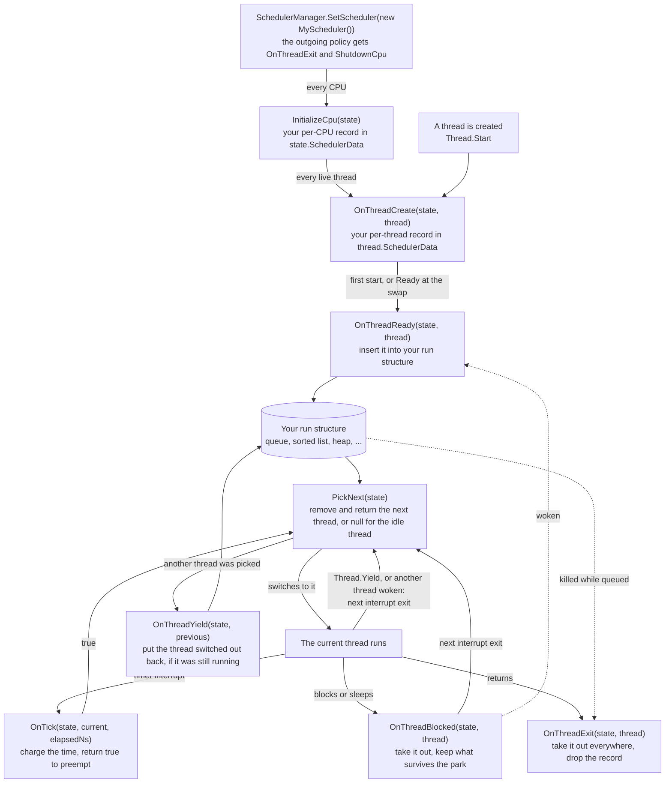

<a id="writing-a-scheduler"></a>

# Écrire un ordonnanceur

Dans cet article, nous verrons comment écrire une politique d'ordonnancement pour Cosmos Gen3 : comment l'installer, l'interface qu'elle implémente, où elle conserve son état et les règles sous lesquelles ses hooks s'exécutent, puis des esquisses des algorithmes classiques et ce qui manque encore à une politique temps réel.

L'ordonnanceur du noyau est divisé en deux, un [mécanisme et une politique](../dev/sched-concepts/policy-and-mechanism.md). Le mécanisme bascule d'un thread à l'autre, tient le registre des threads, reçoit le tick du minuteur et permet au ramasse-miettes de trouver chaque thread, et il ne change jamais. Tout ce qui décide quel thread s'exécute et quand passe par une seule interface, [`IScheduler`](https://github.com/CosmosOS/Cosmos/blob/gen3/src/Cosmos.Kernel.Core/Scheduler/IScheduler.cs), et la politique installée au démarrage est Stride, un ordonnanceur à [partage équitable par temps virtuel](../dev/sched-concepts/virtual-time-fair-share.md). Vous écrivez une politique lorsque vous voulez ordonner les threads autrement : par priorité fixe, par échéance, en simple rotation, ou sans préemption pendant que vous traquez une condition de course. Chaque terme lié dispose d'une courte note de contexte dans le [glossaire de l'ordonnanceur](../dev/scheduler-glossary.md), et le mécanisme lui-même est décrit dans [Ordonnanceur](../dev/scheduler.md), dans la documentation contributeur.

Si vous trouvez des bugs ou quelque chose d'anormal, merci de [soumettre une issue](https://github.com/CosmosOS/Cosmos/issues/new/choose) sur notre dépôt.

---

<a id="experimental-status"></a>

## Statut expérimental

Les types du point d'extension (`IScheduler`, `SchedulerManager`, `SchedulerThread`, `PerCpuState`, `SchedulerExtensible`, `InterruptMaskScope`, `SchedulerThreadState`, `SchedulerThreadFlags`) portent `[Experimental("COSMOS0001")]` : ils sont utilisables dès aujourd'hui mais ne promettent aucune compatibilité, et ils rejoignent la surface stable par le retrait de l'attribut une fois éprouvés. Les référencer provoque une erreur de build tant que le projet n'a pas pris acte de ce contrat :

```xml
<PropertyGroup>
  <NoWarn>$(NoWarn);COSMOS0001</NoWarn>
</PropertyGroup>
```

Consultez [Suivi de l'API publique](../dev/public-api.md) pour savoir comment les points d'extension expérimentaux s'inscrivent dans la politique de surface d'API.

---

<a id="replacing-the-policy"></a>

## Remplacer la politique

Remplacer la politique se fait en trois étapes :

1. Implémentez `IScheduler` dans votre projet de noyau, en conservant la comptabilité de l'algorithme dans les emplacements de données par thread et par CPU ([Attacher un état](#attaching-state)). Le point d'extension est public, si bien qu'une politique n'a besoin d'aucun accès aux éléments internes de `Cosmos.Kernel.Core`.
2. Respectez les [contraintes du noyau](#kernel-constraints) : les hooks s'exécutent en contexte d'interruption ou avec les interruptions masquées, sur l'état vivant de l'ordonnanceur.
3. Installez-la avec `SchedulerManager.SetScheduler`.

Un noyau installe sa politique une fois qu'il a démarré, par exemple depuis `BeforeRun` :

```csharp
using Cosmos.Kernel.Core.Scheduler;
using Sys = Cosmos.Kernel.System;

namespace MyOS;

public class Kernel : Sys.Kernel
{
    protected override void BeforeRun()
    {
        SchedulerManager.SetScheduler(new MyScheduler());
    }

    protected override void Run()
    {
        // The kernel's main loop, which runs on the boot thread.
    }
}
```

Vous ne pouvez pas passer avant la politique par défaut. Le noyau installe Stride pendant son démarrage, avant l'étape des pilotes, si bien qu'au moment où votre code s'exécute, Stride gère déjà le thread de démarrage, le thread de travail du kit de pilotes et tout thread qu'un pilote a lancé. `SetScheduler` les déplace tous : la politique sortante reçoit `OnThreadExit` pour chaque thread vivant et `ShutdownCpu` pour chaque CPU, puis votre politique reçoit `InitializeCpu` pour chaque CPU, `OnThreadCreate` pour chaque thread vivant et `OnThreadReady` pour chacun de ceux qui sont dans l'état `Ready`. L'échange complet s'exécute avec les interruptions masquées, et chaque CPU réordonnance à sa prochaine sortie d'interruption, si bien que votre politique choisit dans sa propre structure d'exécution à partir de ce moment. Pour revenir à Stride plus tard, conservez la politique que renvoie `SchedulerManager.Current` avant l'échange et réinstallez-la ; la classe `StrideScheduler` elle-même est interne.

L'ordonnanceur doit être compilé dans le noyau. Avec `CosmosEnableScheduler` désactivé, ou avec `CosmosEnableInterrupts` ou `CosmosEnableTimer` désactivé, ce qui le désactive aussi, `SetScheduler` lève `InvalidOperationException`.

---

<a id="the-interface"></a>

## L'interface

Le gestionnaire appelle la politique à des points fixes de la vie d'un thread et garde tout le reste : il fixe chaque `SchedulerThread.State`, tient le registre des threads, demande un réordonnancement quand un thread se réveille, rend au ramasse-miettes le tampon d'allocation d'un thread qui se termine, effectue le changement de contexte et exécute le thread inactif quand `PickNext` renvoie `null`, si bien qu'une politique n'a rien de tout cela à refaire. Le diagramme suit un thread à travers les hooks :



La plupart des hooks reçoivent le `PerCpuState` sur lequel ils opèrent, et s'exécutent soit avec les interruptions masquées par le gestionnaire, soit dans le contexte d'interruption lui-même ; les exceptions sont signalées plus bas. Une politique qui n'a pas besoin d'un hook le laisse vide. Le tableau indique quand chaque membre est appelé et ce qu'il doit faire :

| Membre | Appelé quand | Contrat |
|--------|-------------|----------|
| `Name` | `SchedulerDiagnostics.SchedulerName` le lit | Un nom d'affichage pour les journaux |
| `InitializeCpu(state)` | une fois par CPU, quand la politique est installée | Allouer la comptabilité par CPU dans `state.SchedulerData` |
| `ShutdownCpu(state)` | une fois par CPU, quand la politique est remplacée | La libérer, en laissant un emplacement propre pour la politique entrante |
| `OnThreadCreate(state, thread)` | un thread est créé, et une fois pour chaque thread vivant quand la politique est installée | Allouer la comptabilité par thread dans `thread.SchedulerData` ; ne pas encore mettre le thread en file |
| `OnThreadReady(state, thread)` | un thread devient exécutable : son premier lancement, un réveil, un sommeil expiré, ou l'état `Ready` lors de l'échange | Placer le thread et l'insérer dans la structure d'exécution, une seule fois. Le gestionnaire écrit `Ready` après le retour du hook, si bien que `thread.State` indique encore lequel des quatre cas s'applique : `Created`, `Blocked`, `Sleeping` ou `Ready` |
| `OnThreadBlocked(state, thread)` | un thread se bloque sur une primitive ou s'endort | Retirer le thread de la structure d'exécution ; sauvegarder ce qui doit survivre à la mise en attente |
| `OnThreadYield(state, thread)` | un changement de contexte retire le thread du CPU alors qu'il est encore `Running`, préempté ou cédant sa place | Réinsérer le thread |
| `OnThreadExit(state, thread)` | un thread se termine, ou `SchedulerDiagnostics.RequestKill` le tue pendant qu'il attend dans la structure d'exécution, et pour chaque thread vivant quand la politique est remplacée | Le retirer partout et abandonner sa comptabilité |
| `OnTick(state, current, elapsedNs)` | à chaque tick du minuteur, dans l'interruption du minuteur | Comptabiliser le temps écoulé ; renvoyer `true` pour demander un réordonnancement. `elapsedNs` est l'intervalle de tick configuré, pas une mesure |
| `PickNext(state)` | à chaque réordonnancement, en contexte d'interruption | Retirer et renvoyer le prochain thread à exécuter, ou renvoyer `null` pour exécuter le thread inactif |
| `OnPickFailed(state, thread)` | jamais pour l'instant | Remettre en place un thread que le mécanisme a choisi mais vers lequel il n'a pas pu basculer |
| `SelectCpu(thread, currentCpu, cpuCount)` | jamais pour l'instant | Choisir un CPU de départ pour un thread ; respecter `SchedulerThreadFlags.Pinned` |
| `OnThreadMigrate(thread, fromState, toState)` | depuis le `Balance` de la politique elle-même | Déplacer la comptabilité du thread, et toute base de temps virtuel, d'un CPU à l'autre |
| `Balance(state, allCpuStates)` | jamais pour l'instant | Rééquilibrer la charge entre les CPU ; respecter `Pinned` |
| `SetPriority(state, thread, priority)` / `GetPriority(thread)` | `SchedulerManager.SetPriority` ; `SchedulerDiagnostics` lit `GetPriority` à chaque instantané de thread | La priorité est définie par la politique : Stride la lit comme un nombre de tickets, une politique temps réel la lirait comme un niveau de priorité. Aucun des deux n'est appelé avec les interruptions masquées |
| `GetRunQueueCount(state)` / `GetRunQueueThread(state, index)` | `SchedulerDiagnostics` lit la structure d'exécution | Introspection en lecture seule ; protégez-la vous-même (voir [contraintes du noyau](#kernel-constraints)) |

Quatre d'entre eux n'ont aucun appelant sur lequel une politique puisse compter. `SelectCpu` et `Balance` ne sont jamais appelés, parce que le noyau s'exécute sur un seul CPU ([affinité CPU et équilibrage de charge](../dev/sched-concepts/cpu-affinity.md)) ; `OnPickFailed` n'est jamais appelé, parce que le changement de contexte va toujours vers le thread que `PickNext` a renvoyé ; et `SetPriority` n'est atteint qu'au travers de `SchedulerManager.SetPriority`, que rien dans le noyau n'appelle. Implémentez les quatre, mais ne comptez pas sur leur exécution. `Name`, `SelectCpu` et `GetPriority` ne reçoivent aucun `PerCpuState`, et `InitializeCpu` et `ShutdownCpu` s'exécutent en contexte de thread, à l'intérieur de l'échange masqué.

Un thread en cours d'exécution que `RequestKill` tue est seulement marqué `Dead` : il quitte le CPU au changement de contexte suivant sans passer par `OnThreadYield` et n'atteint jamais `OnThreadExit`, si bien que son enregistrement reste dans l'emplacement.

`PickNext` s'exécute à chaque réordonnancement, pas seulement après que `OnTick` a renvoyé `true`. Un réveil, un blocage, un `Thread.Yield` ou un échange de politique demande un réordonnancement, et la sortie d'interruption matérielle suivante appelle `PickNext` pour y répondre : sans appeler `OnTick` du tout quand cette interruption n'est pas le tick, et quelle que soit la réponse de `OnTick` quand c'est le tick ([changement de contexte](../dev/sched-concepts/context-switch.md)). Le thread présent sur le CPU n'est normalement pas dans la structure d'exécution à ce moment-là ([états des threads et file d'exécution](../dev/sched-concepts/run-queue.md)) : il ne repasse par `OnThreadYield` qu'une fois que `PickNext` en a choisi un autre. L'exception est un thread qui s'est bloqué et a été réveillé avant que le changement de contexte ne le retire du CPU : il est `Ready` et déjà en file, et `PickNext` peut le rendre comme n'importe quel autre thread en file. Une politique qui classe les threads, et qui ne doit donc pas laisser chaque réveil déloger le thread courant, compare le meilleur thread en file avec `state.CurrentThread` et renvoie `state.CurrentThread` lui-même tant que le `State` de ce thread vaut encore `Running`, ce qui le garde sur le CPU. Ne renvoyez jamais un thread qui est `Blocked`, `Sleeping` ou `Dead` : le gestionnaire ne le vérifie pas. Renvoyer `null` exécute le thread inactif, qui est le propre thread de démarrage du noyau, si bien qu'un `OnTick` qui renvoie `true` alors que rien n'est en file lui donne le CPU.

**Garder le thread courant, c'est aussi le garder pendant son propre `Thread.Yield`.** `PickNext` ne sait pas pourquoi il s'exécute, et `Thread.Yield` demande le même réordonnancement qu'un réveil. `Thread.Start` s'appuie sur ce réordonnancement : il appelle `Thread.Yield` en boucle jusqu'à ce que le nouveau thread se soit exécuté pour la première fois, si bien qu'une politique qui garde le thread appelant face à un nouveau thread qui ne le surclasse pas ne laisse jamais ce dernier s'exécuter, et l'appel ne revient jamais. Une politique qui garde le thread courant donne donc à un thread en file encore `Created` sa première exécution au réordonnancement suivant. Toute autre boucle qui attend au moyen de `Thread.Yield` un thread que la politique classe plus bas tourne indéfiniment de la même façon.

---

<a id="attaching-state"></a>

## Attacher un état

`SchedulerThread` et `PerCpuState` héritent tous deux de `SchedulerExtensible`, qui porte exactement un emplacement `object?`, `SchedulerData`, réservé à la politique active. Allouez dans les hooks de création, et lisez l'emplacement avec `as` :

```csharp
public sealed class MyThreadData { public ulong Deadline; }
public sealed class MyCpuData { public List<SchedulerThread> Queue { get; } = new(SchedulerThread.MaxThreadCount); }

public void OnThreadCreate(PerCpuState state, SchedulerThread thread)
    => thread.SchedulerData = new MyThreadData();

public bool OnTick(PerCpuState state, SchedulerThread current, ulong elapsedNs)
{
    MyThreadData? data = current.SchedulerData as MyThreadData;
    if (data is null) { return true; }   // exited: get it off the CPU
    ...
}
```

Lisez l'emplacement avec `as`, jamais avec un cast, et gérez `null` dans chaque hook. `OnThreadExit` vide l'emplacement, si bien qu'un thread peut perdre son enregistrement entre un tick et le hook qui l'observe, et déréférencer l'emplacement vide échoue à l'intérieur de l'interruption du minuteur. Un cast n'aiderait pas ici, puisque caster `null` donne `null`, et il lèverait une exception sur un emplacement contenant autre chose que votre enregistrement ; `as` transforme les deux cas en `null`, que l'unique vérification traite.

Un enregistrement écrit par une autre politique n'est pas un cas qu'un hook doit gérer, parce que `SetScheduler` réinstalle chaque thread vivant ([Remplacer la politique](#replacing-the-policy)). Un thread qui arrive déjà en cours d'exécution, en revanche, en est un. Le thread présent sur le CPU lors de l'échange (le thread de démarrage quand Stride est installé au démarrage, ou le thread qui appelle `SetScheduler` plus tard) atteint `OnThreadCreate` dans l'état `Running` et n'est jamais transmis à `OnThreadReady`, si bien qu'une politique qui compte ses threads exécutables ou leurs poids le prend en compte à cet endroit, sans le mettre en file. C'est pour cette raison que Stride ajoute les tickets du thread à son total dans `OnThreadCreate`.

Un emplacement par objet, c'est tout le budget. Une politique qui a besoin de plusieurs valeurs définit une classe qui les regroupe, comme le fait Stride avec un enregistrement par thread et un par CPU.

---

<a id="kernel-constraints"></a>

## Contraintes du noyau

Les hooks s'exécutent dans la fenêtre la plus sensible du noyau, si bien que quatre règles n'ont rien de facultatif.

**Un hook ne peut pas attendre.** `OnTick` s'exécute dans l'interruption du minuteur, et `PickNext` et `OnThreadYield` dans la sortie d'interruption, quelle qu'elle soit, qui porte le réordonnancement ([contexte d'interruption](driver-concepts/interrupt-context.md)) ; `OnThreadReady` peut aussi s'exécuter dans une interruption quand le tick ou le gestionnaire d'interruption d'un périphérique réveille un thread, et les autres hooks du cycle de vie s'exécutent avec les interruptions masquées, sur le thread qui a appelé le gestionnaire, quel qu'il soit. Dans un cas comme dans l'autre, aucun autre thread et aucun tick ne peut s'exécuter sur ce CPU avant le retour du hook, si bien qu'un hook qui bloque, se met en attente ou attend un autre thread attend indéfiniment.

**N'allouez pas sur le chemin du tick.** L'allocation est sûre en contexte d'interruption dans ce noyau, mais une allocation dans `OnTick` ou `PickNext` peut déclencher une collecte à l'intérieur d'une interruption. Allouez dans `OnThreadCreate` et `InitializeCpu`, où la création d'un thread en paie déjà le coût, et donnez-y aux collections leur capacité, puisqu'une liste qui grandit dans `OnThreadReady` ou `OnThreadYield` alloue sur le même chemin.

**Comparez les threads avec `ReferenceEquals`.** `List<T>.Remove`, `Contains` et `IndexOf` passent par `EqualityComparer<T>.Default`, qui nécessite des fonctions d'assistance du runtime que le noyau ne fournit pas. Parcourez avec `ReferenceEquals` et retirez avec `RemoveAt`, comme le fait Stride.

**Masquez les interruptions sur les points d'entrée que le gestionnaire ne masque pas.** Un hook qui modifie la structure d'exécution peut être interrompu à mi-parcours par le tick, sauf si les interruptions sont masquées ([spinlocks et masquage des interruptions](../dev/sched-concepts/spinlocks-and-masking.md)). Le gestionnaire les masque autour des hooks du cycle de vie et des deux hooks par CPU, et les hooks du tick s'exécutent dans l'interruption elle-même, mais quatre hooks ne bénéficient d'aucun masquage : `SetPriority`, `GetPriority`, `GetRunQueueCount` et `GetRunQueueThread`. Le spinlock par CPU que le gestionnaire tient autour de `SetPriority` n'y change rien, parce qu'il écarte un autre appelant et que le tick ne prend aucun verrou. Ces quatre-là, et tout point d'entrée qu'une politique ajoute elle-même, comme un setter de réglage ou une lecture de statistiques, masquent eux-mêmes les interruptions :

```csharp
public int GetRunQueueCount(PerCpuState state)
{
    using (SchedulerManager.MaskInterrupts())
    {
        MyCpuData? data = state.SchedulerData as MyCpuData;
        return data is null ? 0 : data.Queue.Count;
    }
}
```

Masquer à l'intérieur d'un hook rend un appel atomique, et rien de plus : un appelant qui lit `GetRunQueueCount` puis parcourt les indices a besoin de son propre masquage autour de tout le parcours.

---

<a id="worked-sketches"></a>

## Esquisses commentées

Les mêmes questions reviennent pour chaque algorithme : ce qu'il faut stocker par thread et par CPU, quelle forme prend la structure d'exécution, ce qui déclenche la préemption dans `OnTick`, et ce qui doit survivre à une mise en attente. Les esquisses ci-dessous y répondent pour les algorithmes classiques. Toute politique qui classe les threads (MLFQ, priorité fixe, EDF) a aussi besoin de la comparaison dans `PickNext` que décrit [L'interface](#the-interface), qui garde le thread courant quand rien en file ne le surclasse, ainsi que de l'exception de première exécution pour un thread `Created` qui l'accompagne ; les tableaux omettent l'une et l'autre.

### Round-robin

Une file FIFO avec [préemption](../dev/sched-concepts/preemption.md) à quantum fixe :

| Hook | Comportement |
|------|----------|
| `PerCpuState.SchedulerData` | Une file de threads |
| `SchedulerThread.SchedulerData` | Un compteur de quantum restant |
| `OnThreadReady` | Ajouter en fin de file avec un quantum neuf |
| `OnThreadBlocked` | Retirer de la file : le thread qui se bloque est généralement celui en cours d'exécution, qui n'est pas en file, mais un thread réveillé avant d'avoir quitté le CPU est en file alors qu'il s'exécute encore |
| `OnTick` | Imputer `elapsedNs` sur le quantum ; à zéro, renvoyer `true` si un autre thread est en file, ou accorder sur place un quantum neuf |
| `OnThreadYield` | Remettre en fin de file, réinitialiser le quantum |
| `PickNext` | Retirer la tête de file |

L'ordre FIFO borne déjà la latence à `quantum * queue depth`, si bien que le round-robin n'a besoin d'aucune logique de placement au réveil.

Cette esquisse existe sous la forme d'une politique complète écrite uniquement sur le point d'extension public, exactement comme le serait celle d'un noyau : [`RoundRobinScheduler`](https://github.com/CosmosOS/Cosmos/blob/gen3/tests/Kernels/Cosmos.Kernel.Tests.Threading/RoundRobinScheduler.cs) sur GitHub. Son quantum est de deux [ticks](../dev/sched-concepts/scheduler-tick.md), si bien que sa comptabilité doit se maintenir pendant le tick intermédiaire. Un noyau teste une telle politique en conditions réelles, après l'avoir installée, parce que `PerCpuState` et `SchedulerThread` n'ont pas de constructeur public et que les hooks ne peuvent pas être pilotés sur vos propres objets. Vérifiez ce que seul un noyau en cours d'exécution montre : que les nouveaux threads obtiennent le CPU, qu'un thread qui tourne en boucle est préempté quand son quantum expire, que deux threads qui bouclent se partagent le CPU comme la politique l'entend, et que `SchedulerDiagnostics.GetRunQueueCount` diminue quand un thread se bloque et remonte quand il se réveille. Ne vérifiez pas par assertion l'ordre dans lequel les threads atteignent leur délégué : ce n'est pas l'ordre dans lequel ils sont devenus prêts, parce qu'un thread préempté dans son code de démarrage repart en fin de file comme n'importe quel autre.

Les deux sens de l'échange méritent aussi d'être testés. À l'aller, la politique reçoit le thread de démarrage et tous les autres threads vivants par `OnThreadCreate`, et doit malgré tout lire chaque emplacement avec `as`, pour la raison donnée dans [Attacher un état](#attaching-state). Au retour, la politique sauvegardée depuis `SchedulerManager.Current` les reçoit de la même façon, si bien qu'un thread qui reste vivant au travers des deux échanges change de politique, et qu'un thread qui boucle et reste en exécution au travers d'eux devrait continuer à progresser sous chacune.

<a id="multi-level-feedback-queue-mlfq"></a>

### File multiniveau à rétroaction (MLFQ)

Plusieurs niveaux de priorité ; les threads sont rétrogradés quand ils consomment un quantum complet et promus quand ils se bloquent tôt :

| Hook | Comportement |
|------|----------|
| `PerCpuState.SchedulerData` | Un tableau de files, une par niveau |
| `SchedulerThread.SchedulerData` | Niveau courant et compteur de quantum consommé |
| `OnThreadReady` | Mettre en file au niveau courant du thread |
| `OnThreadBlocked` | Retirer de sa file et promouvoir d'un niveau : le thread s'est bloqué avant l'épuisement de son quantum, il est donc traité comme interactif |
| `OnTick` | Imputer le temps ; à la fin du quantum du niveau, marquer le thread pour rétrogradation et renvoyer `true` |
| `OnThreadYield` | Remettre en file au niveau du thread, un niveau plus bas s'il était marqué pour rétrogradation |
| `PickNext` | Parcourir les niveaux de haut en bas, retirer la tête de la première file non vide |
| périodique (par exemple tous les N ticks dans `OnTick`) | Remettre tous les threads au niveau le plus haut, la remontée classique contre la [famine](../dev/sched-concepts/starvation.md) |

MLFQ ne suit aucun temps virtuel ; toute sa comptabilité tient en niveaux entiers.

<a id="fixed-priority-preemptive-fpp"></a>

### Priorité fixe préemptive (FPP)

La politique par défaut de la plupart des RTOS (FreeRTOS, Zephyr, ThreadX) : le thread exécutable de plus haute priorité s'exécute toujours, en FIFO au sein d'un niveau :

| Hook | Comportement |
|------|----------|
| `PerCpuState.SchedulerData` | Un tableau de files indexé par priorité |
| `SchedulerThread.SchedulerData` | Une priorité statique |
| `OnThreadReady` | Mettre en file à la fin du niveau du thread ; le réordonnancement que le gestionnaire demande à chaque réveil exécute `PickNext` à la sortie d'interruption suivante, et c'est ainsi qu'un réveil de priorité plus haute préempte |
| `OnThreadBlocked` / `OnThreadYield` | Retirer de son niveau / remettre en file à la fin de son niveau |
| `OnTick` | Renvoyer `true` si un niveau au-dessus de celui du thread courant n'est pas vide (priorité pure, pas de quantum) |
| `PickNext` | Parcours de haut en bas, retirer la première tête |
| `SetPriority` | Déplacer le thread d'un niveau à l'autre, à l'intérieur de `SchedulerManager.MaskInterrupts()` |

Rate Monotonic est une FPP dont les priorités sont attribuées à partir de la période de chaque thread : plus la période est courte, plus la priorité est haute ([ordonnancement temps réel](../dev/sched-concepts/real-time-scheduling.md)). Le point d'extension ne transporte aucune période, si bien que la politique la reçoit par un point d'entrée qui lui est propre, ou l'encode dans la valeur passée à `SetPriority`. Elle doit aussi maintenir elle-même l'utilisation totale sous la borne d'ordonnançabilité, et comme aucun hook ne peut refuser un thread (`OnThreadCreate` ne renvoie rien), ce contrôle d'admission a sa place dans le point d'entrée propre à la politique, que le noyau appelle avant de lancer le thread.

<a id="earliest-deadline-first-edf"></a>

### Échéance la plus proche d'abord (EDF)

Priorité dynamique selon l'échéance absolue. Earliest Deadline First est optimal sur un seul CPU, puisqu'il respecte chaque échéance jusqu'à 100 % d'utilisation là où Rate Monotonic en garantit environ 69 %, et il est plus difficile à analyser en surcharge :

| Hook | Comportement |
|------|----------|
| `PerCpuState.SchedulerData` | Un tas min ordonné par échéance absolue |
| `SchedulerThread.SchedulerData` | Période, échéance relative, échéance absolue, les deux premières reçues par un point d'entrée propre à la politique, comme pour Rate Monotonic |
| `OnThreadReady` | `absolute = now + relative`, insérer dans le tas |
| `OnThreadBlocked` / `OnThreadYield` | Retirer du tas / réinsérer avec son échéance absolue inchangée |
| `OnTick` | Renvoyer `true` si l'échéance de la racine du tas est antérieure à celle du thread courant |
| `PickNext` | Extraire la racine |

<a id="fifo-cooperative"></a>

### FIFO (coopératif)

Une politique de débogage, utile pour traquer une condition de course qui disparaît sous préemption : une seule file, `OnTick` renvoie toujours `false`, et `PickNext` garde le thread courant tant qu'il est encore `Running`, si bien qu'un thread s'exécute jusqu'à ce qu'il se bloque, s'endorme ou se termine. Sans cette vérification dans `PickNext`, chaque réveil ailleurs ferait tout de même changer de thread, parce que le gestionnaire réordonnance à chacun d'eux. La vérification a deux coûts. Un thread limité par le calcul qui ne se bloque jamais garde le CPU pour de bon, et il en irait de même d'un thread à l'intérieur de `Thread.Start`, qui attend au moyen de `Thread.Yield` la première exécution du nouveau thread, si bien que `PickNext` doit laisser s'exécuter en premier un thread encore `Created`.

---

<a id="real-time-notes"></a>

## Remarques sur le temps réel

La séparation entre politique et mécanisme fait du framework une base plausible pour un noyau [temps réel](../dev/sched-concepts/real-time-scheduling.md). Le changement de contexte n'alloue rien, si bien que son coût est déterministe ; une mise en sommeil temporisée fournit le réveil dont une tâche périodique a besoin, et `SetPriority` est le levier qu'utiliserait un protocole de priorité. L'affinité n'est là qu'à moitié : une politique respecte `SchedulerThreadFlags.Pinned`, mais seuls les threads inactifs le portent, puisqu'un noyau peut lire `SchedulerThread.Flags` mais pas le modifier. Un build temps réel dur doit encore ajouter des éléments des deux côtés de l'interface.

Le côté politique doit borner son propre coût et surveiller sa charge. Tout ce qui se trouve dans `OnTick` et `PickNext` s'ajoute à la latence d'interruption dans le pire cas, si bien que l'insertion triée linéaire de Stride ne conviendrait pas, alors que des FIFO par priorité ou un tas maintiennent les hooks en O(log n) ou mieux. Rien n'empêche non plus la surréservation, et c'est à la politique d'ajouter elle-même le contrôle d'admission que décrit l'esquisse Rate Monotonic.

Au côté noyau, il manque l'héritage de priorité et un tick piloté par les échéances. Le mutex propre au noyau, interne à `Cosmos.Kernel.Core` et sur lequel reposent les attentes de moniteur bas niveau de CoreLib, réveille ses threads en attente dans l'ordre FIFO et transmet la propriété directement au premier d'entre eux, sans remontée de priorité pour le détenteur : c'est équitable, mais exposé à l'[inversion de priorité](../dev/sched-concepts/priority-inversion.md). Un protocole d'héritage, qui élève le détenteur à la priorité du plus prioritaire des threads en attente par `SetPriority` et la rétablit à la libération, dispose de son hook mais d'aucune implémentation. Le tick de l'ordonnanceur s'exécute à une période fixe, 10 ms dès le démarrage. Sur ARM64, son minuteur, le Generic Timer, est déjà réarmé en mode ponctuel à chaque interruption ; sur x64, le tick provient du minuteur APIC local périodique, qu'il faudrait faire passer à un réarmement ponctuel. Dans les deux cas, la pièce manquante est un canal de la politique vers le minuteur, afin que la prochaine interruption soit programmée pour la prochaine échéance plutôt que selon une période fixe.

---

<a id="summary"></a>

## Résumé

| Tâche | Appel |
|---|---|
| Installer une politique | `SchedulerManager.SetScheduler(policy)` |
| Conserver la politique installée, pour la réinstaller plus tard | `SchedulerManager.Current` |
| Attacher un état par CPU | `state.SchedulerData = new MyCpuData()`, dans `InitializeCpu` |
| Attacher un état par thread | `thread.SchedulerData = new MyThreadData()`, dans `OnThreadCreate` |
| Relire l'un ou l'autre | `SchedulerData as MyRecord`, en gérant `null` |
| Mettre en file un thread exécutable | `OnThreadReady`, `OnThreadYield` |
| Retirer un thread | `OnThreadBlocked`, `OnThreadExit` |
| Choisir le thread suivant | `PickNext`, en renvoyant `state.CurrentThread` pour le garder ou `null` pour le thread inactif |
| Préempter sur le tick | `true` renvoyé par `OnTick` |
| Protéger un point d'entrée que le gestionnaire ne protège pas | `using (SchedulerManager.MaskInterrupts())` |
| Changer la priorité d'un thread | `SchedulerManager.SetPriority(cpuId, thread, priority)` |
| Lire la structure d'exécution pendant l'exécution | `SchedulerDiagnostics.GetRunQueueCount(cpuId)`, `SchedulerDiagnostics.TryGetRunQueueThread(cpuId, index, out info)` |
| Lire la période du tick | `SchedulerDiagnostics.TickPeriodNs` |
