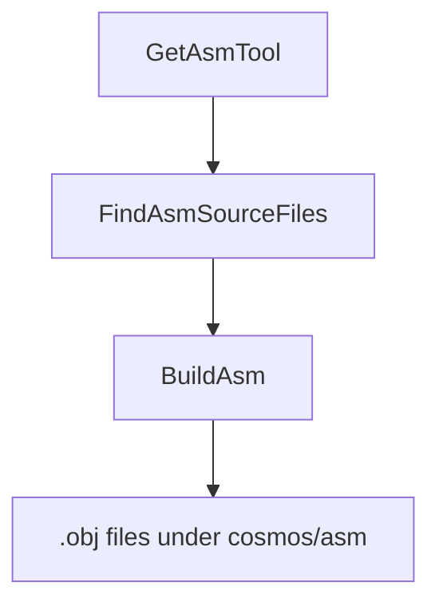

`Cosmos.Build.Asm` 将手写的汇编源文件编译为目标文件，这些目标文件随后会与 NativeAOT 的输出链接在一起。x64 和 ARM64 两种目标都使用 **clang 集成汇编器**处理 GAS 语法的 `.s` 文件。

---

## 流程图

---

## 参数

| 名称 | 说明 | 默认值 |
| --- | --- | --- |
| `AsmToolPath` | `clang` 可执行文件的完整路径。未设置时由 `GetAsmTool` 自动检测。 | 通过 `ResolveCosmosToolTask` 解析（系统 PATH + Cosmos 工具捆绑包） |
| `AsmSearchPath` | 要扫描（非递归）`*.s` 文件的一个或多个目录。 | 无 |
| `AsmFiles` | 要编译的 `*.s` 文件的显式列表（会添加到扫描结果中）。 | 无 |
| `AsmOutputPath` | 存放编译后目标文件的目录。 | `$(IntermediateOutputPath)/cosmos/asm/` |

注：
- 设置了 `RuntimeIdentifier`（例如 `linux-x64`）时，如果存在架构子文件夹（例如 `<searchDir>/x64/`），`FindAsmSourceFiles` 会优先使用它。
- 目标三元组由 `AsmBuildTask` 根据 `TargetArchitecture` 选择：x64 为 `x86_64-elf`，ARM64 为 `aarch64-none-elf`。

---

## 任务

| 任务 | 说明 | 依赖于 |
| --- | --- | --- |
| `GetAsmTool` | 通过 `ResolveCosmosToolTask` 将 `AsmToolPath` 解析为 clang 二进制文件。 | 无 |
| `FindAsmSourceFiles` | 清理输入，应用按架构的替换，并在 `AsmSearchPath` 下发现 `*.s` 文件。 | `Build` |
| `BuildAsm` | 对每个文件以 `--target=<triple> -c` 调用 `AsmBuildTask`，输出写入 `AsmOutputPath`。 | `FindAsmSourceFiles; GetAsmTool` |
| `CleanAsm` | 删除 `$(IntermediateOutputPath)/cosmos/asm/`。 | `Clean` |

---

## 详细工作流程

1. `GetAsmTool` 将 `AsmToolPath` 解析为一个 `clang` 二进制文件（显式指定 / 系统 / Cosmos 工具捆绑包）。
2. `FindAsmSourceFiles`：
   - 从 `AsmSearchPath` 和 `AsmFiles` 中移除所有不存在的条目（并发出警告）。
   - 如果设置了 `RuntimeIdentifier`，则将包含匹配架构子文件夹的 `AsmSearchPath` 条目替换为该子文件夹（例如 `x64`）。
   - 构建非递归搜索模式 `%(AsmSearchPath.FullPath)/*.s`，并将结果添加到 `AsmFiles`（已去重）。
3. `BuildAsm` 对每个文件调用 `AsmBuildTask`：
   - 计算源文件的 SHA1，并将 `<name>-<sha1>.obj` 输出到 `AsmOutputPath`。
   - 执行 `clang --target=<x86_64-elf|aarch64-none-elf> -c -o <output.obj> <input.s>`。
4. `CleanAsm` 在 `Clean` 期间删除 `cosmos/asm` 中间文件夹。

---

## 输出

- 位于 `$(IntermediateOutputPath)/cosmos/asm/` 中的目标文件，命名为 `<sourceName>-<sha1>.obj`，其中 `<sha1>` 是源文件内容的哈希。这保证了文件名具有确定性，并且在多次构建之间对缓存友好。

---

## 相关组件

- [`Cosmos.Build.Asm`](https://github.com/CosmosOS/Cosmos/blob/gen3/src/Cosmos.Build.Asm)
