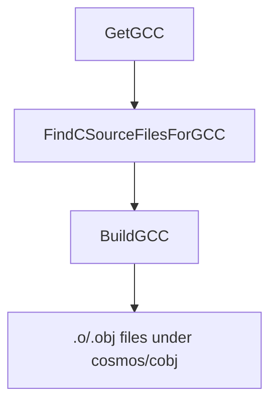

`Cosmos.Build.GCC` 将 C 源文件编译为目标文件，这些目标文件随后与 NativeAOT 的输出链接在一起。

---

## 流程图

---

## 参数

| 名称 | 说明 | 默认值 |
| --- | --- | --- |
| `GCCPath` | `gcc` 可执行文件的完整路径或名称。由 `GetGCC` 按操作系统设置，可在你的项目中覆盖。 | Unix：`gcc`；Windows：`x86_64-elf-gcc` |
| `GCCProject` | 一个或多个要在其中查找 `*.c` 文件的目录（不递归）。支持用架构子文件夹覆盖。 | 无 |
| `GCCOutputPath` | 存放编译后目标文件的目录。 | `$(IntermediateOutputPath)/cosmos/cobj/` |
| `GCCCompilerFlags` | 传递给 GCC 的额外编译器标志。 | `-O2 -fno-stack-protector -nostdinc -fno-builtin`，外加架构相关标志 |

注：
- 设置了 `RuntimeIdentifier`（例如 `linux-x64`）时，如果存在架构子文件夹（例如 `<dir>/x64/`），`FindCSourceFilesForGCC` 会优先使用它。
- 在 Windows 上，默认工具是交叉编译器（`x86_64-elf-gcc`）；在 Unix 上则是 `gcc`。你可以覆盖 `GCCPath`。

---

## 任务

| 任务 | 说明 | 依赖于 |
| --- | --- | --- |
| `GetGCC` | 按操作系统解析 `GCCPath`（Unix：`gcc`，Windows：`x86_64-elf-gcc`）。 | 无 |
| `FindCSourceFilesForGCC` | 清理 `@(GCCProject)` 的输入并应用架构覆盖。 | `Build` |
| `BuildGCC` | 调用 `GCCBuildTask`，编译每个 `@(GCCProject)` 目录中的每个 `*.c` 文件。 | `FindCSourceFilesForGCC; GetGCC` |
| `CleanGCC` | 删除 `$(IntermediateOutputPath)/cosmos/cobj/`。 | `Clean` |

---

## 详细工作流程

1. `GetGCC` 根据宿主操作系统设置 `GCCPath`。如有需要，你可以在项目文件中覆盖 `GCCPath`。
2. `FindCSourceFilesForGCC`：
   - 从 `@(GCCProject)` 中移除所有不存在的路径（并发出警告）。
   - 如果设置了 `RuntimeIdentifier`，并且存在匹配的架构子文件夹（例如 `x64`），就用该子文件夹替换原文件夹。
   - 记录最终的 C 项目目录列表。
3. `BuildGCC`：
   - 确保 `GCCOutputPath`（`$(IntermediateOutputPath)/cosmos/cobj/`）存在，并清理过时的目标文件。
   - 对每个 `@(GCCProject)` 目录调用 `GCCBuildTask`，由它编译该目录中的每个 `*.c` 文件（不递归）。
   - 每个文件单独编译为一个名为 `<name>-<sha1>.(obj|o)` 的目标文件，其中哈希由文件内容计算得出；扩展名在 Windows 上为 `.obj`，在其他系统上为 `.o`。
4. `CleanGCC` 在 `Clean` 期间删除 `cosmos/cobj` 目录。

---

## 输出

- 位于 `$(IntermediateOutputPath)/cosmos/cobj/` 中的目标文件，命名为 `<sourceName>-<sha1>.(obj|o)`。

---

## 相关组件

- [`Cosmos.Build.GCC`](https://github.com/CosmosOS/Cosmos/blob/gen3/src/Cosmos.Build.CC)
