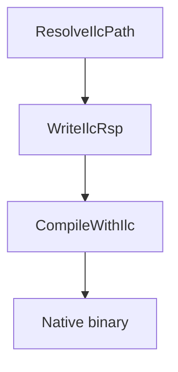

## 概述

`Cosmos.ilc.Build` 将原生 AOT 编译器 [ILCompiler](https://github.com/dotnet/runtime/blob/main/docs/design/coreclr/botr/ilc-architecture.md) 接入 MSBuild 流水线。它接收 [`Cosmos.Build.Patcher`](https://github.com/CosmosOS/Cosmos/blob/gen3/src/Cosmos.Build.Patcher) 输出的修补后程序集，并将其转换为原生目标文件，这些目标文件随后会与 CosmosOS 的平台库链接。

---

## 流程图

---

## 参数

| 名称 | 说明 | 默认值 |
| --- | --- | --- |
| `IlcToolsPath` | 从 `Microsoft.DotNet.ILCompiler` 运行时包中解析出的 `ilc` 可执行文件的路径。 | 自动解析 |
| `IlcIntermediateOutputPath` | 写入 `.ilc.rsp` 和 `.o` 文件的目录。 | `$(IntermediateOutputPath)/cosmos/native/` |
| `IlcSystemModule` | 用作 ILCompiler 入口点的系统模块。 | `System.Private.CoreLib` |
| `UnmanagedEntryPointsAssembly` | 其方法通过 `--generateunmanagedentrypoints` 导出的程序集。 | `Cosmos.Kernel.Runtime` |

---

## 任务

| 任务 | 说明 | 依赖于 |
| --- | --- | --- |
| `ResolveIlcPath` | 下载并定位 ILCompiler，同时设置 `IlcToolsPath`。 | `Build` |
| `WriteIlcRsp` | 生成 ILCompiler 响应文件，其中列出输入、引用和选项。 | `ResolveIlcPath` |
| `CheckIlcCache` | 对输入、引用和响应文件计算哈希，并与上一次编译的哈希进行比较。 | `WriteIlcRsp` |
| `CompileWithIlc` | 使用响应文件运行 `ilc` 以生成原生目标文件，除非 `CheckIlcCache` 发现该目标文件已是最新。 | `WriteIlcRsp`, `CheckIlcCache` |

---

## 详细工作流程

1. **ResolveIlcPath** 使用 `GetPackageDirectory` 查找 `runtime.<RID>.Microsoft.DotNet.ILCompiler` 包，并设置 `IlcToolsPath`。
2. **WriteIlcRsp** 创建 `$(IlcIntermediateOutputPath)$(AssemblyName).ilc.rsp`，从 `$(IntermediateOutputPath)/cosmos` 收集修补后的程序集，从 `cosmos/ref` 收集引用，并加入 `--runtimeknob` 和 `--feature` 标志等 ILCompiler 选项。
3. **CheckIlcCache** 对输入程序集、引用程序集和响应文件计算一个 SHA-256 哈希，并将其与上一次编译留下的 `.ilc-hash` 进行比较。响应文件是有意纳入键中的：在内核的 `.csproj` 中切换一个功能开关不会改变任何程序集，只会改变响应文件中的 `--runtimeknob` 参数，如果键只基于程序集计算，就会保留按旧值编译的目标文件。
4. **CompileWithIlc** 使用生成的响应文件执行 `ilc`，在 `$(IlcIntermediateOutputPath)` 中生成 `$(AssemblyName).o`，并写入新的哈希。哈希一致时，该步骤会被跳过，日志中输出 `ILC cache hit`。
5. 原生二进制文件随后可以进一步打包，例如集成到引导加载程序中。

---

## 输出

- 响应文件：`$(IntermediateOutputPath)/cosmos/native/$(AssemblyName).ilc.rsp`，列出输入、引用和 ILCompiler 选项。
- 原生目标文件：`$(IntermediateOutputPath)/cosmos/native/$(AssemblyName).o`，由 `CompileWithIlc` 生成，用于链接。
- 缓存键：`$(IntermediateOutputPath)/cosmos/native/.ilc-hash`，即编译该目标文件时所用输入的哈希。

注：
- ILC 解析的引用程序集位于 `$(IntermediateOutputPath)/cosmos/ref/` 下，来自 Patcher 步骤。

---

## 相关组件

- [`Cosmos.Build.Ilc`](https://github.com/CosmosOS/Cosmos/blob/gen3/src/Cosmos.Build.Ilc)
- [`Cosmos.Build.Patcher`](https://github.com/CosmosOS/Cosmos/blob/gen3/src/Cosmos.Build.Patcher)
- [`Cosmos.Patcher`](https://github.com/CosmosOS/Cosmos/blob/gen3/src/Cosmos.Patcher)
