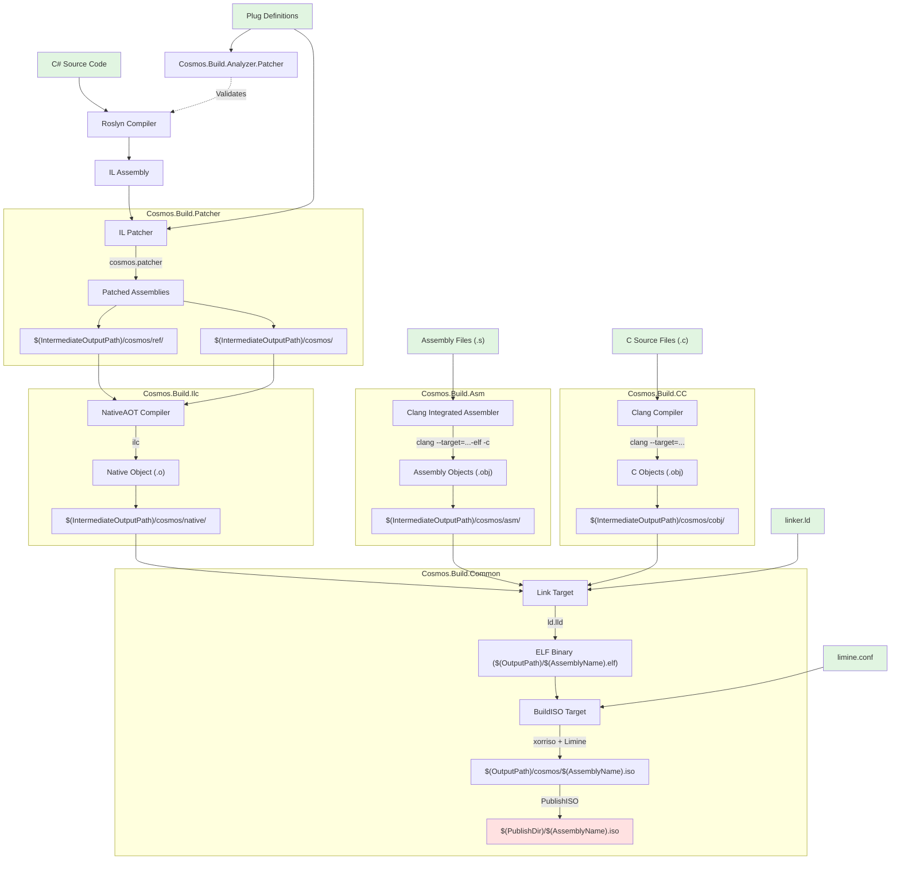

# 内核编译步骤

本文档概述完整的构建流水线：它借助 .NET NativeAOT 编译、自定义的 IL 修补和原生代码生成，把 C# 内核代码转换为可启动的 ISO 镜像。

## 编译流程图

## 前提条件

| 工具 | 用途 | 版本要求 |
|------|---------|-----------------|
| **.NET SDK** | 核心编译 | 10.0+ |
| **Clang** | C 与汇编代码的编译（通过 --target 支持 x64/ARM64） | LLVM 工具链 |
| **ld.lld** | ELF 链接 | LLVM 工具链 |
| **xorriso** | 创建 ISO | 最新版本 |

## 关键组件

- [`Cosmos.Sdk`](https://github.com/CosmosOS/Cosmos/blob/gen3/src/Cosmos.Sdk)：MSBuild SDK 编排
- [`Cosmos.Build.Patcher`](https://github.com/CosmosOS/Cosmos/blob/gen3/src/Cosmos.Build.Patcher)：IL 修补基础设施
- [`Cosmos.Build.Ilc`](https://github.com/CosmosOS/Cosmos/blob/gen3/src/Cosmos.Build.Ilc)：NativeAOT 集成
- [`Cosmos.Build.Asm`](https://github.com/CosmosOS/Cosmos/blob/gen3/src/Cosmos.Build.Asm)：汇编代码编译
- [`Cosmos.Build.CC`](https://github.com/CosmosOS/Cosmos/blob/gen3/src/Cosmos.Build.CC)：C 代码编译（Clang）
- [`Cosmos.Build.Common`](https://github.com/CosmosOS/Cosmos/blob/gen3/src/Cosmos.Build.Common)：链接与 ISO 创建

## 示例项目

参考实现：`examples/DevKernel/DevKernel.csproj`

## 输出汇总

| 阶段 | 输出路径 | 内容 |
|-------|------------|---------|
| 修补 | `$(IntermediateOutputPath)/cosmos/` | 修补后的主程序集 |
| 修补 | `$(IntermediateOutputPath)/cosmos/ref/` | 引用程序集 |
| NativeAOT | `$(IntermediateOutputPath)/cosmos/native/` | 原生目标文件（.o） |
| 汇编 | `$(IntermediateOutputPath)/cosmos/asm/` | Clang 汇编器生成的目标文件（.obj） |
| C 代码 | `$(IntermediateOutputPath)/cosmos/cobj/` | Clang 目标文件（.o/.obj） |
| 链接 | `$(OutputPath)/$(AssemblyName).elf` | 链接后的 ELF 内核 |
| ISO | `$(OutputPath)/cosmos/$(AssemblyName).iso` | 可启动的 ISO 镜像 |
| 发布 | `$(PublishDir)/$(AssemblyName).iso` | 已发布的 ISO |
