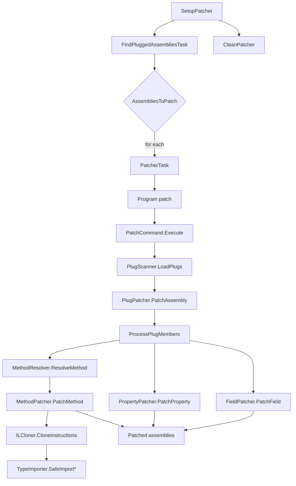

<a id="overview"></a>

## 概述

`Cosmos.Patcher.Build` 将 [`Cosmos.Patcher`](https://github.com/CosmosOS/Cosmos/blob/gen3/src/Cosmos.Patcher) 工具接入 MSBuild 流水线。`Cosmos.Patcher` 通过应用 CosmosOS 风格的 plug 来重写候选程序集中的 IL，使 .NET Core 框架能够在 NativeAOT 目标上运行。静态分析由 [`Cosmos.Patcher.Analyzer`](https://github.com/CosmosOS/Cosmos/blob/gen3/src/Cosmos.Build.Analyzer.Patcher) 提供，它会在 C# 编译期间、任何 IL 被重写之前报告 plug 错误。

---

<a id="net-assembly-structure"></a>

## .NET 程序集结构

.NET 程序集（`.dll` 或 `.exe`）是一个包含元数据和 IL 代码的可移植可执行文件。patcher 使用 Mono.Cecil 操作这些结构。

```
┌─────────────────────────────────────────────────────────────────────┐
│                        AssemblyDefinition                           │
│  ┌───────────────────────────────────────────────────────────────┐  │
│  │ Name: "MyAssembly"                                            │  │
│  │ Version: 1.0.0.0                                              │  │
│  │ CustomAttributes: [AssemblyInfo, ...]                         │  │
│  └───────────────────────────────────────────────────────────────┘  │
│                              │                                      │
│                              ▼                                      │
│  ┌───────────────────────────────────────────────────────────────┐  │
│  │                   ModuleDefinition[0]                         │  │
│  │  ┌─────────────────────────────────────────────────────────┐  │  │
│  │  │ Name: "MyAssembly.dll"                                  │  │  │
│  │  │ AssemblyReferences: [mscorlib, System.Runtime, ...]     │  │  │
│  │  │ TypeReferences: [external type tokens]                  │  │  │
│  │  └─────────────────────────────────────────────────────────┘  │  │
│  │                           │                                   │  │
│  │                           ▼                                   │  │
│  │  ┌─────────────────────────────────────────────────────────┐  │  │
│  │  │                  TypeDefinition[0]                      │  │  │
│  │  │  ┌───────────────────────────────────────────────────┐  │  │  │
│  │  │  │ FullName: "MyNamespace.MyClass"                   │  │  │  │
│  │  │  │ BaseType: System.Object                           │  │  │  │
│  │  │  │ Interfaces: [IDisposable, ...]                    │  │  │  │
│  │  │  │ CustomAttributes: [Plug, Serializable, ...]       │  │  │  │
│  │  │  │                                                   │  │  │  │
│  │  │  │  ┌─────────────────────────────────────────────┐  │  │  │  │
│  │  │  │  │            FieldDefinition[0]               │  │  │  │  │
│  │  │  │  │  Name, FieldType, Attributes, Constant      │  │  │  │  │
│  │  │  │  ├─────────────────────────────────────────────┤  │  │  │  │
│  │  │  │  │            FieldDefinition[n]               │  │  │  │  │
│  │  │  │  └─────────────────────────────────────────────┘  │  │  │  │
│  │  │  │                                                   │  │  │  │
│  │  │  │  ┌─────────────────────────────────────────────┐  │  │  │  │
│  │  │  │  │          PropertyDefinition[0]              │  │  │  │  │
│  │  │  │  │  Name, PropertyType, GetMethod, SetMethod   │  │  │  │  │
│  │  │  │  ├─────────────────────────────────────────────┤  │  │  │  │
│  │  │  │  │          PropertyDefinition[n]              │  │  │  │  │
│  │  │  │  └─────────────────────────────────────────────┘  │  │  │  │
│  │  │  │                                                   │  │  │  │
│  │  │  │  ┌─────────────────────────────────────────────┐  │  │  │  │
│  │  │  │  │           MethodDefinition[0]               │  │  │  │  │
│  │  │  │  │  Name, ReturnType, Parameters, Attributes   │  │  │  │  │
│  │  │  │  │                                             │  │  │  │  │
│  │  │  │  │  ┌───────────────────────────────────────┐  │  │  │  │  │
│  │  │  │  │  │           MethodBody                  │  │  │  │  │  │
│  │  │  │  │  │  Variables: [local0, local1, ...]     │  │  │  │  │  │
│  │  │  │  │  │  MaxStackSize: 8                      │  │  │  │  │  │
│  │  │  │  │  │  InitLocals: true                     │  │  │  │  │  │
│  │  │  │  │  │                                       │  │  │  │  │  │
│  │  │  │  │  │  Instructions:                        │  │  │  │  │  │
│  │  │  │  │  │   IL_0000: ldarg.0                    │  │  │  │  │  │
│  │  │  │  │  │   IL_0001: call .ctor                 │  │  │  │  │  │
│  │  │  │  │  │   IL_0006: ldstr "Hello"              │  │  │  │  │  │
│  │  │  │  │  │   IL_000B: call Console.WriteLine     │  │  │  │  │  │
│  │  │  │  │  │   IL_0010: ret                        │  │  │  │  │  │
│  │  │  │  │  │                                       │  │  │  │  │  │
│  │  │  │  │  │  ExceptionHandlers:                   │  │  │  │  │  │
│  │  │  │  │  │   [try/catch/finally blocks]          │  │  │  │  │  │
│  │  │  │  │  └───────────────────────────────────────┘  │  │  │  │  │
│  │  │  │  ├─────────────────────────────────────────────┤  │  │  │  │
│  │  │  │  │           MethodDefinition[n]               │  │  │  │  │
│  │  │  │  └─────────────────────────────────────────────┘  │  │  │  │
│  │  │  └───────────────────────────────────────────────────┘  │  │  │
│  │  ├─────────────────────────────────────────────────────────┤  │  │
│  │  │                  TypeDefinition[n]                      │  │  │
│  │  └─────────────────────────────────────────────────────────┘  │  │
│  └───────────────────────────────────────────────────────────────┘  │
│  ┌───────────────────────────────────────────────────────────────┐  │
│  │                   ModuleDefinition[n]                         │  │
│  └───────────────────────────────────────────────────────────────┘  │
└─────────────────────────────────────────────────────────────────────┘
```

<a id="flow-chart"></a>

## 流程图



---

<a id="parameters"></a>

## 参数

| 名称 | 说明 | 默认值 |
| --- | --- | --- |
| `EnablePatching` | 启用或禁用修补。 | `true` |
| `CosmosPatcherExe` | `Cosmos.Patcher` 可执行文件的路径。 | Windows 上为 `%USERPROFILE%\.dotnet\tools\cosmos.patcher.exe`，Unix 上为 `cosmos.patcher` |
| `PatcherOutputPath` | 写入修补后程序集的目录。 | `$(IntermediateOutputPath)/cosmos/ref/` |
| `PlugReference` | 要包含的 plug 程序集的名称。 | 无 |

---

<a id="tasks"></a>

## 任务

| 任务 | 说明 | 依赖于 |
| --- | --- | --- |
| `SetupPatcher` | 收集候选程序集，解析 plug 引用，并准备输出目录。 | `Build`, `ResolveIlcPath` |
| `RunPatcher` | 对 `AssembliesToPatch` 中的每一项执行 `Cosmos.Patcher`。 | `SetupPatcher` |
| `CleanPatcher` | 删除 patcher 生成的文件。 | `Clean` |
| `FindPluggedAssembliesTask` | 筛选候选程序集，只保留包含目标类型的程序集。 | `SetupPatcher` |
| `PatcherTask` | 围绕 `Cosmos.Patcher` 的 MSBuild 包装器，用于自定义场景。 | 无 |

---

<a id="detailed-workflow"></a>

## 详细工作流程

1. **SetupPatcher** 收集输出程序集和引用程序集，解析 plug 引用，并将它们存放在 `$(IntermediateOutputPath)/cosmos` 中。

2. **FindPluggedAssembliesTask** 使用 [`PlugScanner.FindPluggedAssemblies`](https://github.com/CosmosOS/Cosmos/blob/gen3/src/Cosmos.Patcher/PlugScanner.cs) 将 plug 的目标与候选程序集交叉比对，并生成 `AssembliesToPatch`。

3. **RunPatcher** 遍历 `AssembliesToPatch`，对每个程序集，由 [`PatcherTask`](https://github.com/CosmosOS/Cosmos/blob/gen3/src/Cosmos.Build.Patcher/Tasks/PatcherTask.cs) 启动 [`Cosmos.Patcher`](https://github.com/CosmosOS/Cosmos/blob/gen3/src/Cosmos.Patcher) CLI（[`Program`](https://github.com/CosmosOS/Cosmos/blob/gen3/src/Cosmos.Patcher/Program.cs) → [`PatchCommand.Execute`](https://github.com/CosmosOS/Cosmos/blob/gen3/src/Cosmos.Patcher/PatchCommand.cs)）。在 `Execute` 内部：
   - 目标程序集和 plug 程序集通过 [`PatcherAssemblyLoader`](https://github.com/CosmosOS/Cosmos/blob/gen3/src/Cosmos.Patcher/Resolution/PatcherAssemblyLoader.cs) 读取，并配合一个 [`PatcherAssemblyResolver`](https://github.com/CosmosOS/Cosmos/blob/gen3/src/Cosmos.Patcher/Resolution/PatcherAssemblyResolver.cs)，它会搜索目标、plug 和输出所在的目录，以及 `RunPatcher` 通过 `--search` 传入的目录（`cosmos/ref` 和每个候选程序集所在的目录）。把修补后的程序集写回时，需要解析其常量所用的类型：如果某个 `const` 字段或某个默认参数的类型是来自另一个 Cosmos 程序集的枚举，就必须找到该程序集，而 Mono.Cecil 的默认解析器只会在当前目录和宿主运行时中查找。
   - [`PlugScanner.LoadPlugs`](https://github.com/CosmosOS/Cosmos/blob/gen3/src/Cosmos.Patcher/PlugScanner.cs) 在这些程序集中发现 plug 类型。
   - [`PlugPatcher.PatchAssembly`](https://github.com/CosmosOS/Cosmos/blob/gen3/src/Cosmos.Patcher/Patching/PlugPatcher.cs) 按 `[Plug]` 目标对 plug 分组，并借助以下组件修补每个目标类型：
       - [`MethodResolver`](https://github.com/CosmosOS/Cosmos/blob/gen3/src/Cosmos.Patcher/Resolution/MethodResolver.cs) 按名称和参数类型匹配 plug 签名（包括构造函数和 `aThis` 参数）。
       - [`PlugPatcher.Method`](https://github.com/CosmosOS/Cosmos/blob/gen3/src/Cosmos.Patcher/Patching/PlugPatcher.Method.cs) 交换或克隆 IL，并去除 P/Invoke 元数据。
       - [`ILCloner`](https://github.com/CosmosOS/Cosmos/blob/gen3/src/Cosmos.Patcher/IL/ILCloner.cs) 克隆指令、重新映射参数并修正分支目标。
       - [`TypeImporter`](https://github.com/CosmosOS/Cosmos/blob/gen3/src/Cosmos.Patcher/IL/TypeImporter.cs) 安全地导入类型、方法和字段引用，并修正那些会导致无效 IL 元数据的自引用。
       - [`PlugPatcher.Property`](https://github.com/CosmosOS/Cosmos/blob/gen3/src/Cosmos.Patcher/Patching/PlugPatcher.Property.cs) 将 getter 和 setter 连接到 plug 实现。
       - [`PlugPatcher.Field`](https://github.com/CosmosOS/Cosmos/blob/gen3/src/Cosmos.Patcher/Patching/PlugPatcher.Field.cs) 复制常量值并重定向字段访问。
   - 修补后的程序集被写入 `PatcherOutputPath`。

4. **CleanPatcher** 在清理项目时删除修补后的输出。

5. [`Cosmos.Patcher.Analyzer`](https://github.com/CosmosOS/Cosmos/blob/gen3/src/Cosmos.Build.Analyzer.Patcher) 在编译期间验证 plug 规则，以便在修补之前发现错误。

---

<a id="outputs"></a>

## 输出

- 修补后的应用程序集：`$(IntermediateOutputPath)/cosmos/$(AssemblyName)_patched.dll`，即应用 plug 之后的项目主输出。
- 供 ILC 使用的引用程序集：`$(IntermediateOutputPath)/cosmos/ref/*.dll`，有 plug 适用时会被修补；否则原样复制，供解析使用。
- 中间目录会在 `$(IntermediateOutputPath)/cosmos/` 下按需创建。

注：
- 只有当 `EnablePatching` 为 `true`，并且在 `SetupPatcher` 计算出 `@(AssembliesToPatch)` 和目标位置之后，`RunPatcher` 才会运行。

---

<a id="related-components"></a>

## 相关组件

- [`Cosmos.Patcher`](https://github.com/CosmosOS/Cosmos/blob/gen3/src/Cosmos.Patcher)
- [`Cosmos.Patcher.Analyzer`](https://github.com/CosmosOS/Cosmos/blob/gen3/src/Cosmos.Build.Analyzer.Patcher)
