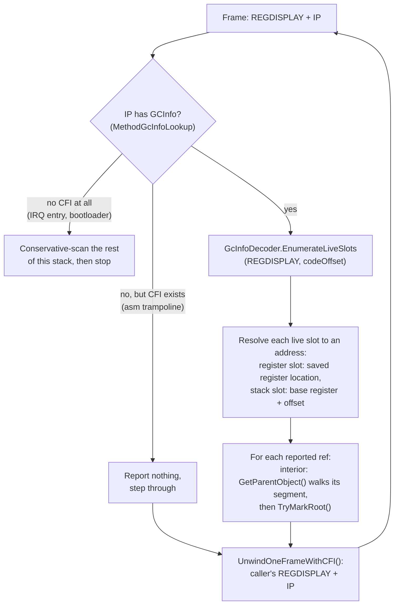

<a id="overview"></a>

## 概述

栈扫描可以[猜测或确知](gc-concepts/conservative-vs-precise.md)哪些栈字是对象引用。本文讨论确知的一方：ILC 为每个方法生成的 **GCInfo** 元数据，GC 如何用它逐帧遍历触发回收的线程，以及决定它能覆盖哪些线程的[安全点（safepoint）](gc-concepts/safepoint.md)约束。本文接续垃圾回收器一文中的[标记阶段](garbage-collector.md#mark-phase)一节。

> [!NOTE]
> 状态：精确扫描已对触发 GC 的线程以及异常 [funclet](gc-concepts/funclet.md) 栈帧生效，并且会把内部指针解析到其父对象（epic [#348](https://github.com/valentinbreiz/nativeaot-patcher/issues/348) 的第 1 至 3 阶段和第 5 阶段，内部指针支持来自 [#376](https://github.com/valentinbreiz/nativeaot-patcher/issues/376)/[#384](https://github.com/valentinbreiz/nativeaot-patcher/issues/384)）。在[返回地址劫持](#the-safepoint-constraint)落地之前（[#385](https://github.com/valentinbreiz/nativeaot-patcher/issues/385)），在调度器中被抢占的线程仍使用保守扫描。

---

<a id="why-precise-scanning"></a>

## 为什么需要精确扫描

[保守扫描](gc-concepts/conservative-vs-precise.md)不知道哪些栈字是引用，因此把每个指针大小的字都当作候选（在 [`GarbageCollector.Mark.cs`](https://github.com/CosmosOS/Cosmos/blob/gen3/src/Cosmos.Kernel.Core/Memory/GarbageCollector/GarbageCollector.Mark.cs) 中由 `ScanThreadStack` 和 `ScanMemoryRange` 把候选交给 `TryMarkRoot`），并保留那些落在 GC 堆内且带有看似合理的 `MethodTable` 的字。这些只是合理性过滤，而非证明，由此带来两个问题。

**过度生根。** 遗留在已失效的溢出槽中，或尚未被覆盖的被调用者栈帧中的任何过时堆指针，都会成为一个[根](gc-concepts/gc-roots.md)，于是它指向的死对象会在这次回收中存活下来，连同它传递引用的一切。经由强引用产生的虚假根会悄无声息地造成泄漏。而让弱引用目标保持存活的虚假根至少是可见的：一个本应被置空的弱句柄仍然能解析，CI 捕获的正是这种情况。

**布局脆弱性。** 过时指针是否位于被扫描的槽中，完全取决于编译的偶然结果，因此每当代码生成发生变化，正确性也随之变化。issue [#346](https://github.com/valentinbreiz/nativeaot-patcher/issues/346) 就是典型：给一个在栈上分配的结构体（`InterruptScope`，内联在每条 GC 和调度器路径周围）增加一个 8 字节字段，使其下方的槽发生移动，一个过时的数组指针恰好落在扫描读取的位置，弱引用测试随之失败。增加字段、引入局部变量或升级编译器，都属于同一类故障，直到触发线程的扫描变为精确扫描为止。

一个诱人的折中办法是保留保守扫描，但只读取沿帧指针链遍历找到的存活帧范围。这在这里并不安全：ILC 编译的许多函数没有帧指针，因此这条链会悄无声息地跳过一些帧。异常分派可以容忍跳过一帧；GC 却不能，因为漏掉一个根会释放存活对象，并在清除阶段变成释放后使用（use-after-free），这比它原本要消除的过度生根严格更糟。向编译器询问引用在哪里，才是唯一正确的途径。

---

<a id="what-gcinfo-is"></a>

## GCInfo 是什么

ILC 编译一个方法时，会在机器码之外生成一个小的 GCInfo 数据块（blob），它只回答一个问题：

> 如果执行位于该方法内代码偏移 N 处时发生 GC，哪些 CPU 寄存器和哪些栈槽持有存活的对象引用，其中哪些是内部指针，哪些被固定？

每个方法一个数据块。正是它让精确扫描成为可能：GC 不再猜测哪些栈字看起来像指针，而是去问编译器。

<a id="where-it-lives-in-the-binary"></a>

### 它在二进制文件中的位置

在运行时找到该数据块依赖于 ELF 的栈展开机制，因此下文会反复出现四个 DWARF 术语。每个二进制文件都带有一个 `.eh_frame` 节：这是一张每个函数对应一项的表（每一项是一个 **FDE**，即帧描述条目（frame description entry）），其中的调用帧信息（**CFI**）规则让运行时可以从该函数内的任意一条指令重建调用者的寄存器。每个 FDE 还可以指向一块语言特定数据（**LSDA**），这是一块自由格式的区域，展开器本身从不解释它。NativeAOT 把它的每方法记录放在这个 LSDA 指针后面。

ILC 为每个方法向 `.dotnet_eh_table` 节写入一条记录，布局为 `[LSDA header][GCInfo blob][EH clauses]`。链接器会保留该节及其边界：参见 [`linker.x64.ld`](https://github.com/CosmosOS/Cosmos/blob/gen3/src/Cosmos.Build.Templates/Linker/linker.x64.ld) 和 [`linker.arm64.ld`](https://github.com/CosmosOS/Cosmos/blob/gen3/src/Cosmos.Build.Templates/Linker/linker.arm64.ld) 中的 `*(.dotnet_eh_table)` 以及 `__dotnet_eh_table_start` / `__dotnet_eh_table_end`。方法的 DWARF `.eh_frame` FDE 携带一个指向该记录 LSDA 头的指针，[`MethodGcInfoLookup`](https://github.com/CosmosOS/Cosmos/blob/gen3/src/Cosmos.Kernel.Core/Runtime/GcInfo/MethodGcInfoLookup.cs) 遍历 `.eh_frame`，把指令指针解析到这个头。因此，从一个 IP 出发，只需走过一个 LSDA 头就能到达 GCInfo 数据块。无需修改构建流水线、链接后工具或 patcher。

`.dotnet_eh_table` 节由这样的记录依次组成，每个方法一条，每条按以下顺序排布：

| 记录部分 | 内容 |
|-------------|----------|
| LSDA 头，第 0 字节 | `unwindBlockFlags`：`UBF_FUNC_KIND_MASK` 0x03（ROOT / HANDLER / FILTER）、`UBF_FUNC_HAS_EHINFO` 0x04、`UBF_FUNC_HAS_ASSOCIATED_DATA` 0x10 |
| 仅 funclet 记录 | 一个指向主方法 LSDA 的 int32 自相对偏移，外加一个 int32 起始增量；funclet 复用其主方法的 GCInfo |
| 若有 `HAS_ASSOCIATED_DATA` | int32 指针 |
| 若有 `HAS_EHINFO` | int32 指针 |
| **GCInfo 数据块** | 按位紧凑编码（见下文）；精确扫描解码的正是这一部分 |
| EH 子句 | try/catch/finally 表 |

方法的 `.eh_frame` FDE 让其 LSDA 指针指向该记录的第一个字节，GCInfo 查询所用的代码偏移为 `ip - methodStart`。

> [!NOTE]
> 上游参考：LSDA 头的布局就是 NativeAOT 运行时在 [`UnixNativeCodeManager.cpp`](https://github.com/dotnet/runtime/blob/main/src/coreclr/nativeaot/Runtime/unix/UnixNativeCodeManager.cpp) 的 `FindMethodInfo` / `GetCodeOffset` 中解析的格式。

<a id="whats-inside-the-blob"></a>

### 数据块内部有什么

GCInfo 是一个紧密的按位打包流；每个字段只占用最少的位数，没有任何内容按字节对齐。逻辑上它分为三部分：

| 部分 | 内容 |
|------|----------|
| **头部** | 标志（版本由运行时固定，不编码在数据块中）、代码长度（等于 FDE 的 PC 范围，可用于合理性检查）、栈槽偏移所相对的栈基址寄存器（`SP` 或帧寄存器）、是否存在 GS cookie 或泛型上下文、安全点数量，以及完全可中断范围的数量。 |
| **槽表** | 该方法曾用于存放对象引用的全部槽。每个槽要么是寄存器（按编号），要么是栈槽（基址寄存器加有符号偏移）。每个槽的标志：`GC_SLOT_INTERIOR`（值指向对象中间，而非对象头）和 `GC_SLOT_PINNED`（目标不得移动）。未跟踪的槽在整个方法体内都存活，位于表的末尾。 |
| **存活性** | 哪些槽在哪些代码偏移处存活。完全可中断范围编码的存活性对其中任意 IP 都有效；部分可中断的方法只按**安全点**（调用点）编码存活性。 |

<a id="a-tiny-worked-example"></a>

### 一个小型示例

```csharp
static void Foo()
{
    byte[] a = new byte[128];     // 'a' is an object reference
    Bar();                        // ←(I) call site = safepoint; 'a' still needed below, so live here
    GC.KeepAlive(a);
    string s = Compute();         // 's' is an object reference; 'a' is now dead
    Console.WriteLine(s);         // ←(II) call site = safepoint; 's' live, 'a' dead here
}
```

ILC 为 `Foo` 生成的 GCInfo，从概念上看如下。首先是槽表：

| 槽 | 位置 | 持有 | 标志 |
|------|----------|-------|-------|
| 0 | 寄存器 `RSI` | `s` | 无 |
| 1 | 栈，帧基址 - 0x18 | `a` | 无 |

持有一个指向数组的 `ref` 的方法会增加一个标记为 `INTERIOR` 的槽，`fixed` 块则会增加一个标记为 `PINNED` 的槽；`Foo` 两者都没有。然后是这些槽在整个方法体上的存活性，从偏移 0x00 到代码长度：

| 代码偏移 | 存活的槽 |
|-------------|------------|
| 0x00 至 0x4A | 无 |
| 0x4A 至 0x6C | 仅槽 1（数组） |
| 0x6C 至代码长度 | 仅槽 0（字符串） |

- `Foo` 的栈帧位于栈上、IP 处于 `Bar()` 之后的返回地址时发生 GC。代码偏移解析为安全点（I），GCInfo 只报告持有 `a` 的槽，`byte[128]` 被保留。仅此而已。
- IP 处于 `WriteLine` 之后的返回地址时发生 GC。安全点（II）只报告持有 `s` 的寄存器。`byte[128]` 没有被报告，因而被回收，尽管它的过时指针仍留在 `a` 的栈槽中。最后这种情况恰恰是保守扫描会弄错的。

> [!NOTE]
> 上游参考：权威的格式与解码器语义是 [`gcinfodecoder.cpp`](https://github.com/dotnet/runtime/blob/main/src/coreclr/vm/gcinfodecoder.cpp) 中的 `GcInfoDecoder::EnumerateLiveSlots`（NativeAOT 使用 `GCINFODECODER_NO_EE` 构建它），类型定义在 [`gcinfotypes.h`](https://github.com/dotnet/runtime/blob/main/src/coreclr/inc/gcinfotypes.h) 和 [`gcinfodecoder.h`](https://github.com/dotnet/runtime/blob/main/src/coreclr/inc/gcinfodecoder.h) 中。内核的解码器是对其所需 v4 子集的直接移植。

---

<a id="how-the-precise-scan-walks-a-thread"></a>

## 精确扫描如何遍历线程

扫描逐帧遍历触发 GC 的线程。对于每一帧，它有两个输入：IP（指向该方法代码内部的返回地址）和一个 `REGDISPLAY`，即保存该帧寄存器状态的结构体。两者都来自为异常处理构建的机制：[`ExceptionHelper.cs`](https://github.com/CosmosOS/Cosmos/blob/gen3/src/Cosmos.Kernel.Core/Runtime/ExceptionHandling/ExceptionHelper.cs) 中的 CFI 展开器逐帧重建调用者的寄存器状态，一个小型原生桩代码（`_native_capture_regdisplay`）为扫描自身的栈帧填充初始的 `REGDISPLAY`。

驱动遍历的是 [`GarbageCollector.PreciseStack.cs`](https://github.com/CosmosOS/Cosmos/blob/gen3/src/Cosmos.Kernel.Core/Memory/GarbageCollector/GarbageCollector.PreciseStack.cs) 中的 `PreciseScanCurrentThread`，它由 `ScanStackRoots` 分派调用，且只针对触发 GC 的线程。遍历在第一帧之后最多进行 256 步展开。



对于每个被报告的槽，回调（`PreciseRootTrampoline`）会做以下两件事之一：

- 普通引用直接传给 `TryMarkRoot`；对于精确报告的根，常规的堆范围检查和 `MethodTable` 检查只是无害的双重保险。
- 标记为 `GC_CALL_INTERIOR` 的槽持有指向对象中间的指针（byref，或 span 的引用）。回调用 `GetParentObject` 把它解析为所在的对象：`GetParentObject` 在任一条链中找到包含该地址的段，并从段的第一个对象开始遍历；逐步的机制见[垃圾回收器：内部指针](garbage-collector.md#interior-pointers)。槽的 `GC_CALL_PINNED` 标志不起任何作用：它表示该槽是一个被固定的局部变量（`fixed` 语句的局部变量），而不表示对象位于哪个堆上。不落在任何对象内的地址不会标记任何东西。这就是对仅能通过 byref 到达的对象的修复（issue [#384](https://github.com/valentinbreiz/nativeaot-patcher/issues/384)）。

没有 GCInfo 的栈帧分为两类。仍带有 `.cfi` 指令的手写汇编跳板（`RhpCallCatchFunclet`、`RhpCallFilterFunclet`、`RhpCallFinallyFunclet`、`RhpThrowEx`）会被直接跨过，不报告任何内容：两侧的托管栈帧覆盖了它保存寄存器的位置，而正在传播的异常对象仍会被报告，因为栈中更深处的托管栈帧（funclet 主体中的异常局部变量、桩代码调用的托管分派器 `RhThrowEx`）把它保存在由它们自己的 GCInfo 描述的槽中。完全没有 CFI 的栈帧（中断入口桩代码、引导加载程序）会终止遍历：扫描器以保守方式扫描剩余的栈范围，然后停止，而不是崩溃。如果展开器在遍历中途失败，或者某个方法的槽表超出解码器的固定缓冲区，也会执行同样的保守收尾。有两种退出方式更为严厉：展开得到的栈帧未通过合理性检查（IP 为零，或栈指针没有增大或离开了栈），或者遍历用完了 256 帧的上限，这两种情况都会直接停止扫描而不做保守收尾，更早的栈帧在这次回收中都不会被扫描。

[Funclet](gc-concepts/funclet.md) 栈帧（catch、filter 和 finally 主体）没有自己的 GCInfo。它们的 LSDA 头重定向到主方法的记录，代码偏移相对于主方法的起始地址解析，因此 funclet 会在它实际运行的栈帧上，使用父方法的槽表进行扫描。filter funclet 在异常抛出的过程中运行，因此父方法的未跟踪槽在那里可能已经过时，不会被报告（`NoReportUntracked`）；catch 和 finally funclet 正常报告它们，而标记是幂等的，因此与父栈帧重复报告也无害。

---

<a id="the-safepoint-constraint"></a>

## 安全点约束

GCInfo 只在[安全点](gc-concepts/safepoint.md)上有效：对于部分可中断的方法是调用点，对于完全可中断的范围则是其中的任意 IP。因此，对某个线程进行精确扫描是否可靠，取决于 GC 运行时该线程的指令指针位于何处：

1. **触发 GC 的线程。** 它通过一条进入分配器的托管调用链到达回收器，因此其栈上的每个返回地址都是调用点安全点。对该线程进行精确扫描是可靠的。异常 funclet 栈帧同样是通过分派器的 `call` 进入的，因此它们也是安全点。

2. **停驻在调度器中的线程。** 位于运行队列中、被阻塞或正在睡眠的线程，是在任意指令处被定时器 IRQ 抢占的，那里不一定是安全点，因此在那里查询它的 GCInfo 可能毫无意义。被抢占的 IP 可能碰巧落在完全可中断范围内，此时查询是有效的，但这没有任何保证：大多数方法体只在调用点处有描述，因此一个只是有时精确的扫描，对其他所有停止位置仍然需要保守回退。标准 NativeAOT 用返回地址劫持解决这个问题：在扫描这样的线程之前，运行时把栈上的某个返回地址改写为一个桩代码的地址，让线程运行到这次返回，使其停驻在桩代码处（这在构造上就是一个安全点），对它进行精确扫描，然后恢复真正的返回地址。Cosmos 目前还没有这样的子系统；这是 issue [#385](https://github.com/valentinbreiz/nativeaot-patcher/issues/385)。

在此之前，除触发 GC 的线程之外的其他线程仍使用[垃圾回收器：标记阶段](garbage-collector.md#mark-phase)中描述的保守扫描。这些线程及其保存的寄存器状态来自调度器的线程登记表；参见[调度器](scheduler.md)。

---

<a id="source-files"></a>

## 源文件

| 组成部分 | 位置 | 说明 |
|-------|-------|-------|
| 精确的逐帧遍历 | [`GarbageCollector.PreciseStack.cs`](https://github.com/CosmosOS/Cosmos/blob/gen3/src/Cosmos.Kernel.Core/Memory/GarbageCollector/GarbageCollector.PreciseStack.cs) | 遍历循环、根回调、内部指针解析；由 `GarbageCollector.Mark.cs` 中的 `ScanStackRoots` 分派到这里 |
| GCInfo v4 解码器 | [`GcInfoDecoder.cs`](https://github.com/CosmosOS/Cosmos/blob/gen3/src/Cosmos.Kernel.Core/Memory/GarbageCollector/GcInfo/GcInfoDecoder.cs)、[`GcSlotTable.cs`](https://github.com/CosmosOS/Cosmos/blob/gen3/src/Cosmos.Kernel.Core/Memory/GarbageCollector/GcInfo/GcSlotTable.cs)、[`GcInfoTypes.cs`](https://github.com/CosmosOS/Cosmos/blob/gen3/src/Cosmos.Kernel.Core/Memory/GarbageCollector/GcInfo/GcInfoTypes.cs)、[`GcInfoBitStreamReader.cs`](https://github.com/CosmosOS/Cosmos/blob/gen3/src/Cosmos.Kernel.Core/Memory/GarbageCollector/GcInfo/GcInfoBitStreamReader.cs) | 头部、槽表、`EnumerateLiveSlots`；`gcinfodecoder.cpp` 的移植 |
| 从 IP 查找 GCInfo | [`MethodGcInfoLookup.cs`](https://github.com/CosmosOS/Cosmos/blob/gen3/src/Cosmos.Kernel.Core/Runtime/GcInfo/MethodGcInfoLookup.cs)、[`EhFrameNative.cs`](https://github.com/CosmosOS/Cosmos/blob/gen3/src/Cosmos.Kernel.Core/Bridge/Import/EhFrameNative.cs) | 内核唯一的 `.eh_frame` / LSDA 解析器：IP → FDE → LSDA → GCInfo 数据块，包括从 funclet 到主方法的重定向；也为异常展开器服务 |
| CFI 展开器、`REGDISPLAY` | [`ExceptionHelper.cs`](https://github.com/CosmosOS/Cosmos/blob/gen3/src/Cosmos.Kernel.Core/Runtime/ExceptionHandling/ExceptionHelper.cs)（+ `ExceptionHelper.X64.cs` / `ExceptionHelper.ARM64.cs`、[`RegisterContext.X64.cs`](https://github.com/CosmosOS/Cosmos/blob/gen3/src/Cosmos.Kernel.Core/Runtime/ExceptionHandling/RegisterContext.X64.cs) / [`RegisterContext.ARM64.cs`](https://github.com/CosmosOS/Cosmos/blob/gen3/src/Cosmos.Kernel.Core/Runtime/ExceptionHandling/RegisterContext.ARM64.cs)） | `UnwindOneFrameWithCFI` 执行 DWARF 调用帧指令以重建调用者的寄存器状态，为 [#227](https://github.com/valentinbreiz/nativeaot-patcher/issues/227) 而构建 |
| `_native_capture_regdisplay` 桩代码 | `src/Cosmos.Kernel.Native.X64/CPU/ContextCapture.s`、`src/Cosmos.Kernel.Native.ARM64/CPU/ContextCapture.s`、[`ContextSwitchNative.cs`](https://github.com/CosmosOS/Cosmos/blob/gen3/src/Cosmos.Kernel.Core/Bridge/Import/ContextSwitchNative.cs) | 为触发 GC 的线程填充初始的 `REGDISPLAY` |
| 保留 `.dotnet_eh_table`，并提供 `__dotnet_eh_table_start/end` | [`linker.x64.ld`](https://github.com/CosmosOS/Cosmos/blob/gen3/src/Cosmos.Build.Templates/Linker/linker.x64.ld)、[`linker.arm64.ld`](https://github.com/CosmosOS/Cosmos/blob/gen3/src/Cosmos.Build.Templates/Linker/linker.arm64.ld) | 运行时可通过 FDE 的 LSDA 访问 GCInfo |
| 保守扫描（停驻的线程） | [`GarbageCollector.Mark.cs`](https://github.com/CosmosOS/Cosmos/blob/gen3/src/Cosmos.Kernel.Core/Memory/GarbageCollector/GarbageCollector.Mark.cs) | `ScanThreadStack` / `ScanMemoryRange` / `TryMarkRoot`；在劫持落地之前保留的部分 |
| 测试 | `tests/Kernels/Cosmos.Kernel.Tests.GarbageCollector` | `GC_GcInfoDecoder`、`GC_PreciseStackScan`、`GC_FuncletNoFalseRoot`、`GC_FuncletNoCrashOnAllocInCatch`、`GC_StackScanPaddingStress`、`GC_InteriorPointerRoot`、`GC_InteriorPointerRootMidTlab`、`GC_InteriorPointerRootPinnedHeap`、`GC_InteriorPointerRootFixed` |
| 劫持桩代码 | 尚未编写 | [#385](https://github.com/valentinbreiz/nativeaot-patcher/issues/385)，epic 的第 4 阶段 |
