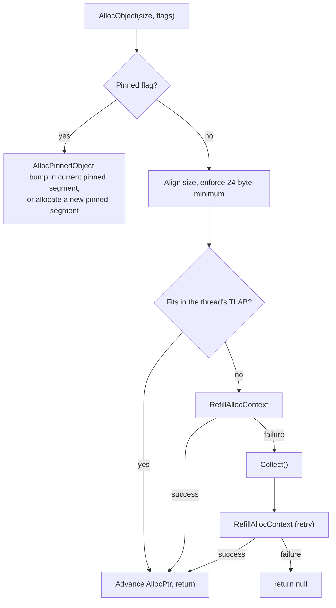
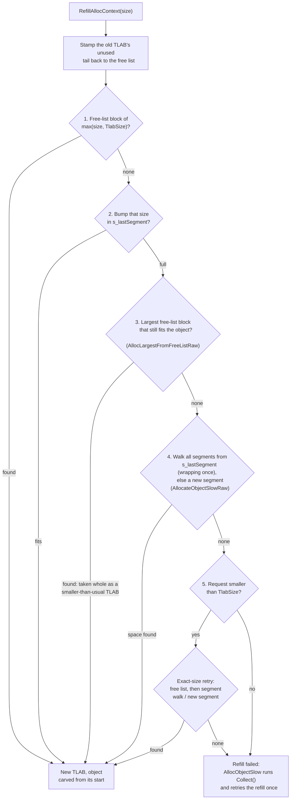
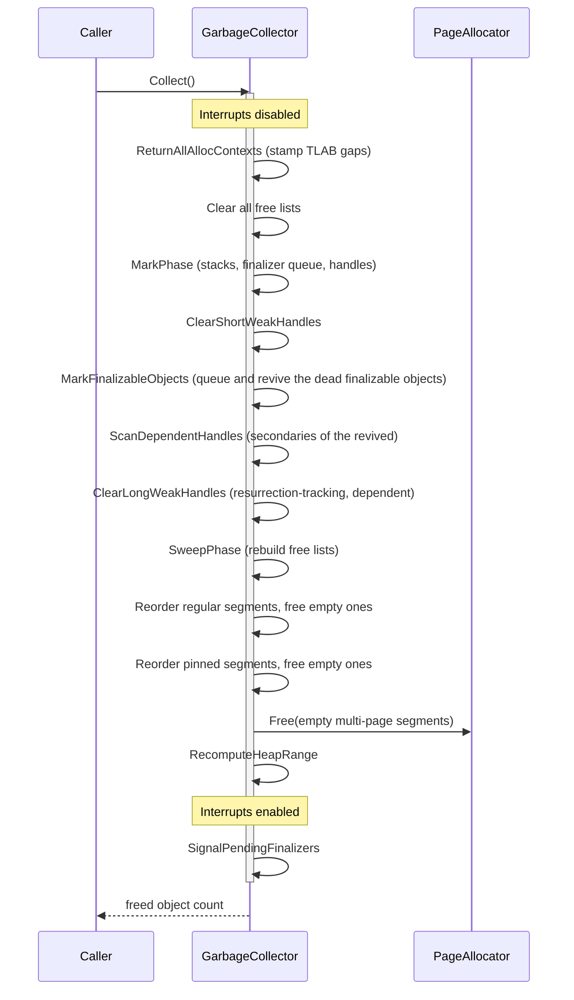
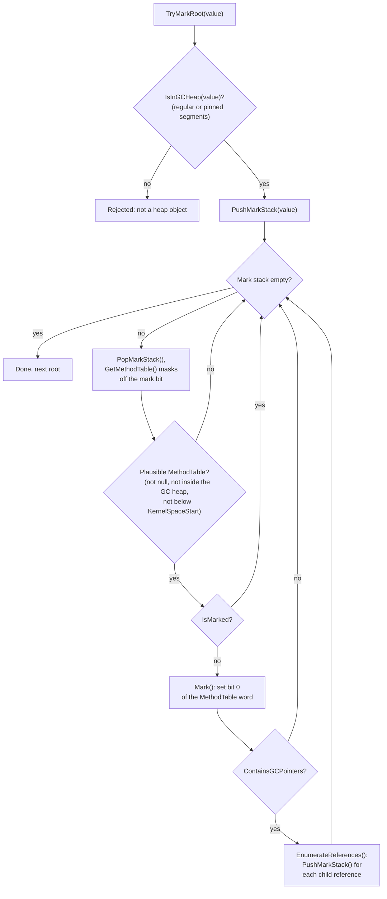
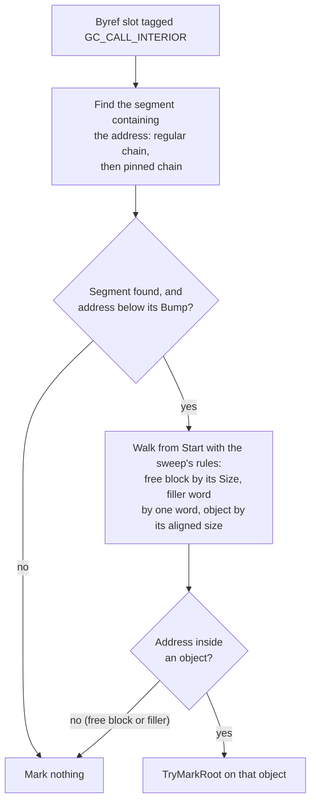
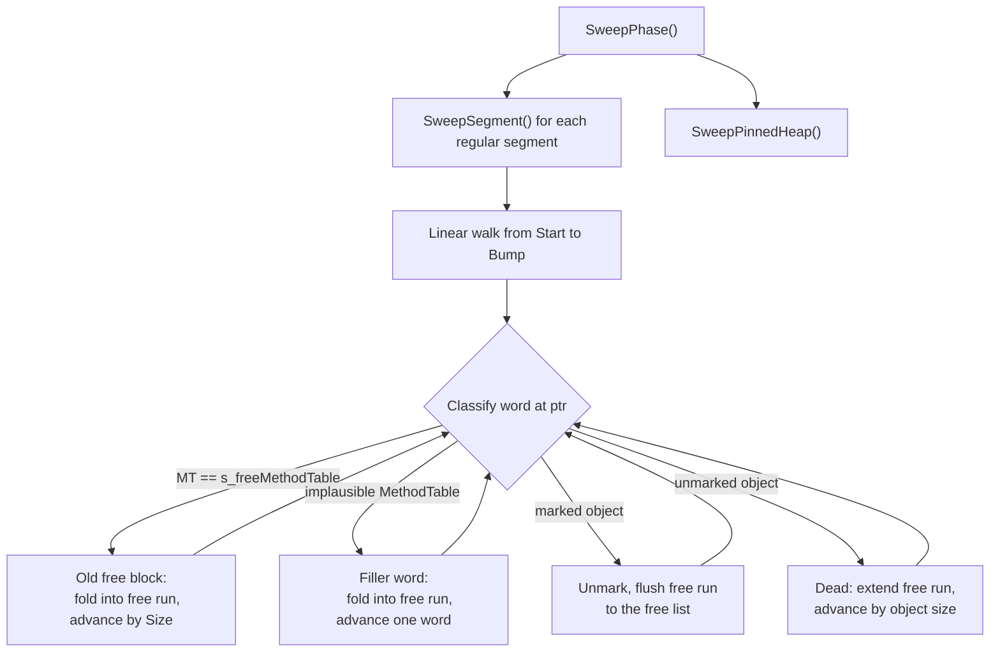

*OrionGC 名字的由来。图片来源与版权：[Stanislav Volskiy](https://apod.nasa.gov/apod/ap151123.html)，APOD 2015 年 11 月 23 日。*

## 概述

垃圾回收器（在运行时配置表中自称 **OrionGC**）是一个[全局停顿（stop-the-world）](gc-concepts/stop-the-world.md)、[非移动式](gc-concepts/non-moving.md)、[标记-清除](gc-concepts/mark-and-sweep.md)的回收器，只有[单一代](gc-concepts/gc-generations.md)。每次垃圾回收都会暂停所有线程，标记仍然可达的对象，就地释放其余对象，并且从不改变存活对象的地址。每个带链接的术语都在[术语表](garbage-collector-glossary.md)中有一段简短的背景说明。回收器管理四类内存：

- [常规 GC 堆](#regular-heap)，每个 `new` 都在这里分配；
- [固定对象堆](#pinned-heap)，用于地址绝不能改变的对象；
- [GC 句柄存储区](#handle-store)，即从堆外持有的、指向堆对象的引用；
- [冻结段](#frozen-segments)，即编入内核二进制文件的只读对象，从不回收。

GC 通常在多线程内核中运行，但并不依赖多线程。[调度器](scheduler.md)运行时，调度器会从定时器中断中抢占线程，把每个存活线程保存在一个供 GC 扫描的全局登记表中，并把每个线程的分配状态存放在该线程的 `SchedulerThread` 控制块上；中断处理程序同样会分配内存（调度器节拍、输入驱动程序）。在调度器启动之前，或者在把调度器编译排除的内核中，GC 以同样的方式工作，只使用一个静态分配上下文，并把当前栈作为唯一的栈根。无论哪种模式，都没有专门的 GC 线程：垃圾回收在触发它的那个线程上运行，位于 `InternalCpu.DisableInterruptsScope()` 内部，因此任何线程切换或中断处理程序都无法看到回收进行到一半的堆。

由于每个线程和中断处理程序都可能分配内存，分配经由每线程的 [TLAB](gc-concepts/tlab.md)（线程本地分配缓冲区，thread-local allocation buffer）进行：每个线程在自己的缓冲区内递增指针，除了一个全局的已分配字节计数器之外，只有当缓冲区用尽、需要重新填充时才会触及共享状态。垃圾回收是最后的手段。重新填充失败时，回收器首先扩展堆；只有当页分配器本身已无内存可给，或被显式调用时，`Collect()` 才会运行。

标记从[根](gc-concepts/gc-roots.md)开始，根是存在于堆外、持有引用的位置。OrionGC 扫描三组根：触发回收的线程的栈，依据 NativeAOT 的 GCInfo 进行[精确](gc-concepts/conservative-vs-precise.md)扫描（参见[精确栈扫描（GCInfo）](garbage-collector-gcinfo.md)）；其他所有已注册线程的栈和保存的寄存器，以保守方式扫描；以及强 GC 句柄（使目标保持存活的那些句柄类型）。静态字段无需单独扫描：在模块初始化期间，持有各模块静态字段的对象被收集到由一个强句柄保持存活的主干数组中，因此句柄扫描会传递地到达每个静态字段。

这种扫描上的划分制约着整个设计。被抢占的线程可能停在任意一条指令上，因此它的栈只能保守扫描，而保守引用会固定其目标：一个看起来像堆指针的字可能只是一个整数，所以回收器永远不能移动它看似指向的对象。反过来，非移动式又让其余部分保持简单：对象地址终生稳定，固定也没有任何代价。单一代意味着没有[写屏障和记忆集](gc-concepts/gc-generations.md)；引用存储被编译为普通的写操作。贯穿始终的取舍是以吞吐量换取简单性和可验证性：每次回收都扫描整个堆，但每个结构都可以手动遍历，统计也是精确的，精确到[测试套件](#tests)所断言的已释放对象数量。设计所放弃的内容汇总在[局限与演进](#limitations-and-evolution)中。

代码位于 `src/Cosmos.Kernel.Core/Memory/GarbageCollector/`。`GarbageCollector` 类本身是一个按阶段拆分的静态分部类（`.Alloc`、`.Tlab`、`.Mark`、`.Sweep` 等）；段、句柄和 TLAB 结构体各有自己的类型，`GcInfo/` 文件夹包含精确栈扫描的解码器。完整的文件清单见本文末尾的[源文件](#source-files)。

---

## 核心结构

四种数据形态是本文其余所有内容的基础：编译器为每个托管类型生成的类型描述符、GC 眼中的对象、描述死空间的空闲块，以及每线程的分配状态。后续每一节都建立在它们之上。

### MethodTable

ILC（NativeAOT 的预先编译器；参见[内核编译步骤](build/kernel-compilation-steps.md)）编译的每个托管类型都有一个 `MethodTable`，这是一个位于内核数据段中的类型描述符，从不位于 GC 堆上。GC 会读取其中的几个字段：

| 字段 | 用途 |
|-------|---------|
| `RawBaseSize` | 固定大小对象的字节大小 |
| `BaseSize` / `ComponentSize` | 数组和字符串的基础大小加每元素大小 |
| `HasComponentSize` | 对数组和字符串为 true |
| `ContainsGCPointers` | 如果实例包含 GC 必须追踪的引用，则为 true |

由于 `MethodTable` 指针总是位于内核空间、堆之外，GC 将其用作有效性过滤器：如果候选对象的第一个字为 null、指向 GC 堆内部，或位于 `AddressSpace.KernelSpaceStart` 之下，它就不可能是真正的对象。

这些字段唯一没有描述的，是实例内部引用所在的位置。这一布局存放在紧挨 `MethodTable` 之前的 GCDesc 中（参见 [GCDesc](#gcdesc)）。

### 对象头

GC 堆上的每个对象都以一个 [`GCObject`](https://github.com/CosmosOS/Cosmos/blob/gen3/src/Cosmos.Kernel.Core/Memory/GarbageCollector/GCObject.cs) 头开始：

| 偏移 | 大小（x64） | 内容 | 说明 |
|--------|------------|----------|-------|
| 0 | 8 字节 | `MethodTable*` | 第 0 位兼作标记位 |
| 8 | 4 字节 | `Length` | 元素数量；只有数组和字符串有这个槽 |
| 8、12 或 16 | 对象其余部分 | 字段或元素 | 固定大小对象的字段从 8 开始；字符串的字符从 12 开始；数组元素从 16 开始（`Length` 之后有 4 字节填充） |

`MethodTable` 指针是对齐的，因此第 0 位通常为零。`Mark()` 设置该位，`Unmark()` 清除该位，`GetMethodTable()` 在解引用之前将其屏蔽掉。对于数组和字符串，`ComputeSize()` 返回 `BaseSize + Length * ComponentSize`，对其他所有对象返回 `RawBaseSize`。

### FreeBlock

死空间由链接到按大小类别划分的空闲链表中的 `FreeBlock` 条目描述。`FreeBlock` 的布局使清除阶段可以像遍历对象一样跨过它：作为标识的 `MethodTable` 位于偏移 0，`Size` 位于 `GCObject.Length` 所在的位置：

| 偏移 | 大小（x64） | 内容 | 说明 |
|--------|------------|----------|-------|
| 0 | 8 字节 | `MethodTable*` | 指向用来标识空闲块的 `s_freeMethodTable` |
| 8 | 4 字节 | `Size` | 此空闲块的总大小（其后有 4 字节填充） |
| 16 | 8 字节 | `Next*` | 同一大小类别中的下一个空闲块 |

块头为 24 字节，这就是 `MinBlockSize` 为 24 的原因：每次分配都至少向上取整到这个大小，因此任何对象以后都可以就地转换成空闲块。

### AllocContext (TLAB)

[`AllocContext`](https://github.com/CosmosOS/Cosmos/blob/gen3/src/Cosmos.Kernel.Core/Memory/GarbageCollector/AllocContext.cs) 是每线程的分配状态（即 [TLAB](gc-concepts/tlab.md) 本身），内联存放在每个 `SchedulerThread` 上（另有一个静态后备上下文，在调度器运行之前使用；当调度器被编译排除时，则在内核的整个生命周期中使用）：

| 字段 | 含义 |
|-------|---------|
| `AllocPtr` | 当前分配指针，向 `AllocLimit` 推进 |
| `AllocLimit` | TLAB 的末尾；到达它会强制重新填充 |
| `AllocBytes` | 该线程在常规堆上累计分配的字节数 |
| `AllocBytesUoh` | 该线程在固定堆上累计分配的字节数 |

---

## 内存布局

本节回答托管内存位于何处，以及 GC 如何在其中定位：先讲一个段及其砖表的构成，再讲段如何串成两个堆的链，然后是位于堆旁边的两个结构（句柄存储区和冻结段），最后是刻意置于 GC 管辖范围之外的内容。

### 段

段是来自页分配器（`PageType.GCHeap`）的一段连续页。[`GCSegment`](https://github.com/CosmosOS/Cosmos/blob/gen3/src/Cosmos.Kernel.Core/Memory/GarbageCollector/GCSegment.cs) 头位于这次分配的基址处，其后依次是该段的砖表、8 个保留字节，然后是可用区域：

这条带状图是按地址顺序排列的一次连续分配，左侧是按页对齐的基址。`Start` 指向保留槽之后的第一个字节，`Bump` 指向下一次分配将落在的分界处（它向 `End` 推进，`End` 位于段最后一个字节之后），`Next` 把各个段链接成下文所示的链。`TotalSize` 等于 `End - Start`；`UsedSize` 统计清除之前正在使用的字节数。

- `Start` 到 `Bump` 之间存放已分配的对象，以及先前的垃圾回收留下的空闲块。
- `Bump` 到 `End` 之间是从未使用过的空间；[指针碰撞分配](gc-concepts/bump-allocation.md)从 `Bump` 处分出内存并将其推进。
- `Start` 之前之所以有 8 个保留字节，是因为运行时会在 `objRef - 4` 处写入一个[运行时对象头](gc-concepts/object-header.md)（标识哈希或瘦锁）。对于段中的第一个对象，这次写入必须落在保留的填充区，而不是段自身的元数据上。

段的分配逻辑位于 [`GCSegmentManager`](https://github.com/CosmosOS/Cosmos/blob/gen3/src/Cosmos.Kernel.Core/Memory/GarbageCollector/GCSegmentManager.cs) 中。`AllocateSegment(requestedSize)` 把请求至少提升到一页，确定砖表的大小，把总大小向上取整为整页，并把新段追加到其管理器的链表中。按页取整产生的余量归入可用区域，因此 `TotalSize` 通常略大于请求的大小。

### 砖表

在标记期间，GC 有时持有的地址指向对象中间而非对象起始处：指向数组元素的 `ref`，或 `Span<T>` 内部的引用（参见[内部指针](#interior-pointers)）。要标记该对象，GC 必须先找到对象的起始位置，而堆内存没有提供回溯的途径：对象首尾相接，没有反向指针，因此从任意内部地址找到起始位置唯一可靠的方法，是从 `Start` 开始逐个对象遍历段，直到遇到包含该地址的对象。

砖表（brick table）本意是缩短这一遍历：它是每个段上一份粗粒度的对象起始位置索引，使查找可以跳到目标附近，只需向前走很短一段距离。标准 .NET GC 为同样的目的维护着一张砖表，名字就来源于此。

具体机制是：可用区域被划分为若干块，每块含 255 个指针大小的槽（约 2 KiB，这一大小使槽索引能放进一个字节），表中每块存一个字节，记录该块中最后一个已登记对象起始位置的槽索引，从 1 开始计数（0 表示没有）。`GCSegment.MarkObject(addr)` 在分配时登记起始位置：在固定堆上登记每个对象，而在常规堆上只登记从段中以指针碰撞方式分出的每个缓冲区，实际上也就是每个 TLAB。

这张表目前只写不读，因为它的条目不能安全地作为遍历的起点。它们是不完整的：TLAB 中第一个对象之后的对象从不登记，而从空闲链表回收再利用的 TLAB 根本不会添加条目。它们也是过时的：当清除把 `Bump` 往回移，或从空闲链表重新填充而复用空间时，没有任何操作会抹掉条目，而且 `MarkObject` 只会增大条目，因此一个旧条目可能指向某个存活对象的中间，从那里开始的遍历会把对象数据当作对象头来读。因此，内部指针查找总是从 `Start` 开始遍历。由于段很小，这样做的代价仍然很低：新段的大小按需要它的那次请求确定，至少一页，TLAB 重新填充时为 8 KiB，或者恰好容纳一个大对象。

### 段链

#### 常规堆

常规链就是托管堆，即内核 C# 代码中每个 `new` 背后的内存。类实例、数组、字符串和装箱值都在它的某个段中开始自己的生命周期；用户代码从不选择段，由分配器来选择。扩展堆意味着向链中追加一个段；收缩堆意味着把一个空段归还给页分配器。标准 .NET GC 也以同样的方式组织其堆，使用从更大的预留空间中划出的段或区域。

> [!NOTE]
> 官方文档：[垃圾回收的基本原理](https://learn.microsoft.com/en-us/dotnet/standard/garbage-collection/fundamentals)。

#### 固定堆

固定链之所以存在，是因为对象的地址有时会逃出 GC 的管辖范围：交给设备做 DMA 的缓冲区、传给本机代码的结构体、用 `fixed` 取得的指针。在会压缩堆的标准 .NET 中，这类对象必须被固定，以免在操作进行中被移动；固定可以是临时的（`fixed` 语句，或以 `GCHandleType.Pinned` 调用 `GCHandle.Alloc`），也可以是终生的，即把对象分配在专门的固定对象堆上（`GC.AllocateArray<T>(length, pinned: true)`），这样可以防止长期固定的对象使主堆碎片化。在 OrionGC 中没有任何东西会移动，因此固定不会增加任何约束；固定链用自己的一份段列表来遵循运行时的固定堆标志（具体机制参见[固定分配](#pinned-allocation)）。

> [!NOTE]
> 官方文档：[fixed 语句](https://learn.microsoft.com/en-us/dotnet/csharp/language-reference/statements/fixed)、[GC.AllocateArray](https://learn.microsoft.com/en-us/dotnet/api/system.gc.allocatearray)、[固定对象堆的内部机制](https://devblogs.microsoft.com/dotnet/internals-of-the-poh/)。

两个堆都把各自的段保存在单链表中，每个链表由自己的 `GCSegmentManager` 实例拥有（常规堆为 `s_segmentManager`，固定堆为 `s_pinnedSegmentManager`）：

`s_lastSegment` 是下一次指针碰撞尝试开始的段；`s_currentSegment` 与它保持一致（每个更新点都给两者赋同一个段）。带 `GC_ALLOC_PINNED_OBJECT_HEAP` 标志分配的对象则进入固定链。

每次垃圾回收之后，两条链中的段都按 FULL、SEMIFULL、FREE 的顺序重新分组，跨越多于一页的空段会归还给页分配器（参见[段重排](#segment-reordering)）。

为了快速排除任意值，GC 缓存了覆盖常规段的一个边界框（`s_gcHeapMin` / `s_gcHeapMax`）。`IsInGCHeap` 先检查边界框，再遍历段列表；落在边界框之外，或在边界框之内但处于段与段之间的值，会通过一次简单的线性遍历与固定链进行比对（`IsInPinnedHeap`）。每当段的变化设置了 `s_heapRangeDirty`，边界框就会被惰性地重新计算。

### 句柄存储区

GC 句柄是对托管对象的一种引用，它不在常规的根扫描之列，并且有明确的生命周期：代码分配句柄、使用它，然后释放它。C# 代码主要通过三种形式接触句柄。`GCHandle.Alloc` 在本机代码持有对象的原始指针期间让对象保持存活（并可选地固定），这是互操作的模式。`WeakReference` 观察一个对象而不让它保持存活，这是缓存的模式。`DependentHandle` 是 `ConditionalWeakTable` 背后的机制，它把一个对象的生命周期绑定到另一个对象上，借此可以给无法修改的对象附加额外状态。内核运行时本身也是客户端：它的内部缓存以及概述中提到的静态字段主干都通过句柄持有。

> [!NOTE]
> 官方文档：[GCHandle](https://learn.microsoft.com/en-us/dotnet/api/system.runtime.interopservices.gchandle)、[弱引用](https://learn.microsoft.com/en-us/dotnet/standard/garbage-collection/weak-references)、[DependentHandle](https://learn.microsoft.com/en-us/dotnet/api/system.runtime.dependenthandle)。

存储区由唯一的 [`GCHandleManager`](https://github.com/CosmosOS/Cosmos/blob/gen3/src/Cosmos.Kernel.Core/Memory/GarbageCollector/GCHandleManager.cs)（`s_gCHandleManager` 实例）拥有，并按句柄类型组织：每种句柄类型一个 `GCHandleSegmentStore`，依赖句柄另有一个单独的存储区。

| 类型 | 值 | 是否让目标保持存活？ | 说明 |
|------|-------|--------------------|-------|
| `Weak` | 0 | 否 | 一旦标记发现目标已死即被置空，早于[终结](gc-concepts/finalization.md)可能使其复活之时 |
| `WeakTrackResurrection` | 1 | 否 | 只有在终结之后目标仍然已死时才被置空 |
| `Normal` | 2 | 是 | 作为强根扫描 |
| `Pinned` | 3 | 是 | 作为强根扫描；目标反正位于非移动式堆上 |
| 依赖句柄 | 6 | 视条件而定 | 主对象存于 `Object`，次对象存于 `ExtraInfo`；对应运行时的 `HNDTYPE_DEPENDENT`。枚举中没有与之对应的具名成员 |

每个存储区是由 `GCHandleSegment` 页组成的链表。一个段是一个 4 KiB 的页：16 字节的头，后面跟着 170 个各 24 字节的句柄槽：

一个 `GCHandle` 槽是 `{ GCObject* Object; nint ExtraInfo; GCHandleType Type; }`。空闲槽被打上哨兵类型 `(GCHandleType)(-1)`，并通过 `ExtraInfo` 串成段内的空闲链表。链表头、存活计数和一个 [ABA](gc-concepts/aba-problem.md) 版本标签被打包进一个 64 位字，用 `Interlocked.CompareExchange` 更新，因此在一个段内，槽的分配和释放都是无锁的。当存储区的每个段都已满时，存储区再分配一页，并在存储区自己的 IRQ 安全自旋锁保护下追加该页：否则，两个线程同时扩展存储区时会各自把一个段链接到同一个尾部，第二次链接会让第一个段成为孤儿，其中的句柄再也不会被任何一次垃圾回收扫描或置空。这条链只增不减，因此查找有空位的段时可以不加锁读取它；回收器在遍历存储区、把指向已死目标的句柄置空时会获取该锁。

交给运行时的句柄值就是其槽的地址。分配、`RhHandleSet`、依赖句柄次对象的访问以及释放，都会把 `IntPtr` 转换回 `GCHandle*`。

在垃圾回收期间，`Normal` 和 `Pinned` 存储区作为根扫描，依赖句柄由一个收敛循环处理，弱句柄则从不扫描；参见[标记期间的句柄](#handles-during-marking)。

### 冻结段

内容在构建时就已知的对象，无需在运行时构造。ILC 把字符串字面量、冻结数组和预初始化的静态数据作为现成的对象布置在内核二进制文件的数据段中，因此它们从第一条指令起就存在于永不改变的地址上，不占用堆空间，也不给回收器带来任何开销。这没有对应的 C# API；只要代码使用字符串字面量以及编译器能够预先求值的静态数据，就会自动获得这一点。上游 .NET 把它称为非 GC 堆。

> [!NOTE]
> 官方文档：[非 GC 堆设计说明](https://github.com/dotnet/runtime/blob/main/docs/design/features/NonGC-Heap.md)。

运行时在启动时通过 `RhRegisterFrozenSegment` 注册每个这样的区域，`ManagedModule` 则直接注册每个模块的 `FrozenObjectRegion`。GC 把它们记录在一个由 `FrozenSegmentInfo` 节点组成的链表中，这些节点从一个以指针碰撞方式分配的元数据页中划出：

冻结段不参与标记和清除。`IsInFrozenSegment` 回答成员关系查询（以 `AllocSize` 为界），`GetObjectGeneration` 把冻结对象报告为不属于任何 GC 代。置身标记阶段之外，依赖于一个内核并不验证的假设：冻结对象绝不能持有指向常规堆对象的唯一引用（参见[局限与演进](#limitations-and-evolution)）。

### GC 不触及的内存

内核中 malloc 风格的堆（`Memory/Heap/` 中的 SmallHeap、MediumHeap、LargeHeap）不属于 GC。托管对象从不位于其中，清除阶段也刻意从不遍历它们：一个存活的非托管块，如果它的第一个字恰好存放着一个 GC 堆指针，就会与一个未标记的对象头无法区分，清除它就会释放仍在使用的内存（issue [#386](https://github.com/valentinbreiz/nativeaot-patcher/issues/386)，由 `GC_MallocHeapNotSwept` 测试覆盖）。它们唯一的入口 `Heap`（`Alloc`、`Free`、`Realloc`，以及垃圾回收之后对小堆空页的修剪）用自己的一把 IRQ 安全自旋锁保护各子堆的链，就像 `PageAllocator` 用锁保护其页表那样：线程栈、运行时的非托管块以及 `NativeMemory` 会从任意线程在那里分配。

---

## 分配

本节回答一个 `new` 如何在寥寥几条指令内变成一个指针，以及快速路径用尽时会发生什么。请求从运行时导出的辅助函数出发，经过线程的 TLAB；未命中时依次退回到空闲链表、段内指针碰撞、新段，最后才是一次垃圾回收。

### 运行时桥接

NativeAOT 运行时调用 [`Memory.cs`](https://github.com/CosmosOS/Cosmos/blob/gen3/src/Cosmos.Kernel.Core/Runtime/Memory.cs) 中的导出函数。分配类导出最终都汇集到 `GarbageCollector.AllocObject(size, flags)`；在 GC 初始化之前，它们会退回到启动分配器（`MemoryOp.Alloc` 加上显式清零）。

| 运行时导出 | 映射到 | 用途 |
|----------------|---------|---------|
| `RhpNewFast` | `AllocObject(RawBaseSize)` | 固定大小的对象 |
| `RhpNewArray`、`RhpNewArrayFast`、`RhpNewPtrArrayFast` | `AllocObject(BaseSize + length * ComponentSize)` | 数组；长度为负时返回 null |
| `RhNewArray` | 不带标志的 `RhAllocateNewArray` | 数组 |
| `RhAllocateNewArray` | `AllocObject(size, flags)` | 带分配标志的数组 |
| `RhAllocateNewObject` | `AllocObject(RawBaseSize, flags)` | 带标志的对象（为 GC 静态字段分配时与固定标志一起使用） |
| `RhNewString`、`RhNewVariableSizeObject` | `RhpNewArray` | 字符串及其他可变大小的对象 |

句柄和冻结段的导出：

| 运行时导出 | 映射到 | 用途 |
|----------------|---------|---------|
| `RhpHandleAlloc` | `AllocateHandler(obj, type, IntPtr.Zero)` | 分配给定类型的句柄 |
| `RhpHandleAllocDependent` | `AllocateHandler(primary, (GCHandleType)6, secondary)` | 为一对主对象/次对象分配依赖句柄 |
| `RhHandleSet` | `HandleSetPrimary` | 让已有句柄指向新的目标 |
| `RhHandleFree` | `FreeHandle` | 把槽归还到所在段的空闲链表 |
| `RhRegisterFrozenSegment` | `RegisterFrozenSegment` | 在启动时注册冻结区域 |
| `RhUpdateFrozenSegment` | `UpdateFrozenSegment` | 更新已注册冻结区域的边界 |

终结相关的导出位于 [`GC.cs`](https://github.com/CosmosOS/Cosmos/blob/gen3/src/Cosmos.Kernel.Core/Runtime/GC.cs) 中，与 `RhGetMaxGcGeneration` 放在一起，为 `GC` 类的终结器方法和 `GC.MaxGeneration` 提供支持；它们所作用的对象见[终结](#finalization)：

| 运行时导出 | 映射到 | 用途 |
|----------------|---------|---------|
| `RhSuppressFinalize` | `SuppressFinalize` | `GC.SuppressFinalize`：取消该对象的每一次注册 |
| `RhReRegisterForFinalize` | `TryRegisterForFinalize` | `GC.ReRegisterForFinalize`：再注册一次该对象；返回 false 时 CoreLib 抛出 `OutOfMemoryException` |
| `RhWaitForPendingFinalizers` | `WaitPendingFinalizers` | `GC.WaitForPendingFinalizers`：等待终结器线程完成一轮，或在该线程关闭时在调用线程上运行队列 |
| `RhGetMaxGcGeneration` | 返回 `0` | `GC.MaxGeneration`：回收器只有单一代 |

在各种分配标志中，`GC_ALLOC_PINNED_OBJECT_HEAP` 和 `GC_ALLOC_FINALIZE` 会被遵循。终结标志与 .NET 中一样，是请求为该对象注册终结：`RhpNewFinalizable` 是 ILC 在每次 `new` 一个带终结器的类型时调用的辅助函数，它会传入该标志；`RhNewObject` 是 CoreLib 在 `MemberwiseClone`、`GetUninitializedObject` 和反射中走的慢速路径，它会让可终结类型经由那个辅助函数分配；而不带该标志分配这类类型的对象（来自不设置该标志的调用者的 `RhAllocateNewObject`）则不会被注册，其内存被回收时终结器不会运行。对齐标志和可选清零标志会被接受但忽略，常规堆上的分配总是以清零状态交付。

### 分配流程

`AllocObject` 完全在 `DisableInterruptsScope` 内运行：中断处理程序同样会分配内存（调度器节拍、输入），而在同一个上下文上交错进行的重新填充会把来自两个不同 TLAB 的指针混在一起（issue [#382](https://github.com/valentinbreiz/nativeaot-patcher/issues/382)）。

快速路径只有两次指针操作：如果 `AllocPtr + size <= AllocLimit`，就推进指针并返回。其余一切都在重新填充时发生。

### TLAB 重新填充

`RefillAllocContext`（位于 [`GarbageCollector.Tlab.cs`](https://github.com/CosmosOS/Cosmos/blob/gen3/src/Cosmos.Kernel.Core/Memory/GarbageCollector/GarbageCollector.Tlab.cs)）替换一个已用尽的 TLAB，先尝试代价低的来源，再尝试代价高的来源：首先是回收再利用的[空闲链表](#free-lists)空间，然后是段中从未使用过的空间，然后是新页，只有在其他一切都失败时才进行垃圾回收。

`TlabSize` 为 8 KiB。第 3 步让部分存活的段保持可用：清除之后，幸存的对象把空闲空间切成小于 8 KiB 的块，坚持要求完整大小 TLAB 的重新填充在那里总会失败，转而扩展堆；把最大的块整块取作一个比平常小的 TLAB，就能回收利用这部分空间。

注意整体的顺序：堆会在尝试垃圾回收之前先扩展。只有当页分配器本身已无内存可给时，`Collect` 才会运行；如果其后的重新填充重试也失败，分配就返回 null。

### 空闲链表

在非移动式回收器中，清除回收的空间留在原处，散布在幸存的对象之间，指针碰撞分配无法触及它们：`Bump` 游标只会向从未使用过的空间推进。空闲链表就是让这些分散的空间得以再次使用的方式。清除找到的每个空洞，以及每个归还的 TLAB 尾部，都会登记为一个 [FreeBlock](#freeblock)，TLAB 重新填充会先从这些链表中取用，再动用段中的新空间。

找到合适的空洞必须很快，因此这些块被分到 12 个大小类别中，即从 16 到 32768 字节的 2 的幂；查找会直接跳到能满足请求的最小类别，而不是扫描一条长链表。它沿类别逐级向上，取第一个恰好合适或剩余至少 24 字节的块；剩余部分成为一个独立的空闲块，并重新登记。24 字节的下限就是 `MinBlockSize`，即仍能容纳一个 `FreeBlock` 头的最小空间。大于 32768 字节的块登记在最后一个类别下。

空闲链表从不跨越一次垃圾回收而保留：回收开始时清空它们，再由清除阶段重建。清除会把相邻的死空间合并成新的、更大的连续区间，因此在它之前记录的条目所描述的块已不复存在；从零开始重建，无需额外的簿记就能让链表保持可信。

有一条规则保护相邻对象：当一段死空间被登记为空闲块时，它的最后 8 个字节（`ReservedHeaderSlotSize`）不计入该块。这些字节紧挨着该区间后面的对象，正是运行时写入该对象[运行时对象头](gc-concepts/object-header.md)（标识哈希或瘦锁，位于 `objRef - 4`）的位置；如果把它们回收再利用，新的分配就可能覆盖一个存活邻居的对象头。因此，登记需要至少 32 字节的区间：块本身的 `MinBlockSize`（24）加上 8 字节的尾部。已经在链表中的块可以完整分配，这就是拆分一个块时只需要 24 字节剩余的原因。

### 归还 TLAB

`Collect` 首先归还每个分配上下文：每个已注册线程的 TLAB 以及静态后备上下文（`ReturnAllAllocContexts`）。至少 32 字节的空隙（即[空闲链表](#free-lists)中的登记下限）会被就地打上 `FreeBlock` 标记并压入空闲链表；更小的空隙只是被清零，以免清除阶段被过时数据绊倒。之后，每个上下文都是 `null`/`null`，并在下次使用时重新填充。

### 固定分配

固定对象完全绕过 TLAB：`AllocPinnedObject` 在当前固定段中以指针碰撞方式分配，当前段已满时再分配一个新的固定段。固定分配从不从空闲链表中取用（不过清除阶段在固定段中发现的空闲空间确实会流入这些链表）。固定堆是为地址必须保持稳定的对象而设的，例如 `ManagedModule.InitializeStatics` 以固定标志分配的 GC 静态字段基对象。

---

## 回收

一次垃圾回收先标记所有可达对象，再回收所有不可达对象。下面的阶段顺序是由依赖关系决定的：必须在任何操作遍历堆之前归还 TLAB；弱句柄只能在标记完成后才能判定；带终结器的死对象在两类弱句柄的置空之间被复活；空闲链表由清空它们的清除阶段重建；段链最后整理，以便下一次分配落在合适的位置。终结器本身在屏蔽中断的区段之外运行：`SignalPendingFinalizers` 运行它们或唤醒终结器线程，当调用者仍处于中断屏蔽状态时，则把它们留给下一次分配。`Collect()` 返回释放的对象数：

第 0 代的大小和碎片情况会在各阶段之前和之后各做一次快照，回收耗时则用于计算 `GetLastGCPercentTimeInGC`。

### 标记阶段

标记阶段借助一个工作列表找出所有可达对象。`MarkPhase` 重置标记栈，扫描栈根，标记仍在终结器队列中等待的对象（它们在终结器运行之前一直保持存活，参见[终结](#finalization)），然后扫描 GC 句柄。

栈扫描是混合式的：

- **触发 GC 的线程**以**精确**方式扫描。它通过一条托管调用链到达回收器，因此其栈上的每个返回地址都是一个调用点[安全点（safepoint）](gc-concepts/safepoint.md)，在那里 GCInfo 是有效的。`PreciseScanCurrentThread` 逐个遍历它的栈帧，并准确报告编译器标明为存活的槽，包括异常 [funclet](gc-concepts/funclet.md) 的栈帧。该机制有专门的文章：[精确栈扫描（GCInfo）](garbage-collector-gcinfo.md)。
- **其他每个已注册线程**都是在任意指令处被抢占的，在那里查询 GCInfo 毫无意义。这些线程采用**保守**扫描：每个保存的寄存器以及栈上每个指针大小的字都被视为潜在的引用。要取代这条最后的保守路径，需要返回地址劫持，该工作在 issue [#385](https://github.com/valentinbreiz/nativeaot-patcher/issues/385) 中跟踪。已死的线程会被跳过。

两种扫描都需要知道栈在哪里结束，而启动线程（即内核的主线程）没有调度器分配的栈：它运行在引导加载程序的栈上，因此对它的扫描终止于 `kmain` 记录的栈顶（`BootStack.Top`）。在 ARM64 上，它运行在 EL1t 下，使用 `SP_EL0`，而中断会把上下文保存在 `SP_EL1` 栈上。因此，中断桩代码把 `SP_EL0` 保存到上下文的栈指针槽中；当保存的 `SPSR` 表明处于 EL1t 时，保守扫描就从这个值开始。如果改为从保存的上下文开始，扫描就会从 `SP_EL1` 栈一直扫到 `BootStack.Top`，跨越大半个地址空间。

没有单独的静态根扫描阶段。`ManagedModule.InitializeStatics` 把每个模块的 GC 静态字段基对象存入一个主干数组，该数组可从一个强（`Normal`）GC 句柄到达，因此扫描句柄存储区就能传递地覆盖所有静态字段（`GC_StaticOnlyReachability` 测试证明了这一点）。

每个候选指针，无论来自哪个根，都要经过 `TryMarkRoot(value)`：先做一次代价很低的成员关系测试，然后进入排空工作列表的标准标记循环：

这两个验证步骤正是保守扫描得以安全的原因：候选值可能是恰好位于某个寄存器或栈槽中的任意位模式，因此在把它当作对象之前，它必须既落在某个堆段内，又带有一个看似合理的 `MethodTable` 指针（即 [MethodTable](#methodtable) 一节中的有效性过滤器）。精确根也经过同样的检查，只是从不会失败。

标记栈初始为一页（512 个条目），满时通过复制到更大的页分配中来扩展。如果扩展失败，回收器会记录一条警告并丢弃该指针，因此此时的分配失败可能导致标记不足；没有任何后备方案。

#### GCDesc

`EnumerateReferences` 解码 ILC 紧挨每个 `MethodTable` 之前存放的 **GCDesc**。位于 `MT[-1]` 的字是 `numSeries`，它决定采用两种布局中的哪一种。

普通序列（`numSeries > 0`），用于常规对象和引用数组。表中各行按内存顺序排列，低地址在前；GCDesc 从 `MethodTable` 向下增长：

| 位置 | 内容 |
|----------|----------|
| `MT[-1]` 之下，向下延伸 | 从 `GCDescSeries[numSeries-1]` 到 `GCDescSeries[0]`，每项包含 `SeriesSize` 和 `StartOffset`；第 0 项离计数字最近 |
| `MT[-1]` | `numSeries`（正数） |
| `MT[0]`、`MT[1]`、... | `MethodTable` 本身的字段 |

每个 `GCDescSeries` 描述一段连续的引用。`SeriesSize` 存储时以对象大小作为偏置，因此扫描器计算 `SeriesSize + objectSize` 得到字节数，并从 `obj + StartOffset` 开始遍历相应数量的字。

值序列（`numSeries < 0`），用于包含引用的结构体数组，布局方式相同：

| 位置 | 内容 |
|----------|----------|
| `MT[-2]` 之下，向下延伸 | `ValSerieItem` 条目，每项包含 `Nptrs`（指针数）和 `Skip`（要跳过的字节数）；第 0 项离偏移字最近 |
| `MT[-2]` | 元素数据的 `startOffset` |
| `MT[-1]` | `numSeries`（负数；条目数为其绝对值） |
| `MT[0]`、`MT[1]`、... | `MethodTable` 本身的字段 |

扫描器把游标置于 `obj + startOffset`，对数组的每个元素遍历 `ValSerieItem` 条目：读取 `Nptrs` 个指针，然后跳过 `Skip` 个字节，每个元素重复 `|numSeries|` 次。

### 内部指针

指向数组元素的 `ref`、`Span<T>` 的 `_reference`，或任何其他 byref，都可能是指向某个对象的唯一存活引用。这样的指针并不指向对象头，因此 `TryMarkRoot` 的 MethodTable 检查会丢弃它，对象就会在仍被使用时被回收（issue [#384](https://github.com/valentinbreiz/nativeaot-patcher/issues/384)，已由 [#376](https://github.com/valentinbreiz/nativeaot-patcher/issues/376) 引入的内部指针支持针对精确扫描的栈帧修复；以保守方式扫描的线程仍会漏掉它们，参见[局限与演进](#limitations-and-evolution)）。

精确栈扫描为触发 GC 的线程解决了这个问题。GCInfo 用 `GC_CALL_INTERIOR` 标记 byref 槽，扫描的根回调在标记之前用 `GetParentObject` 把它们解析为所在的对象：

这次查找中有三个刻意的选择：

- **按地址查找两条链。** 槽的 `GC_CALL_PINNED` 标志描述的是栈槽（一个固定的局部变量，也就是 `fixed` 语句所创建的东西），而不是对象来自哪个堆：指向常规堆数组的 `fixed` 指针，以及覆盖 `GC.AllocateArray<T>(n, pinned: true)` 数组的普通 `Span<T>`，都是普通的槽。固定堆清除得到的空闲区间也会流入共享的空闲链表，因此常规堆的 TLAB 可能位于固定段之内。
- **从 `Start` 开始。** [砖表](#brick-table)不能安全地作为遍历的起点，因此每次查找都从段中的第一个对象开始遍历。
- **采用[清除](#sweep-phase)的步进规则。** 遍历以 `SweepSegment` 的方式对每个字分类，并按 `Align(ComputeSize())`（即分配器预留的大小）跨过对象，因此找到的对象也正是 `SweepSegment` 作为对象起始处访问、并为下一轮取消标记的对象。单独的 `ComputeSize()` 不能作为步长：字符串以及元素为 1 或 2 字节的数组，其大小不是指针大小的整数倍。

落在空闲块中、填充区中或 `Bump` 之后的地址不会标记任何东西，而不会被当作对象头交给 `TryMarkRoot`。

保守扫描仍然只接受恰好命中对象头的指针。`GC_InteriorPointerRoot` 是验收测试：一个只能通过指向第 8 个元素的 `ref int` 到达的 `int[2100]`，必须在一次垃圾回收及随后的大量分配之后存活下来。前两个选择各有自己的测试单元格（cell）：`GC_InteriorPointerRootMidTlab` 以一个在其 TLAB 中位于另一个对象之后的数组为根，因此它的起始位置从未登记在砖表中；`GC_InteriorPointerRootPinnedHeap` 通过一个普通 byref 以固定堆数组为根；`GC_InteriorPointerRootFixed` 则仅通过一个 `fixed` 指针以常规堆数组为根。

### 标记期间的句柄

句柄扫描在栈扫描之后进行，分两轮：

1. 先把所有 `Normal` 句柄，再把所有 `Pinned` 句柄，作为强根标记。
2. 依赖句柄运行到不动点：每当某个句柄的主对象已标记而次对象未标记时，就标记次对象，循环一直重复，直到某一轮不再标记任何新对象为止。这样可以处理一个依赖句柄的次对象是另一个依赖句柄主对象的链。

弱句柄从不扫描。标记完成后，回收器把每个目标未被标记的弱句柄置空，分两步进行，分别位于终结之前和之后。`ClearShortWeakHandles` 先置空 `Weak` 存储区中的句柄，因此短弱引用一旦发现其目标已死就会读到 null，即使有终结器使目标复活也是如此。随后，带终结器的死对象连同它们引用的对象一起入队并被标记，依赖句柄循环再运行一次，处理挂在它们身上的次对象。最后，`ClearLongWeakHandles` 置空 `WeakTrackResurrection` 存储区中的句柄，以及主对象仍未标记的依赖句柄，并把它们的次对象也清零，因为句柄已不再让它保持存活。被置空的句柄仍保持已分配状态，因为其所有者仍持有它，会从中读到 null，之后再释放它或给它设置新的目标。

| 类型 | 是否作为根扫描？ | 标记后的清理 |
|------|------------------|--------------------|
| `Weak` | 否 | 若目标未标记，在终结之前置空 |
| `WeakTrackResurrection` | 否 | 若目标在终结之后仍未标记，则置空 |
| `Normal` | 是 | 无 |
| `Pinned` | 是 | 无 |
| 依赖句柄（6） | 主对象已标记时扫描次对象 | 若主对象在终结之后仍未标记，则置空 |

### 清除阶段

清除阶段从 `Start` 到 `Bump` 线性遍历每个段，把连续的死空间累积成一个空闲区间。有三类非存活的字会被并入该区间：

- 先前垃圾回收留下的空闲块（第一个字等于空闲标识 `MethodTable`），按其存储的大小跨过；
- 第一个字不可能是 `MethodTable` 的填充字（为 null、低于内核空间，或位于 GC 堆内部）。它们来自太小而无法打上标记的已清零 TLAB 空隙、在空隙旁边写入 `objRef - 4` 处的运行时对象头，或过时数据。它们每次跳过一个指针大小的字；
- 未标记的对象，计为已释放。

遇到已标记的对象时，会为下一轮取消其标记，并把待处理的区间作为 `FreeBlock` 写入空闲链表（减去 8 字节的保留尾部，这部分会被清理而不是回收再利用）。小于 32 字节的区间（即[空闲链表](#free-lists)中的登记下限）会被丢弃，成为下一次清除时的填充。到达 `Bump` 的区间则改为通过把 `Bump` 往回移来回收，正是这一点让清空的段可以归还给页分配器。

固定堆用同样的遍历方式清除，只是没有空闲块分支；它的空闲区间同样进入共享的空闲链表。如果清除遇到不可能的大小（零，或超出段末尾），就在本次垃圾回收中放弃该段，而不是走进已损坏的数据。

### 段重排

清除之后，每条链都在一轮中重新分组：先是 FULL 段，然后是 SEMIFULL 段，最后是 FREE 段。大于一页的空段归还给页分配器；单页的空段则保留，作为现成的容量。`s_lastSegment`（对固定链而言是 `s_currentPinnedSegment`）指向第一个半满段，没有则指向第一个空闲段，使下一次分配落在可用空间中。两次重排都会把堆范围标记为已失效，`Collect` 在最后重新计算边界框。

---

## 终结

带终结器（`~ClassName`）的类型要求回收器在回收对象内存之前运行这段代码，[概念页](gc-concepts/finalization.md)解释了为什么这会迫使一个死对象多保留一次垃圾回收。实现位于 [`GarbageCollector.Finalizer.cs`](https://github.com/CosmosOS/Cosmos/blob/gen3/src/Cosmos.Kernel.Core/Memory/GarbageCollector/GarbageCollector.Finalizer.cs) 中，基于两个对象指针数组，它们存放在各自专用的页中，因此添加条目从不在 GC 堆上分配，回收器也不会意外地扫描到它们。

登记表 `s_finalizable` 保存每个终结器尚未运行的存活对象。`AllocObject` 会把每个分配时带有 `GC_ALLOC_FINALIZE` 的对象加入其中（`RhpNewFinalizable` 在每次 `new` 一个带终结器的类型时传入该标志，参见[运行时桥接](#runtime-bridge)），而 `GC.ReRegisterForFinalize` 会为一个未被抑制终结的对象再添加一个条目；与 .NET 一样，注册两次的对象会被终结两次。当登记表无法扩展时，分配仍然成功，回收器记录一条警告，该对象则永远不会被终结；只有 `GC.ReRegisterForFinalize` 会报告这一失败，CoreLib 会把它转为 `OutOfMemoryException`。登记表不是根。在一次垃圾回收中，当根已标记、短弱句柄已置空之后，`MarkFinalizableObjects` 把每个没有被任何东西到达的已注册对象移入队列 `s_finalizerQueue`，然后才标记入队的对象及其引用的对象。在标记任何一个之前先把它们全部入队，意味着一个只被另一个可终结死对象引用的对象，会在同一次垃圾回收中被终结，这与 .NET 的做法相同。从这时起，队列就是一个根：`MarkPhase` 在之后的每次垃圾回收中都会标记其中的条目，因此对象及其引用的一切在其终结器运行之前都保持存活，而它的内存由此后第一次再次发现它已死的垃圾回收来回收。如果队列无法扩展，这些死对象就保持已注册且存活的状态，由下一次垃圾回收重试。

`GC.SuppressFinalize` 在对象的[运行时对象头](gc-concepts/object-header.md)中设置一个标志。运行时对象头是对象之前的 4 个字节，CoreLib 在其中保存标识哈希码和瘦锁；该标志位于 CoreLib 为回收器保留的三个位之一（即 .NET 的 `BIT_SBLK_FINALIZER_RUN`）。登记表和队列都不受影响，因此这次调用只需一次原子或操作。如果一次垃圾回收发现某个带此标志的对象已死，会把它从登记表中删除而不是入队，该对象随后被清除；如果某一轮在队列中遇到一个带此标志的条目，即在某次垃圾回收将其入队之后才被抑制终结的条目（由与它一同死亡的另一个终结器抑制，或通过一个跟踪复活的弱引用抑制），就会跳过它并清除该标志，这也与 .NET 的做法相同。对带此标志的对象调用 `GC.ReRegisterForFinalize` 会清除该标志，其原有注册重新生效；对于已被垃圾回收删除、此后又被另一个终结器保持存活的对象，它会重新添加一次注册，此前要对登记表和队列做一次线性扫描，只有这条罕见路径才需付出这一代价。分配器会在交付的每个可终结对象上清除该标志：它不会把对象头字清零，而一个回收再利用的块，其起始处可能正是某个被抑制终结的对象死去的地方。

终结器从不在垃圾回收内部运行，因为垃圾回收期间中断是屏蔽的；在其他任何屏蔽中断的地方也不运行：终结器是任意代码，可能会分配内存、获取锁或触发垃圾回收。它们在哪里运行取决于 `GarbageCollector.ThreadedFinalizer`。当 `CosmosEnableFinalizerThread` 开关打开时，`Kernel.Start` 会在启用中断之后立即打开它；在每个带调度器的内核中，该开关默认是打开的（`Sdk.targets` 会随调度器一起关闭它）。以关闭该开关的方式构建的内核，或重写了 `Start` 的内核，会让它保持关闭。只有 Core 和受支持层能够访问该属性，因为 `GarbageCollector` 是 internal 的。

当它关闭时，终结器在执行垃圾回收的线程上、紧接着垃圾回收之后运行。如果垃圾回收是在中断屏蔽的情况下运行的（`Heap.Collect` 就是如此，分配器在内存耗尽时发起的垃圾回收也是如此），终结器则改在下一个进行分配的线程上运行。分配器在分配之前而不是之后检查队列，因此新对象不会在终结器运行期间被清除。`GC.WaitForPendingFinalizers` 在调用线程上运行队列。

打开 `ThreadedFinalizer` 会启动一个内核线程，分轮运行终结器。当调度器被编译排除时，它不起作用；如果线程无法启动，会记录一条警告，该属性保持关闭。此后，一次垃圾回收，或一次发现队列非空的分配，只需获取该线程的监视器来请求一轮运行；如果已有待处理的请求或某一轮正在运行，连这一步也省去；它从不等待这一轮完成。`GC.WaitForPendingFinalizers` 请求一轮运行，并等待一个在其请求之后开始的轮次结束。当中断被屏蔽、没有待处理的内容，或由终结器调用它时，它会立即返回，因为否则线程会等待自己。关闭 `ThreadedFinalizer` 会在当前轮次结束后停止该线程，由执行垃圾回收的线程重新运行终结器；正在进行的等待，或在停止期间开始的等待，会一直持续到线程退出为止，因为在此之前队列归该线程所有，随后它会在调用线程上运行最后一轮留下的内容。终结器不能关闭它，因为线程会等待自己退出，所以这样的调用会被记录并忽略。

同一时刻只运行一轮：`RunPendingFinalizers` 在屏蔽中断的情况下占用一个标志，如果另一轮持有该标志则立即返回，触发垃圾回收的终结器也不例外。这一轮逐个取出队列中的条目，只有在发现队列为空时才结束，并在同一个屏蔽中断的步骤中释放该标志，因此一次垃圾回收在某一轮期间入队的内容，会由这一轮来运行。终结器未捕获而抛出的异常会被记录，这一轮继续运行下一个终结器，而 .NET 在这种情况下会终止进程。

`GCMemoryInfo.FinalizationPendingCount` 报告上一次垃圾回收在队列中留下了多少个对象。它很少降到零：CoreLib 的 `Gen2GcCallback`（`ArrayPool` 用它来修剪自身）会在自己的终结器中重新注册自己，以便在每次垃圾回收之后被回调，因此每次垃圾回收都会再次发现它已死。

---

## 统计与内存信息

[`GarbageCollector.Info.cs`](https://github.com/CosmosOS/Cosmos/blob/gen3/src/Cosmos.Kernel.Core/Memory/GarbageCollector/GarbageCollector.Info.cs) 为运行时的内存查询提供支持：

- `GetStats(out totalCollections, out totalObjectsFreed)` 公开两个累计计数器。`Collect()` 的返回值和这些计数器都是精确的：测试套件会断言其差值相符。
- `GetSimpleMemoryInfo()` 填充 `RhGetMemoryInfo` 背后的快照，`GC.GetGCMemoryInfo()` 读取的就是它：堆大小（常规段与固定段的已占用范围）、碎片字节数（所有空闲链表块的总和）、已提交字节数（段、冻结段、标记栈、空闲链表页、句柄存储区页）、固定对象数（固定堆对象加上 `Pinned` 句柄）、回收序号，以及[被回收代](gc-concepts/gc-generations.md)（始终为 0；回收器不分代，因此提升的字节数也始终为 0）。`RhGetMemoryInfo` 在快照之外还添加了待终结数，它读取自 `GetFinalizationPendingCount()`：即上一次垃圾回收在终结器队列中留下的对象数。
- `GetTotalAllocatedBytes()` / `GetTotalAllocatedBytesPrecise()` 为 `GC.GetTotalAllocatedBytes()` 提供支持；精确版本会减去每个存活 TLAB 未使用的尾部。
- `GetLastGCPercentTimeInGC()` 由上一次垃圾回收的耗时以及距前一次垃圾回收的间隔推算得出。
- `Variables` 是运行时配置表；它报告 `GCName = "OrionGC"`，服务器 GC、并发 GC 和大页均为关闭。

---

## 局限与演进

上述每个选择都有所舍弃。本节把这些棘手之处集中在一处，并在有出路时给出出路。

- **全堆停顿。** 单一代且没有并发，意味着每次垃圾回收都要在关闭中断的情况下扫描每个存活对象。在堆很小时，这是正确的取舍；更大的堆则需要分代（以及随之而来的写屏障和记忆集）或增量标记。
- **全局停顿依赖于单 CPU。** 调度器目前在 CPU 0 上运行一切（`SchedulerManager.GetCurrentCpuId()` 返回 0），因此关闭中断就能停住所有赋值器（mutator）。多核内核需要先实现一次跨 CPU 会合，这一保证才能重新成立。
- **保守扫描会过度保留对象，并阻碍移动。** 在被抢占的线程上，一个恰好像堆地址的整数会让一个死对象保持存活，而这些栈看似引用的任何东西都永远不能被移动。出路是返回地址劫持（[#385](https://github.com/valentinbreiz/nativeaot-patcher/issues/385)），它能让每个线程都被精确扫描。
- **内部指针只在精确路径上解析。** 仅由被抢占线程的栈保持存活的 byref，必须恰好命中对象头才能被找到（[#376](https://github.com/valentinbreiz/nativeaot-patcher/issues/376)、[#384](https://github.com/valentinbreiz/nativeaot-patcher/issues/384)）。
- **冻结段不被追踪。** 持有某个常规堆对象唯一引用的冻结对象，并不能让该对象保持存活。冻结对象通常只引用其他冻结数据，因此不应存在这样的引用，但也没有任何机制验证这一点。
- **[终结](#finalization)同样依赖于单 CPU。** 同一时刻只运行一轮，是靠一个在屏蔽中断时占用的标志来保证的，而这只能排除共享同一个 CPU 的线程。
- **没有终结器线程时，终结器在借用的线程上运行。** 当 `CosmosEnableFinalizerThread` 关闭，或没有调度器时，终结器在接下来执行垃圾回收或分配的那个线程上运行，并处于该线程持有的任何普通 `SpinLock` 之下：`KernelConsole` 在持有其锁时进行分配，因此从那里向控制台写入的终结器会让 CPU 在自己身上自旋。正因如此，终结器线程默认是打开的；内核自带的终结器（`Monitor`、`WeakReference`、`ConditionalWeakTable`、`SafeHandle`）使用 IRQ 安全的锁，或者不使用锁。
- **标记栈扩展失败可能导致标记不足。** 如果标记栈在垃圾回收中途无法扩展，指针会被丢弃并记录一条警告，而一个未被标记的存活对象将会被清除。目前还没有溢出后备方案。
- **分配失败返回 null。** 当连一次垃圾回收都无法释放足够的内存时，分配辅助函数返回 null；分配器没有通往 `OutOfMemoryException` 的路径。

淘汰保守路径是关键所在：一旦每个线程都能被精确扫描，移动对象就不再是不可能的，压缩或分代就会成为可选的设计方案，而不再是行不通的选项。

---

## 测试

[`tests/Kernels/Cosmos.Kernel.Tests.GarbageCollector`](https://github.com/CosmosOS/Cosmos/blob/gen3/tests/Kernels/Cosmos.Kernel.Tests.GarbageCollector/Kernel.cs) 中的内核测试套件运行 96 个测试（`make test KERNEL=GarbageCollector`）。重点包括：

- 精确的回收统计（`GC_CollectBasic`、`GC_UnreachableExactCount`），
- 弱句柄和依赖句柄的行为（`GC_WeakReference`、`GC_DependentHandle`、`GC_DependentHandleCleanup`），以及两个线程同时扩展句柄存储区（`GC_HandleStore_ConcurrentSegmentGrowth`），
- 内部指针根（`GC_InteriorPointerRoot`，即 #384 的验收测试，以及 `GC_InteriorPointerRootMidTlab`、`GC_InteriorPointerRootPinnedHeap`、`GC_InteriorPointerRootFixed`），
- 通过句柄主干实现的静态字段可达性（`GC_StaticOnlyReachability`），
- 精确栈扫描与 funclet 栈帧（`GC_PreciseStackScan`、`GC_FuncletNoFalseRoot`、`GC_FuncletNoCrashOnAllocInCatch`、`GC_StackScanPaddingStress`），
- malloc 堆保持不被触及（`GC_MallocHeapNotSwept`），
- 反复垃圾回收下的多线程分配（`GC_MultithreadChurnUnderCollect`），
- 当位于引导加载程序栈上的主线程被切换出去时，由工作线程执行的一次垃圾回收（`GC_CollectFromWorkerThread`），
- TLAB 统计与空隙标记（`GC_TLAB_*`），
- 内存信息的接线（`GC_Info_*`），
- 在执行垃圾回收的线程上进行的终结（`GC_Finalizer_*`，位于 `FinalizerTests.cs`）：终结器每次注册只运行一次且只针对不可达对象，复活、抑制与重新注册（瘦锁旁边的抑制标志、残留在回收再利用的对象头字中的过时标志，以及在已被垃圾回收删除的对象上的情形），与弱句柄和依赖句柄之间的顺序，会分配、触发垃圾回收或抛出异常的终结器，在中断屏蔽时进行的分配，以及待终结数和 `GC.MaxGeneration`，
- 终结器线程（`GC_FinalizerThread_*`，位于 `FinalizerThreadTests.cs`，首先是 `GC_FinalizerThread_OnByDefault`，它检查 `Kernel.Start` 已打开该线程，并为检查执行垃圾回收线程的那些单元格将其关闭）：启动、停止和重启该线程，等待它的各轮运行，包括被一次停止打断的一轮，以及在该线程上运行的同样的终结器行为。

---

## 源文件

| 领域 | 路径 |
|------|------|
| GC 核心 | [`src/Cosmos.Kernel.Core/Memory/GarbageCollector/GarbageCollector.cs`](https://github.com/CosmosOS/Cosmos/blob/gen3/src/Cosmos.Kernel.Core/Memory/GarbageCollector/GarbageCollector.cs) |
| 分配 | [`GarbageCollector.Alloc.cs`](https://github.com/CosmosOS/Cosmos/blob/gen3/src/Cosmos.Kernel.Core/Memory/GarbageCollector/GarbageCollector.Alloc.cs)、[`GarbageCollector.Tlab.cs`](https://github.com/CosmosOS/Cosmos/blob/gen3/src/Cosmos.Kernel.Core/Memory/GarbageCollector/GarbageCollector.Tlab.cs) |
| 标记阶段 | [`GarbageCollector.Mark.cs`](https://github.com/CosmosOS/Cosmos/blob/gen3/src/Cosmos.Kernel.Core/Memory/GarbageCollector/GarbageCollector.Mark.cs)、[`GarbageCollector.PreciseStack.cs`](https://github.com/CosmosOS/Cosmos/blob/gen3/src/Cosmos.Kernel.Core/Memory/GarbageCollector/GarbageCollector.PreciseStack.cs) |
| GCInfo 解码器（精确扫描） | [`GcInfo/`](https://github.com/CosmosOS/Cosmos/tree/gen3/src/Cosmos.Kernel.Core/Memory/GarbageCollector/GcInfo)，参见[精确栈扫描](garbage-collector-gcinfo.md) |
| 清除阶段 | [`GarbageCollector.Sweep.cs`](https://github.com/CosmosOS/Cosmos/blob/gen3/src/Cosmos.Kernel.Core/Memory/GarbageCollector/GarbageCollector.Sweep.cs) |
| 段 | [`GCSegment.cs`](https://github.com/CosmosOS/Cosmos/blob/gen3/src/Cosmos.Kernel.Core/Memory/GarbageCollector/GCSegment.cs)、[`GCSegmentManager.cs`](https://github.com/CosmosOS/Cosmos/blob/gen3/src/Cosmos.Kernel.Core/Memory/GarbageCollector/GCSegmentManager.cs) |
| GC 句柄 | [`GCHandle.cs`](https://github.com/CosmosOS/Cosmos/blob/gen3/src/Cosmos.Kernel.Core/Memory/GarbageCollector/GCHandle.cs)、[`GCHandleSegment.cs`](https://github.com/CosmosOS/Cosmos/blob/gen3/src/Cosmos.Kernel.Core/Memory/GarbageCollector/GCHandleSegment.cs)、[`GCHandleManager.cs`](https://github.com/CosmosOS/Cosmos/blob/gen3/src/Cosmos.Kernel.Core/Memory/GarbageCollector/GCHandleManager.cs)、[`GarbageCollector.GCHandler.cs`](https://github.com/CosmosOS/Cosmos/blob/gen3/src/Cosmos.Kernel.Core/Memory/GarbageCollector/GarbageCollector.GCHandler.cs) |
| 终结 | [`GarbageCollector.Finalizer.cs`](https://github.com/CosmosOS/Cosmos/blob/gen3/src/Cosmos.Kernel.Core/Memory/GarbageCollector/GarbageCollector.Finalizer.cs) |
| 固定堆 | [`GarbageCollector.PinnedHeap.cs`](https://github.com/CosmosOS/Cosmos/blob/gen3/src/Cosmos.Kernel.Core/Memory/GarbageCollector/GarbageCollector.PinnedHeap.cs) |
| 冻结段 | [`GarbageCollector.Frozen.cs`](https://github.com/CosmosOS/Cosmos/blob/gen3/src/Cosmos.Kernel.Core/Memory/GarbageCollector/GarbageCollector.Frozen.cs) |
| 统计 | [`GarbageCollector.Info.cs`](https://github.com/CosmosOS/Cosmos/blob/gen3/src/Cosmos.Kernel.Core/Memory/GarbageCollector/GarbageCollector.Info.cs) |
| 对象头 | [`GCObject.cs`](https://github.com/CosmosOS/Cosmos/blob/gen3/src/Cosmos.Kernel.Core/Memory/GarbageCollector/GCObject.cs) |
| TLAB 结构体 | [`AllocContext.cs`](https://github.com/CosmosOS/Cosmos/blob/gen3/src/Cosmos.Kernel.Core/Memory/GarbageCollector/AllocContext.cs) |
| 运行时导出 | [`src/Cosmos.Kernel.Core/Runtime/Memory.cs`](https://github.com/CosmosOS/Cosmos/blob/gen3/src/Cosmos.Kernel.Core/Runtime/Memory.cs) |
| 模块与静态字段初始化 | [`src/Cosmos.Kernel.Core/Runtime/ManagedModule.cs`](https://github.com/CosmosOS/Cosmos/blob/gen3/src/Cosmos.Kernel.Core/Runtime/ManagedModule.cs) |
| 页分配器 | [`src/Cosmos.Kernel.Core/Memory/PageAllocator.cs`](https://github.com/CosmosOS/Cosmos/blob/gen3/src/Cosmos.Kernel.Core/Memory/PageAllocator.cs) |
