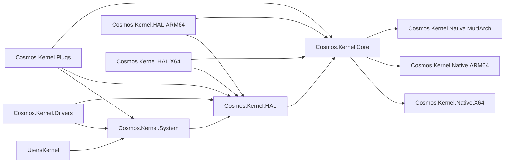

# 内核项目结构

Cosmos 内核由分层的项目组成，以保证依赖图清晰。依赖关系**只能向下**：一个项目绝不能引用层级中位于其上方的项目。

## 依赖图

## 项目说明

| 项目 | 用途 |
|---------|---------|
| **Cosmos.Kernel.System** | 高层操作系统 API：Console、FileSystem（带有 FAT 和 ext2 文件系统的 VFS）、Graphics（以及 `Graphics.Rendering3D` 下需显式启用的 3D 类型）、Input、Network（以及 `Network.Protocols` 下的实验性数据包扩展点）、Timers。这是用户内核与之交互的层。 |
| **Cosmos.Kernel.Drivers** | Cosmos 基于驱动工具包随附的二十五个驱动程序：PCI 主机和 PCI Express 根端口驱动程序，Intel E1000E 驱动程序，virtio PCI 和 MMIO 传输驱动程序，virtio-net 和 virtio-input 驱动程序，四个显示驱动程序 `VirtioGpuDriver`、`VmwareSvgaDriver`（及其 SVGA3D 命令层和 `Canvas3D`）、`AmdDcnDriver` 和 `IntelGraphicsDriver`，三个块设备驱动程序 `AhciDriver`、`NvmeDriver` 和 virtio 叶子驱动 `VirtioBlkDriver`（存储管理器使用它们的磁盘），HD Audio 驱动程序 `HdAudioDriver`，USB 驱动程序：`XhciDriver`、`EhciDriver` 和 `OhciDriver`，以及集线器、HID 启动键盘、HID 启动鼠标和大容量存储类驱动程序，还有 PS/2 驱动程序：`I8042Driver` 以及 `Ps2KeyboardDriver` 和 `Ps2MouseDriver`。每个驱动程序位于“总线种类 / 类别 / 驱动程序”结构的文件夹中，其命名空间与文件夹一致（[驱动程序文件夹](coding-guidelines.md#driver-folders)）：`Pci/`（`Audio/HdAudio`、`Bus/Ehci`、`Bus/Ohci`、`Bus/PcieRootPort`、`Bus/VirtioPci`、`Bus/Xhci`、`Display/AmdDcn`、`Display/IntelGraphics`、`Display/VmwareSvga`、`Network/E1000E`、`Storage/Ahci`、`Storage/Nvme`）、`Platform/Bus/`（`I8042`、`PciHost`、`VirtioMmio`）、`Ps2/Input/`（`Ps2Keyboard`、`Ps2Mouse`）、`Usb/`（`Bus/UsbHub`、`Input/UsbKeyboard`、`Input/UsbMouse`、`Storage/UsbMassStorage`）和 `Virtio/`（`Display/VirtioGpu`、`Input/VirtioInput`、`Network/VirtioNet`、`Storage/VirtioBlk`），因此 xHCI 驱动程序是 `Cosmos.Kernel.Drivers.Pci.Bus.Xhci.XhciDriver`。它是一个 User 层驱动程序程序集（`CosmosDriverAssembly`），分层分析器把它限制在内核作者能够引用的范围内，任何项目都不向它授予 `InternalsVisibleTo`；它是一个不区分 RID 的 `lib/net10.0` 包，因为其中没有任何特定于架构的代码。它被 Cosmos.Kernel 引用，因此每个内核都会在清单中带上它的驱动程序。 |
| **Cosmos.Kernel.HAL** | 硬件抽象层：共享逻辑、平台契约，全部为内部（`Boot/`：启动契约 `IPlatformInitializer` 和平台注册 `PlatformHAL`；`Timers/`：节拍源基类及其定时器条目（**System** 中的每个 `SoftwareTimer` 句柄包装其中一个）），设备类别（`Devices/`：`Display/`（含显示设备的能力接口（facet））、`Input/`、`Network/` 和 `Storage/`，每个类别都包含该设备种类的契约和词汇、驱动程序用来报告的接收器（块设备种类没有接收器）以及受支持层的内部消费者；`IBlockDevice`（内核直接实现并驱动它）和 `MacAddress` 是其中稳定的类型），驱动工具包（`DriverKit/`，根目录下是驱动程序及其绑定，绑定所提供的资源位于 `Resources/`、`Interrupts/` 和 `Threading/` 下，六种总线种类位于 `DriverKit/Buses/` 下（合成、平台、PCI、virtio、USB 和 PS/2，各占一个文件夹），内部注册表和引擎位于 `DriverKit/Engine/` 下）。工具包基于启动帧缓冲区发布的固件显示设备与显示设备种类放在一起。没有不安全代码（[不安全代码](coding-guidelines.md#unsafe-code)）。[HAL 文件夹](coding-guidelines.md#hal-folders)给出了其文件夹的规则。 |
| **Cosmos.Kernel.HAL.X64** | x86-64 平台代码：机器描述（8042 和 PCI 主机节点）、I/O APIC 中断线路由、PIT 和 CMOS RTC。不包含设备驱动程序。 |
| **Cosmos.Kernel.HAL.ARM64** | ARM64 平台代码：机器描述（ECAM 主机和 virtio-mmio 插槽，来自 ACPI 的 MCFG 表、设备树或 virt 机器的表）、GIC 中断线路由、通用定时器和 PL031 RTC。不包含设备驱动程序。 |
| **Cosmos.Kernel.Core** | 底层运行时：内存管理、GC、调度器、串行 I/O、恐慌处理程序、`RandomNumberGenerator` 背后的内核 CSPRNG（[随机数](../user/random.md)），以及引导加载程序和固件交出的内容（`Firmware/`：启动帧缓冲区、ARM64 描述所读取的设备树解析器、启动时间、通往原生启动代码所解析的 ACPI MCFG 表的桥接，以及通过 UEFI 运行时服务读取的时钟）。这是持有不安全代码的内核层：上层通过它基于地址的入口点访问内存（`MemoryBlock` 与 `PageAllocator.AllocBlock`、`AddressSpace.HhdmOffset`）。 |
| **Cosmos.Kernel.Native.X64** | x86-64 汇编文件（`.s`，GAS 语法）：中断桩、上下文切换、SIMD。 |
| **Cosmos.Kernel.Native.ARM64** | ARM64 汇编文件（`.s`，GAS 语法）：异常向量、上下文切换。 |
| **Cosmos.Kernel.Native.MultiArch** | 跨平台原生 C 代码（ACPI、libc 桩）。 |
| **Cosmos.Kernel.Plugs** | 针对 BCL 类型（`Console`、`Thread`、`Environment` 等）的 IL 级方法替换。 |
| **Cosmos.Kernel.Boot.Limine** | Limine 引导加载程序协议集成。 |
| **Cosmos.Kernel** | 每个内核都引用的聚合项目。它引入 Boot.Limine、Core、Drivers、HAL、Plugs 和 System，随附 `kmain` 引导 C 源文件，并包含负责连接 CPU 异常处理程序和调度器的库初始化器。没有公共类型。 |

## 构建系统项目

| 项目 | 用途 |
|---------|---------|
| **Cosmos.Build.Patcher** | IL patcher：在构建时应用 plug 和补丁。 |
| **Cosmos.Build.Ilc** | 面向 NativeAOT 的自定义 ILC（IL 编译器）集成。 |
| **Cosmos.Build.Asm** | 使用 Clang 编译汇编（x64 和 ARM64 均为 GAS 语法的 `.s` 文件）。 |
| **Cosmos.Build.CC** | 使用 Clang 针对 x64 和 ARM64 裸机目标进行交叉编译。 |
| **Cosmos.Build.Common** | 共享构建属性、架构选择器。 |
| **Cosmos.Build.API** | Plug 特性（`[Plug]`、`[PlugMember]`）和枚举。 |
| **Cosmos.Build.Analyzer.Patcher** | 检查 plug 正确性的 Roslyn 分析器。 |

## 规则

- **绝不**向上引用（Core 不得引用 HAL 或 System）
- **绝不**从 Core 引用特定于平台的 HAL 项目
- 横切关注点（内存、调度器、串行）放在 **Core** 中
- 不安全代码放在 **Core** 中：HAL、HAL.X64、HAL.ARM64、System 和 Drivers 均以 `AllowUnsafeBlocks=false` 编译，它们从内存或固件获取的任何东西都来自 Core 的某个入口点
- 平台代码（机器描述、中断线路由、节拍源、固件时钟）放在 **HAL.X64** / **HAL.ARM64** 中；设备驱动程序基于工具包放在 **Cosmos.Kernel.Drivers** 中
- 面向用户的 API 放在 **System** 中
- 受支持层仍共享的硬件契约（`IBlockDevice`、`MacAddress`）定义在 **HAL** 中，位于工具包的实验性扩展点之外；`Devices/` 下与它们并列的其他设备种类类型位于扩展点上，而网络协议栈所驱动的网络设备是 **System** 的内部类型
- 基于驱动工具包、为工具包总线可达的设备编写的驱动程序放在 **Drivers** 中，它只引用 System 和 HAL，从不引用架构程序集

如需了解编码风格和实现模式，请参阅[编码规范](coding-guidelines.md)。
