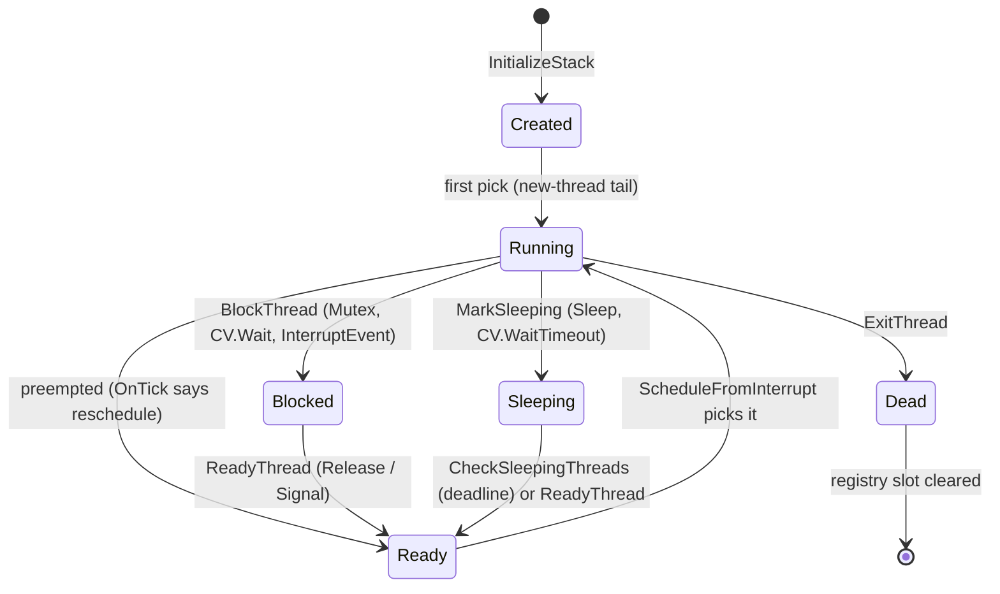
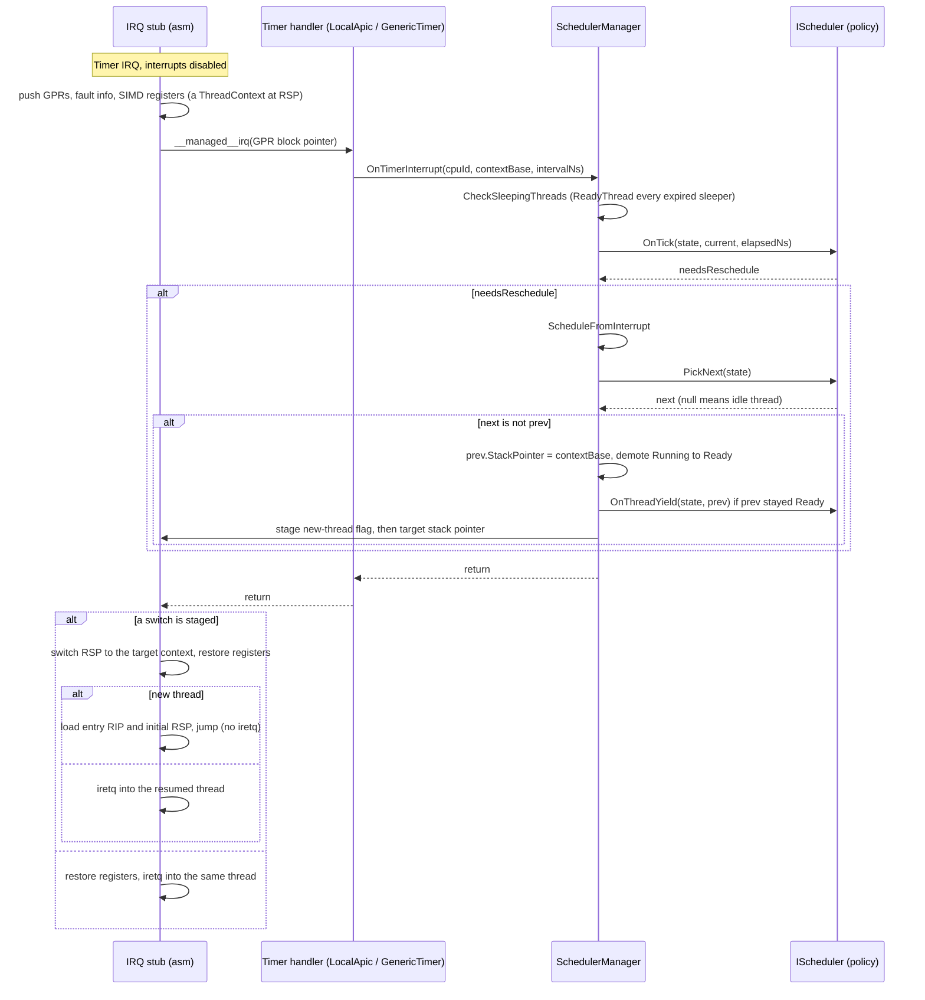
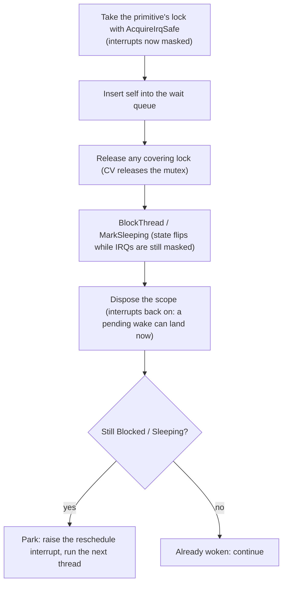

## 概述

调度器有三个特点：[**抢占式**](sched-concepts/preemption.md)、[**可插拔**](../user/scheduler-plugging.md)，并且默认采用[**基于虚拟时间的公平份额**](sched-concepts/virtual-time-fair-share.md)调度。每次上下文切换都发生在中断上下文中：硬件节拍到来时，中断桩代码已经把当前线程的寄存器保存到它的栈上，调度器决定中断返回到哪一个已保存的栈。没有专门的调度器线程，目前也没有可用的主动切换：线程会一直运行，直到某次中断退出把它切换走（节拍，或者某个设备中断的处理程序唤醒了另一个线程），直到它在某个阻塞原语上挂起（park），或者直到它退出。每个带链接的术语在[术语表](scheduler-glossary.md)中都有一段简短的背景说明；“可插拔”则链接到操作指南。

该设计将[策略与机制](sched-concepts/policy-and-mechanism.md)分离。机制是固定且共享的：线程登记表、生命周期转换、定时器节拍入口、保存和恢复寄存器的汇编代码，以及 GC 用来扫描线程的桥接层。策略，即决定*哪个*线程在*何时*运行的一切，是一个单独的接口 [`IScheduler`](https://github.com/CosmosOS/Cosmos/blob/gen3/src/Cosmos.Kernel.Core/Scheduler/IScheduler.cs)，任何算法都可以实现它。默认实现是 [Stride](#the-stride-policy)，一种基于虚拟时间的公平份额调度器；[编写调度器](../user/scheduler-plugging.md)介绍了如何替换它。

启动时，只要功能开关处于打开状态，[`LibraryInitializer`](https://github.com/CosmosOS/Cosmos/blob/gen3/src/Cosmos.Kernel/Internal/Runtime/CompilerHelpers/LibraryInitializer.cs) 就会把整个调度器装配起来：它以 CPU 数量调用 `SchedulerManager.Initialize`，为每个 CPU 创建一个空闲线程并将其设为该 CPU 的当前线程（空闲线程就是正在启动的内核本身，因此它没有单独的栈），在这些线程之上安装一个 `StrideScheduler`，翻转 `SchedulerManager.IsRunning`，最后以 10 ms 的时间片启动调度器定时器。之所以先创建空闲线程，是因为线程静态变量存放在当前线程上，而策略钩子可能会运行类构造函数，类构造函数的运行器会获取一个以线程静态变量为键的锁。从第一个节拍开始，内核的主流程就只是空闲线程，像其他线程一样被抢占。

调度器所做的一切都受到两个从外部观察其状态的使用者的约束：定时器中断和垃圾回收器。中断可以在任意[指令边界](sched-concepts/instruction-boundary.md)触发：在一条机器指令之后、下一条之前，指令流中的任何位置，把任何长于一条指令的代码序列拆开。因此，每次状态转换都在中断禁用的情况下进行，阻塞原语遵循严格的[挂起协议](#the-park-protocol)，使得在转换过程中到达的唤醒永远不会丢失。此外，[垃圾回收器](garbage-collector.md)在回收期间遍历[线程登记表](#thread-registry)，因此每个存活线程都必须登记在册，并且其保存的状态必须恰好位于登记表所指示的位置。

代码位于 `src/Cosmos.Kernel.Core/Scheduler/`。[`SchedulerManager`](https://github.com/CosmosOS/Cosmos/blob/gen3/src/Cosmos.Kernel.Core/Scheduler/SchedulerManager.cs) 是机制；`Stride/` 存放默认策略；同步原语和闹钟服务各自位于旁边的独立文件中。与架构相关的寄存器保存和恢复代码位于原生项目中。完整的文件清单见本文末尾的[源文件](#source-files)。

---

## 线程模型

本节说明线程在物理上是什么：控制块、线程运行所用的栈、在抢占前后保存线程状态的寄存器快照，以及让调度器和 GC 能够看到线程的登记表。

### 线程控制块

[`SchedulerThread`](https://github.com/CosmosOS/Cosmos/blob/gen3/src/Cosmos.Kernel.Core/Scheduler/SchedulerThread.cs) 是 GC 堆上的一个托管类：

| 字段 | 用途 |
|-------|---------|
| `Id`, `CpuId` | 全局唯一的 id（一个简单的递增计数器）和分配到的 CPU |
| `State` | `Created`、`Ready`、`Running`、`Blocked`、`Sleeping`、`Dead` 之一 |
| `Flags` | `IdleThread`、`Pinned`、`Managed`；第 8 到 15 位保留给调度器使用。`IsIdle` 读取第一个标志：阻塞原语会让这样的线程自旋或轮询，而不是将其挂起 |
| `StackBase`, `StackSize`, `StackPointer` | 栈分配和已保存的栈指针（见下文） |
| `InstructionPointer` | 入口点，预置到初始上下文中。属于管理器的簿记信息，不在扩展点上 |
| `LastScheduledAt`, `WakeupTime` | 由管理器维护的记账信息，不在扩展点上；`WakeupTime` 是以 `Stopwatch` 刻度表示的睡眠截止时间 |
| `TotalRuntime` | 累计 CPU 时间，由当前生效的策略记到当前线程上 |
| `AllocContext` | 线程的 [TLAB](gc-concepts/tlab.md)（见 [GC 文章](garbage-collector.md#alloccontext-tlab)） |
| `_threadStaticStorage` | `[ThreadStatic]` 字段的后备存储，以引用方式交给 CoreLib |
| `_exceptionDispatchState` | 该线程的异常分派器状态，线程在自己的栈上抛出、展开和捕获异常：其 ExInfo 链的头部、防止在分派过程中再次抛出的保护，以及在其上运行的 funclet。`ExceptionHelper.State` 以引用方式读取它，启动代码在成为调度器线程之前使用分派器自身的状态（valentinbreiz/nativeaot-patcher#440） |
| `SchedulerData` | 一个 `object?` 槽，当前生效的调度器把自己的簿记信息挂在上面（继承自 `SchedulerExtensible`） |

有两个标志会改变其他地方的行为：

- `Pinned`：线程不能在 CPU 之间迁移。Stride 的 `SelectCpu` 和 `Balance` 会遵守这一点。
- `Managed`：入口参数是一个 `System.Threading.Thread` 的 `GCHandle`，入口跳板调用 CoreLib 的 `Thread.StartThread`，而不是把参数解码为一个独立的 `Action`。

### 每线程栈

`SchedulerThread.InitializeStack` 分配一个连续的内存块，创建者未指定大小时为 `DefaultStackSize` = 256 KiB（显式请求的大小会被采纳，下限为 64 KiB；见[创建与首次运行](#creation-and-first-run)）。尚未运行过的线程的寄存器上下文被伪造在底部（最低地址处，向上取整到 16 字节），可用的调用栈从顶部向下朝它增长：

`StackPointer` 始终指向当前保存的上下文，因此 IRQ 桩代码知道从哪里恢复，GC 也知道挂起线程保存的状态从哪里开始。对于 `Created` 线程，这就是上图所示位于栈底的伪造上下文，由首次运行消费；此后，每次抢占都会在中断发生时所处的栈位置保存一个新的上下文，`StackPointer` 随之更新。有两个大小下限很重要（issue [#433](https://github.com/valentinbreiz/nativeaot-patcher/issues/433)）：

- `DefaultStackSize` 必须保持在 128 KiB 以上，即 CoreLib 的 `MinExecutionStackSize`：`RuntimeHelpers.EnsureSufficientExecutionStack` 会把当前栈指针与运行时报告的边界进行比较，栈更小会使它在每次调用时都抛出异常。
- 启动栈是独立的：内核向 Limine 请求 1 MiB，[`BootStack`](https://github.com/CosmosOS/Cosmos/blob/gen3/src/Cosmos.Kernel.Core/Runtime/BootStack.cs) 在任何托管代码运行之前记录其栈顶。在调度器启动之前运行的代码（以及空闲线程，它自己没有任何分配）报告的是这一组边界。

没有保护页：一个递归超过 `StackBase` 的线程会直接闯入分配器放在它下方的任何东西，而且没有任何机制能检测到这种溢出。

### 保存的上下文

[`ThreadContext`](https://github.com/CosmosOS/Cosmos/blob/gen3/src/Cosmos.Kernel.Core/Scheduler/ThreadContext.X64.cs) 逐字段地对应中断触发时 IRQ 桩代码压入的帧。这种等价正是核心技巧：抢占线程和创建线程产生的是同一种结构，因此恢复两者走的是同一条代码路径。

| | x64（448 字节） | ARM64（816 字节） |
|---|---|---|
| SIMD 区 | `Xmm[256]`（XMM0 到 XMM15） | `Neon[512]`（Q0 到 Q31） |
| 通用寄存器 | R15 到 RAX（按内存顺序共 15 个槽；桩代码最先压入 RAX） | X0 到 X30 |
| 故障信息 | `Interrupt`、`CpuFlags`、`Cr2`，外加一个 `TempRcx` 中转槽 | `Interrupt`、`CpuFlags`（ESR_EL1）、`Far`（FAR_EL1） |
| 返回帧 | `Rip`、`Cs`、`Rflags`、`Rsp`、`Ss`（`iretq` 帧） | `Sp`、`Elr`、`Spsr` |

（各行按 x64 的内存顺序排列；在 ARM64 上，返回帧位于故障信息之前。）

对于新线程，`ThreadContext.Initialize` 伪造出一个被抢占线程应有的快照：除入口参数（x64 上为 RDI，ARM64 上为 X0）外所有寄存器清零，帧指针为零以便栈遍历能够终止，入口点放在恢复槽中（`Rip` / `Elr`），以及一个对齐的初始栈指针（在 x64 上，栈顶对齐到 16 再减 8，即 ABI 所期望的执行 `call` 之后的状态；在 ARM64 上只需对齐，因为 AArch64 始终保持 SP 16 字节对齐）。

### 线程登记表

`SchedulerManager` 拥有一个扁平的、固定大小的 `SchedulerThread?[256]` 数组（`SchedulerThread.MaxThreadCount`），在 `Initialize` 时一次性分配，并以 `SchedulerManager.Threads` 的形式公开。每个存活线程从 `CreateThread` 起占据一个槽，直到 `ExitThread` 将其清除；阻塞和睡眠的线程即使不在任何运行队列中，也仍然登记在册。

登记表是为 GC 而存在的。回收期间，标记阶段直接遍历该数组，不经过接口分派（接口分派可能会分配内存，而回收过程中不允许任何分配），并扫描每个已登记线程的栈；一个不在登记表中的线程会继续运行，而 GC 会释放它的栈所指向的对象。这也是固定容量的危险之处：登记表满时，`RegisterThread` 记录一条警告并放弃这次登记，但该线程仍然会被加入队列并照常运行，只是不会被扫描（issue [#444](https://github.com/valentinbreiz/nativeaot-patcher/issues/444)）。

---

## 生命周期

每次转换都在中断被屏蔽的情况下进行：下面这些 `SchedulerManager` 入口点会获取 `InternalCpu.DisableInterruptsScope()`，而切换本身（`ScheduleFromInterrupt`）依赖于它已经运行在中断上下文中这一事实。每个入口点都会通过对应的 `IScheduler` 钩子通知当前生效的策略；下表列出了它们还会做的其他事情：

| 入口点 | 状态变化 | 策略钩子 | 其他操作 |
|-------------|--------------|-------------|------|
| `CreateThread` | 无（`InitializeStack` 已经设置了 `Created`） | `OnThreadCreate` | 把线程登记到登记表中 |
| `ReadyThread` | 在钩子之后设为 `Ready`，除非线程仍处于 `Created` | `OnThreadReady` | 设置每 CPU 的 `_needReschedule` 标志 |
| `BlockThread` | `Blocked` | `OnThreadBlocked` | 设置 `_needReschedule` |
| `MarkSleeping` | 计算出 `WakeupTime` 之后设为 `Sleeping` | `OnThreadBlocked` | 不停机；由调用者自己挂起（见[挂起协议](#the-park-protocol)） |
| `Sleep` | 通过 `MarkSleeping` | | 然后调用 `Park` |
| `Park` | 无 | 无 | 设置 `_needReschedule` 并触发控制器的重新调度中断；线程再次运行后返回（见[挂起](#parking)） |
| `YieldThread` | 无 | 无；它请求的切换会调用 `OnThreadYield` | 设置 `_needReschedule`，并在切换之前返回 |
| `ExitThread` | `Dead` | `OnThreadExit` | 运行退出回调，把 TLAB 交还给 GC，清除登记表槽 |

有三个细节是有意为之的：

- `Created` 线程即使在 `ReadyThread` 将其加入队列之后也保持该状态。`ScheduleFromInterrupt` 通过 `State == Created` 检测首次运行，首次运行需要下文所述的特殊退出路径。
- `ReadyThread`、`BlockThread` 和 `YieldThread` 会设置 `_needReschedule`，使下一次中断退出立即重新调度。如果没有它，被设备中断唤醒的线程最多要在运行队列中等待一个完整的时间片，刚刚阻塞的线程会在停机循环中空转掉剩余的时间片，而主动让出的线程会一直占用 CPU，直到时间片耗尽。
- `WakeupTime` 以 `Stopwatch` 刻度存储，而不是纳秒。节拍检查会与 `Stopwatch.GetTimestamp()` 进行比较，而经由纳秒换算曾使 ARM64 上 62.5 MHz 定时器的超时时间失真 16 倍。

### 创建与首次运行

内核代码通过唯一的一个入口创建线程：[`libSystemNative.cs`](https://github.com/CosmosOS/Cosmos/blob/gen3/src/Cosmos.Kernel.Core/Bridge/Interop/libSystemNative.cs) 中的 `SystemNative_CreateThread` 导出函数，它是 CoreLib 中 `Interop.Sys.CreateThread` P/Invoke 的底层实现。因此，内核代码中的 `new System.Threading.Thread(...).Start()` 会经过 CoreLib 流入这个导出函数，它把请求的栈大小向上取整到页的整数倍（下限 64 KiB），构建一个带 `Managed` 标志的 `SchedulerThread`，让其上下文指向 `ThreadNative.EntryPointStub` 跳板，然后调用 `CreateThread` 和 `ReadyThread`。（`System.Threading.Thread` 没有任何 plug：`Thread.CreateThread` 运行 CoreLib 未经修改的方法体，`Thread.Yield` 则到达运行时的 `RhYield`。）

驱动工具包的线程（它的工作线程，以及驱动程序的 `TryStartThread` 线程，例如 USB 主机控制器驱动程序的热插拔线程，或 PCI Express 根端口驱动程序的插槽线程），以及 `GarbageCollector.ThreadedFinalizer` 打开时回收器的终结器线程，都不经过 CoreLib：`Thread.Start` 要等到新线程运行之后才返回，因此在一台永远不会切换到新线程的机器上（定时器从不产生节拍，或者启动 CPU 的 APIC ID 不为 0，其节拍从不进行调度），它会永远自旋。[`KernelThread.TryStart`](https://github.com/CosmosOS/Cosmos/blob/gen3/src/Cosmos.Kernel.Core/Scheduler/KernelThread.cs) 自己构建 `SchedulerThread`，不带 `Managed` 标志，并以一个 `GCHandle<Action>` 作为参数，然后等待线程把一个握手字从“待处理”翻转为“已启动”。只要调度器在工作，它就一直等待，只会因为它所针对的两种故障而结束：在 `Stopwatch` 时间上持续 `KernelThread.NoTickTimeoutMs`（1 s）没有节拍，即定时器停止了；或者 `SchedulerManager.TickCount` 前进了 `KernelThread.NoSwitchTicks`（10）个节拍而 `SchedulerManager.SwitchCount` 没有变化，即节拍没有切换任何线程。只要节拍还在切换线程，无论策略排在新线程前面的线程要占用多少个时间片，策略都会让新线程轮到运行：一个被唤醒的 Stride 线程可能落后全局行程值两个时间片，因此新线程运行之前可能会经过好几个节拍。这两个界限都不是从新线程自己的启动时刻开始计算的，也都不单纯是时间：在模拟环境下，TSC 或 Generic Timer 的计数器按宿主机时间运行，因此一个被宿主机取消调度的虚拟 CPU 会看到几毫秒过去了，却没有收到任何节拍。等待结束时，它会改为把握手字翻转为“已放弃”；两次比较交换决定了这场竞争的胜负，输掉竞争的线程会直接返回，而不运行其入口。从未运行过的线程还会立即通过 `ExitThread` 从运行队列中移除：如果留在队列中，下一次设备中断仍会切换到它，而它的退出会让 CPU 一直挂起，直到等来一个这种机器永远不会送达的定时器节拍。

`Created` 线程的首次运行不能以 `iretq` 结束，因为没有可供返回的被中断帧。取而代之的是，IRQ 退出路径会（通过一个从 C# 预置的标志）被告知走新线程尾路径：它从上下文中加载入口点和伪造的初始栈指针，途中重新启用中断，然后跳转。落点始终是 `EntryPointStub`，它转发给 `SchedulerManager.InvokeCurrentThreadStart`：后者解码参数（对 `Managed` 线程是 CoreLib 的 `Thread.StartThread`，否则是一个 `GCHandle<Action>`），在一个兜底的 catch 中运行它，使抛出异常的线程以退出码 1 结束，而不是拖垮内核，最后以 `ExitThread` 和一个停机循环收尾。首次进入之后，该线程与任何被抢占的线程已无从区分。

---

## 抢占

本节说明节拍如何变成一次上下文切换：哪个硬件触发它，中断路径保存什么，策略的决定如何被暂存，以及退出路径如何消费它。

### 定时器源

调度器并不拥有定时器；它公开 `OnTimerInterrupt`，由平台来调用。各架构的连接方式不同：

| 架构 | 调度器节拍 | 软件定时器（[定时器与闹钟](#timers-and-alarms)） |
|--------------|----------------|------------------------------|
| x64 | LAPIC 定时器，向量 239，周期性，10 ms | IRQ 0 上的 PIT，一次性，每次中断后重新设置，10 ms |
| ARM64 | Generic Timer，INTID 30，每次中断后重新设置，10 ms | 同一个中断，在调度器节拍之前分派 |

两种情况下，处理程序都把*配置的*间隔作为 `elapsedNs` 传入，而不是实际测得的经过时间，并且自己计算保存的上下文的地址：托管 IRQ 入口收到一个指向通用寄存器块的指针，处理程序减去 SIMD 保存区（x64 上 256 字节，ARM64 上 512 字节）以得到 `ThreadContext` 的基址。被抢占线程的 `StackPointer` 中保存的就是这个地址。

### 节拍

策略从不接触寄存器。桩代码保存与恢复之间的一切，都是操作 `SchedulerThread` 和 `PerCpuState` 的普通托管 C# 代码；每个方向的交接都只是一个指针。运行队列中永远不会出现同一个线程两次，`Ready` 就意味着已在队列中。换出时的簿记只在 `prev` 处于 `Running` 时，才通过 `OnThreadYield`（策略的重新入队钩子）把它重新入队，并将其降为 `Ready`。在节拍之前刚刚阻塞或进入睡眠的线程保持其挂起状态，不会被重新入队；而已经是 `Ready` 的线程本来就在队列中：它把自己挂起之后，在切换把它从 CPU 上移走之前，就被一次唤醒设为了就绪（节拍的睡眠线程检查会在本将把某个睡眠线程换出的那个节拍上唤醒它）。当策略交回的正是当前线程自己的条目时，该线程继续留在 CPU 上并回到 `Running`。`ReadyThread` 对已经是 `Ready` 或 `Running` 的线程不做任何事，`YieldThread` 自己也不让任何线程入队：它请求的切换会像对待任何其他处于 `Running` 的 `prev` 一样，把该线程重新入队。第二个条目并非无害：线程的行程值不断上升，而过时的条目保持原位，于是队列不再有序，而只取队首的 `PickNext` 永远到达不了排在该条目后面的线程。

暂存本身是对原生全局变量的两次写入：先写新线程标志，再写目标栈指针（`_context_switch_target_rsp`；非零表示要切换）。全部 256 个中断向量在退出时都会检查这个全局变量，因此任何中断都可以执行已暂存的切换，而不只是定时器中断。暂存变量是单一的全局变量，这是目前把内核限制在单个 CPU 上的又一个原因。

### 从中断处理程序中唤醒

设备中断处理程序也会唤醒线程：NVMe 驱动程序的消息中断处理程序会向驱动工具包的一个 `DeviceEvent`（其底层是一个 [`InterruptEvent`](#interruptevent)）发出信号，它的等待者必须得到运行。仅靠节拍路径，会让那个线程在队列中最多等待一个完整的时间片，所以唤醒走了一条捷径。`ReadyThread`（以及 `BlockThread` 和 `YieldThread`）会设置每 CPU 的 `_needReschedule` 标志，中断分派器在一个已处理的硬件中断退出时调用 `ReschedulePendingFromIrq`：如果该标志已设置，且本次中断还没有暂存切换，它就在设备中断自己的退出路径上当场运行 `ScheduleFromInterrupt`。“是否已暂存”的检查很重要：定时器处理程序可能已在同一次中断中暂存了一次切换，而第二次 `ScheduleFromInterrupt` 会把这个帧的栈指针保存到一个真实上下文位于别处的线程中。

### 挂起

阻塞或睡眠的线程通过 `SchedulerManager.Park` 让出 CPU，它在状态翻转之后、关闭 IRQ 的作用域释放之后被调用。`Park` 设置 `_needReschedule`，并在当前 CPU 上触发控制器的重新调度中断（`IInterruptController.TryRaiseReschedule`）。该中断的处理程序什么也不做：这个中断只是为了它的退出而存在，退出时会运行 `ReschedulePendingFromIrq` 并切换到下一个线程。

| 架构 | 重新调度中断 |
|--------------|----------------------|
| x64 | Local APIC 自 IPI，向量 `0xF0` |
| ARM64 | SGI 8，在 GICv3 上通过 `ICC_SGI1R_EL1`，在 GICv2 上通过 `GICD_SGIR` |

随后 `Park` 等待状态离开 `Blocked` 或 `Sleeping`：当一次唤醒使线程就绪、且调度器再次运行了它时就会如此；如果唤醒在切换之前就已到达，则会立即如此。以前改用停机的做法，每当有线程阻塞，都会让 CPU 在该节拍剩余的时间里空闲。在控制器能够触发该中断之前就挂起的线程仍然会停机；空闲线程则从不挂起（见下文的原语），而是在检查条件变量的间隙停机。

### 不存在的东西：主动切换

`SchedulerManager.Schedule` 和 `ContextSwitch.Switch` 存在于代码树中，但没有任何调用者，而且两者都无法完成同步切换：它们只是*暂存*一个目标栈指针，暂存的切换在中断退出时才被消费，而主动调用者并没有由中断保存的寄存器帧可供该退出路径恢复（`Schedule` 的辅助函数甚至不保存换出线程的栈指针）。唯一可用的主动让出入口，即 `Thread.Yield` 背后运行时的 `RhYield`，借用的是中断路径：`YieldThread` 设置 `_needReschedule`，使下一次硬件中断退出时即使时间片尚未用完也进行切换，然后立即返回。该切换先选出替代线程，之后再通过 `OnThreadYield` 把让出的线程重新入队，与抢占的做法完全相同，因此线程在仍在运行时永远不会位于队列中。调用者不等待切换，`Thread.Yield` 总是报告没有其他线程运行过：等待会让每次调用付出最多一个节拍的代价，而 CoreLib 在其“先自旋后阻塞”循环的每一轮都会调用一次 `Thread.Yield`（在单个 CPU 上，一个空闲的线程池工作线程在挂起前会自旋 70 次，`Thread.Start` 则会一直自旋，直到新线程报告已启动）。停机直到切换发生，会使这些循环持续 70 个节拍。真正的同步切换需要自己的保存路径（相当于 IRQ 桩代码的保存路径，但通过调用而非中断进入），而这条路径目前还不存在。

---

## Stride 策略

[Stride 调度](https://web.eecs.umich.edu/~mosharaf/Readings/Stride.pdf)是一种比例份额调度，采用确定性的、基于虚拟时间的记账方式。每个线程持有票数 `Tickets`（默认 100），即它的份额权重。由票数可以得出步长 `Stride`，即常量 `Stride1`（2^20）除以票数，以及行程值 `Pass`，即线程的虚拟时间。运行队列始终按 `Pass` 排序，`PickNext` 总是弹出最小的一个：在自己的份额中消耗得最少的线程下一个运行。线程运行时，它的 `Pass` 按运行时间成比例地增加（`Stride * elapsed / quantum`，因此每个完整的 10 ms 时间片恰好增加一个步长），票数越多，步长越小，`Pass` 上升得越慢，得到的 CPU 也越多。

每个 CPU 都带有一个 `StrideCpuData`：运行队列（一个按 `Pass` 升序保持有序的 `List<SchedulerThread>`）、`TotalTickets`（总份额，同时用作负载指标），以及 `GlobalPass`，即该 CPU 自己的虚拟时钟，以总体速率（每个时间片 `Stride1 / TotalTickets`）前进。`GlobalPass` 是计算唤醒放置和优先级变化时所依据的参考点。

Stride 在每个钩子中的行为：

| 钩子 | 行为 |
|------|----------|
| `InitializeCpu` / `ShutdownCpu` | 创建 / 丢弃每 CPU 的 `StrideCpuData` |
| `OnThreadCreate` | 附加 `StrideThreadData`（100 张票，`Pass = 0`）；线程尚未入队 |
| `OnThreadReady` | 放置线程（见下文的唤醒放置），按 `Pass` 有序插入，把它的票数加到 `TotalTickets` |
| `OnThreadBlocked` | 保存 `Remain = Pass - GlobalPass`，从队列中移除，减去票数 |
| `OnThreadExit` | 从队列中移除，减去票数，丢弃该线程的簿记信息 |
| `OnTick` | 推进当前线程的 `Pass` 和该 CPU 的 `GlobalPass`；如果队首的 `Pass` 严格更低，或者时间片已用完，则重新调度 |
| `OnThreadYield` | 如果 `Pass` 落后于 `GlobalPass`，就把它提升到 `GlobalPass`，然后重新插入 |
| `PickNext` | 弹出队首（最小的 `Pass`）；队列为空时返回 null，由管理器运行空闲线程 |
| `OnPickFailed` | 重新插入管理器未能切换过去的线程 |
| `SelectCpu` | 遵守 `Pinned`；否则接受负载（`TotalTickets`）低于目前所找到的最佳负载 80% 的 CPU |
| `Balance` | 仅当本 CPU 的队列为空时：从队列最长的对等 CPU 窃取队尾线程（`Pass` 最大），前提是该队列至少有两个线程，且队尾线程不是 `Pinned` |
| `OnThreadMigrate` | 在 CPU 之间转移票数，并以目标 CPU 的 `GlobalPass + Remain` 为基准重新设定 `Pass` |
| `SetPriority` / `GetPriority` | 设置 / 读取票数；票数改变时，当前相对 `GlobalPass` 的偏移量按步长之比缩放，从而保持相对位置不变 |

唤醒放置是公平性需要权衡的地方。被唤醒的线程不能保留它原来的 `Pass`：它在挂起期间已远远落后于 `GlobalPass`，让它一直运行到追上来，会使其他所有线程陷入饥饿。`ReadyThread` 在把线程标记为 `Ready` 之前调用钩子，因此钩子能够区分唤醒（`Blocked` 或 `Sleeping`）与首次启动（`Created`，放置在 `GlobalPass`），而唤醒会采用以下两种放置之一：

- **防饥饿上限**，`Pass = max(GlobalPass + Remain, GlobalPass - 2 * Stride1)`：`Remain` 恢复线程阻塞时其时间片所剩的比例，上限则限制了任何被唤醒线程能被放置到落后 `GlobalPass` 多远的位置；
- **交互加成**，`Pass = GlobalPass - Stride / 2`，为被归类为交互式的线程提供半个时间片的领先，使输入驱动的线程能够及时抢占批处理工作。如果一个线程自上次唤醒以来挂起的时长超过其运行时长的两倍，它就是交互式的。`OnThreadBlocked` 为挂起打上时间戳，`OnTick` 累加自唤醒以来的运行时间，两者都以纳秒比较，并且每次唤醒都会重新分类，因此一个变成 CPU 密集型的线程会失去这一资格。运行时间一侧的粒度与[节拍](sched-concepts/scheduler-tick.md)一样粗：节拍落在某个线程上时，它会被记上整整一个周期，而如果它在节拍之前挂起，则什么也不记，因此对于相同的行为，这一次唤醒可能判定为交互式，下一次却不是；平均值是对的，每次唤醒的判定则不是。在策略替换时以挂起状态继承过来的线程两者都没有记录：它的挂起从替换时刻开始计时，其整个生命周期的运行时间被用来代替运行时长，因此这第一次唤醒可能扣下一次加成，但绝不会给出真实测量会拒绝的加成。

有两条实现说明，任何修改这段代码的人都需要了解。从队列中移除在 `DisableInterruptsScope` 下进行，并用 `ReferenceEquals` 扫描，而不是使用 `List.Remove`，因为 `EqualityComparer<T>.Default` 需要内核所没有的运行时辅助函数。另外，`OnTick` 能够容忍 `SchedulerData` 已经为 null 的线程（它在时间片中途退出了）：只要队列中还有其他线程，就重新调度。

---

## 同步原语

阻塞式同步建立在三个管理器调用之上：`BlockThread`、`ReadyThread` 和 `MarkSleeping`，因此它在任何策略下都能原样工作。这些原语是：`SpinLock`（非阻塞）、`Mutex`、`ConditionVariable`、`Monitor`（前两者的组合）以及 `InterruptEvent`（从中断到线程的完成通知）。它们都与调度器放在一起，因为它们的正确性依赖于调度器的内部细节，尤其是下文的挂起协议。

### SpinLock 与 IRQ 安全作用域

[`SpinLock`](https://github.com/CosmosOS/Cosmos/blob/gen3/src/Cosmos.Kernel.Core/Scheduler/SpinLock.cs) 是一个单字 CAS 锁，有两种获取形式，选择正确的那一种就是全部契约。普通的 `Acquire`/`Release` 只对从不在中断上下文中使用的锁是安全的：在单个 CPU 上，一个中断处理程序如果在自旋等待一个由它所中断的线程持有的锁，就会永远自旋下去。`AcquireIrqSafe` 返回一个作用域，它在获取锁之前禁用中断，在释放锁之后恢复中断，两端都按这个顺序，因此在本 CPU 上持有该锁期间，中断永远不会触发。`Mutex`、`ConditionVariable` 和 `InterruptEvent` 中的每一个锁都只通过 `AcquireIrqSafe` 获取：它们的等待一侧在中断被屏蔽的情况下持有锁，因此一个以普通方式获取锁的持有者如果在临界区中途被抢占，就会使其他所有自旋者陷入死锁，而 `InterruptEvent` 的信号一侧还确实会在中断处理程序中运行。

### 挂起协议

阻塞原语必须把线程从运行状态转为挂起状态，而与此同时，唤醒可能在任何一条指令处到达，可能来自定时器路径，也可能来自设备中断。其失效模式是丢失唤醒：等待者在完成阻塞*之前*就被设为就绪，随后阻塞操作又覆盖在其上，线程便再也不会醒来（issue [#357](https://github.com/valentinbreiz/nativeaot-patcher/issues/357)，正是 `ConditionVariable.Wait` 中的这种竞争）。内核中的每条阻塞路径都遵循同样的三条规则：

1. **单一原子区段**。入队、任何外层锁的释放以及状态翻转，都在同一个 `AcquireIrqSafe` 作用域内完成。唤醒无法穿插进来，因为信号一侧需要同一把锁，而且中断已被屏蔽。
2. **由状态把关的挂起**。作用域之后的 `Park` 只在线程仍处于挂起状态时才起作用。在作用域退出与切换之间的窗口内到达的唤醒会把状态翻转回 `Ready`，而这一检查能够看到它；无条件停机则会把这次唤醒睡过去。
3. **基于成员关系的结果**。对于带超时的等待，“我是收到了信号还是超时了”由是否仍在等待队列中来回答，而不是靠标志：信号会把线程从队列中移除，因此醒来后仍在队列中就意味着超时（线程还会移除自己的过时条目，使后续的信号不会浪费在它身上）。

`MarkSleeping` 之所以作为单独的入口存在，正是为了规则 1：`Sleep` 就是 `MarkSleeping` 加上 `Park`，但 `ConditionVariable.WaitTimeout` 需要在*它自己的*锁作用域内完成状态翻转，因此它在那里调用 `MarkSleeping`，之后再调用 `Park`。

### Mutex

[`Mutex`](https://github.com/CosmosOS/Cosmos/blob/gen3/src/Cosmos.Kernel.Core/Scheduler/Mutex.cs) 是一个可重入的阻塞锁：一个所有者引用、一个递归深度和一个 FIFO 等待列表。发生争用的获取在第一次尝试失败时就按上述协议挂起；没有先自旋后挂起的阶段。在深度为零时释放会执行**直接移交**：仍在锁内时，它把队首的等待者出队，先让它成为所有者再将其设为就绪，因此正在运行的线程无法在等待者被唤醒的延迟期间插队，重新取得互斥锁。被唤醒的等待者能识别出这次移交（它拥有一个自己从未显式获取过的互斥锁），然后返回。

两种特殊情况：空闲线程从不挂起（阻塞它只会让它作为空闲后备再次被选中），因此它以自旋方式获取，并在两次尝试之间启用中断。而在完全没有线程上下文时（调度器关闭或尚未就绪），`Acquire`/`Release` 不执行任何操作，`TryAcquire` 总是成功，因此早期启动代码可以经过受互斥锁保护的路径。

### ConditionVariable 与 Monitor

[`ConditionVariable`](https://github.com/CosmosOS/Cosmos/blob/gen3/src/Cosmos.Kernel.Core/Scheduler/ConditionVariable.cs) 提供与互斥锁集成的等待/信号机制。`Wait(mutex)` 把自己插入队列、释放互斥锁并阻塞，全部在一个作用域内完成（规则 1；在作用域之外释放互斥锁正是 #357 这个 bug），然后在醒来时重新获取互斥锁。`WaitTimeout` 带着截止时间通过 `MarkSleeping` 挂起，并根据成员关系报告是收到信号还是超时（规则 3）。`Signal` 使 FIFO 队首就绪；`SignalAll` 使所有等待者就绪。

与 `Mutex` 相同的特殊情况：空闲线程在这里同样从不挂起。它在同一个作用域内插入自己并释放互斥锁，然后在两次停机之间检查等待者列表，直到某个 `Signal` 把它移除或截止时间已过。它停机而不是自旋，这与互斥锁（按契约其持有时间很短）和中断事件（其信号可能来自一个之后不再有中断的 ISR）不同：条件变量的信号来自某个线程，而线程只在中断退出时运行，因此停机最迟会在下一个节拍结束，一个用 `Thread.Sleep` 控制其 `Run` 节奏的内核也不会在整个睡眠期间空耗 CPU。过去让它挂起时，它的票数被从 Stride 总数中扣除，却没有那次把票数还回来的唤醒（空闲后备会把它重新设为 `Running`），于是总数发生回绕，`GlobalPass` 冻结，之后创建的线程让主线程一直得不到 CPU；CoreLib 的 `Thread.Sleep` 和 `Thread.Join` 通过底层管程到达这条路径，因此内核主线程会不断碰到它。

[`Monitor`](https://github.com/CosmosOS/Cosmos/blob/gen3/src/Cosmos.Kernel.Core/Scheduler/Monitor.cs) 把一个 `Mutex` 和一个 `ConditionVariable` 组合成经典的管程形式；它的 `Signal`/`SignalAll` 还会释放互斥锁，因此发出信号即退出管程。

### InterruptEvent

[`InterruptEvent`](https://github.com/CosmosOS/Cosmos/blob/gen3/src/Cosmos.Kernel.Core/Scheduler/InterruptEvent.cs) 是从中断到线程的完成原语：中断处理程序向它发出信号，线程在它上面等待。驱动工具包的 `DeviceEvent` 封装了一个：`Cosmos.Kernel.Drivers` 中的 NVMe 驱动程序通过其绑定为每个命令槽创建一个，并在该槽的完成到达时，从其消息中断处理程序中通过 `InterruptContext.Signal` 向它发出信号。

信号是**计数式**的，而不是锁存式的：两个信号唤醒两个等待者，没有等待者时到达的信号会被累积起来，在之后的每次等待中各消耗一个（自动复位）。信号一侧在设计上就是中断安全的：它获取 IRQ 安全锁，增加计数，让一个等待者出队，然后调用 `ReadyThread`，整条路径上没有分配，也没有接口分派（等待者列表预先分配了四个位置，因此常见的等待也不会在中断处理程序所自旋等待的锁下分配内存）。这个 `ReadyThread` 会设置 `_needReschedule`，因此被唤醒的等待者就在同一次中断的退出路径上运行（见[从中断处理程序中唤醒](#waking-from-an-interrupt-handler)）。

等待一侧遵循挂起协议，但有两处变化。不具备挂起能力的调用者（空闲线程，或在调度器就绪之前运行的代码）会轮询信号计数，在两次检查之间启用中断，并且刻意从不停机：如果发出信号的中断恰好在停机之前触发，可能再也不会有中断到来结束这次停机。另外，`Wait(maxIterations)` 以循环次数限制等待，它是针对丢失的设备中断的防卡死措施，而不是一个时钟。

---

## 定时器与闹钟

延迟工作分为两层，按执行上下文划分。两者的 API 文档中都写明了这条规则：中断上下文不得阻塞，线程上下文可以阻塞。

| | [`TimerManager`](https://github.com/CosmosOS/Cosmos/blob/gen3/src/Cosmos.Kernel.System/Timers/TimerManager.cs) | [`AlarmManager`](https://github.com/CosmosOS/Cosmos/blob/gen3/src/Cosmos.Kernel.System/Timers/AlarmManager.cs) |
|---|---|---|
| 回调运行于 | 中断上下文（定时器节拍） | 一个专用的内核线程 |
| 可否阻塞、获取 Mutex | 否 | 是 |
| 精度 | 节拍源的周期 | 调度器节拍 |
| 底层实现 | 节拍源上的 `TimerEntry` 登记表 | [`AlarmSystem`](https://github.com/CosmosOS/Cosmos/blob/gen3/src/Cosmos.Kernel.Core/Scheduler/AlarmSystem.cs)：一个按截止时间排序的列表、一个 `Mutex`、一个 `ConditionVariable` |
| 调度方法 | `Schedule(Action, TimeSpan)`、`ScheduleRecurring(Action, TimeSpan)` | 相同的两个签名 |
| 句柄 | 一个 `SoftwareTimer`，未注册节拍源时为 null | 一个 `ulong` id，调度器未运行时为 0 |
| 取消方法 | `Cancel(SoftwareTimer?)` | `Cancel(ulong)` |
| 取消的返回值 | 仅当定时器仍待处理时为 true | 仅当闹钟仍待处理时为 true |
| 可调用的上下文 | 任何上下文，包括节拍路径：这些成员会屏蔽中断 | 仅限线程上下文：每个成员都会获取闹钟列表的互斥锁，若该锁已被持有则挂起 |
| 一次性 / 周期性 | 两者皆可（周期必须为正） | 两者皆可（周期必须为正） |

两个管理器以相同的顺序接受相同的参数，并以相同的方式报告取消结果，因此调用点唯一需要选择的就是*回调*运行的上下文，而这正是管理器名称所表明的。不一致的是每个管理器可以*从*哪种上下文中被调用：调度或取消闹钟会在互斥锁上挂起，因此在 `TimerManager` 回调中这样做，会在定时器中断内部挂起，导致内核卡死。句柄类型也不同，因为闹钟归 `AlarmSystem` 所有，而 `AlarmSystem` 是 `Cosmos.Kernel.Core` 的内部类型；软件定时器则是受支持层包装在节拍源登记表条目之外的一个公共句柄。

第一层贴近硬件：`TickSource` 维护一个 `TimerEntry` 倒计时登记表（每个 `SoftwareTimer` 句柄包装其中一个），并由其节拍中断（`HandleTick`）驱动它们，就在中断上下文中当场调用到期的回调。在 x64 上，这个节拍由 PIT 提供，独立于 LAPIC 的调度器节拍；在 ARM64 上，唯一的 Generic Timer 中断同时驱动两者，先处理软件定时器。

第二层是一个完全构建在上述原语之上的服务，同时也是这些原语的参考用法。`AlarmSystem` 把闹钟保存在一个按截止时间排序、由 `Mutex` 保护的列表中；一个延迟启动的内核线程在一个 `ConditionVariable` 上等待，`WaitTimeout` 的超时被限制在下一个截止时间（空闲时则是 1 s 的心跳），它在锁外、在一个兜底的 catch 中触发到期的闹钟，并从*当前时刻*而不是名义到期时间开始重新设置周期性闹钟，因此一次迟到的唤醒不会引发补偿性的连续触发。`Add` 会向条件变量发出信号，使新的最近截止时间能够缩短正在进行的等待。由于插入和等待共用同一个互斥锁，在计算截止时间与挂起之间，不可能有闹钟悄无声息地插进来（这又是规则 1，只是高了一层）。

---

## GC 集成

调度器是 GC 获取栈根的权威来源；完整说明见 [GC 文章](garbage-collector.md#mark-phase)。调度器一侧的契约分为三部分：

- **登记表就是根集合**。标记阶段直接遍历 `SchedulerManager.Threads`，这是一次扁平数组遍历，没有接口分派，也没有分配。每个已登记且不是 `Dead` 的线程都会被扫描；登记表中没有的线程对 GC 来说并不存在。
- **挂起的线程根据其保存的状态被保守地扫描**。对于每个当前未在运行的线程，GC 通过 `SchedulerThread.GetContext()` 读取保存的 `ThreadContext`，把保存的通用寄存器视为根候选（跳过 SIMD 区和标志），然后扫描从 `StackPointer` 到栈顶的每一个指针大小的字。对挂起线程进行精确扫描需要返回地址劫持，见 issue [#385](https://github.com/valentinbreiz/nativeaot-patcher/issues/385)。
- **触发回收的线程被精确扫描**。进入 `Collect` 的线程是通过一条托管调用链到达那里的，因此它的栈会根据 GCInfo 逐帧遍历（见[精确栈扫描](garbage-collector-gcinfo.md)）；调度器提供栈的边界。

保守扫描也是 `TryMarkRoot` 进行严格验证的原因：一个栈字只有在指向 GC 堆内部时才是候选，而且在解引用之前，在那里找到的 `MethodTable` 指针必须位于堆之外，并且高于 `AddressSpace.KernelSpaceStart`（内核高半区）。

回收在触发线程上以中断禁用的方式运行，因此在扫描过程中，没有任何节拍、切换或中断处理程序能够改变线程状态。同样的规则也保护了另一个方向：由于 `AllocObject` 同样对中断是原子的，中断处理程序（节拍本身、输入驱动程序）可以分配内存。

---

## 运行时桥接

运行时和 CoreLib 通过 [`Runtime/Thread.cs`](https://github.com/CosmosOS/Cosmos/blob/gen3/src/Cosmos.Kernel.Core/Runtime/Thread.cs) 中的导出函数看到调度器：

| 导出函数 | 行为 |
|--------|----------|
| `RhGetCurrentThreadStackBounds` | 当前线程真实的 `[StackBase, StackBase + StackSize)`；在调度器运行之前、对于空闲线程以及开关关闭时，返回启动栈的边界（issue [#433](https://github.com/valentinbreiz/nativeaot-patcher/issues/433)） |
| `RhGetThreadStaticStorage` | 指向当前线程 `[ThreadStatic]` 后备存储的引用（开关关闭时为一个静态主干） |
| `RhGetDefaultStackSize` | `SchedulerThread.DefaultStackSize`，256 KiB |
| `RhSetThreadExitCallback` | 保存 `ExitThread` 调用的回调；CoreLib 用它来清理托管线程 |
| `RhYield` | 支撑 `Thread.Yield`：通过 `YieldThread` 请求在下一次中断退出时切换，并在切换之前返回 0；见[不存在的东西](#what-there-is-not-a-voluntary-switch) |
| `RhSpinWait` | 一个计数的空循环 |
| `RhGetThreadEntryPointAddress`, `RhSetCurrentThreadName` | 桩实现：返回零，以及输出一条串口日志 |

切换的原生一侧是 [`ContextSwitchNative`](https://github.com/CosmosOS/Cosmos/blob/gen3/src/Cosmos.Kernel.Core/Bridge/Import/ContextSwitchNative.cs)：五个很小的 `[SuppressGCTransition]` 导入，在两种架构上完全相同。暂存函数对（`_native_set_context_switch_sp`、`_native_set_context_switch_new_thread`）和已暂存指针的读取函数（读到非零值时同时充当“切换已暂存”的检查）驱动退出路径；`_native_get_sp` 读取当前栈指针，供 GC 扫描正在运行的线程；`_native_capture_regdisplay` 则为 GC 的精确栈遍历提供起点。

---

## 功能开关

调度器由内核 `.csproj` 中的 `CosmosEnableScheduler` 控制，以 `CosmosFeatures.SchedulerEnabled` 的形式公开，并在三个层面上检查：

- `SchedulerManager.IsEnabled`（内部）反映该开关。创建类入口点（`Initialize`、`CreateThread`、`ReadyThread`）在开关关闭时抛出异常；开关关闭时，其他任何东西都无法到达，因为根本不会有线程存在。在受支持层上，同一事实体现为 `KernelFeatures.Scheduler` 和 `SchedulerDiagnostics.IsSupported`。
- `SchedulerManager.IsRunning`（内部）是运行时的启用开关，在受支持层上通过 `SchedulerDiagnostics.IsRunning` 读取。`LibraryInitializer` 只在管理器、策略和空闲线程全部装配完毕之后才翻转它，而中断一侧的入口（`OnTimerInterrupt`、`ReschedulePendingFromIrq`）在它被设置之前会提前返回，因此第一个节拍不可能与一个只搭建了一半的调度器发生竞争。
- `SchedulerManager.IsReady`（`IsEnabled` 加上已初始化状态）是访问每 CPU 状态的守卫，也是三者中扩展点所公开的那一个。`Mutex` 和 `InterruptEvent` 直接检查它；`ConditionVariable` 和运行时导出函数则通过功能检查加上对 CPU 状态的 null 传播达到同样的效果。调度器未就绪时它们会降级：`Mutex` 变为空操作，`InterruptEvent` 改为轮询而不是挂起，栈边界退回到启动栈。

---

## 局限与演进

- **单 CPU**（[CPU 亲和性与负载均衡](sched-concepts/cpu-affinity.md)）。`GetCurrentCpuId()` 返回 0，切换暂存变量是单一的全局变量，而且从来没有任何代码调用 `SelectCpu` 或 `Balance`。这些结构是按每 CPU 设计的（`PerCpuState` 正是为此存在），但 SMP 需要每 CPU 的暂存、真正的 CPU id 来源，以及一个进行负载均衡的调用点。
- **没有主动切换**。阻塞的线程会在自己的 CPU 上触发重新调度中断，并在该中断退出时切换，但 `Thread.Yield` 只设置 `_needReschedule` 并等待下一次中断，在空闲系统上最多要等一个时间片。解决办法是一条与 IRQ 桩代码对称的同步保存路径。
- **登记表上限为 256 个线程，并且以失败放行的方式失效**。登记被丢弃，只留下一行日志，而线程仍在运行；此后 GC 永远不会扫描它的栈，这是释放后使用（use-after-free）问题的来源，而不是一种优雅的降级（issue [#444](https://github.com/valentinbreiz/nativeaot-patcher/issues/444)）。
- **没有栈保护**。没有保护页，而且保存的上下文就位于线程自身栈帧溢出时会覆盖到的路径上。
- **没有优先级继承**。`Mutex` 按 FIFO 唤醒并直接移交，这很公平，却会[反转优先级](sched-concepts/priority-inversion.md)：当一个高票数的线程在等待时，低票数的持有者不会得到提升。`SetPriority` 钩子是实现继承协议的原材料；目前没有任何策略实现它。
- **挂起的线程会钉住它们引用的对象**。对挂起线程栈的保守扫描，是在任意指令处抢占在 GC 一侧付出的代价；返回地址劫持（[#385](https://github.com/valentinbreiz/nativeaot-patcher/issues/385)）是出路。
- **节拍是名义上的**。`OnTimerInterrupt` 收到的是配置的间隔，而不是测量值（[节拍与时间片](sched-concepts/scheduler-tick.md)），因此时间记账会随硬件在两次节拍之间的实际行为而漂移。

---

## 测试

有两个内核测试套件覆盖本文内容。[`Cosmos.Kernel.Tests.Threading`](https://github.com/CosmosOS/Cosmos/blob/gen3/tests/Kernels/Cosmos.Kernel.Tests.Threading/Kernel.cs) 运行 89 个测试（`make test KERNEL=Threading`）：

- 线程生命周期与并发（`Thread_Start_ExecutesDelegate`、`Thread_Multiple_CanRunConcurrently`），以及由两个线程同时创建线程时分配出的线程 id（`Thread_Ids_UniqueAcrossConcurrentStarts`）；
- 多个线程同时进行的异常分派（`Thread_Throw_TwoThreadsUnhandled_BothJoin`、`Thread_Throw_ConcurrentCatchRethrow_OwnExceptions`）；
- 引用形式的 `Interlocked.CompareExchange`（运行时的 `RhpCheckedLockCmpXchg`，用汇编编写，因为它必须相对于节拍保持原子性）在两个线程之间的竞争（`Interlocked_ReferenceExchange_TwoThreads`）；
- 栈大小设定与 #433 的下限（`Thread_MaxStackSize_IsHonored`、`Thread_MaxStackSize_TinyRequestIsFloored`、`Thread_EnsureSufficientExecutionStack_Passes`）；
- 线程静态变量（`Thread_ThreadStatics`）；
- 互斥锁争用、移交与空闲线程记账（`Mutex_ThreeContenders_AllAcquire`、`Mutex_ReleaseHandsOffToParkedWaiter`、`Mutex_IdleThreadContention_KeepsTicketAccounting`）；
- 自旋锁、管程和 `lock` 语句（`SpinLock_*`、`Monitor_*`、`Lock_Statement_*`）；
- 中断事件（`InterruptEvent_TwoWaiters_BothWake`）；
- 在这一切之上的 BCL 接口：委托、`Task`、`async`/`await`、`ThreadPool`。

[`Cosmos.Kernel.Tests.Timer`](https://github.com/CosmosOS/Cosmos/blob/gen3/tests/Kernels/Cosmos.Kernel.Tests.Timer/Kernel.cs) 在 x64 上运行 27 个测试，在 ARM64 上运行 21 个（`make test KERNEL=Timer`），覆盖两层延迟工作（`TimerManager_Schedule_*`、`AlarmSystem_*`）、构建在它们之上的 BCL `System.Threading.Timer`、`Stopwatch`、`DateTime`，以及各架构的定时器硬件（x64 上的 PIT 和 LAPIC）。

---

## 源文件

| 领域 | 路径 |
|------|------|
| 策略接口 | [`src/Cosmos.Kernel.Core/Scheduler/IScheduler.cs`](https://github.com/CosmosOS/Cosmos/blob/gen3/src/Cosmos.Kernel.Core/Scheduler/IScheduler.cs) |
| 机制 | [`SchedulerManager.cs`](https://github.com/CosmosOS/Cosmos/blob/gen3/src/Cosmos.Kernel.Core/Scheduler/SchedulerManager.cs), [`SchedulerExtensible.cs`](https://github.com/CosmosOS/Cosmos/blob/gen3/src/Cosmos.Kernel.Core/Scheduler/SchedulerExtensible.cs), [`PerCpuState.cs`](https://github.com/CosmosOS/Cosmos/blob/gen3/src/Cosmos.Kernel.Core/Scheduler/PerCpuState.cs) |
| 线程控制块 | [`SchedulerThread.cs`](https://github.com/CosmosOS/Cosmos/blob/gen3/src/Cosmos.Kernel.Core/Scheduler/SchedulerThread.cs), [`SchedulerThreadState.cs`](https://github.com/CosmosOS/Cosmos/blob/gen3/src/Cosmos.Kernel.Core/Scheduler/SchedulerThreadState.cs) |
| 保存的上下文 | [`ThreadContext.X64.cs`](https://github.com/CosmosOS/Cosmos/blob/gen3/src/Cosmos.Kernel.Core/Scheduler/ThreadContext.X64.cs), [`ThreadContext.ARM64.cs`](https://github.com/CosmosOS/Cosmos/blob/gen3/src/Cosmos.Kernel.Core/Scheduler/ThreadContext.ARM64.cs) |
| Stride 策略 | [`Stride/StrideScheduler.cs`](https://github.com/CosmosOS/Cosmos/blob/gen3/src/Cosmos.Kernel.Core/Scheduler/Stride/StrideScheduler.cs), [`Stride/StrideThreadData.cs`](https://github.com/CosmosOS/Cosmos/blob/gen3/src/Cosmos.Kernel.Core/Scheduler/Stride/StrideThreadData.cs), [`Stride/StrideCpuData.cs`](https://github.com/CosmosOS/Cosmos/blob/gen3/src/Cosmos.Kernel.Core/Scheduler/Stride/StrideCpuData.cs) |
| 同步 | [`SpinLock.cs`](https://github.com/CosmosOS/Cosmos/blob/gen3/src/Cosmos.Kernel.Core/Scheduler/SpinLock.cs), [`Mutex.cs`](https://github.com/CosmosOS/Cosmos/blob/gen3/src/Cosmos.Kernel.Core/Scheduler/Mutex.cs), [`ConditionVariable.cs`](https://github.com/CosmosOS/Cosmos/blob/gen3/src/Cosmos.Kernel.Core/Scheduler/ConditionVariable.cs), [`Monitor.cs`](https://github.com/CosmosOS/Cosmos/blob/gen3/src/Cosmos.Kernel.Core/Scheduler/Monitor.cs), [`InterruptEvent.cs`](https://github.com/CosmosOS/Cosmos/blob/gen3/src/Cosmos.Kernel.Core/Scheduler/InterruptEvent.cs) |
| 闹钟 | [`AlarmSystem.cs`](https://github.com/CosmosOS/Cosmos/blob/gen3/src/Cosmos.Kernel.Core/Scheduler/AlarmSystem.cs) |
| 软件定时器 | [`src/Cosmos.Kernel.System/Timers/SoftwareTimer.cs`](https://github.com/CosmosOS/Cosmos/blob/gen3/src/Cosmos.Kernel.System/Timers/SoftwareTimer.cs), [`src/Cosmos.Kernel.HAL/Timers/TimerEntry.cs`](https://github.com/CosmosOS/Cosmos/blob/gen3/src/Cosmos.Kernel.HAL/Timers/TimerEntry.cs), [`src/Cosmos.Kernel.HAL/Timers/TickSource.cs`](https://github.com/CosmosOS/Cosmos/blob/gen3/src/Cosmos.Kernel.HAL/Timers/TickSource.cs), [`src/Cosmos.Kernel.System/Timers/TimerManager.cs`](https://github.com/CosmosOS/Cosmos/blob/gen3/src/Cosmos.Kernel.System/Timers/TimerManager.cs) |
| 启动装配 | [`src/Cosmos.Kernel/Internal/Runtime/CompilerHelpers/LibraryInitializer.cs`](https://github.com/CosmosOS/Cosmos/blob/gen3/src/Cosmos.Kernel/Internal/Runtime/CompilerHelpers/LibraryInitializer.cs) |
| 线程创建入口 | [`src/Cosmos.Kernel.Core/Bridge/Interop/libSystemNative.cs`](https://github.com/CosmosOS/Cosmos/blob/gen3/src/Cosmos.Kernel.Core/Bridge/Interop/libSystemNative.cs), [`src/Cosmos.Kernel.Core/Bridge/Export/ThreadNative.cs`](https://github.com/CosmosOS/Cosmos/blob/gen3/src/Cosmos.Kernel.Core/Bridge/Export/ThreadNative.cs) |
| 运行时导出 | [`src/Cosmos.Kernel.Core/Runtime/Thread.cs`](https://github.com/CosmosOS/Cosmos/blob/gen3/src/Cosmos.Kernel.Core/Runtime/Thread.cs), [`src/Cosmos.Kernel.Core/Runtime/BootStack.cs`](https://github.com/CosmosOS/Cosmos/blob/gen3/src/Cosmos.Kernel.Core/Runtime/BootStack.cs) |
| 原生暂存导入 | [`src/Cosmos.Kernel.Core/Bridge/Import/ContextSwitchNative.cs`](https://github.com/CosmosOS/Cosmos/blob/gen3/src/Cosmos.Kernel.Core/Bridge/Import/ContextSwitchNative.cs) |
| x64 IRQ 桩代码与退出路径 | [`src/Cosmos.Kernel.Native.X64/CPU/Interrupts.s`](https://github.com/CosmosOS/Cosmos/blob/gen3/src/Cosmos.Kernel.Native.X64/CPU/Interrupts.s) |
| ARM64 IRQ 桩代码与退出路径 | [`src/Cosmos.Kernel.Native.ARM64/CPU/Interrupts.s`](https://github.com/CosmosOS/Cosmos/blob/gen3/src/Cosmos.Kernel.Native.ARM64/CPU/Interrupts.s), [`src/Cosmos.Kernel.Native.ARM64/CPU/ContextSwitch.s`](https://github.com/CosmosOS/Cosmos/blob/gen3/src/Cosmos.Kernel.Native.ARM64/CPU/ContextSwitch.s) |
| 定时器硬件 | [`src/Cosmos.Kernel.Core.X64/Cpu/LocalApic.cs`](https://github.com/CosmosOS/Cosmos/blob/gen3/src/Cosmos.Kernel.Core.X64/Cpu/LocalApic.cs), [`src/Cosmos.Kernel.HAL.X64/PIT.cs`](https://github.com/CosmosOS/Cosmos/blob/gen3/src/Cosmos.Kernel.HAL.X64/PIT.cs), [`src/Cosmos.Kernel.HAL.ARM64/GenericTimer.cs`](https://github.com/CosmosOS/Cosmos/blob/gen3/src/Cosmos.Kernel.HAL.ARM64/GenericTimer.cs) |
| GC 标记集成 | [`src/Cosmos.Kernel.Core/Memory/GarbageCollector/GarbageCollector.Mark.cs`](https://github.com/CosmosOS/Cosmos/blob/gen3/src/Cosmos.Kernel.Core/Memory/GarbageCollector/GarbageCollector.Mark.cs) |

---

## 参考资料

调度器的设计借鉴了三个主要来源：

1. *Stride Scheduling: Deterministic Proportional-Share Resource Management*，Waldspurger 和 Weihl（MIT/LCS/TM-528）。[PDF](https://web.eecs.umich.edu/~mosharaf/Readings/Stride.pdf)。`StrideScheduler` 中基于虚拟时间的公平份额算法（行程值、步长、票数、有序的运行队列）来自这篇论文。
2. *Ekiben: a pluggable scheduler API.* [arXiv:2306.15076](https://arxiv.org/pdf/2306.15076)。`IScheduler` 的形态（生命周期钩子、`PickNext`、`OnTick`、每 CPU 状态槽、策略与机制的分离）仿照了 Ekiben 的 `EkibenScheduler` trait。`IScheduler.cs` 在代码中注明了这一点。
3. *Multithreading in .NET at the CLR Level: What Really Happens Under the Hood*。[Medium 上的 codetodeploy](https://medium.com/codetodeploy/multithreading-in-net-at-the-clr-level-what-really-happens-under-the-hood-5699528b6e55)。关于 CLR 如何对线程建模的背景资料；在装配 `RhYield`、线程静态存储和托管线程创建入口时参考过。
