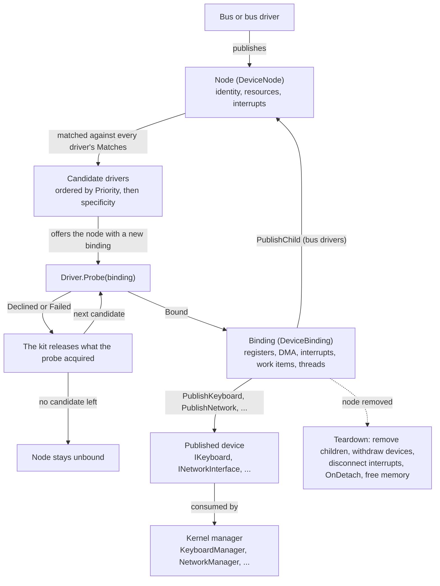

<a id="writing-a-driver"></a>

# 编写驱动程序

本文将介绍如何为 Cosmos Gen3 编写设备驱动程序：驱动程序如何与设备匹配、如何访问硬件、如何把设备交给内核，以及如何在没有硬件的情况下进行测试。

每个内核都已经带有[工具包支持的内容](#what-the-kit-supports)中列出的内置驱动程序，所以只有当你的硬件不在其中时，才需要编写驱动程序。有一条规则决定了整个工具包的形态：驱动程序只能通过它的绑定访问硬件和内核，而绑定会记录驱动程序获取的一切，这样负责归还这些资源的是工具包，而不是驱动程序。本页前半部分跟随一个驱动程序从匹配走到拆除；后半部分依次介绍每种总线，然后是内置设备驱动程序；最后几节说明如何在运行时观察驱动程序、如何在没有硬件的情况下测试驱动程序，以及如何把驱动程序打包成库来分发。每个带链接的术语在[驱动程序术语表](driver-glossary.md)中都有一段简短的背景说明。

如果你发现 bug 或任何异常，请在我们的仓库中[提交 issue](https://github.com/CosmosOS/Cosmos/issues/new/choose)。

---

<a id="experimental-status"></a>

## 实验性状态

驱动工具包目前是实验性的：`Cosmos.Kernel.HAL.DriverKit` 和 `Cosmos.Kernel.HAL.Devices` 下的每个公共类型（稳定的 `IBlockDevice` 和 `MacAddress` 除外）都带有 `[Experimental("COSMOS0003")]`。你现在就可以使用它们，但在被提升为稳定 API 之前，它们可能会发生变化。在你的项目明确确认之前，引用其中任何一个都会导致构建错误：

```xml
<PropertyGroup>
  <NoWarn>$(NoWarn);COSMOS0003</NoWarn>
</PropertyGroup>
```

实验性 API 如何被提升，请参阅[公共 API 跟踪](../dev/public-api.md)。

---

<a id="what-the-kit-supports"></a>

## 工具包支持的内容

工具包在真实硬件上支持五种总线：平台、PCI、virtio、USB 和 PS/2，另外还有一条用于测试的合成总线（[在合成总线上测试驱动程序](#testing-a-driver-over-the-synthetic-bus)）。驱动程序交给内核的设备属于六个种类之一：键盘、指针设备、网络接口、块设备、显示设备或音频输出。该种类对应的内核管理器（`KeyboardManager`、`MouseManager`、`NetworkManager`、`StorageManager`、`DisplayManager` 或 `AudioManager`）会接收驱动程序发布的任何设备。每个内核还会通过 `Cosmos.Kernel.Drivers` 获得下列驱动程序。它们使用与你的驱动程序相同的公共 API，因此它们的[源代码](https://github.com/CosmosOS/Cosmos/tree/gen3/src/Cosmos.Kernel.Drivers)是最值得阅读的示例；[排除与显式启用](#excluding-and-opting-in)说明了如何去掉其中某一个：

| 总线 | 驱动程序 |
|-----|---------|
| 平台 | `PciHostDriver`、`I8042Driver`、`VirtioMmioTransportDriver` |
| PCI | `PcieRootPortDriver`、`VirtioPciTransportDriver`、`XhciDriver`、`EhciDriver`、`OhciDriver`、`E1000EDriver`、`AhciDriver`、`NvmeDriver`、`VmwareSvgaDriver`、`AmdDcnDriver`、`IntelGraphicsDriver`、`HdAudioDriver` |
| Virtio | `VirtioNetDriver`、`VirtioBlkDriver`、`VirtioGpuDriver`、`VirtioInputDriver` |
| USB | `UsbHubDriver`、`UsbKeyboardDriver`、`UsbMouseDriver`、`UsbMassStorageDriver` |
| PS/2 | `Ps2KeyboardDriver`、`Ps2MouseDriver` |

在源代码树中，每个驱动程序都存放在 `<bus>/<category>/<driver>/` 下（例如 `Pci/Network/E1000E/`），其命名空间与文件夹一致，如 `Cosmos.Kernel.Drivers.Pci.Network.E1000E`；[排除与显式启用](#excluding-and-opting-in)需要的正是这个完整类型名。

---

<a id="what-a-driver-is"></a>

## 什么是驱动程序

工具包建立在五个概念之上：

| 概念 | 含义 |
|---------|------------|
| 节点（`DeviceNode`） | 内核能够看到的一个硬件：它在总线上的标识、它的资源和它的中断。总线和总线驱动程序负责发布节点。 |
| 总线种类 | 节点在某种总线（平台、PCI、virtio、USB、PS/2、合成）上的形态，以及驱动程序如何匹配它。 |
| 驱动程序（`Driver`） | 你的类：它声明自己需要哪些节点，并接受或拒绝提供给它的每个节点。 |
| 绑定（`DeviceBinding`） | 一个驱动程序与一个节点之间的联系。驱动程序只能通过它访问硬件和内核，而它会记住驱动程序获取的一切。 |
| 已发布的设备 | 驱动程序交给内核的东西：`IKeyboard`、`IPointer`、`INetworkInterface`、`IBlockDevice`、`IDisplay` 或 `IAudioOutput`。 |

当一个节点出现时，工具包会依次把它提供给每个匹配的驱动程序，直到某个驱动程序返回 `ProbeResult.Bound`；拒绝它的驱动程序所获取的一切都会被释放。当节点消失时，工具包会替你拆除绑定：子节点和已发布的设备最先撤下，内存最后释放。下图跟随一个节点从发布走到拆除：



驱动程序、绑定和节点树位于 `Cosmos.Kernel.HAL.DriverKit` 中。绑定分发的东西按用途放在下一级命名空间中：`Cosmos.Kernel.HAL.DriverKit.Resources`（寄存器窗口、映射区域、DMA 缓冲区）、`.Interrupts`（中断句柄、处理程序契约）和 `.Threading`（锁、事件、线程、工作项）。每个总线种类在 `.Buses` 下有自己的命名空间，每个设备种类则位于 `Cosmos.Kernel.HAL.Devices` 下其类别对应的命名空间中。

下面是能够编译并完成绑定的最小驱动程序：

```csharp
using Cosmos.Kernel.HAL.DriverKit;
using Cosmos.Kernel.HAL.DriverKit.Buses.Synthetic;

namespace MyOS.Drivers;

[Driver]
public sealed class SampleDriver : Driver
{
    private readonly DeviceMatch[] _matches = [SyntheticMatch.Key("sample")];

    public override string Name => "sample";

    public override ReadOnlySpan<DeviceMatch> Matches => _matches;

    public override ProbeResult Probe(DeviceBinding binding)
    {
        binding.Log("bound");
        return ProbeResult.Bound;
    }
}
```

`Name` 会显示在日志中，`Matches` 列出驱动程序需要的节点，`Priority`（默认为 `0`）决定先把节点提供给哪个匹配的驱动程序。`Probe` 是必需的，它让驱动程序有机会检查硬件，判断这是不是自己要服务的设备；`OnDetach` 是可选的。

每个驱动程序类只实例化一次，并会收到它匹配的每个节点，因此它的字段在所有设备之间共享。请把每个设备各自的状态保存在一个在 `Probe` 中创建、存放于 `binding.DriverState` 的对象里。

---

<a id="when-drivers-are-bound"></a>

## 驱动程序何时绑定

驱动阶段在 `Kernel.Start` 中运行，此时堆、中断控制器和调度器都已就绪，中断也已启用。工具包会提供迄今为止发布的每个节点，包括总线驱动程序在其探测过程中发布的子节点，并在所有节点都提供完毕后返回。`OnBoot` 和 `BeforeRun` 在它之后运行，因此在这两处，每个已绑定的设备都可以使用。

串口日志会显示每个节点、它的候选驱动程序以及每次提供的结果。下面的摘录来自用 `cosmos run --nic virtio-net-pci` 启动的 x64 内核：

```
[Kernel] Starting drivers...
[Drivers] manifest: HdAudioDriver(prio 0) EhciDriver(prio 0) OhciDriver(prio 0) PcieRootPortDriver(prio 0) ... VirtioBlkDriver(prio 0)
[Drivers] engine started, worker thread
...
[Drivers] platform:pci@cf8 candidates: PciHostDriver(prio 0, spec 1)
[Drivers] platform:pci@cf8 PciHostDriver: 6 functions on 1 buses
[Drivers] platform:pci@cf8 offer PciHostDriver -> bound
...
[Drivers] pci:0000:00:01.0 no driver
[Drivers] pci:0000:00:02.0 candidates: VirtioPciTransportDriver(prio 0, spec 1)
[Drivers] pci:0000:00:02.0 offer VirtioPciTransportDriver -> bound
...
[Drivers] virtio:pci:0000:00:02.0 candidates: VirtioNetDriver(prio 0, spec 1)
[Drivers] virtio:pci:0000:00:02.0 VirtioNetDriver published network "virtio-net" (consumed)
[Drivers] virtio:pci:0000:00:02.0 offer VirtioNetDriver -> bound
[Kernel] Calling OnBoot()...
```

每一行 `published` 的结尾，如果有内核管理器接收了该设备，就是 `(consumed)`；如果没有，就是 `(no consumer)`。启动后发布的节点（例如新插入的 USB 设备）走的是同一条路径。启动序列的其余部分请参阅[内核启动](startup.md)。

---

<a id="the-two-execution-contexts-and-the-guard"></a>

## 两种执行上下文与防护机制

探测、拆除和工作项在工具包的工作线程上逐个运行，因此驱动程序永远不会看到其中两者重叠。只有驱动程序线程会与它们并发运行。

在关闭 `CosmosEnableScheduler` 的情况下构建的内核没有工作线程：探测仍然可以进行，但 `WorkItem.Schedule`、`TrySchedulePeriodic` 和 `TryStartThread` 会返回 `false`。必须在这种内核中工作的驱动程序要检查这些返回值。此时引擎以内联方式运行：发布或撤回节点的线程会自己清空队列，日志中显示 `engine started, inline (no worker)`。

无论在哪里运行，驱动程序代码都处于两种[上下文](driver-concepts/interrupt-context.md)之一：线程上下文或中断上下文。

| 入口点 | 上下文 | 可以阻塞 | 可以分配内存 |
|-------------|---------|-----------|--------------|
| `Probe`、`OnDetach`、工作项 | 线程（工具包的工作线程） | 是 | 是 |
| 驱动程序线程 | 线程（它们自己的线程） | 是 | 是 |
| 内核调用的设备方法（`Transmit`、`Flush` 等） | 线程（调用者的线程） | 是，可为它们执行的 I/O 而阻塞 | 是 |
| 中断处理程序 | 中断 | 否 | 否 |

`Transmit` 和 `IAudioOutput.Write` 是设备方法中的例外：它们从不等待腾出空间，而是报告队列已满（返回 `false`，或者只写入一部分）。

**中断处理程序运行在中断上下文中。** 它运行在被它中断的线程的栈上，并且中断处于屏蔽状态，因此在它返回之前，该 CPU 上既不能运行线程，也不能运行定时器，而等待其中任何一个的处理程序会永远等下去。正因如此，它的 `InterruptContext` 只提供三个调用：`Mask()` 屏蔽自己的中断源，`Signal(DeviceEvent)` 通知一个正在等待的线程，`Schedule(WorkItem)` 调度需要线程上下文的工作；也正因如此，处理程序应当确认设备的中断，并把其余工作交给工作项。它还可以读写自己的寄存器和 DMA 缓冲区，并通过接收器（sink）进行报告（接收器是驱动程序发布设备时工具包交回的对象，参见[发布设备](#publishing-a-device)）。它不能阻塞，也不能分配内存（不能 `new` 引用类型，不能构建字符串，不能使用捕获变量的 lambda）。内核自己的处理程序确实会分配内存，垃圾回收器（GC）也能容忍；但对于驱动程序的处理程序，工具包把禁止分配作为一条安全规则，因为分配可能牵涉到在中断上下文中行为异常的运行时机制，尤其是接口分派解析和异常抛出。

从处理程序中调用工具包的线程上下文成员（`DeviceBinding` 的方法，或访问对象的成员，例如 `UsbAccess` 传输或 `Ps2Access.TryCommand`）会让内核以 panic 停机，并指出该成员的名称。在合成总线上则改为抛出异常：工具包把这个故障记录在节点上并屏蔽该中断源，以便测试对其进行断言。没有任何机制检测内存分配：防护检查只在这些工具包成员内部运行，从不在驱动程序自己的代码中运行。

---

<a id="the-attribute-and-the-manifest"></a>

## 特性与清单

构建会注册每个标记了 `[Driver]` 的类：一个[源代码生成器](driver-concepts/source-generators.md)把 `DriverManifest.g.cs` 写入内核项目，由它在启动时把每个驱动程序构造一次（[驱动程序清单](../dev/build/driver-manifest.md)介绍了这个生成器）。驱动程序类必须派生自 `Driver`，必须是具体的非泛型类，并且有一个无参构造函数。在内核项目中它可以是 `internal`，但在驱动程序库中必须是 `public`（[驱动程序库](#a-driver-library)）。违反其中任何一条规则的类都会被排除在清单之外，并产生警告 `COSMOSGEN001`，因此不会出现在启动日志的 `manifest:` 一行中。

该特性（attribute）接受两个选项：

- `[Driver(Feature = DriverFeature.Keyboard)]` 只在对应的[功能开关](driver-concepts/trimming.md)（`CosmosEnableKeyboard`）打开时注册该驱动程序；否则它会被裁剪（trimming），不进入编译后的内核。
- `[Driver(Default = false)]` 只在内核按名称显式启用它时注册该驱动程序（[排除与显式启用](#excluding-and-opting-in)）。

清单的顺序是确定的（先是内核自己的驱动程序，然后是所引用库中的驱动程序），并会在启动时打印出来。

---

<a id="identity-and-matches"></a>

## 标识与匹配

每个节点都有一个由其总线设置的 `DeviceIdentity`：`BusName`、`Address`，以及用于日志的 `Describe()`。节点的 `Path` 把前两者连接起来（`pci:0000:00:03.0`），日志就用它来指代节点。

驱动程序的 `Matches` 是一个 `DeviceMatch` 列表。每一项都会测试一个标识，并有一个 `Specificity`，即它检查的字段数。每个总线种类都有自己的一对类型（`PciIdentity` 与 `PciMatch`、`UsbIdentity` 与 `UsbMatch` 等），在下文介绍各总线时说明。在合成总线上，一个匹配项要么指定一个设备，要么指定全部设备：

```csharp
// This device and no other: specificity 1.
private readonly DeviceMatch[] _matches = [SyntheticMatch.Key("kbd")];

// Every synthetic device: specificity 0.
private readonly DeviceMatch[] _matches = [SyntheticMatch.Any()];
```

当节点出现时，工具包会[对匹配的驱动程序排序](driver-concepts/driver-matching.md)：先按 `Priority`，再按特异性（从高到低），最后按清单顺序，然后依次把节点提供给每个驱动程序，直到某一个返回 `Bound`：

```
[Drivers] synthetic:prio candidates: HighPriorityDriver(prio 10, spec 1) LowPriorityDriver(prio 0, spec 1)
[Drivers] synthetic:prio offer HighPriorityDriver -> bound
```

要为同一硬件替换某个内置驱动程序，请给你的驱动程序设置大于 `0` 的 `Priority`：每个内置驱动程序都保留默认值 `0`。没有任何驱动程序接受的节点会在日志中记为 `no driver`，并保持 `Unbound`。

---

<a id="probe-and-the-binding"></a>

## Probe 与绑定

`Probe` 是唯一必需的入口点，而 `DeviceBinding` 是驱动程序访问硬件和内核的唯一途径。驱动程序通过它获取的一切（寄存器窗口、DMA 内存、中断、事件、工作项、线程、已发布的设备、子节点）都会记录在绑定上，并由工具包释放，因此驱动程序从不需要编写清理代码。

探测过程会读取节点（`binding.Node.Resources`、`binding.Node.Interrupts`，以及 `binding.Node.Access<T>()`，即访问对象：它由总线提供，用于与设备通信，下文会随各总线一起介绍），获取所需的资源，创建该设备的状态，发布设备，然后返回。下面是一个完整的驱动程序，针对合成总线上的一个键盘：

```csharp
using Cosmos.Kernel.HAL.DriverKit;
using Cosmos.Kernel.HAL.DriverKit.Buses.Synthetic;
using Cosmos.Kernel.HAL.DriverKit.Interrupts;
using Cosmos.Kernel.HAL.DriverKit.Resources;
using Cosmos.Kernel.HAL.DriverKit.Threading;

namespace MyOS.Drivers;

[Driver(Feature = DriverFeature.Keyboard)]
public sealed class SyntheticKeyboardDriver : Driver
{
    public const string Key = "kbd";

    private readonly DeviceMatch[] _matches = [SyntheticMatch.Key(Key)];

    public override string Name => "synthetic-keyboard";

    public override ReadOnlySpan<DeviceMatch> Matches => _matches;

    public override ProbeResult Probe(DeviceBinding binding)
    {
        if (binding.Node.Resources.Count == 0 || binding.Node.Interrupts.Count == 0)
        {
            return ProbeResult.Declined("no register window or no interrupt source");
        }

        RegisterWindow window = binding.MapRegisters(0);
        DeviceEvent keyEvent = binding.CreateEvent();
        KeyboardState state = new(binding, window, keyEvent);
        binding.DriverState = state;

        state.Sink = binding.PublishKeyboard(state);

        if (!binding.TryRequestInterrupt(binding.Node.Interrupts[0], state.OnInterrupt, out InterruptHandle? handle))
        {
            return ProbeResult.Failed("interrupt 0 could not be connected");
        }

        state.Handle = handle;

        // The handler is live from here on, so the device is armed last.
        window.Write8(KeyboardState.ControlOffset, KeyboardState.EnableBit);
        return ProbeResult.Bound;
    }

    public override void OnDetach(DeviceBinding binding, DetachReason reason)
    {
        if (reason.HardwarePresent && binding.DriverState is KeyboardState state)
        {
            state.Window.Write8(KeyboardState.ControlOffset, 0);
        }
    }
}
```

状态对象是一个普通类，而不是 `Driver`：每个设备对应一个状态对象，它实现设备契约，拥有中断处理程序，并持有探测过程获取的每个工具包对象：

```csharp
using Cosmos.Kernel.HAL.Devices.Input;
using Cosmos.Kernel.HAL.DriverKit;
using Cosmos.Kernel.HAL.DriverKit.Interrupts;
using Cosmos.Kernel.HAL.DriverKit.Resources;
using Cosmos.Kernel.HAL.DriverKit.Threading;

namespace MyOS.Drivers;

public sealed class KeyboardState : IKeyboard
{
    public const int ControlOffset = 0x00;
    public const int ScanCodeOffset = 0x10;
    public const int FlagsOffset = 0x11;
    public const byte EnableBit = 1;
    public const byte ReleasedFlag = 1;

    private readonly DeviceBinding _binding;
    private KeyboardLeds _leds;

    public KeyboardState(DeviceBinding binding, RegisterWindow window, DeviceEvent keyEvent)
    {
        _binding = binding;
        Window = window;
        KeyEvent = keyEvent;
        KeyWork = binding.CreateWorkItem(OnKeyWork);
    }

    public string Name => "synthetic-kbd";

    public RegisterWindow Window { get; }

    public DeviceEvent KeyEvent { get; }

    public WorkItem KeyWork { get; }

    public KeyboardSink? Sink { get; set; }

    public InterruptHandle? Handle { get; set; }

    public void SetLeds(KeyboardLeds leds)
    {
        _leds = leds;
    }

    // Interrupt context: reads two registers, reports the key, wakes the
    // thread and hands the rest to the work item. Allocates nothing.
    public void OnInterrupt(InterruptContext context)
    {
        byte scanCode = Window.Read8(ScanCodeOffset);
        bool released = (Window.Read8(FlagsOffset) & ReleasedFlag) != 0;
        Sink?.Report(scanCode, released);
        context.Signal(KeyEvent);
        context.Schedule(KeyWork);
    }

    // Thread context, on the kit worker.
    public void OnKeyWork()
    {
        _binding.Log("key work ran");
    }
}
```

这两个类都不分配页、不编程中断控制器、不向管理器注册键盘，也不释放任何东西：这些全部由绑定完成。下面各节介绍绑定的成员；其中的示例都是驱动程序 `Probe` 或其状态对象的片段。

<a id="register-windows"></a>

### 寄存器窗口

设备的[寄存器](driver-concepts/registers.md)通过寄存器窗口访问：`binding.MapRegisters(resourceIndex)` 映射 `Node.Resources` 中的一项，并返回一个 `RegisterWindow`，它提供 `Read8` 到 `Read64` 以及 `Write8` 到 `Write64`，按字节偏移量访问。每次访问都会做边界检查；在内存窗口上，访问还必须按其宽度对齐。每次访问都带有所需的[内存屏障](driver-concepts/barriers.md)，因此对门铃寄存器的写入总是在它之前的 DMA 存储之后生效。同一段代码适用于内存窗口、合成节点的 RAM 窗口和 x64 端口范围，只是端口范围没有 64 位访问：在那里 `Read64` 和 `Write64` 会抛出 `NotSupportedException`。这些访问器可以在中断处理程序中安全使用，绑定被拆除后再调用则会抛出异常。

<a id="bulk-regions"></a>

### 大块内存区域

`binding.MapRegion(resourceIndex, RegionCaching)` 把一项资源映射为普通内存，用于帧缓冲区或命令队列，并返回一个 `DeviceRegion`。与寄存器窗口不同，对它的访问既不检查也不排序；探测过程映射一个帧缓冲区，并通过 span 在其中绘制：

```csharp
// In Probe:
DeviceRegion framebuffer = binding.MapRegion(1, RegionCaching.WriteCombining);
framebuffer.Span.Fill(0);
Span<uint> pixels = framebuffer.As<uint>();
pixels[0] = 0x00FF0000;
```

第二个参数告诉 CPU 如何缓存该区域。请根据区域中存放的内容来选择：

- `RegionCaching.Device` 用于设备读取的命令，例如命令队列：每次读写都直接到达设备，并保持顺序。
- `RegionCaching.WriteCombining` 用于帧缓冲区：写入会被合并成突发传输，绘制像素时要快得多。
- `RegionCaching.Normal` 用于与设备共享的普通 RAM。

在 x64 上，`WriteCombining` 会应用到区域完整覆盖的每个 2 MiB 块；与其他内容共享的块仍保持 `Device`。其他任何选择，以及 ARM64 上的任何选择，目前都按 `Device` 映射；合成节点的 RAM 窗口无论选择什么，都保持内核的常规映射。尽管如此，仍请选择正确的值：工具包会把它记录在 `DeviceRegion.Caching` 中，并在平台支持后应用它。

<a id="dma-memory"></a>

### DMA 内存

`binding.AllocateDma(length, alignment)` 返回一个 `DmaBuffer`：已清零、[物理连续](driver-concepts/physical-addresses.md)的内存，其中 `PhysicalAddress` 供设备使用，`Span` 供 CPU 使用。

[DMA](driver-concepts/dma.md) 内存通常存放一个[描述符环](driver-concepts/descriptor-rings.md)：一个固定的描述符数组，每个描述符指向一个数据缓冲区，驱动程序和设备把它当作循环队列来回传递。驱动程序在交出新的描述符时写一个寄存器（门铃），设备则把每个描述符标记为已完成。例如，网卡有一个接收环，由设备填入收到的帧，还有一个发送环，由驱动程序填入要发出的帧。

对于只能进行 32 位寻址的设备，`TryAllocateDma` 接受一个约束条件，缓冲区不满足该约束时返回 `false`，而不是抛出异常。工具包目前还没有低端内存池：它照常分配，如果缓冲区的末尾超过 4 GiB，就把它归还：

```csharp
// In Probe:
if (!binding.TryAllocateDma(RingBytes, 4096, DmaConstraints.Addressable32Bit, out DmaBuffer? ring))
{
    return ProbeResult.Declined("no DMA memory below 4 GiB");
}
```

DMA 是缓存一致的（coherent），因此只需关心顺序。在填写描述符和把它交给设备之间调用 `DmaBuffer.WriteBarrier()`，在读取设备写入的标志和读取该标志所保护的数据之间调用 `DmaBuffer.ReadBarrier()`。把一个描述符交给设备的写法如下；之后对门铃的写入不需要屏障，因为寄存器写入自带屏障：

```csharp
// When sending, for example in Transmit:
Span<byte> descriptors = ring.Span;
descriptors[8] = 0x01;                   // fill the descriptor
DmaBuffer.WriteBarrier();
descriptors[0] = OwnedByDevice;          // then hand it over

window.Write32(DoorbellOffset, 1);       // no barrier needed
```

切勿把托管数组交给设备：垃圾回收器并不知道设备持有它。

<a id="interrupts"></a>

### 中断

`binding.TryRequestInterrupt(source, handler, out handle)` 把处理程序连接到 `Node.Interrupts` 中的一项。当平台无法投递该中断时，它返回 `false`，这样驱动程序可以拒绝，或者改为轮询，即依靠定时器读取设备状态，而不是等待中断。调用一返回 `true`，处理程序就已生效，因此探测过程可以发送命令并等待中断；如果不允许设备在此之前产生中断，就最后再激活设备，也就是写入允许它开始产生中断的那个寄存器。探测过程连接处理程序并保留句柄：

```csharp
// In Probe:
if (!binding.TryRequestInterrupt(binding.Node.Interrupts[0], state.OnInterrupt, out InterruptHandle? handle))
{
    return ProbeResult.Declined("the interrupt cannot be delivered");
}

state.Handle = handle;
```

处理程序运行在中断上下文中：它[确认设备的中断](driver-concepts/interrupt-delivery.md)，把真正的工作留给工作项。这里它是状态对象上的 `OnInterrupt` 方法：

```csharp
// In the state object, in interrupt context:
public void OnInterrupt(InterruptContext context)
{
    uint cause = Window.Read32(InterruptCauseOffset);
    Window.Write32(InterruptCauseOffset, cause);   // acknowledge
    context.Schedule(ReceiveWork);
}
```

`InterruptHandle` 可以在任何上下文中屏蔽和取消屏蔽中断源（`Mask()`、`Unmask()`）。抛出异常的处理程序会使其中断源保持屏蔽。

<a id="events-and-waiting"></a>

### 事件与等待

`binding.CreateEvent()` 返回一个 `DeviceEvent`。处理程序用 `context.Signal(evt)` 发出信号；线程用 `binding.Wait(evt, timeoutMilliseconds)` 等待，收到信号时返回 `true`，超时或拆除开始后返回 `false`。

探测过程可以发送一条命令并等待设备应答。处理程序调用 `context.Signal(CommandDone)`，探测过程则等待同一个事件：

```csharp
// In Probe:
state.CommandDone = binding.CreateEvent();
// ... connect the interrupt, then send the command
window.Write32(CommandOffset, ResetCommand);

if (!binding.Wait(state.CommandDone, 100))
{
    return ProbeResult.Failed("the device did not answer the reset");
}
```

对于线程上下文中的短暂等待，`binding.Delay(microseconds)` 会忙等待，在 CPU 上自旋，适合写入后需要几微秒才能再次访问的寄存器；`binding.Sleep(milliseconds)` 则让出 CPU，以便其他线程在此期间运行：

```csharp
// In Probe or a work item:
window.Write32(ControlOffset, ResetBit);
binding.Delay(10);   // the device needs 10 µs before the next access
```

<a id="work-items"></a>

### 工作项

处理程序把真正的工作交给工作项：`binding.CreateWorkItem(callback)` 返回一个 `WorkItem`，它被调度后，其回调会在工具包的工作线程上运行。在处理程序中调用 `context.Schedule(item)`，或在任何地方调用 `item.Schedule()`，都能在不分配内存的情况下把它加入队列；如果该工作项已在队列中、已被拆除过程取消，或者内核没有工作线程，调用就返回 `false`。请在 `Probe` 中创建工作项，稍后再调度它们：

```csharp
// In Probe: create the work item once.
state.ReceiveWork = binding.CreateWorkItem(state.DrainReceiveRing);

// In the handler: queue it.
context.Schedule(ReceiveWork);

// On the kit worker, in thread context: may allocate, wait and report.
public void DrainReceiveRing()
{
    // walk the receive ring and hand each frame to Sink.Receive
}
```

<a id="periodic-work"></a>

### 周期性工作

`binding.TrySchedulePeriodic(intervalMilliseconds, item)` 按固定间隔运行一个工作项，直到拆除为止，间隔会按定时器的节拍取整。当内核没有定时器或没有调度器时，它返回 `false`。工具包从不代替驱动程序轮询，因此必须轮询的驱动程序要调度自己的工作项，这里是状态对象上的 `OnPoll` 方法：

```csharp
// In Probe:
WorkItem poll = binding.CreateWorkItem(state.OnPoll);
if (!binding.TrySchedulePeriodic(20, poll))
{
    return ProbeResult.Failed("no timer to poll with");
}
```

<a id="driver-threads"></a>

### 驱动程序线程

需要在循环中等待的工作会获得自己的线程：`binding.TryStartThread(name, entry, out thread)` 启动一个线程，调度器未运行时返回 `false`。该线程循环等待绑定的事件，一旦 `IsDetaching` 为 true 就返回；拆除过程会唤醒每个等待者，然后等待（join）该线程结束：

```csharp
// In the state object, on the driver thread:
public void ThreadMain()
{
    while (!_binding.IsDetaching)
    {
        if (_binding.Wait(KeyEvent, 50))
        {
            // a key arrived; drain the device in thread context
        }
    }
}
```

拆除过程会为每个线程等待半秒。超过这个时间仍在运行的线程会阻止绑定的内存被释放，因为它可能仍会访问这块内存：工具包会有意泄漏这块内存，并记录 `thread "name" did not stop in 500 ms; n resources leaked`。探测过程在状态就位后启动线程：

```csharp
// In Probe:
DrainState state = new(binding);
binding.DriverState = state;

if (!binding.TryStartThread("drain", state.ThreadMain, out DriverThread? thread))
{
    return ProbeResult.Failed("no scheduler to run the drain thread on");
}
```

<a id="device-locks"></a>

### 设备锁

`binding.CreateLock()` 返回一个 `DeviceLock`，用于会被多个上下文同时进入的设备，例如网络栈调用 `Transmit` 的同时，驱动程序的工作项正在清空接收环。`Acquire()` 会禁用中断，直到作用域被释放，因此处理程序永远不会中断一个持有该锁的线程、然后在锁上自旋，处理程序也可以获取这个锁。持有者不能在中断关闭时等待，因此持有锁期间不能调用 `Sleep`、`Wait` 或 `Delay`，也不能调用接收器或进行发布，因为它们可能直接回到驱动程序中：网络栈可能在 `Receive` 返回之前，就通过调用 `Transmit` 来应答收到的帧。该锁不可重入，因此持有者再次获取它会永远自旋。在状态对象中，`Transmit` 在操作环时持有该锁：

```csharp
// In the state object, called by the network stack:
public bool Transmit(ReadOnlySpan<byte> frame)
{
    using (_lock.Acquire())
    {
        // check the ring, copy the frame, write the descriptor,
        // DmaBuffer.WriteBarrier(), then advance the tail register
    }

    return true;
}
```

<a id="publishing-a-device"></a>

### 发布设备

一个设备种类由驱动程序实现的一个小接口，加上工具包交回的一个接收器组成，驱动程序通过这个接收器报告事件：

| 种类 | 驱动程序实现 | 发布调用 | 驱动程序通过以下方法报告 |
|------|-----------------------|--------------|----------------------------|
| 键盘 | `IKeyboard`（`Name`、`SetLeds`） | `PublishKeyboard` | `KeyboardSink.Report(scanCode, released)` |
| 指针设备 | `IPointer`（`Name`） | `PublishPointer` | `PointerSink.ReportRelative(...)`、`ReportAbsolute(...)` |
| 网络 | `INetworkInterface`（`Name`、`MacAddress`、`LinkUp`、`Transmit`） | `PublishNetwork` | `NetworkSink.Receive(frame)`、`LinkChanged(up)` |
| 块设备 | `IBlockDevice` | `PublishBlockDevice` | 无 |
| 显示设备 | `IDisplay`（`Name`、`Mode`、`Framebuffer`、`Flush`） | `PublishDisplay` | `DisplaySink.ModeChanged()` |
| 音频 | `IAudioOutput`（`Name`、`Format`、`SampleRate`、`SupportedFormats`、`IsRunning`、`WritableBytes`、`TrySetFormat`、`Start`、`Stop`、`Write`） | `PublishAudio` | `AudioSink.BufferCompleted()`、`FormatChanged()` |

每个设备种类的类型都位于 `Cosmos.Kernel.HAL.Devices` 下其类别对应的命名空间中，这些类别与驱动程序文件夹的类别相同：键盘和指针设备的类型在 `Cosmos.Kernel.HAL.Devices.Input` 中；网络类型在 `Cosmos.Kernel.HAL.Devices.Network` 中，与 `MacAddress`（`INetworkInterface.MacAddress` 返回的类型）放在一起；显示设备类型在 `Cosmos.Kernel.HAL.Devices.Display` 中；音频类型在 `Cosmos.Kernel.HAL.Devices.Audio` 中，与 `AudioFormat` 放在一起；`IBlockDevice` 则在 `Cosmos.Kernel.HAL.Devices.Storage` 中。

该种类对应的内核管理器会在设备发布后立即接收它，而拆除过程会先撤下设备，再释放其他任何东西。接收器从不分配内存，并会在设备撤下后丢弃报告。

如果有一个实现了 `INetworkInterface` 的 `NicState` 状态对象，探测过程会发布它，并保留拿回的接收器：

```csharp
// In Probe:
NicState state = new(binding);
binding.DriverState = state;
state.Sink = binding.PublishNetwork(state);

// In the receive work item, for each frame the device received:
Sink?.Receive(frame);
```

日志会记录首尾两端，下面是上文键盘示例的情况：

```
[Drivers] synthetic:kbd synthetic-keyboard published keyboard "synthetic-kbd" (consumed)
[Drivers] synthetic:kbd synthetic-keyboard withdrew keyboard "synthetic-kbd"
```

每个种类还有各自的规则。键盘驱动程序报告原始扫描码，即按键按下或抬起时的第 1 套扫描码，由 `KeyboardManager` 把它们转换为按键。网络驱动程序在线程上下文中调用 `NetworkSink.Receive`，从不在处理程序中调用，并把收到的帧交给工作项：接收器本身不分配内存，但它背后的网络栈会复制帧，这需要线程上下文。音频驱动程序则正好相反，因为 `AudioSink.BufferCompleted` 可以直接在中断处理程序中调用。它的 `Write` 会把完整的音频帧（每个声道一个采样）复制到设备缓冲区中，能放多少就放多少，并且从不阻塞；只写入一部分，就是设备表示自己已满的方式。

`PublishBlockDevice` 会向 `StorageManager` 注册磁盘，并在返回前扫描其分区，因此驱动程序发布设备时，设备必须已经可以读取。如果管理器拒绝该磁盘（管理器的表已满，或者该磁盘已经注册过），`PublishBlockDevice` 会抛出 `InvalidOperationException`，探测随之失败。

显示驱动程序按发现时的状态发布显示设备：在有人设置模式之前，`Mode` 为空；当 CPU 无法在其中绘制时，`Framebuffer` 为 `null`。同一个对象还可以实现 `IDisplayModes` 来切换模式，实现 `IHardwareCursor` 来提供硬件光标。引导加载程序的帧缓冲区在启动时作为固件显示设备发布，当某个驱动程序绑定了内存窗口包含它的那个 PCI 功能时，它就会被撤下。

使用方的情况请参阅[图形](graphics.md)、[音频](audio.md)和[文件系统](filesystem.md)。

<a id="publishing-child-nodes"></a>

### 发布子节点

总线驱动程序把它发现的设备发布为子节点：`binding.PublishChild(identity, resources, interrupts, access)` 在它的节点下添加一个子节点，这个子节点会像其他节点一样被提供给驱动程序；`binding.RetractChild(child, hardwarePresent)` 则将其移除。子节点随父节点一起消失，它们的驱动程序会看到 `DetachCause.ParentRetracted`。

总线驱动程序要么发布工具包已经定义的总线种类，要么自带一对标识与匹配类型。内置的 virtio 传输驱动程序属于前者：它们用工具包的 `VirtioIdentity` 发布设备，不带资源，带有 `VirtioAccess` 的九个中断源，并以它作为访问对象（[virtio 设备](#virtio-devices)）。工具包的 USB 枚举核心也是如此，它在主机控制器驱动程序（xHCI、EHCI 或 OHCI）或集线器驱动程序的节点下发布设备，带有 `UsbIdentity`，不带资源和中断源，并带有一个 `UsbAccess`（[USB 设备](#usb-devices)）。你自己的总线则需要一个标识类型和一个匹配类型：

```csharp
using Cosmos.Kernel.HAL.DriverKit;

namespace MyOS.Drivers;

public sealed class ChildIdentity : DeviceIdentity
{
    public ChildIdentity(string name)
    {
        Name = name;
    }

    public string Name { get; }

    public override string BusName => "mybus";

    public override string Address => Name;

    public override string Describe()
    {
        return string.Concat("child ", Name);
    }
}

public sealed class ChildMatch : DeviceMatch
{
    private readonly string _name;

    public ChildMatch(string name)
    {
        _name = name;
    }

    public override int Specificity => 1;

    public override bool Matches(DeviceIdentity identity)
    {
        return identity is ChildIdentity child && string.Equals(_name, child.Name);
    }
}
```

总线驱动程序的探测过程随后用该标识发布一个子节点，以其寄存器作为资源 0：

```csharp
// In the bus driver:
public override ProbeResult Probe(DeviceBinding binding)
{
    DeviceResource[] resources =
    [
        DeviceResource.MemoryWindow(0xFEB00000, 0x1000),   // the child's registers, index 0
    ];

    DeviceNode child = binding.PublishChild(new ChildIdentity("port0"), resources, [], null);
    binding.DriverState = child;
    return ProbeResult.Bound;
}
```

资源用 `DeviceResource.MemoryWindow`、`PortRange`、`RamWindow` 或 `None`（一个未分配的槽位，用于保持其后各项的索引不变）构建。中断则是总线提供的 `InterruptSource` 子类。

<a id="logging"></a>

### 日志

`binding.Log(message)` 在线程上下文中向串口日志写入一行：`[Drivers] synthetic:kbd synthetic-keyboard: message`。

---

<a id="declining-and-failing"></a>

## 拒绝与失败

`Probe` 返回以下三种结果之一：

| 结果 | 何时返回 |
|--------|-------------------|
| `ProbeResult.Bound` | 驱动程序接管了该设备。 |
| `ProbeResult.Declined(reason)` | 该设备终究不是驱动程序要服务的设备（未知的修订版本、缺少某项功能）。 |
| `ProbeResult.Failed(reason)` | 该设备是驱动程序要服务的设备，但启动它没有成功。从 `Probe` 中抛出且未被捕获的异常也算作失败。 |

只要结果不是 `Bound`，工具包就会释放探测过程获取的一切，然后把节点提供给下一个候选驱动程序。原因会打印在日志中：

```
[Drivers] synthetic:decline offer DecliningDriver -> declined: declined on purpose
[Drivers] synthetic:decline offer AnyKeyDriver -> bound
[Drivers] synthetic:throw offer ThrowingDriver -> failed: probe threw on purpose
```

---

<a id="teardown-and-ondetach"></a>

## 拆除与 OnDetach

当节点消失时（设备被拔出、其父节点被移除，或者测试撤回了它），工具包会按固定顺序拆除它的绑定：

1. `IsDetaching` 变为 true，绑定拒绝任何新的资源获取。
2. 移除子节点。
3. 撤下已发布的设备，内核随即停止使用它们。
4. 断开中断，并停止工作项、周期性工作和驱动程序线程。
5. 运行 `OnDetach`。
6. 释放内存：DMA 缓冲区、寄存器窗口和区域。

`OnDetach` 是可选的。它是停止硬件的地方，因为此时中断和线程都已停止，而寄存器仍然处于映射状态。请先检查 `reason.HardwarePresent`：设备被[拔出](driver-concepts/hot-plug.md)时它为 `false`，这时不能触碰寄存器，因为写入一个设备已经不在的窗口可能引发故障，或者写到另一个设备上。键盘示例的 `OnDetach` 只在设备仍然存在时才禁用它：

```csharp
// In the driver:
public override void OnDetach(DeviceBinding binding, DetachReason reason)
{
    if (reason.HardwarePresent && binding.DriverState is KeyboardState state)
    {
        state.Window.Write8(KeyboardState.ControlOffset, 0);   // disable the device
    }
}
```

`reason.Cause` 说明原因：节点本身被移除时为 `DetachCause.Retracted`，其父节点被移除时为 `DetachCause.ParentRetracted`。日志先显示设备被撤下，然后显示节点离开设备树：

```
[Drivers] synthetic:kbd synthetic-keyboard withdrew keyboard "synthetic-kbd"
[Drivers] synthetic:kbd retracted
```

---

<a id="buses"></a>

## 总线

[总线](driver-concepts/buses.md)是嵌套的。机器描述（即在启动时描述机器固定设备的平台代码）发布根节点，总线驱动程序再发布它们在下面发现的设备。例如，在一台 x64 机器上，设备树如下所示：

```
platform:i8042@60                    I8042Driver
├── ps2:kbd                          Ps2KeyboardDriver
└── ps2:aux                          Ps2MouseDriver
platform:pci@cf8                     PciHostDriver
├── pci:0000:00:02.0                 VirtioPciTransportDriver
│   └── virtio:pci:0000:00:02.0      VirtioNetDriver
└── pci:0000:00:04.0                 XhciDriver
    └── usb:1-1:0                    UsbKeyboardDriver
```

驱动程序只能看到自己的节点：virtio 驱动程序永远不知道是哪种传输承载着它的设备，USB 驱动程序也永远看不到它上方的控制器或集线器。

每个总线种类都有自己的命名空间 `Cosmos.Kernel.HAL.DriverKit.Buses.<Bus>`（`Platform`、`Pci`、`Virtio`、`Usb`、`Ps2`，以及用于测试的 `Synthetic`），并以相同方式命名其类型：`<Bus>Identity` 表示节点是什么，`<Bus>Match` 表示驱动程序绑定什么，`<Bus>Access` 表示驱动程序如何访问设备。平台总线是个例外：它的驱动程序改为映射节点的资源，只有 PCI 主机节点带有访问对象 `PciHostAccess`。

下面先介绍平台节点和 PCI 主机驱动程序；之后的四节依次介绍驱动程序绑定的各种总线：PCI、virtio、USB 和 PS/2。

<a id="platform-nodes"></a>

### 平台节点

平台节点是根：它们是无法被枚举的设备，由机器描述在启动时发布。内核不能发布自己的平台节点。

| 机器 | 节点 | 兼容字符串 |
|---------|------|------------|
| x64 | `platform:i8042@60`，PS/2 控制器 | `pnp0303` |
| x64 | `platform:pci@cf8`，PCI 主机 | `pci-host-legacy` |
| ARM64 | `platform:pci@<base>`，PCI 主机 | `pci-host-ecam-generic` |
| ARM64 | `platform:virtio_mmio@<base>`，每个已占用的槽位一个 | `virtio,mmio` |

在 ARM64 上，它们来自 ACPI、设备树或 virt 机器的固定布局。两种 PCI 主机访问配置空间的方式不同：`pci-host-legacy` 通过端口 `0xCF8` 和 `0xCFC`，`pci-host-ecam-generic` 通过一个内存窗口。驱动程序通过平台节点的某个兼容字符串来匹配它：

```csharp
// In the driver:
private readonly DeviceMatch[] _matches = [PlatformMatch.Compatible("virtio,mmio")];
```

`PlatformMatch.Any()` 匹配所有平台节点。

<a id="the-pci-host-driver"></a>

### PCI 主机驱动程序

`PciHostDriver` 绑定 PCI 主机节点，沿着桥扫描其后的每条总线，并为发现的每个功能发布一个 `pci:` 节点。PCI Express 热插拔插槽后面的功能则改由 `PcieRootPortDriver` 发布：已插在通电插槽中的设备在启动时发布，之后插入的设备在插入时发布。没有任何驱动程序匹配的功能，会保持[固件](driver-concepts/firmware-handoff.md)设置时的状态。

---

<a id="pci-devices"></a>

## PCI 设备

一个 PCI 节点就是一个[功能](driver-concepts/pci.md)：它的标识从配置头中读取，它有六项资源（它的基址寄存器）、若干中断源（先是传统中断线，然后是它的 MSI-X 消息），以及一个用于访问其配置空间的 `PciAccess`。内置的 `E1000EDriver` 是很好的范例，下面的示例就是它的各个步骤。

<a id="pci-identity-and-match"></a>

### PCI 标识与匹配

`PciIdentity` 保存驱动程序用于匹配的配置头字段：`VendorId`、`DeviceId`、`SubsystemVendorId`、`SubsystemId`、`ClassCode`、`Subclass`、`ProgIf` 和 `Revision`，以及该功能的地址。节点路径为 `pci:<segment>:<bus>:<device>.<function>`，例如 `pci:0000:00:03.0`。

`PciMatch` 可以接受其中任意字段；给出的每个字段都必须相等，特异性就是给出的字段数：

```csharp
// In the driver:
using Cosmos.Kernel.HAL.DriverKit.Buses.Pci;

private readonly DeviceMatch[] _matches =
[
    new PciMatch(vendorId: 0x8086, deviceId: 0x10D3),   // one chip: specificity 2
    new PciMatch(classCode: 0x02),                      // every network controller: specificity 1
];
```

匹配至少要设置一个字段。与其按类别匹配，不如使用你测试过的设备 ID：按类别匹配会绑定该类别的所有功能，包括寄存器与你测试过的芯片不同的芯片。只有当某个规范固定了寄存器布局时，按类别匹配才是正确的，例如 HD Audio 规范之于 `HdAudioDriver`；内置的 E1000E 只匹配八个 Intel 设备 ID，别无其他。

<a id="the-pci-access-object"></a>

### PCI 访问对象

`binding.Node.Access<PciAccess>()` 用于访问该功能的配置空间：

- `ReadConfig8/16/32` 和 `WriteConfig8/16/32` 在按宽度对齐的偏移量处读写寄存器。超出主机可访问配置空间的偏移量会抛出 `ArgumentOutOfRangeException`：在 x64 上该空间为 256 字节（其主机使用传统端口），在 ECAM 下为 4 KiB。
- `FindCapability(id)` 返回某项能力的偏移量，若不存在则返回 0。
- `EnableMemorySpace`、`EnableIoSpace` 和 `EnableBusMastering` 开启驱动程序要使用的功能：开启解码使寄存器能够响应，[总线主控](driver-concepts/dma.md)让设备能够访问 DMA 内存。
- `Bars` 描述六个基址寄存器（见下一节）。

在第一次探测之前，工具包会关闭该功能的总线主控和中断，因此探测过程需要自己开启所需的功能。每次探测没有完成绑定后，工具包会在释放该探测的内存之前再次关闭它们，使设备停止向这块内存写入；在设备仍然存在而绑定被拆除后，也会再关闭一次。如果所有驱动程序都拒绝，工具包会恢复固件原先的设置。

<a id="bar-resources"></a>

### BAR 资源

PCI 节点的 `Node.Resources` 总是有六项，每个基址寄存器一项：`MemoryWindow`、`PortRange`，或者对于未分配的寄存器（或 64 位寄存器的高半部分）为 `None`。映射 `None` 项会抛出异常，因此请先检查 `pci.Bars[i]`：

```csharp
// In Probe:
PciAccess pci = binding.Node.Access<PciAccess>();
PciBar bar0 = pci.Bars[0];
if (!bar0.IsAssigned || bar0.IsIo || bar0.Length < 0x20000)
{
    return ProbeResult.Declined("BAR0 is not a memory window of 128 KiB");
}

RegisterWindow registers = binding.MapRegisters(0);
pci.EnableMemorySpace(true);
pci.EnableBusMastering(true);
```

<a id="the-legacy-line"></a>

### 传统中断线

`Node.Interrupts[0]` 是该功能的[传统中断线](driver-concepts/interrupt-delivery.md)。工具包只在 x64 上为第 3 到第 15 号中断线做路由，并且把每条线只分配给一个功能，而不共享，因此在 ARM64 上、对于其他任何中断线，以及对于已被另一个驱动程序占用的中断线，`TryRequestInterrupt` 都会返回 `false`。即使连接成功，工具包也会把该线编程为边沿触发，QEMU 能够投递这种中断，但真实芯片组的 PCI 中断线是电平触发且共享的，未必能投递。请为它配上一个周期性清空任务，这样即使该线从不触发，设备也能继续工作：

```csharp
// In Probe:
WorkItem drain = binding.CreateWorkItem(state.Drain);
state.DrainWork = drain;

bool hasLine = binding.TryRequestInterrupt(binding.Node.Interrupts[0], state.OnInterrupt, out _);
bool polling = binding.TrySchedulePeriodic(50, drain);
if (!hasLine && !polling)
{
    return ProbeResult.Declined("no interrupt and no timer to poll with");
}
```

处理程序确认设备的中断，并调度同一个清空任务，因此该任务必须在任何时候运行都是安全的。

<a id="message-interrupts"></a>

### 消息中断

当功能支持 MSI-X 时，`Node.Interrupts[1]` 及之后的各项就是它的消息，最多 32 个。它们需要开启内存解码，因为 MSI-X 表位于某个 BAR 中；在平台无法路由消息的地方（没有 GICv3 ITS 的 ARM64，ITS 是 ARM 中断控制器为消息中断提供的转换服务；QEMU 的 virt 机器默认使用 GICv2，它没有 ITS），连接它们会返回 `false`。连接一个消息会关闭传统中断线，因此两者永远不会同时生效：

```csharp
// In Probe:
pci.EnableMemorySpace(true);   // before requesting a message

bool hasMessage = binding.Node.Interrupts.Count > 1
    && binding.TryRequestInterrupt(binding.Node.Interrupts[1], state.OnInterrupt, out _);
```

<a id="hot-plug-slots"></a>

### 热插拔插槽

PCI Express [热插拔](driver-concepts/hot-plug.md)插槽后面的功能会在其设备插入时发布（如果插槽中已有通电的设备，则在启动时发布），并在设备移除时撤回；`PcieRootPortDriver` 负责管理该插槽。如果固件没有为该功能的寄存器分配地址，工具包会在提供该功能之前为它们分配，放不进插槽地址窗口的寄存器则保持未分配。因此驱动程序不需要任何特殊处理：它照常检查 `Bars`，并在 `reason.HardwarePresent` 为 `false` 时，不在 `OnDetach` 中触碰寄存器。

---

<a id="virtio-devices"></a>

## virtio 设备

一个 virtio 节点就是一个 [virtio](driver-concepts/virtio.md) 设备，由传输驱动程序通过 PCI 或 MMIO 发布。它没有资源，有九个中断源，以及一个使用 virtio 协议通信的 `VirtioAccess`，因此驱动程序在两种传输上的工作方式相同。内置的 `VirtioNetDriver` 是很好的范例，下面的示例就是它的各个步骤。

<a id="virtio-identity-and-match"></a>

### virtio 标识与匹配

`VirtioIdentity` 携带 `DeviceType`（`VirtioDeviceType.Network`、`Block`、`Gpu`、`Input` 等）以及传输方式；传输方式会显示在节点路径中（`virtio:pci:0000:00:02.0`、`virtio:mmio:a003e00`），但对驱动程序来说从不重要。驱动程序按设备类型匹配：

```csharp
// In the driver:
using Cosmos.Kernel.HAL.DriverKit.Buses.Virtio;

private readonly DeviceMatch[] _matches = [VirtioMatch.DeviceType(VirtioDeviceType.Network)];
```

<a id="the-virtio-access-object"></a>

### virtio 访问对象

`binding.Node.Access<VirtioAccess>()` 就是设备本身。探测过程按以下顺序使用它：

1. 用驱动程序能理解的特性位（限于低 32 位）调用 `NegotiateFeatures(requestedLow, out negotiatedLow)`；如果设备提供 `VIRTIO_F_VERSION_1`，工具包会自行添加它。设备拒绝这些特性时，它返回 `false`。
2. 为每个队列调用 `TryCreateQueue`（[队列](#queues)）。
3. 用 `ReadConfig8/16/32` 和 `WriteConfig8` 访问设备自身的配置，例如网卡的 MAC 地址。
4. 在队列中断源和配置中断源上调用 `TryRequestInterrupt`（[virtio 中断源](#virtio-interrupt-sources)）。
5. 调用 `SetDriverOk()`，此后设备即开始工作。

工具包在每次探测前都会重置设备，因此探测从协商开始：

```csharp
// In Probe:
VirtioAccess dev = binding.Node.Access<VirtioAccess>();
if (!dev.NegotiateFeatures(FeatureMac | FeatureStatus, out uint features))
{
    return ProbeResult.Failed("the device rejected the feature set");
}
```

`Reset()` 会停止设备；驱动程序在 `OnDetach` 中调用它。

<a id="queues"></a>

### 队列

virtqueue 是驱动程序与设备共享的一个环（[DMA 内存](#dma-memory)）。`dev.TryCreateQueue(binding, index, preferredSize, out Virtqueue? queue)` 分配一个 virtqueue 并在设备上激活它。`Virtqueue` 提供：

- `TryAllocateDescriptor(out index)` 和 `FreeDescriptor(index)`。
- `SetDescriptor(index, physicalAddress, length, flags, next)`：`VirtqueueDescriptorFlags.Write` 用于由设备填充的缓冲区；`Next` 配合在 `next` 中给出的下一个描述符索引，用于把描述符串成链（`next` 默认为 0）。
- `Submit(head)` 把一条描述符链交给设备，`Notify()` 敲响门铃。
- `TryTakeUsed(out id, out length)` 取回设备已完成的内容。

队列不是线程安全的：当 `Transmit` 和某个工作项共享队列时，请用 `DeviceLock` 保护它。缓冲区可以在 `SetDriverOk` 之前提交，但 `Notify` 只能在其后调用：

```csharp
// In Probe:
if (!dev.TryCreateQueue(binding, ReceiveQueue, 128, out Virtqueue? receiveQueue))
{
    return ProbeResult.Failed("no receive queue");
}

// One buffer per descriptor, for the device to write received frames into.
DmaBuffer receiveBuffers = binding.AllocateDma(receiveQueue.Size * BufferBytes, 4096);
for (int i = 0; i < receiveQueue.Size; i++)
{
    receiveQueue.TryAllocateDescriptor(out ushort slot);
    ulong physical = receiveBuffers.PhysicalAddress + (ulong)(slot * BufferBytes);
    receiveQueue.SetDescriptor(slot, physical, BufferBytes, VirtqueueDescriptorFlags.Write);
    receiveQueue.Submit(slot);
}

// ... connect the interrupts ...

dev.SetDriverOk();
receiveQueue.Notify();
state.Sink = binding.PublishNetwork(state);
```

<a id="virtio-interrupt-sources"></a>

### virtio 中断源

`dev.QueueInterrupt(n)` 是队列 `n` 的中断，`dev.ConfigInterrupt` 在设备配置发生变化时触发。当传输层无法路由这些中断时（例如没有 GICv3 ITS 的 ARM64），`TryRequestInterrupt` 返回 `false`，驱动程序改为轮询：

```csharp
// In Probe:
WorkItem drain = binding.CreateWorkItem(state.Drain);
bool hasInterrupt = binding.TryRequestInterrupt(dev.QueueInterrupt(ReceiveQueue), state.OnInterrupt, out _);
if (!hasInterrupt && !binding.TrySchedulePeriodic(50, drain))
{
    return ProbeResult.Declined("no interrupt and no timer to poll with");
}
```

在 `OnDetach` 中，请重置设备，使它停止向工具包即将释放的内存写入，然后给正在进行的 DMA 留出片刻时间完成：

```csharp
// In the driver:
public override void OnDetach(DeviceBinding binding, DetachReason reason)
{
    if (reason.HardwarePresent)
    {
        binding.Node.Access<VirtioAccess>().Reset();
        binding.Delay(100);
    }
}
```

<a id="the-transport-drivers"></a>

### 传输驱动程序

`VirtioPciTransportDriver` 绑定所有 virtio PCI 功能（厂商 `0x1AF4`），只使用现代接口和 MSI-X 消息。`VirtioMmioTransportDriver` 绑定 ARM64 上的 `virtio,mmio` 平台节点。叶驱动程序从不需要与两者打交道。

<a id="the-shipped-leaf-drivers"></a>

### 内置叶驱动程序

| 驱动程序 | 设备类型 | 发布 |
|--------|-------------|-----------|
| `VirtioNetDriver` | `Network` | 一个网络接口，`virtio-net` |
| `VirtioInputDriver` | `Input` | 一个键盘 `virtio-keyboard`，或一个指针设备 `virtio-mouse` |
| `VirtioBlkDriver` | `Block` | 一个块设备，`vblk<n>` |
| `VirtioGpuDriver` | `Gpu` | 一个显示设备，`virtio-gpu`（仅 2D） |

---

<a id="usb-devices"></a>

## USB 设备

一个 USB 节点是 USB 设备的一个[接口](driver-concepts/usb.md)：根端口上的设备由主机控制器驱动程序发布，集线器后面的设备由集线器驱动程序发布。它没有资源，也没有中断源，只有一个 `UsbAccess`，用于类驱动程序要做的一切。有多个接口的设备会产生多个节点。类驱动程序永远看不到它上方的控制器或集线器；内置的 `UsbKeyboardDriver`、`UsbMouseDriver` 和 `UsbMassStorageDriver` 都是很好的范例。

<a id="usb-identity-and-match"></a>

### USB 标识与匹配

`UsbIdentity` 保存设备的 `VendorId`、`ProductId` 和类，以及接口的类、子类和协议。节点路径由端口链和接口编号组成：`usb:1-1:0` 是第一个控制器根端口 1 上那个设备的接口 0，`usb:1-2.1:0` 则是插在根端口 2 上的集线器的端口 1 上的设备。

`UsbMatch` 的工作方式与 `PciMatch` 相同：给出的每个字段都必须相等，特异性就是给出的字段数。类驱动程序通常匹配接口的类、子类和协议。内置的键盘和鼠标驱动程序匹配 HID 启动接口，每个 PC 键盘和鼠标都会声明这个接口，以便固件使用：

```csharp
// In the driver:
using Cosmos.Kernel.HAL.DriverKit.Buses.Usb;

private readonly DeviceMatch[] _matches =
[
    new UsbMatch(interfaceClass: UsbClassCode.Hid, interfaceSubclass: 0x01, interfaceProtocol: 0x01),   // a HID boot keyboard: specificity 3
];
```

<a id="the-usb-access-object"></a>

### USB 访问对象

`binding.Node.Access<UsbAccess>()` 就是接口本身。它的成员运行在线程上下文中：

- `Endpoints` 列出接口的端点，`FindEndpoint(type, isIn)` 查找其中一个。
- `ControlIn`、`ControlOut` 和 `GetDescriptor` 向设备发送控制请求。它们都返回一个 `UsbTransferStatus`：`Success`、`Stall`、`Timeout`、`Error` 或 `Disconnected`。
- `OpenInterruptPipe(binding, endpoint, handler, out pipe)` 打开一个[中断 IN 端点](driver-concepts/usb.md)，并在设备每次发送报告时调用处理程序。
- `OpenBulkPipe(binding, endpoint, out pipe)` 打开一个批量端点，`BulkIn` 和 `BulkOut` 通过它传输数据并等待传输完成。
- 设备被拔出后，`IsDisconnected` 变为 true；此后每次传输都会返回 `Disconnected`，因此请检查它，而不是重试。

管道会记录在绑定上，因此当探测拒绝或设备消失时，工具包会关闭它们。大容量存储驱动程序会打开两个批量管道；如果第二个打开失败，工具包仍会关闭第一个：

```csharp
// In Probe:
UsbAccess usb = binding.Node.Access<UsbAccess>();
UsbEndpoint? bulkIn = usb.FindEndpoint(UsbEndpointType.Bulk, isIn: true);
UsbEndpoint? bulkOut = usb.FindEndpoint(UsbEndpointType.Bulk, isIn: false);
if (bulkIn is null || bulkOut is null)
{
    return ProbeResult.Declined("no bulk endpoints");
}

if (!usb.OpenBulkPipe(binding, bulkIn, out UsbPipe? inPipe) || !usb.OpenBulkPipe(binding, bulkOut, out UsbPipe? outPipe))
{
    return ProbeResult.Failed("could not open the bulk pipes");
}
```

报告处理程序可能运行在中断上下文中，因此它遵循中断处理程序的规则：不阻塞、不分配内存，也不调用 `UsbAccess` 或 `DeviceBinding`。它可以调用接收器、`DeviceEvent.Signal` 和 `Interlocked`。键盘驱动程序先发布键盘，确保处理程序始终有接收器可用，然后再打开报告管道：

```csharp
// In Probe:
UsbEndpoint? reports = usb.FindEndpoint(UsbEndpointType.Interrupt, isIn: true);
if (reports is null)
{
    return ProbeResult.Declined("no interrupt IN endpoint");
}

state.Sink = binding.PublishKeyboard(state);
if (!usb.OpenInterruptPipe(binding, reports, state.OnReport, out UsbPipe? pipe))
{
    return ProbeResult.Failed("could not open the report pipe");
}

// In the state object, for every report:
public void OnReport(ReadOnlySpan<byte> report)
{
    // compare with the previous report and hand each key change to Sink.Report
}
```

<a id="the-host-controller-contract"></a>

### 主机控制器契约

主机控制器驱动程序绑定控制器自身的节点，实现 `UsbHostController` 和 `UsbDevice`，其管道派生自 `UsbPipe`。它创建一个 `UsbBus`，由该对象的 `Attach(port, speed)` 和 `Detach(port)` 枚举设备，并发布或撤回设备的接口节点。`XhciDriver`、`EhciDriver` 和 `OhciDriver` 实现了这一契约，其中 `XhciDriver` 是参考实现；类驱动程序从不需要处理这些。

<a id="hubs"></a>

### 集线器

`UsbHubDriver` 绑定所有集线器接口。它通过 `ConfigureAsHub`、`AttachChild` 和 `DetachChild` 把集线器端口上的设备交给同一套枚举流程，并在一个线程中监视这些端口，因此集线器后面的设备会像其他设备一样被提供，路径形如 `usb:1-2.1:0`。

<a id="the-xhci-driver"></a>

### xHCI 驱动程序

`XhciDriver` 绑定所有 xHCI 控制器。它在探测期间枚举已经插入的设备，因此 U 盘在 `OnBoot` 之前就已就绪；它还在一个线程中处理热插拔。在平台能路由 MSI-X 消息的地方，它使用 MSI-X 消息，否则每 20 ms 轮询一次。不支持等时端点、中断 OUT 端点和流（streams）。

<a id="the-ehci-driver"></a>

### EHCI 驱动程序

`EhciDriver` 绑定所有 EHCI 控制器。EHCI 是 PC 上先于 xHCI 出现的 USB 2.0 主机，许多嵌入式板卡至今仍然配备。它的根端口只接受高速设备，因此对于插在根端口上的全速或低速设备，驱动程序会把它交给共享该端口的伴随控制器，由伴随控制器在自己的总线上枚举它（[OHCI 驱动程序](#the-ohci-driver)）；在没有伴随控制器的端口上，该设备只会被记入日志，然后被搁置。有些板卡改为在端口前放置一个高速集线器（Intel 芯片组就是如此），在这样的板卡上，这类设备会出现在该集线器后面，由 `UsbHubDriver` 枚举，控制器则通过集线器的事务转换器访问它，因此它会像其他设备一样被提供（[集线器](#hubs)）。它在探测期间枚举已经插入的设备，因此 U 盘在 `OnBoot` 之前就已就绪；它还在一个线程中处理热插拔。在平台能路由该 PCI 功能的传统中断线的地方（工具包只在 x64 上这样做），它使用这条中断线，否则每 20 ms 轮询一次。不支持等时端点、中断 OUT 端点、位于 4 GiB 以上的数据结构、挂起，以及因主机系统错误而停机的控制器的恢复；集线器只通过一个事务转换器驱动。

<a id="the-ohci-driver"></a>

### OHCI 驱动程序

`OhciDriver` 绑定所有 OHCI 控制器。OHCI 是许多芯片组（包括 AMD 和 NVIDIA 的芯片组）的 USB 1.1 主机接口（Intel 和 VIA 芯片组的 USB 1.1 主机 UHCI 没有驱动程序）；OHCI 控制器可以单独工作，也可以作为 EHCI 的伴随控制器，此时它服务于 EHCI 驱动程序交过来的全速和低速设备。没有任何东西协调这两个驱动程序：交接只是 EHCI 端口寄存器中的一个位，OHCI 会把它看作自己根端口上的一次普通连接；如果 OHCI 在 EHCI 之后绑定，它在探测中看到这次连接，如果它先绑定，则在热插拔线程中看到，因此按后一种顺序进行交接需要调度器。它在探测期间枚举已经插入的设备，因此 U 盘在 `OnBoot` 之前就已就绪；它还像 `XhciDriver` 一样在一个线程中处理热插拔。在平台能路由该 PCI 功能的传统中断线的地方（工具包只在 x64 上这样做），它使用这条中断线，否则每 20 ms 轮询一次。不支持等时端点、中断 OUT 端点、挂起，以及因不可恢复的错误而停止的控制器的恢复。

<a id="the-usb-class-drivers"></a>

### USB 类驱动程序

| 驱动程序 | 匹配 | 发布 |
|--------|---------|-----------|
| `UsbKeyboardDriver` | HID 启动键盘 | 一个键盘，`usb-keyboard` |
| `UsbMouseDriver` | HID 启动鼠标 | 一个指针设备，`usb-mouse` |
| `UsbMassStorageDriver` | 使用仅批量传输协议的大容量存储设备（U 盘、读卡器、USB 磁盘） | 每个单元一个块设备，`usb<n>` |
| `UsbHubDriver` | 集线器 | 集线器后面的设备，作为子节点 |

单元是大容量存储设备后面的一个逻辑磁盘，例如读卡器的一个卡槽。启动时已插入的 U 盘在日志中显示如下：

```
[Drivers] pci:0000:00:03.0 XhciDriver: usb 1-1: 46f4:0001 SuperSpeed, 1 interface(s)
[Drivers] pci:0000:00:03.0 offer XhciDriver -> bound
[Drivers] usb:1-1:0 candidates: UsbMassStorageDriver(prio 0, spec 3)
[StorageManager] usb0 registered by UsbMassStorageDriver (primary)
[Drivers] usb:1-1:0 UsbMassStorageDriver published block "usb0" (consumed)
[Drivers] usb:1-1:0 offer UsbMassStorageDriver -> bound
```

---

<a id="ps2-devices"></a>

## PS/2 设备

一个 PS/2 节点是 [8042 控制器](driver-concepts/ps2.md)的一个端口，由 `I8042Driver` 发布：`ps2:kbd` 是键盘端口，`ps2:aux` 是鼠标端口。它没有资源，有一个中断源，以及一个用于与设备通信的 `Ps2Access`。插入的是什么设备，由类驱动程序自行查明。PS/2 只存在于 x64 上。

<a id="ps2-identity-and-match"></a>

### PS/2 标识与匹配

驱动程序只匹配一个端口，从不同时匹配两个，因为键盘和鼠标使用不同的协议：

```csharp
// In the driver:
using Cosmos.Kernel.HAL.DriverKit.Buses.Ps2;

private readonly DeviceMatch[] _matches = [Ps2Match.Port(Ps2Port.Keyboard)];
```

<a id="the-ps2-access-object"></a>

### PS/2 访问对象

`binding.Node.Access<Ps2Access>()` 就是端口本身：

- `TryCommand(command, arguments, reply, out replyLength, timeoutMilliseconds)` 发送一条命令及其参数，等待设备确认每个字节，并收集应答。仅限线程上下文。
- `TryReceive(out value)` 取出设备主动发送的下一个字节，例如扫描码。可在任何上下文中使用，因此处理程序使用的就是它。
- 当控制器既不能产生中断、也不能被轮询时，`DeliversUnattended` 为 `false`；这时请拒绝该端口。

应答命令的字节会交给 `TryCommand`，从不交给 `TryReceive`。鼠标的探测过程先发布指针设备，再启用数据上报；键盘的探测过程则先重置设备，发布键盘，连接端口的中断，然后开始扫描按键：

```csharp
// In Probe:
Ps2Access ps2 = binding.Node.Access<Ps2Access>();
if (!ps2.DeliversUnattended)
{
    return ProbeResult.Declined("no interrupt and no timer to poll with");
}

Span<byte> reply = stackalloc byte[1];
if (!ps2.TryCommand(Reset, [], reply, out int count, 1000) || count == 0 || reply[0] != SelfTestPassed)
{
    return ProbeResult.Declined("no keyboard on the port");
}

state.Sink = binding.PublishKeyboard(state);   // before scanning starts
if (!binding.TryRequestInterrupt(binding.Node.Interrupts[0], state.OnInterrupt, out _))
{
    return ProbeResult.Failed("the port's interrupt could not be connected");
}

if (!ps2.TryCommand(EnableScanning, [], [], out _, 100))
{
    return ProbeResult.Failed("enable scanning was not acknowledged");
}

// In the state object, in interrupt context:
public void OnInterrupt(InterruptContext context)
{
    while (_ps2.TryReceive(out byte value))
    {
        // decode the scan code and hand it to Sink.Report
    }
}
```

<a id="the-controller-contract"></a>

### 控制器契约

`Ps2Controller` 是控制器驱动程序要实现的接口，用于向端口发送字节，并交回它读到的字节。唯一的实现在 `I8042Driver` 中，类驱动程序从不使用它。

<a id="the-8042-driver"></a>

### 8042 驱动程序

`I8042Driver` 绑定 `platform:i8042@60`。它测试控制器及其两个端口，连接 IRQ 1 和 IRQ 12（无法连接时每 20 ms 轮询一次），并为每个正常工作的端口发布一个节点。它是唯一访问端口 `0x60` 和 `0x64` 的驱动程序；此外，内核在 x64 上重启时也会向 `0x64` 写入 `0xFE`。

<a id="the-ps2-class-drivers"></a>

### PS/2 类驱动程序

| 驱动程序 | 端口 | 发布 |
|--------|------|-----------|
| `Ps2KeyboardDriver` | `ps2:kbd` | 一个键盘，`ps2-keyboard`（AT 和 MF2 键盘，包括其指示灯） |
| `Ps2MouseDriver` | `ps2:aux` | 一个指针设备，`ps2-mouse`（标准鼠标和滚轮鼠标） |

两者都在驱动阶段发布，因此内核在 `OnBoot` 中就能找到它们。PS/2 不支持热插拔。启动日志显示两个端口都已绑定：

```
[Drivers] ps2:kbd Ps2KeyboardDriver published keyboard "ps2-keyboard" (consumed)
[Drivers] ps2:kbd Ps2KeyboardDriver: MF2 keyboard (id ab 41), scanning
[Drivers] ps2:kbd offer Ps2KeyboardDriver -> bound
[Drivers] ps2:aux Ps2MouseDriver published pointer "ps2-mouse" (consumed)
[Drivers] ps2:aux Ps2MouseDriver: wheel mouse (id 03), 4-byte packets, reporting
[Drivers] ps2:aux offer Ps2MouseDriver -> bound
```

---

<a id="shipped-device-drivers"></a>

## 内置设备驱动程序

上述总线上还承载着用于显示设备、磁盘和声音的内置驱动程序。它们使用与你的驱动程序相同的调用进行发布，这里按它们发布的设备种类列出。

<a id="the-display-drivers"></a>

### 显示设备驱动程序

| 驱动程序 | 硬件 | 说明 |
|--------|----------|-------|
| `VirtioGpuDriver` | virtio-gpu，通过 PCI 或 MMIO | 2D：客户机绘制，主机合成 |
| `VmwareSvgaDriver` | VMware SVGA II，PCI，仅限 x64 | 可切换模式并绘制硬件光标；取代位于其 VRAM 中的固件帧缓冲区 |
| `AmdDcnDriver` | AMD DCN 3.1.5，即 Ryzen 7000（Raphael、Dragon Range）和 Ryzen 9000（Granite Ridge）处理器的集成 Radeon 显卡，PCI | 保留 UEFI 模式；无撕裂翻页；硬件光标；取代位于其 VRAM 中的固件帧缓冲区 |
| `IntelGraphicsDriver` | 从第 2 代（Sandy Bridge，HD Graphics 2000 和 3000）到第 14 代（Raptor Lake，UHD 和 Iris Xe Graphics）Intel Core 处理器的集成显卡，PCI | 保留 UEFI 模式；无撕裂翻页；硬件光标；取代固件帧缓冲区，并通过 GPU 的孔径（aperture）访问它 |

`AmdDcnDriver` 和 `IntelGraphicsDriver` 保留 UEFI 固件设置的模式，而不切换模式。它们在三帧之间翻页，AMD 在 VRAM 中、于垂直更新时翻页，Intel 在预留内存（stolen memory）中、于垂直消隐时翻页，因此不会出现撕裂，并且两者都会绘制硬件光标。在传统（CSM）启动之后（CSM 是固件的 BIOS 兼容模式），或者遇到无法在其中绘制的表面时，两者都会拒绝。`AmdDcnDriver` 还会在处于仅独显模式的笔记本电脑上拒绝，`IntelGraphicsDriver` 则会在设备 ID 不在它与 Linux 的 i915 共用的表中时拒绝。拒绝会把原因记录在该次提供上，`DriverDiagnostics` 会报告它。如果固件的表面占用后剩余的预留内存太少，`IntelGraphicsDriver` 会在不翻页或不带光标的情况下绘制，绑定日志会说明是哪一种。

<a id="the-storage-drivers"></a>

### 存储驱动程序

| 驱动程序 | 硬件 | 磁盘名称 |
|--------|----------|------------|
| `AhciDriver` | AHCI 模式下的 SATA 控制器（仅限磁盘，不支持 CD-ROM） | `sata<n>` |
| `NvmeDriver` | NVMe 控制器 | `nvme<controller>n<namespace>` |
| `VirtioBlkDriver` | virtio-blk，通过 PCI 或 MMIO | `vblk<n>` |

NVMe 命名空间是控制器公开的磁盘之一，这就是 NVMe 磁盘名称中第二个数字的由来。U 盘由 `UsbMassStorageDriver` 处理（[USB 类驱动程序](#the-usb-class-drivers)）。每个磁盘在发布时都会注册到 `StorageManager`。

<a id="the-audio-driver"></a>

### 音频驱动程序

`HdAudioDriver` 绑定任何报告 HD Audio 编程接口的 PCI 控制器，它按类别而不是按设备 ID 匹配，因为该规范固定了寄存器布局；它向 `AudioManager` 发布一个音频输出（[音频](audio.md)）。只有当 `CosmosEnableAudio` 打开时，它才会被注册。

---

<a id="observing-drivers"></a>

## 观察驱动程序

工具包会在两个地方报告它所做的事情。串口日志中每个事件一行，以 `[Drivers]` 为前缀，因此你可以跟踪整个启动过程。`Cosmos.Kernel.System.Diagnostics` 中的 `DriverDiagnostics` 类则把同样的信息提供给代码，供测试或 shell 命令使用。

最常见的日志行如下，按设备生命周期中产生它们的顺序排列：

| 日志行 | 含义 |
|------|---------|
| `manifest: A(prio 0) B(prio 10)` | 已注册的驱动程序，在驱动阶段开始时输出一次 |
| `synthetic:k candidates: A(prio 10, spec 1) B(prio 0, spec 1)` | 节点按此顺序被提供给这些驱动程序 |
| `synthetic:k offer A -> bound` / `-> declined: reason` / `-> failed: message` | 每次探测的返回结果 |
| `synthetic:k no driver` | 没有驱动程序匹配该节点 |
| `synthetic:k A published keyboard "name" (consumed)` / `(no consumer)` | 设备已发布，以及是否有内核管理器接收了它 |
| `synthetic:k A: message` | 驱动程序调用了 `binding.Log` |
| `synthetic:k A interrupt handler threw: message` | 处理程序抛出了异常；其中断已被屏蔽 |
| `synthetic:k A work item threw: message` | 工作项抛出了异常；它已被取消 |
| `synthetic:k A withdrew keyboard "name"` | 拆除过程撤下了一个设备 |
| `synthetic:k retracted` | 节点已被移除 |

总线驱动程序通过 `binding.Log` 添加自己的日志行：USB 主机控制器驱动程序会记录发现的每个 USB 设备，根端口驱动程序会记录每个热插拔事件。存储管理器在注册或移除磁盘时会添加 `[StorageManager]` 日志行。

`DriverDiagnostics` 只做读取，因此它从不改变工具包，也从不抛出异常：

- `DriverCount`、`NodeCount` 和 `DeviceCount`，以及按索引读取单个条目的 `TryGetDriver`、`TryGetNode` 和 `TryGetDevice`。
- `TryGetOffer(nodeIndex, offerIndex, out DeviceOfferInfo)` 重现节点收到的各次提供：驱动程序、它的优先级和特异性、`Outcome`（`Bound`、`Declined`、`Failed`）以及 `Reason`。
- 节点（`DeviceNodeInfo`）提供它的 `Path`、`DriverName`、`State`（`Pending`、`Bound`、`Unbound`、`Retracted`），以及 `HeldResourceCount`、`FaultCount` 和 `LastFault` 等计数器。

下面的代码打印每个节点、接管它的驱动程序，以及促成这一结果的各次提供：

```csharp
// In the kernel:
using Cosmos.Kernel.System.Diagnostics;

for (int i = 0; i < DriverDiagnostics.NodeCount; i++)
{
    if (!DriverDiagnostics.TryGetNode(i, out DeviceNodeInfo node))
    {
        continue;
    }

    Console.WriteLine($"{node.Path}: {node.DriverName ?? "no driver"} ({node.State})");
    for (int j = 0; j < node.OfferCount; j++)
    {
        if (DriverDiagnostics.TryGetOffer(i, j, out DeviceOfferInfo offer))
        {
            Console.WriteLine($"  {offer.DriverName} -> {offer.Outcome} {offer.Reason}");
        }
    }
}
```

快照是在不加锁的情况下获取的，因此对于此刻正在被提供或拆除的节点，读到的状态可能落后一步。

---

<a id="testing-a-driver-over-the-synthetic-bus"></a>

## 在合成总线上测试驱动程序

合成总线让你可以在没有硬件的情况下测试驱动程序。测试内核发布一个模拟节点，工具包像对待真实设备一样把它提供给你的驱动程序，测试则扮演硬件一方。它在 x64 和 ARM64 上的行为相同。

`SyntheticBus` 有四个成员：

| 成员 | 作用 |
|--------|--------------|
| `Publish(key, data, interruptCount, windowBytes)` | 在 `synthetic:key` 处发布一个节点，带有 `interruptCount` 个中断源；设置了 `windowBytes` 时，还会以资源 0 的形式提供一个以 RAM 为后备、最多一页大小的寄存器窗口。在节点被提供之后返回 |
| `RaiseInterrupt(node, index)` | 像真实中断那样运行连接到该中断源的处理程序。没有连接任何处理程序或该中断源被屏蔽时返回 `false` |
| `WaitForQueuedJobs()` | 等待到目前为止排队的每个工作项都运行完毕，以便测试检查它们做了什么 |
| `Retract(node, hardwarePresent)` | 移除节点，并在绑定拆除后返回。`hardwarePresent` 就是 `OnDetach` 看到的值；默认为 `false`，即热拔出 |

测试通过节点的 `SyntheticAccess` 看到设备：`Window` 是寄存器窗口的内存，因此测试写入驱动程序将要读取的内容，并读取驱动程序写入的内容。

针对上文键盘驱动程序的测试会发布它的节点，模拟一次按键，然后拔出设备，并对每项不成立的检查向串口日志写入一行 `FAIL:`：

```csharp
// In the test kernel:
using Cosmos.Kernel.HAL.DriverKit;
using Cosmos.Kernel.HAL.DriverKit.Buses.Synthetic;
using Cosmos.Kernel.System.Diagnostics;
using MyOS.Drivers;

// In BeforeRun:
DeviceNode node = SyntheticBus.Publish(SyntheticKeyboardDriver.Key, [], interruptCount: 1, windowBytes: 64);
SyntheticAccess access = node.Access<SyntheticAccess>();
if (access.Window[KeyboardState.ControlOffset] != KeyboardState.EnableBit)
{
    Log.WriteString("FAIL: the probe should arm the device\n");
}

// Play a key press: fill the registers, then raise the interrupt.
access.Window[KeyboardState.ScanCodeOffset] = 0x1E;
access.Window[KeyboardState.FlagsOffset] = 0;
if (!SyntheticBus.RaiseInterrupt(node, 0))
{
    Log.WriteString("FAIL: the handler should run\n");
}
SyntheticBus.WaitForQueuedJobs();   // the work item the handler scheduled has run too

// Unplug: the kit releases everything the probe acquired.
int heldBefore = DriverDiagnostics.GetTotalHeldResourceCount();
SyntheticBus.Retract(node);
if (DriverDiagnostics.GetTotalHeldResourceCount() >= heldBefore)
{
    Log.WriteString("FAIL: teardown should release the binding\n");
}
if (SyntheticBus.RaiseInterrupt(node, 0))
{
    Log.WriteString("FAIL: nothing is connected any more\n");
}
```

通过 `node.Binding.DriverState` 访问驱动程序自己的状态，以检查处理程序做了什么；使用 `DriverDiagnostics`（参见[观察驱动程序](#observing-drivers)）检查节点的状态和它收到的各次提供。在内核构造函数中（即驱动阶段之前）发布的节点测试的是启动路径；在 `BeforeRun` 中发布的节点测试的是热插拔。`cosmos run` 会把串口连接到你的终端，因此 `FAIL:` 行会出现在那里，与工具包自己的 `[Drivers]` 行并列（[写入串口日志](debugging.md#writing-to-the-serial-log)）。

---

<a id="project-settings"></a>

## 项目设置

在用 `Cosmos.Sdk` 构建的内核项目中，驱动程序只需要在内核的 `.csproj` 中加入[实验性状态](#experimental-status)中提到的 `NoWarn` 行，其类可以是 `internal`。

<a id="a-driver-library"></a>

### 驱动程序库

要单独分发驱动程序，请把它们放进一个类库。该类库引用 `Cosmos.Kernel.HAL` 以使用工具包，引用 `Cosmos.Kernel.System` 以使用内核 API。它的 `[Driver]` 类必须是 `public`，这样内核的清单生成器才能看到它们：

```xml
<!-- The library's .csproj: -->
<Project Sdk="Microsoft.NET.Sdk">

  <PropertyGroup>
    <TargetFramework>net10.0</TargetFramework>
    <CosmosDriverAssembly>true</CosmosDriverAssembly>
    <NoWarn>$(NoWarn);COSMOS0003</NoWarn>
  </PropertyGroup>

  <ItemGroup>
    <PackageReference Include="Cosmos.Kernel.HAL" />
    <PackageReference Include="Cosmos.Kernel.System" />
    <PackageReference Include="Cosmos.Build.Analyzer.Patcher" />
  </ItemGroup>

</Project>
```

版本交由中央包管理决定。如果没有 `Directory.Packages.props`，请为每个引用指定你的内核所用的版本。

`CosmosDriverAssembly` 与分析器包配合，会在构建时检查该库是否只使用公共 API：

- `NAOT0007`：它不引用 `Cosmos.Kernel.Core` 中的任何内容，只使用 `Cosmos.Kernel.HAL` 和 `Cosmos.Kernel.System` 提供的内容。
- `NAOT0008`：它不使用 `[UnsafeAccessor]` 访问内部成员。
- `NAOT0009`：没有任何 Cosmos 程序集向它授予 `InternalsVisibleTo`。

`Cosmos.Kernel.Drivers` 中的内置驱动程序也以同样方式构建，因此它们用到的东西，你自己的驱动程序也都能用。

内核通过 `ProjectReference` 或 `PackageReference` 引用该库，并添加自己的 `NoWarn` 行。库中的驱动程序排在内核自己的驱动程序之后加入清单。

<a id="excluding-and-opting-in"></a>

### 排除与显式启用

内核带有哪些驱动程序，在它的 `.csproj` 中按完整类型名设置：

```xml
<!-- In the kernel's .csproj: -->
<ItemGroup>
  <!-- Drop a driver the build would otherwise register, here the shipped Intel network driver. -->
  <CosmosDriverExclude Include="Cosmos.Kernel.Drivers.Pci.Network.E1000E.E1000EDriver" />
  <!-- Register a driver declared [Driver(Default = false)]. -->
  <CosmosDriverInclude Include="Acme.Drivers.ExperimentalGpu" />
</ItemGroup>
```

排除一个总线驱动程序，也会使它后面的设备无法绑定：没有 `PciHostDriver`，就不会发布任何 PCI 节点，因此也不会有 PCI 驱动程序绑定。要去掉一整类设备，请改为关闭它的功能开关；把 `CosmosEnableNetwork` 设为 `false` 会排除所有网络驱动程序。不匹配任何驱动程序的名称会以警告 `COSMOSGEN002` 报告，而 `obj/` 下生成的 `DriverManifest.g.cs` 会显示内核带有哪些驱动程序。

---

<a id="summary"></a>

## 总结

| 任务 | 调用 |
|---|---|
| 声明驱动程序 | 在派生自 `Driver` 的类上加 `[Driver]`，并提供 `Name`、`Matches` 和 `Probe` |
| 映射寄存器 | `binding.MapRegisters(index)` |
| 映射帧缓冲区或队列 | `binding.MapRegion(index, caching)` |
| 分配 DMA 内存 | `binding.AllocateDma(length, alignment)`、`binding.TryAllocateDma(length, alignment, constraints, out buffer)` |
| 连接中断 | `binding.TryRequestInterrupt(source, handler, out handle)` |
| 把工作推迟到线程中执行 | `binding.CreateWorkItem(callback)`，然后 `context.Schedule(item)` |
| 依靠定时器轮询 | `binding.TrySchedulePeriodic(ms, item)` |
| 运行线程 | `binding.TryStartThread(name, entry, out thread)` |
| 等待设备 | `binding.CreateEvent()`、`context.Signal(evt)`、`binding.Wait(evt, ms)` |
| 在多个上下文之间共享设备 | `binding.CreateLock()`、`using (lock.Acquire())` |
| 把设备交给内核 | `PublishKeyboard`、`PublishPointer`、`PublishNetwork`、`PublishBlockDevice`、`PublishDisplay`、`PublishAudio` |
| 发布子节点 | `binding.PublishChild(identity, resources, interrupts, access)` |
| 退出时停止硬件 | `OnDetach`，先检查 `reason.HardwarePresent` |
| 无硬件测试 | `SyntheticBus.Publish`、`RaiseInterrupt`、`WaitForQueuedJobs`、`Retract` |
| 在运行时检查驱动程序 | `DriverDiagnostics` |
