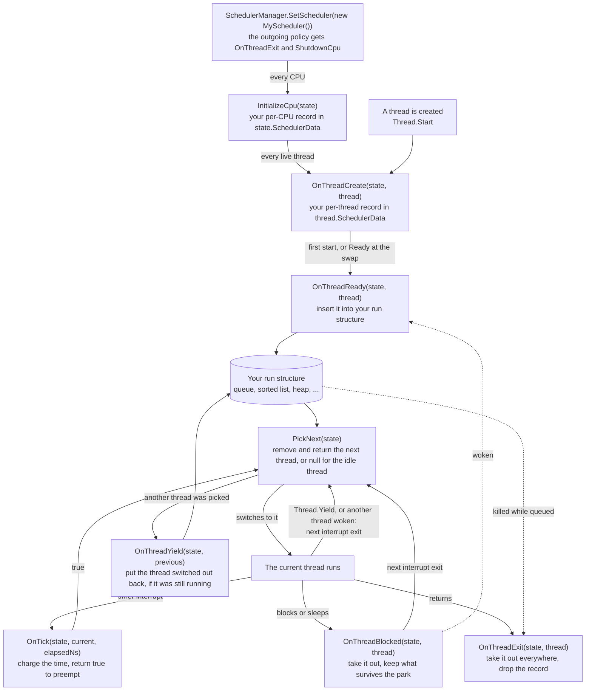

<a id="writing-a-scheduler"></a>

# 编写调度器

本文将介绍如何在 Cosmos Gen3 上编写调度策略：如何安装它、它实现的接口、它在哪里保存状态以及其钩子运行时须遵守的规则，然后给出经典算法的示意实现，并说明实时策略仍然缺少什么。

内核的调度器分为两部分：[机制与策略](../dev/sched-concepts/policy-and-mechanism.md)。机制负责切换线程、维护线程登记表、接收定时器节拍，并让垃圾回收器找到每一个线程，它永远不变。决定哪个线程何时运行的一切都经过同一个接口 [`IScheduler`](https://github.com/CosmosOS/Cosmos/blob/gen3/src/Cosmos.Kernel.Core/Scheduler/IScheduler.cs)，启动时安装的策略是 Stride，一种[基于虚拟时间的公平份额](../dev/sched-concepts/virtual-time-fair-share.md)调度器。当你希望以其他方式排列线程时，就需要编写策略：按固定优先级、按截止时间、简单轮转，或者在追查竞态条件时不使用抢占。每个带链接的术语在[调度器术语表](../dev/scheduler-glossary.md)中都有一段简短的背景说明，机制本身则在贡献者文档的[调度器](../dev/scheduler.md)一文中介绍。

如果你发现 bug 或任何异常，请在我们的仓库中[提交 issue](https://github.com/CosmosOS/Cosmos/issues/new/choose)。

---

<a id="experimental-status"></a>

## 实验性状态

扩展点类型（`IScheduler`、`SchedulerManager`、`SchedulerThread`、`PerCpuState`、`SchedulerExtensible`、`InterruptMaskScope`、`SchedulerThreadState`、`SchedulerThreadFlags`）带有 `[Experimental("COSMOS0001")]`：它们现在就可以使用，但不做任何兼容性承诺，一旦经过验证，就会通过移除该特性提升为稳定的 API 面。在项目明确接受这一约定之前，引用它们会产生构建错误：

```xml
<PropertyGroup>
  <NoWarn>$(NoWarn);COSMOS0001</NoWarn>
</PropertyGroup>
```

关于实验性扩展点如何纳入 API 面的策略，请参阅[公共 API 跟踪](../dev/public-api.md)。

---

<a id="replacing-the-policy"></a>

## 替换策略

替换策略需要三步：

1. 在内核项目中实现 `IScheduler`，并将算法的簿记数据保存在每线程和每 CPU 的数据槽中（[附加状态](#attaching-state)）。扩展点是公开的，因此策略无需访问 `Cosmos.Kernel.Core` 的内部成员。
2. 遵守[内核约束](#kernel-constraints)：钩子在中断上下文中或在中断被屏蔽的情况下运行，操作的是正在使用的调度器状态。
3. 使用 `SchedulerManager.SetScheduler` 安装它。

内核在启动完成后安装自己的策略，例如在 `BeforeRun` 中：

```csharp
using Cosmos.Kernel.Core.Scheduler;
using Sys = Cosmos.Kernel.System;

namespace MyOS;

public class Kernel : Sys.Kernel
{
    protected override void BeforeRun()
    {
        SchedulerManager.SetScheduler(new MyScheduler());
    }

    protected override void Run()
    {
        // The kernel's main loop, which runs on the boot thread.
    }
}
```

你无法抢在默认策略之前安装。内核在启动过程中、驱动程序阶段之前就安装了 Stride，因此当你的代码运行时，Stride 已经在管理启动线程、驱动工具包的工作线程以及驱动程序启动的任何线程。`SetScheduler` 会迁移所有这些线程：被替换的策略为每个存活线程收到 `OnThreadExit`，为每个 CPU 收到 `ShutdownCpu`，然后你的策略为每个 CPU 收到 `InitializeCpu`，为每个存活线程收到 `OnThreadCreate`，并为每个处于 `Ready` 状态的线程收到 `OnThreadReady`。整个替换过程在中断被屏蔽的情况下进行，每个 CPU 都会在下一次中断退出时重新调度，因此从那时起，你的策略就从它自己的运行结构中挑选线程。如果以后要换回 Stride，请在替换之前保存 `SchedulerManager.Current` 返回的策略，之后再次安装它；`StrideScheduler` 类本身是内部的。

调度器必须被编译进内核。如果关闭了 `CosmosEnableScheduler`，或者关闭了 `CosmosEnableInterrupts` 或 `CosmosEnableTimer`（它们也会关闭调度器），`SetScheduler` 会抛出 `InvalidOperationException`。

---

<a id="the-interface"></a>

## 接口

管理器在线程生命周期中的固定节点调用策略，其余一切都由它自己负责：它设置每个 `SchedulerThread.State`，维护线程登记表，在线程被唤醒时请求重新调度，把退出线程的分配缓冲区归还给垃圾回收器，执行切换，并在 `PickNext` 返回 `null` 时运行空闲线程，因此策略无需重复其中任何一项。下图跟随一个线程经过各个钩子：



大多数钩子会收到它们所操作的 `PerCpuState`，并且要么在管理器屏蔽中断的情况下运行，要么就在中断上下文中运行；例外情况见下文。策略不需要的钩子留空即可。下表列出每个成员何时被调用以及它必须做什么：

| 成员 | 调用时机 | 约定 |
|--------|-------------|----------|
| `Name` | `SchedulerDiagnostics.SchedulerName` 读取它时 | 用于日志的显示名称 |
| `InitializeCpu(state)` | 安装策略时，每个 CPU 一次 | 将每 CPU 簿记数据分配到 `state.SchedulerData` 中 |
| `ShutdownCpu(state)` | 替换策略时，每个 CPU 一次 | 释放它，为接替的策略留下一个干净的槽 |
| `OnThreadCreate(state, thread)` | 创建线程时；安装策略时，也会为每个存活线程各调用一次 | 将每线程簿记数据分配到 `thread.SchedulerData` 中；此时还不要将线程入队 |
| `OnThreadReady(state, thread)` | 线程变为可运行时：首次启动、被唤醒、睡眠到期，或替换时处于 `Ready` 状态 | 安置线程并将其插入运行结构，只插入一次。管理器在钩子返回后才写入 `Ready`，因此 `thread.State` 仍能说明是四种情况中的哪一种：`Created`、`Blocked`、`Sleeping` 或 `Ready` |
| `OnThreadBlocked(state, thread)` | 线程在同步原语上阻塞或进入睡眠时 | 将线程从运行结构中移除；保存挂起期间必须保留的内容 |
| `OnThreadYield(state, thread)` | 线程仍处于 `Running` 状态时被一次切换移出 CPU，无论是被抢占还是主动让出 | 重新插入该线程 |
| `OnThreadExit(state, thread)` | 线程返回时，或者 `SchedulerDiagnostics.RequestKill` 在线程于运行结构中等待时将其终止时；替换策略时，也会为每个存活线程调用 | 将它从所有地方移除，并丢弃其簿记数据 |
| `OnTick(state, current, elapsedNs)` | 每个定时器节拍，在定时器中断内部 | 统计流逝的时间；返回 `true` 以请求重新调度。`elapsedNs` 是配置的节拍间隔，而不是测量值 |
| `PickNext(state)` | 每次重新调度时，在中断上下文中 | 移除并返回下一个要运行的线程，或返回 `null` 以运行空闲线程 |
| `OnPickFailed(state, thread)` | 目前从未调用 | 放回机制已选中但未能切换过去的线程 |
| `SelectCpu(thread, currentCpu, cpuCount)` | 目前从未调用 | 为线程选择起始 CPU；遵守 `SchedulerThreadFlags.Pinned` |
| `OnThreadMigrate(thread, fromState, toState)` | 由策略自身的 `Balance` 调用 | 在 CPU 之间迁移线程的簿记数据以及任何虚拟时间基准 |
| `Balance(state, allCpuStates)` | 目前从未调用 | 在各 CPU 之间重新平衡负载；遵守 `Pinned` |
| `SetPriority(state, thread, priority)` / `GetPriority(thread)` | `SchedulerManager.SetPriority`；`SchedulerDiagnostics` 在每次生成线程快照时读取 `GetPriority` | 优先级由策略定义：Stride 将其解读为票数，实时策略则会将其解读为优先级等级。两者都不在中断被屏蔽的情况下调用 |
| `GetRunQueueCount(state)` / `GetRunQueueThread(state, index)` | `SchedulerDiagnostics` 读取运行结构时 | 只读内省；需要你自己加以保护（参见[内核约束](#kernel-constraints)） |

其中有四个成员没有策略可以依赖的调用者。`SelectCpu` 和 `Balance` 从不被调用，因为内核只在一个 CPU 上运行（[CPU 亲和性与负载均衡](../dev/sched-concepts/cpu-affinity.md)）；`OnPickFailed` 从不被调用，因为切换总是切换到 `PickNext` 返回的线程；而 `SetPriority` 只能通过 `SchedulerManager.SetPriority` 到达，内核中却没有任何代码调用它。这四个都要实现，但不要指望它们会被执行到。`Name`、`SelectCpu` 和 `GetPriority` 不会收到 `PerCpuState`，而 `InitializeCpu` 和 `ShutdownCpu` 在线程上下文中运行，处于屏蔽中断的替换过程之内。

被 `RequestKill` 终止的正在运行的线程只会被标记为 `Dead`：它在下一次切换时离开 CPU，不经过 `OnThreadYield`，也永远不会到达 `OnThreadExit`，因此它的记录会留在槽中。

`PickNext` 在每次重新调度时都会运行，而不只是在 `OnTick` 返回 `true` 之后。唤醒、阻塞、`Thread.Yield` 或策略替换都会请求重新调度，下一次硬件中断退出时就会为此调用 `PickNext`：如果那次中断不是节拍，就完全不调用 `OnTick`；如果是节拍，则无论 `OnTick` 返回什么都会调用（[上下文切换](../dev/sched-concepts/context-switch.md)）。此时，CPU 上的线程通常不在运行结构中（[线程状态与运行队列](../dev/sched-concepts/run-queue.md)）：只有在 `PickNext` 选中另一个线程之后，它才会经由 `OnThreadYield` 回到运行结构。例外是一个阻塞之后、在切换将其移出 CPU 之前就被唤醒的线程：它处于 `Ready` 状态且已入队，`PickNext` 可能像对待其他已入队线程一样把它交回。对线程进行排序的策略不能让每次唤醒都挤掉当前线程，因此它会将最优的已入队线程与 `state.CurrentThread` 比较，并在该线程的 `State` 仍为 `Running` 时返回 `state.CurrentThread` 本身，从而让它留在 CPU 上。永远不要返回处于 `Blocked`、`Sleeping` 或 `Dead` 状态的线程：管理器不会检查。返回 `null` 会运行空闲线程，也就是内核自己的启动线程，因此在没有任何线程入队时返回 `true` 的 `OnTick` 会把 CPU 交给它。

**保留当前线程，也意味着在它自己调用 `Thread.Yield` 时同样保留它。** `PickNext` 并不知道自己为何运行，而 `Thread.Yield` 请求的重新调度与唤醒请求的完全相同。`Thread.Start` 依赖这次重新调度：它会循环调用 `Thread.Yield`，直到新线程第一次运行，因此，如果新线程的排名不高于发起启动的线程，而策略总是保留后者，新线程就永远得不到运行，这个调用也永远不会返回。所以，保留当前线程的策略会在下一次重新调度时，让仍处于 `Created` 状态的已入队线程进行首次运行。任何其他通过 `Thread.Yield` 等待一个被策略排得更低的线程的循环，都会以同样的方式空转下去。

---

<a id="attaching-state"></a>

## 附加状态

`SchedulerThread` 和 `PerCpuState` 都继承自 `SchedulerExtensible`，它恰好带有一个 `object?` 槽 `SchedulerData`，专供当前生效的策略使用。在创建类钩子中分配，并用 `as` 读取该槽：

```csharp
public sealed class MyThreadData { public ulong Deadline; }
public sealed class MyCpuData { public List<SchedulerThread> Queue { get; } = new(SchedulerThread.MaxThreadCount); }

public void OnThreadCreate(PerCpuState state, SchedulerThread thread)
    => thread.SchedulerData = new MyThreadData();

public bool OnTick(PerCpuState state, SchedulerThread current, ulong elapsedNs)
{
    MyThreadData? data = current.SchedulerData as MyThreadData;
    if (data is null) { return true; }   // exited: get it off the CPU
    ...
}
```

读取该槽时要用 `as`，不要用强制转换，并在每个钩子中处理 `null`。`OnThreadExit` 会清空该槽，因此线程可能在某个节拍与观察到它的钩子之间失去自己的记录，而在定时器中断内部解引用空槽会失败。强制转换在这里无济于事，因为对 `null` 进行强制转换得到的还是 `null`，而且当槽中存放的不是你的记录时它会抛出异常；`as` 会把这两种情况都变成 `null`，一次检查就能处理。

钩子无需处理由其他策略写入的记录，因为 `SetScheduler` 会重新安置每个存活线程（[替换策略](#replacing-the-policy)）。但已经处于运行中的线程则需要处理。替换时位于 CPU 上的线程（在启动阶段安装 Stride 时是启动线程，之后则是调用 `SetScheduler` 的那个线程）会以 `Running` 状态到达 `OnThreadCreate`，并且永远不会被交给 `OnThreadReady`，因此，统计可运行线程数量或其权重的策略要在这里把它计算在内，但不将其入队。正因如此，Stride 在 `OnThreadCreate` 中把该线程的票数加到自己的总数上。

每个对象一个槽，这就是全部预算。需要多个值的策略应定义一个类来容纳它们，就像 Stride 那样：每个线程一条记录，每个 CPU 一条记录。

---

<a id="kernel-constraints"></a>

## 内核约束

钩子运行在内核最敏感的时间窗口内，因此有四条规则必须遵守。

**钩子不能等待。** `OnTick` 在定时器中断内部运行，`PickNext` 和 `OnThreadYield` 在承载重新调度的那次中断退出内部运行（[中断上下文](driver-concepts/interrupt-context.md)）；当节拍或某个设备的中断处理程序唤醒线程时，`OnThreadReady` 也可能在中断内部运行，其他生命周期钩子则在调用管理器的那个线程上、在中断被屏蔽的情况下运行。无论哪种情况，在钩子返回之前，该 CPU 上都不能运行其他线程，也不会处理节拍，因此一个阻塞、挂起或等待其他线程的钩子会永远等待下去。

**不要在节拍路径上分配内存。** 在这个内核中，分配在中断上下文中是安全的，但在 `OnTick` 或 `PickNext` 中分配可能会在中断内部触发一次垃圾回收。请在 `OnThreadCreate` 和 `InitializeCpu` 中分配，创建线程本来就要付出这部分代价，并在那里为集合预留容量，因为在 `OnThreadReady` 或 `OnThreadYield` 中增长的列表同样会在这条路径上分配内存。

**用 `ReferenceEquals` 比较线程。** `List<T>.Remove`、`Contains` 和 `IndexOf` 都会经过 `EqualityComparer<T>.Default`，而它需要内核未提供的运行时辅助函数。请像 Stride 那样，用 `ReferenceEquals` 扫描，用 `RemoveAt` 移除。

**在管理器不负责屏蔽的入口上自行屏蔽中断。** 除非中断被屏蔽，否则修改运行结构的钩子可能在执行到一半时被节拍打断（[自旋锁与中断屏蔽](../dev/sched-concepts/spinlocks-and-masking.md)）。管理器会在生命周期钩子和两个每 CPU 钩子周围屏蔽中断，节拍类钩子本身就在中断内部运行，但有四个钩子没有任何屏蔽：`SetPriority`、`GetPriority`、`GetRunQueueCount` 和 `GetRunQueueThread`。管理器在 `SetPriority` 周围持有的每 CPU 自旋锁并无帮助，因为它只能挡住其他调用者，而节拍根本不获取任何锁。这四个钩子，以及策略自己添加的任何入口点（例如调优用的设置方法或统计信息读取），都要自行屏蔽中断：

```csharp
public int GetRunQueueCount(PerCpuState state)
{
    using (SchedulerManager.MaskInterrupts())
    {
        MyCpuData? data = state.SchedulerData as MyCpuData;
        return data is null ? 0 : data.Queue.Count;
    }
}
```

在钩子内部屏蔽中断只能让单次调用具有原子性，仅此而已：先读取 `GetRunQueueCount` 再遍历各个索引的调用者，需要在整个遍历过程外面加上自己的屏蔽。

---

<a id="worked-sketches"></a>

## 示意实现

每种算法都会反复遇到同样的问题：每个线程和每个 CPU 要存储什么，运行结构采用什么形式，`OnTick` 中由什么触发抢占，以及挂起期间必须保留什么。下面的示意实现针对经典算法回答这些问题。每个对线程进行排序的策略（MLFQ、固定优先级、EDF）还需要在 `PickNext` 中进行[接口](#the-interface)一节所描述的比较，在没有任何已入队线程排名高于当前线程时保留当前线程，同时还需要与之配套的、针对 `Created` 线程的首次运行例外；下面的表格对这两点都未列出。

<a id="round-robin"></a>

### 轮转调度（round-robin）

一个采用固定时间片[抢占](../dev/sched-concepts/preemption.md)的 FIFO 队列：

| 钩子 | 行为 |
|------|----------|
| `PerCpuState.SchedulerData` | 一个线程队列 |
| `SchedulerThread.SchedulerData` | 一个剩余时间片计数器 |
| `OnThreadReady` | 以全新的时间片加入队尾 |
| `OnThreadBlocked` | 从队列中移除：阻塞的线程通常是正在运行的线程，它不在队列中，但在离开 CPU 之前就被唤醒的线程会在仍在运行时处于队列中 |
| `OnTick` | 从时间片中扣除 `elapsedNs`；归零时，如果有其他线程在排队就返回 `true`，否则就地授予一个全新的时间片 |
| `OnThreadYield` | 重新加入队尾，重置时间片 |
| `PickNext` | 取出队首 |

FIFO 顺序本身已经将延迟限制在 `quantum * queue depth` 以内，因此轮转调度完全不需要唤醒时的放置逻辑。

这个示意实现有一个完整的策略版本，它只基于公共扩展点编写，与内核自己的策略写法完全相同：GitHub 上的 [`RoundRobinScheduler`](https://github.com/CosmosOS/Cosmos/blob/gen3/tests/Kernels/Cosmos.Kernel.Tests.Threading/RoundRobinScheduler.cs)。它的时间片是两个[节拍](../dev/sched-concepts/scheduler-tick.md)，因此它的簿记数据必须跨越中间的那个节拍保留下来。内核要在安装这样的策略之后实地测试它，因为 `PerCpuState` 和 `SchedulerThread` 没有公共构造函数，无法在你自己创建的对象上驱动这些钩子。要检查的是只有运行中的内核才能体现的行为：新线程能够被调度运行，在循环中空转的线程会在时间片耗尽时被抢占，两个空转线程按策略预期的方式分享 CPU，以及 `SchedulerDiagnostics.GetRunQueueCount` 会在线程阻塞时下降、在线程被唤醒时回升。不要断言线程到达其委托的顺序：这个顺序并不是它们变为就绪的顺序，因为在启动代码中被抢占的线程也会像其他线程一样回到队尾。

两个替换方向也都值得测试。换入时，策略会通过 `OnThreadCreate` 收到启动线程和其他所有存活线程，并且仍然必须用 `as` 读取每个槽，原因见[附加状态](#attaching-state)。换回时，从 `SchedulerManager.Current` 保存下来的策略会以同样的方式收到它们，因此在两次替换中一直存活的线程会更换策略，而在两次替换中一直保持运行的空转线程应当在每种策略下都持续取得进展。

<a id="multi-level-feedback-queue-mlfq"></a>

### 多级反馈队列（MLFQ）

多个优先级等级；线程用完一个完整时间片时被降级，提前阻塞时被升级：

| 钩子 | 行为 |
|------|----------|
| `PerCpuState.SchedulerData` | 一个队列数组，每个等级一个 |
| `SchedulerThread.SchedulerData` | 当前等级和已用时间片计数器 |
| `OnThreadReady` | 加入线程当前等级的队列 |
| `OnThreadBlocked` | 从其队列中移除并提升一级：它在时间片用完之前就阻塞了，因此将其视为交互式线程 |
| `OnTick` | 计入时间；当该等级的时间片结束时，将线程标记为待降级并返回 `true` |
| `OnThreadYield` | 重新加入线程所在等级的队列，如果已被标记为待降级则降低一级 |
| `PickNext` | 自上而下扫描各等级，取出第一个非空队列的队首 |
| 周期性（例如在 `OnTick` 中每 N 个节拍一次） | 将所有线程重置到最高等级，这是对抗[饥饿](../dev/sched-concepts/starvation.md)的经典提升手段 |

MLFQ 不跟踪虚拟时间；它的全部簿记数据就是整数等级。

<a id="fixed-priority-preemptive-fpp"></a>

### 固定优先级抢占式（FPP）

大多数 RTOS（FreeRTOS、Zephyr、ThreadX）的默认策略：优先级最高的可运行线程总是运行，同一等级内按 FIFO 顺序：

| 钩子 | 行为 |
|------|----------|
| `PerCpuState.SchedulerData` | 一个按优先级索引的队列数组 |
| `SchedulerThread.SchedulerData` | 一个静态优先级 |
| `OnThreadReady` | 加入线程所在等级的队尾；管理器在每次唤醒时请求的重新调度会在下一次中断退出时运行 `PickNext`，更高优先级线程的唤醒正是这样实现抢占的 |
| `OnThreadBlocked` / `OnThreadYield` | 从其等级中移除 / 重新加入其等级的队尾 |
| `OnTick` | 如果高于当前线程等级的任何等级非空，则返回 `true`（纯优先级，没有时间片） |
| `PickNext` | 自上而下扫描，取出第一个队首 |
| `SetPriority` | 在 `SchedulerManager.MaskInterrupts()` 内部将线程在等级之间移动 |

速率单调（Rate Monotonic）就是根据每个线程的周期分配优先级的 FPP：周期越短，优先级越高（[实时调度](../dev/sched-concepts/real-time-scheduling.md)）。扩展点不携带周期信息，因此策略要通过它自己的入口点获取周期，或者将其编码在 `SetPriority` 的值中。它还必须自己把总利用率保持在可调度性界限以下，而由于没有任何钩子能拒绝线程（`OnThreadCreate` 没有返回值），这项准入检查应放在策略自己的入口点中，由内核在启动线程之前调用。

<a id="earliest-deadline-first-edf"></a>

### 最早截止时间优先（EDF）

按绝对截止时间确定的动态优先级。最早截止时间优先在单个 CPU 上是最优的：在利用率达到 100% 之前它都能满足所有截止时间，而速率单调只能保证约 69%；不过在过载情况下它更难分析：

| 钩子 | 行为 |
|------|----------|
| `PerCpuState.SchedulerData` | 一个以绝对截止时间为键的最小堆 |
| `SchedulerThread.SchedulerData` | 周期、相对截止时间、绝对截止时间，前两者与速率单调一样，通过策略自己的入口点获取 |
| `OnThreadReady` | `absolute = now + relative`，插入堆中 |
| `OnThreadBlocked` / `OnThreadYield` | 从堆中移除 / 以不变的绝对截止时间重新插入 |
| `OnTick` | 如果堆顶的截止时间早于当前线程的截止时间，则返回 `true` |
| `PickNext` | 弹出堆顶 |

<a id="fifo-cooperative"></a>

### FIFO（协作式）

一种调试用策略，适合追查在抢占下会消失的竞态条件：只有一个队列，`OnTick` 总是返回 `false`，`PickNext` 在当前线程仍为 `Running` 时保留它，因此线程会一直运行，直到阻塞、睡眠或退出。如果 `PickNext` 中没有这项检查，其他地方的每次唤醒仍然会切换线程，因为管理器在每次唤醒时都会重新调度。这项检查有两个代价。一个从不阻塞的计算密集型线程会永久占用 CPU，处于 `Thread.Start` 内部的线程也会如此，因为它要通过 `Thread.Yield` 等待新线程的首次运行，所以 `PickNext` 必须让仍处于 `Created` 状态的线程先运行。

---

<a id="real-time-notes"></a>

## 实时说明

策略与机制的分离使这个框架有望成为[实时](../dev/sched-concepts/real-time-scheduling.md)内核的基础。上下文切换不分配内存，因此其开销是确定的；定时睡眠提供了周期性任务所需的唤醒，而 `SetPriority` 正是优先级协议会用到的抓手。亲和性只实现了一半：策略会遵守 `SchedulerThreadFlags.Pinned`，但只有空闲线程带有这个标志，因为内核可以读取 `SchedulerThread.Flags`，却不能设置它。硬实时构建仍然需要在接口两侧补充一些部分。

策略一侧必须限制自身开销并管控自身负载。`OnTick` 和 `PickNext` 中的一切都会增加最坏情况下的中断延迟，因此 Stride 的线性有序插入不符合要求，而按优先级划分的 FIFO 或堆能让钩子保持在 O(log n) 或更好的水平。也没有任何机制阻止超额订阅，速率单调示意实现中描述的准入检查需要由策略自己添加。

内核一侧缺少优先级继承和由截止时间驱动的节拍。内核自己的互斥锁位于 `Cosmos.Kernel.Core` 内部，CoreLib 的底层监视器等待就构建在它之上；它按 FIFO 顺序唤醒等待者，并直接将所有权交给队首的等待者，不会提升持有者的优先级：这很公平，但容易出现[优先级反转](../dev/sched-concepts/priority-inversion.md)。继承协议会通过 `SetPriority` 将持有者提升到最高等待者的优先级，并在释放时恢复，它已经有了钩子，但还没有实现。调度器节拍以固定周期运行，从启动起就是 10 ms。在 ARM64 上，它的定时器 Generic Timer 已经在每次中断时以一次性模式重新装载；在 x64 上，节拍来自周期性的本地 APIC 定时器，需要改为一次性重新装载。无论在哪种架构上，缺少的都是一条从策略通向定时器的通道，以便下一次中断按下一个截止时间编程，而不是按固定周期。

---

<a id="summary"></a>

## 总结

| 任务 | 调用 |
|---|---|
| 安装策略 | `SchedulerManager.SetScheduler(policy)` |
| 保存已安装的策略，以便以后重新安装 | `SchedulerManager.Current` |
| 附加每 CPU 状态 | `state.SchedulerData = new MyCpuData()`，在 `InitializeCpu` 中 |
| 附加每线程状态 | `thread.SchedulerData = new MyThreadData()`，在 `OnThreadCreate` 中 |
| 读回其中任一状态 | `SchedulerData as MyRecord`，并处理 `null` |
| 将可运行线程入队 | `OnThreadReady`、`OnThreadYield` |
| 将线程移出 | `OnThreadBlocked`、`OnThreadExit` |
| 选择下一个线程 | `PickNext`，返回 `state.CurrentThread` 以保留它，或返回 `null` 以运行空闲线程 |
| 在节拍时抢占 | 从 `OnTick` 返回 `true` |
| 保护管理器不负责保护的入口 | `using (SchedulerManager.MaskInterrupts())` |
| 更改线程优先级 | `SchedulerManager.SetPriority(cpuId, thread, priority)` |
| 在运行时读取运行结构 | `SchedulerDiagnostics.GetRunQueueCount(cpuId)`、`SchedulerDiagnostics.TryGetRunQueueThread(cpuId, index, out info)` |
| 读取节拍周期 | `SchedulerDiagnostics.TickPeriodNs` |
